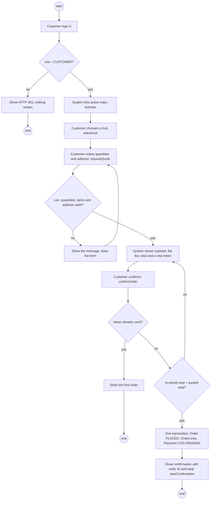

> AI-assisted (Claude); reviewed and corrected by the team in October 2026.

# UC-01 Place an order - Iteration 1 subset: activity diagram

Owner: Dat (722I0004). Same steps and names as `uc01_subset_description.md` (main flow and exceptions E-01 to E-12).
The full UC-01 (busy hub, voucher, distance fee, online payment) is in Figure 1, Part A, of the proposal.

Guards in the diagram match the server checks in `PlaceOrderController`; the loop back from "re-priced total"
is review finding C-01 (20/10).
