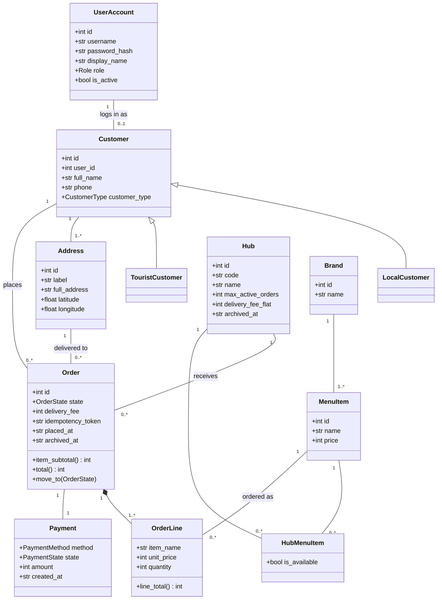

> AI-assisted draft (Claude), to be reviewed by Dat and Quan.

# Domain model v1 (Iteration 1)

Classes below exist in `saigonbite/business/domain/` and have a table in `db/schema.sql`.
Delivery, Voucher and Shipper-specific data are planned for later iterations and are not in the code yet.

## Class to table to code

| Class | Table | Domain module | DAO |
|---|---|---|---|
| `UserAccount` | `user_account` | `models.py` | `UserDAO` |
| `Customer` (`LocalCustomer`, `TouristCustomer`) | `customer` (column `customer_type`) | `models.py` | `CustomerDAO` |
| `Address` | `address` | `models.py` | `CustomerDAO` |
| `Hub` | `hub` | `models.py` | `HubDAO` |
| `Brand` | `brand` | name carried in `MenuItem.brand_name` | `HubDAO` (join) |
| `MenuItem` | `menu_item` | `models.py` | `HubDAO` |
| `HubMenuItem` | `hub_menu_item` | `models.py` | `HubDAO` |
| `Order` | `orders` | `models.py` | `OrderDAO` |
| `OrderLine` | `order_line` | `models.py` | `OrderDAO` |
| `Payment` | `payment` | `models.py` | `PaymentDAO` |
| `Quote` (not persisted) | none | `models.py` | none |

## Mapping rules used in I1

| UML | Python | SQL |
|---|---|---|
| Class | `@dataclass` | one table, singular name (`orders` because `order` is an SQL keyword) |
| Attribute type `int`, `str`, `float`, `bool` | type hints | `INTEGER`, `TEXT`, `REAL`, `INTEGER` 0/1 |
| Money | `int` whole VND | `INTEGER` |
| Enumeration (`OrderState`, `PaymentState`, `PaymentMethod`, `Role`, `CustomerType`) | `str`-based `Enum` | `TEXT` with a `CHECK (... IN (...))` using the same names |
| Generalization `Customer` to `LocalCustomer` / `TouristCustomer` | subclass | one table with `customer_type` |
| Composition `Order` to `OrderLine` | `Order.lines` list | `order_line.order_id` foreign key, `UNIQUE (order_id, menu_item_id)` |
| Association with multiplicity 1 to 0..* | id attribute | foreign key column |
| Derived value (`item_subtotal`, `total`, `line_total`) | property | `total_amount` is also stored; `CHECK (total_amount = item_subtotal + delivery_fee)` |

## Notes

- `order_line.item_name` and `unit_price` are copies taken at order time, so a later menu price change does not change an existing order.
- `hub.max_active_orders` is seeded in I1 but not enforced until I2.
- `orders.idempotency_token` is unique and carries the double-submit rule (AC-7).
