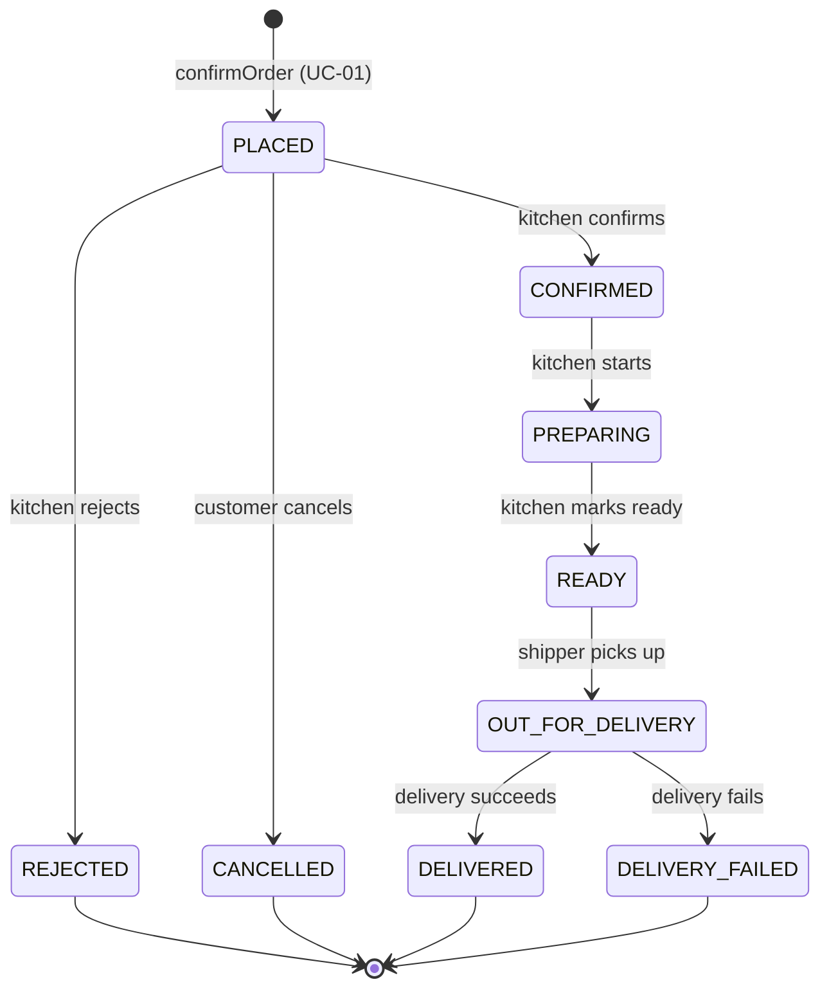

> AI-assisted draft (Claude), to be reviewed by Dat and Quan.

# Order state machine v1

State names are frozen (BRIEF) and are the values of `OrderState` in
`saigonbite/business/domain/enums.py` and the `orders.state` CHECK constraint in `db/schema.sql`.
The transitions are the table `ALLOWED_TRANSITIONS` in `saigonbite/business/domain/models.py`.
**In Iteration 1 only the initial state `PLACED` is created.** The other transitions are the planned ones.

## Transition table

| From | To | Trigger | Actor | Use case | Built in I1? |
|---|---|---|---|---|---|
| (start) | `PLACED` | Customer confirms a valid quote | Customer | UC-01 | Yes |
| `PLACED` | `CONFIRMED` | Kitchen confirms | Kitchen staff | Kitchen board | No (I2) |
| `PLACED` | `REJECTED` | Kitchen rejects (for example an item ran out) | Kitchen staff | Kitchen board | No (I2) |
| `PLACED` | `CANCELLED` | Customer cancels while the order is early | Customer | Cancel order (analysed) | No |
| `CONFIRMED` | `PREPARING` | Kitchen starts cooking | Kitchen staff | Kitchen board | No (I2) |
| `PREPARING` | `READY` | Kitchen marks ready | Kitchen staff | Kitchen board | No (I2) |
| `READY` | `OUT_FOR_DELIVERY` | Shipper picks up (Delivery becomes PICKED_UP) | Shipper | UC-02 | No (I3) |
| `OUT_FOR_DELIVERY` | `DELIVERED` | Shipper confirms hand-over | Shipper | UC-02 | No (I3) |
| `OUT_FOR_DELIVERY` | `DELIVERY_FAILED` | Shipper reports failure | Shipper | UC-02 | No (I3) |

`REJECTED`, `CANCELLED`, `DELIVERED` and `DELIVERY_FAILED` are final: no transition leaves them.
`Order.move_to()` raises `InvalidTransition` for any other pair (tests `test_T_DOM_02` to `_04`).

Open: which state is the last one a customer can cancel from is client question 3. The v1 proposal is "before the kitchen confirms", so only `PLACED` leads to `CANCELLED`.

## Active orders (workload)

The busy-hub rule from I2 counts orders in `ACTIVE_ORDER_STATES` = `PLACED`, `CONFIRMED`, `PREPARING` against `hub.max_active_orders` (assumption A-02). The constant exists in the domain; the rule is not enforced in I1.

## Payment states (separate from the order state)

`DELIVERED` (order) is not the same as `PAID` (payment). Payment states are the values of `PaymentState` and the `payment.state` CHECK constraint.

| Payment state | Meaning | Set by | Built in I1? |
|---|---|---|---|
| `PENDING` | Payment created, money not yet confirmed | UC-01 on confirm | Yes (COD) |
| `PAID` | COD: shipper confirmed the cash was collected | UC-02 | No |
| `FAILED` | Online payment failed | Online stub | No |
| `VOIDED` | COD order rejected or delivery failed: nothing to collect | Kitchen board, UC-02 | No |
| `REFUND_PENDING` | Online order rejected or delivery failed: refund still to be decided (refund use case deferred) | Kitchen board, UC-02 | No |

Payment methods: `COD` (used in I1) and `ONLINE` (team-built stub from I3).
