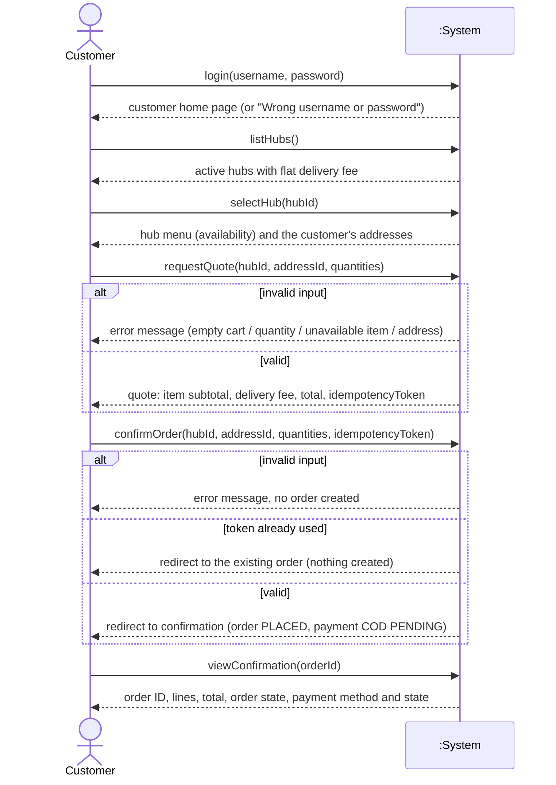

> AI-assisted draft (Claude), to be reviewed by Dat and Quan.

# System sequence diagram - UC-01 subset (COD, one hub)

The system is a black box. Each message from the Customer is a **system operation**; in the code each one is a
method of `PlaceOrderController` (or `AuthController` for `login`), called from a thin Flask route.

## System operations to code

| System operation | Controller method | Route | DAO calls |
|---|---|---|---|
| `login(username, password)` | `AuthController.authenticate` | `POST /login` | `UserDAO.get_by_username` |
| `listHubs()` | `PlaceOrderController.list_hubs` | `GET /order/hubs` | `HubDAO.list_active` |
| `selectHub(hubId)` | `PlaceOrderController.select_hub` | `GET /order/hubs/<hub_id>` | `HubDAO.get`, `HubDAO.list_menu`, `CustomerDAO.list_addresses` |
| `requestQuote(hubId, addressId, quantities)` | `PlaceOrderController.request_quote` | `POST /order/quote` | `HubDAO.get`, `HubDAO.get_available_item`, `CustomerDAO.get_address` |
| `confirmOrder(hubId, addressId, quantities, idempotencyToken)` | `PlaceOrderController.confirm_order` | `POST /order/confirm` | `OrderDAO.get_by_token`, the quote DAO calls, `OrderDAO.insert`, `PaymentDAO.insert` (inside `BEGIN IMMEDIATE`) |
| `viewConfirmation(orderId)` | `PlaceOrderController.get_confirmation` | `GET /order/<order_id>/confirmation` | `OrderDAO.get_by_id`, `PaymentDAO.get_by_order_id`, `HubDAO.get`, `CustomerDAO.list_addresses` |

Every operation except `login` first checks on the server that the caller is a logged-in user with role `CUSTOMER`
(`role_required` in the route, `_require_customer` in the controller).

## Parameters

| Parameter | Type | Rule |
|---|---|---|
| `hubId` | int | An active hub (BR-01) |
| `addressId` | int | One of the customer's own addresses (BR-05) |
| `quantities` | map `menuItemId` to text | Blank = not ordered; otherwise a whole number 1 to 99 (BR-03); item available at the hub (BR-04) |
| `idempotencyToken` | text | Issued with the quote; one order per token (BR-08) |
