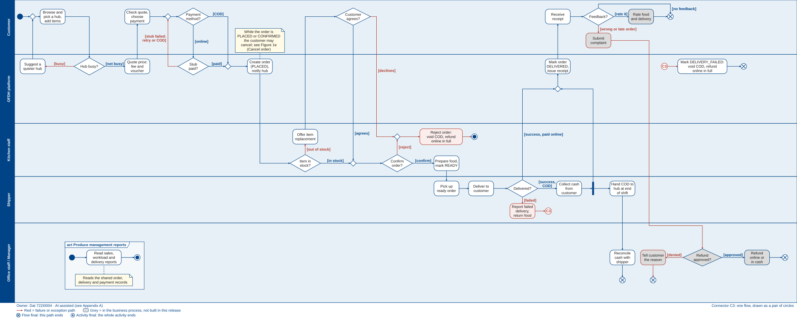

# Part 1 – Project Proposal (Team02)

Proposal for the SaigonBite Online Food Delivery Hub Platform, presented live on 26/10/2026.

| Document | File |
|---|---|
| Proposal (A4, 22 pages) | [Team02_Proposal_for_SaigonBite.pdf](Team02_Proposal_for_SaigonBite.pdf) |
| Slides (15 slides, PDF) | [Team02_Proposal_Slides_for_SaigonBite.pdf](Team02_Proposal_Slides_for_SaigonBite.pdf) |
| Slides (PowerPoint, with speaker notes) | [Team02_Proposal_Slides_for_SaigonBite.pptx](Team02_Proposal_Slides_for_SaigonBite.pptx) |

## Business process (Figure 1)

UML activity diagram with swimlanes. The editable source is [models/SaigonBite_Business_Process.drawio](models/SaigonBite_Business_Process.drawio), with one page per view.

| Part | Scope |
|---|---|
| [A](models/SaigonBite_Business_Process_PartA.svg) | Order, quote and payment |
| [B](models/SaigonBite_Business_Process_PartB.svg) | Kitchen and item replacement |
| [C](models/SaigonBite_Business_Process_PartC.svg) | Delivery and cash |
| [D](models/SaigonBite_Business_Process_PartD.svg) | Receipt, failed delivery, refund and reports |
| [E](models/SaigonBite_Business_Process_PartE.svg) | Cancel order (separate activity, analysed only) |

Owner: Quan 523K0049. AI-assisted; see Appendix A of the proposal.
