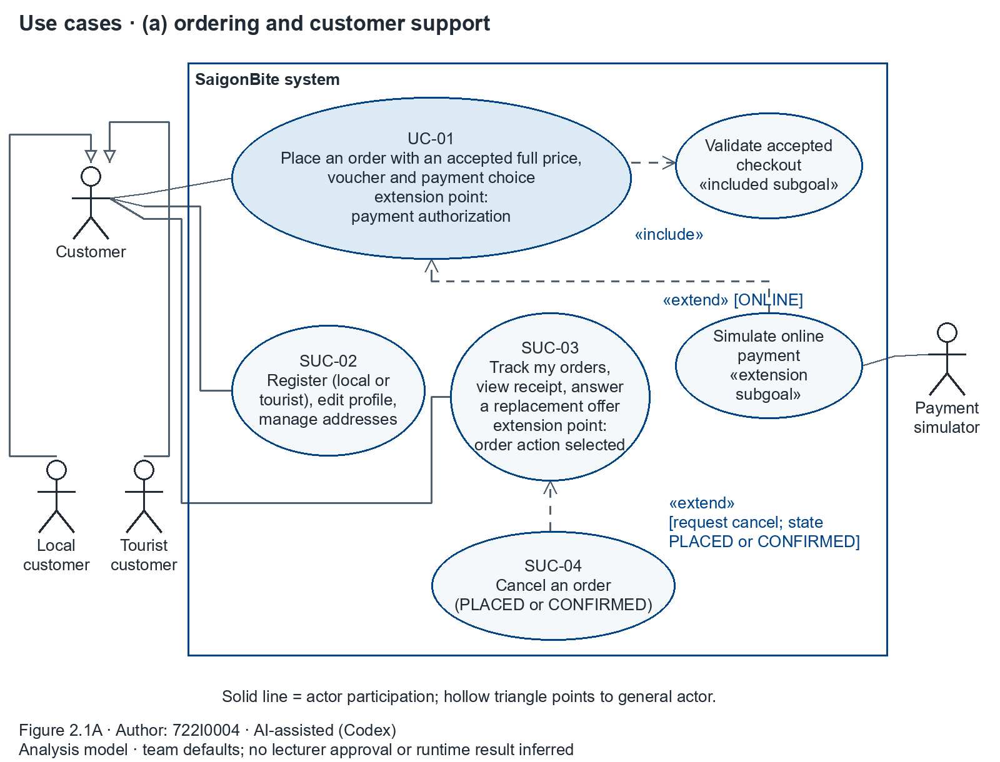
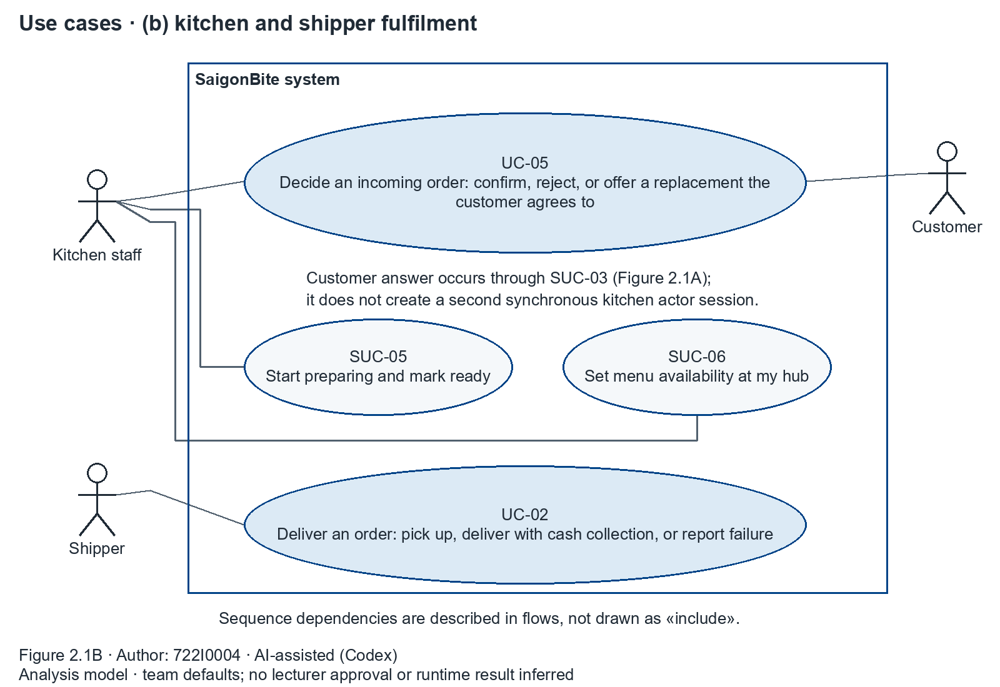
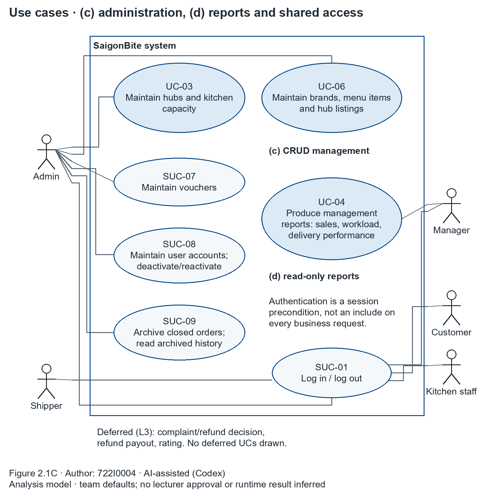

# Appendix 1: Full-size use case diagram

Large diagrams are split into parts A–C in the modelling source; each part is printed at full size.

A1.1. Use cases: ordering and customer support — Author: 722I0004 · AI-assisted (Codex).

A1.2. Use cases: fulfilment — Author: 722I0004 · AI-assisted (Codex).

A1.3. Use cases: administration and reports — Author: 722I0004 · AI-assisted (Codex).
