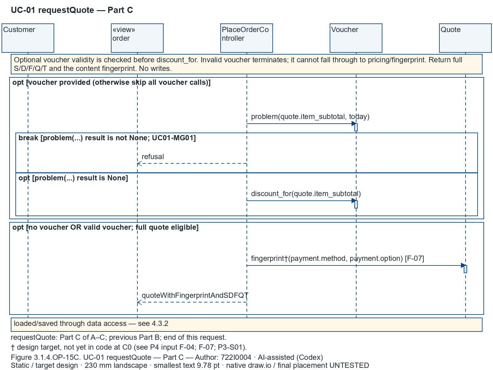
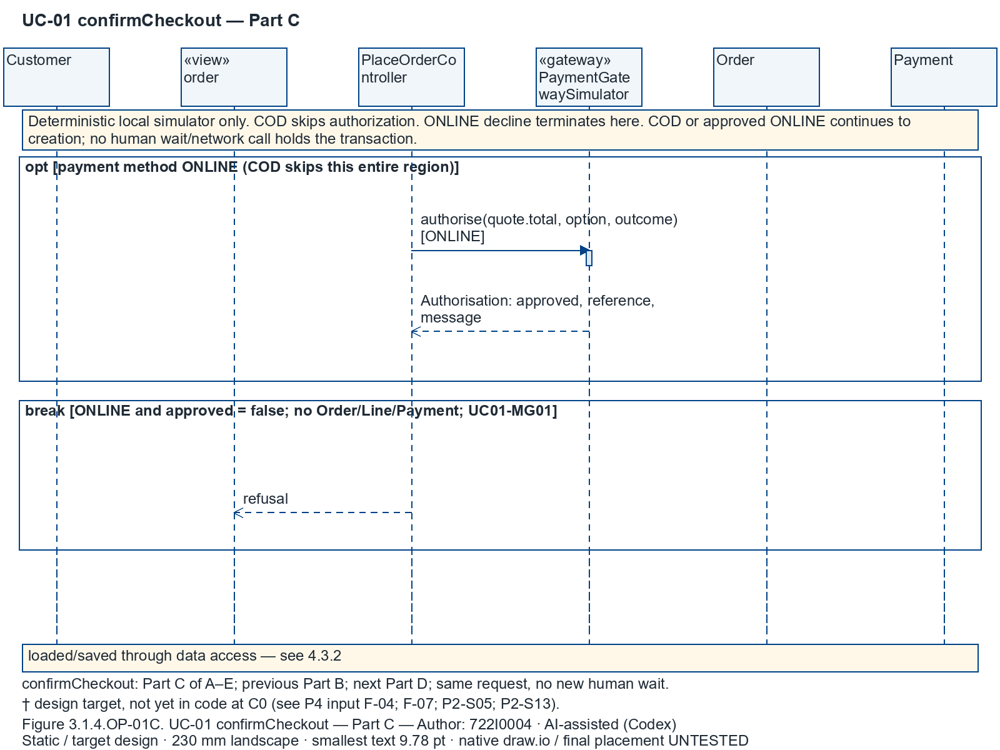
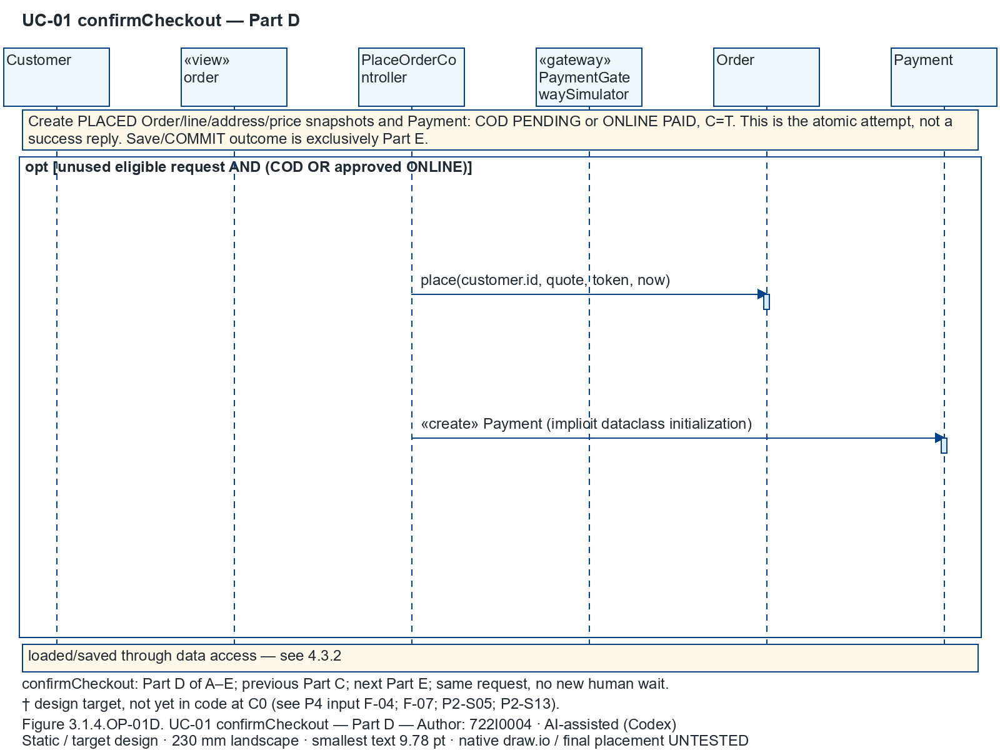
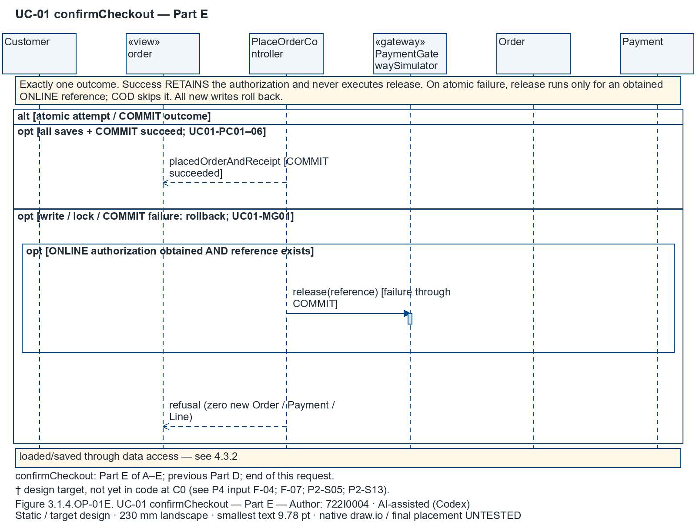
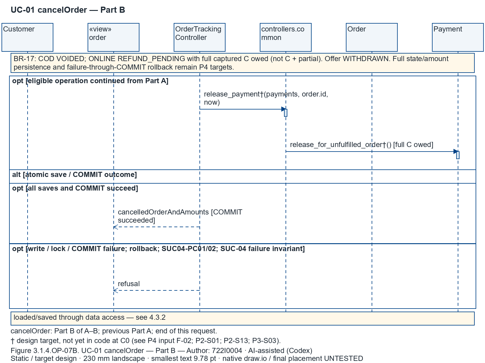

# 3.1 Design for Use Case 1: Place an order with an accepted full price, voucher and payment choice (author: 722I0004)

Author: 722I0004 · AI-assisted (Codex)

This package is a target design at committed C0 `45ac76221b0a103174c7c01d17577e6e49cfd665`. Read it with the frozen UC description/SSD/state views. It makes no runtime or implementation claim for † behavior.

## 3.1.1 Design Classes in Detailed Design

<!-- include: ../UC-01/design_classes.md -->

## 3.1.2 Design Class Diagram

### i. Domain design class

Filtered from the single shared design model. Member projection and relationship plates form one logical DCD; repeated class names identify the same class. Retained relation identifiers are omitted from domain figures; the table above and 4.3.1 retain them.

Figure 3.1.2.iA. UC-01 domain detailed design members — Author: 722I0004 · AI-assisted (Codex)

Figure 3.1.2.iB. UC-01 domain detailed design members — Author: 722I0004 · AI-assisted (Codex)

Figure 3.1.2.iC. UC-01 domain detailed design members — Author: 722I0004 · AI-assisted (Codex)

Figure 3.1.2.iD. UC-01 domain detailed design members — Author: 722I0004 · AI-assisted (Codex)

Figure 3.1.2.i.R1. UC-01 domain navigation / multiplicities — Author: 722I0004 · AI-assisted (Codex)

Figure 3.1.2.i.R2. UC-01 domain navigation / multiplicities — Author: 722I0004 · AI-assisted (Codex)

Figure 3.1.2.i.R3. UC-01 domain navigation / multiplicities — Author: 722I0004 · AI-assisted (Codex)

Figure 3.1.2.i.R4. UC-01 domain navigation / multiplicities — Author: 722I0004 · AI-assisted (Codex)

Figure 3.1.2.i.R5. UC-01 domain navigation / multiplicities — Author: 722I0004 · AI-assisted (Codex)

Figure 3.1.2.i.R6. UC-01 domain navigation / multiplicities — Author: 722I0004 · AI-assisted (Codex)

### ii. Controller

Filtered from the single shared design model. Member projection and relationship plates form one logical DCD; repeated class names identify the same class. Retained relation identifiers are omitted from domain figures; the table above and 4.3.1 retain them.

Figure 3.1.2.iiA. UC-01 controller detailed design members — Author: 722I0004 · AI-assisted (Codex)

Figure 3.1.2.iiB. UC-01 controller detailed design members — Author: 722I0004 · AI-assisted (Codex)

Figure 3.1.2.ii.R1. UC-01 controller navigation / multiplicities — Author: 722I0004 · AI-assisted (Codex)

### iii. UI (view)

Filtered from the single shared design model. Member projection and relationship plates form one logical DCD; repeated class names identify the same class. Retained relation identifiers are omitted from domain figures; the table above and 4.3.1 retain them.

Figure 3.1.2.iii. UC-01 view detailed design members — Author: 722I0004 · AI-assisted (Codex)

### iv. Data access

Filtered from the single shared design model. Member projection and relationship plates form one logical DCD; repeated class names identify the same class. Retained relation identifiers are omitted from domain figures; the table above and 4.3.1 retain them.

Figure 3.1.2.ivA. UC-01 dao detailed design members — Author: 722I0004 · AI-assisted (Codex)

Figure 3.1.2.ivB. UC-01 dao detailed design members — Author: 722I0004 · AI-assisted (Codex)

### v. Design class (all layers together)

Filtered from the single shared design model. Member projection and relationship plates form one logical DCD; repeated class names identify the same class. Retained relation identifiers are omitted from domain figures; the table above and 4.3.1 retain them.

Figure 3.1.2.vA. UC-01 all detailed design members — Author: 722I0004 · AI-assisted (Codex)

Figure 3.1.2.vB. UC-01 all detailed design members — Author: 722I0004 · AI-assisted (Codex)

Figure 3.1.2.vC. UC-01 all detailed design members — Author: 722I0004 · AI-assisted (Codex)

Figure 3.1.2.vD. UC-01 all detailed design members — Author: 722I0004 · AI-assisted (Codex)

Figure 3.1.2.vE. UC-01 all detailed design members — Author: 722I0004 · AI-assisted (Codex)

Figure 3.1.2.vF. UC-01 all detailed design members — Author: 722I0004 · AI-assisted (Codex)

Figure 3.1.2.vG. UC-01 all detailed design members — Author: 722I0004 · AI-assisted (Codex)

Figure 3.1.2.vH. UC-01 all detailed design members — Author: 722I0004 · AI-assisted (Codex)

Figure 3.1.2.vI. UC-01 all detailed design members — Author: 722I0004 · AI-assisted (Codex)

Figure 3.1.2.v.R1. UC-01 all navigation / multiplicities — Author: 722I0004 · AI-assisted (Codex)

Figure 3.1.2.v.R2. UC-01 all navigation / multiplicities — Author: 722I0004 · AI-assisted (Codex)

Figure 3.1.2.v.R3. UC-01 all navigation / multiplicities — Author: 722I0004 · AI-assisted (Codex)

Figure 3.1.2.v.R4. UC-01 all navigation / multiplicities — Author: 722I0004 · AI-assisted (Codex)

Figure 3.1.2.v.R5. UC-01 all navigation / multiplicities — Author: 722I0004 · AI-assisted (Codex)

Figure 3.1.2.v.R6. UC-01 all navigation / multiplicities — Author: 722I0004 · AI-assisted (Codex)

Figure 3.1.2.v.R7. UC-01 all navigation / multiplicities — Author: 722I0004 · AI-assisted (Codex)

Figure 3.1.2.v.R8. UC-01 all navigation / multiplicities — Author: 722I0004 · AI-assisted (Codex)

Figure 3.1.2.v.R9. UC-01 all navigation / multiplicities — Author: 722I0004 · AI-assisted (Codex)

Figure 3.1.2.v.R10. UC-01 all navigation / multiplicities — Author: 722I0004 · AI-assisted (Codex)

Figure 3.1.2.v.R11. UC-01 all navigation / multiplicities — Author: 722I0004 · AI-assisted (Codex)

Figure 3.1.2.v.R12. UC-01 all navigation / multiplicities — Author: 722I0004 · AI-assisted (Codex)

Figure 3.1.2.v.R13. UC-01 all navigation / multiplicities — Author: 722I0004 · AI-assisted (Codex)

Figure 3.1.2.v.R14. UC-01 all navigation / multiplicities — Author: 722I0004 · AI-assisted (Codex)

## 3.1.3 OOD with CRC Cards or Communication Diagram

<!-- include: ../UC-01/crc.md -->

## 3.1.4 OOD with Sequence Diagram

Each SSD occurrence has its own operation sequence. Actor → actual blueprint module → controller → domain / typed value; UC-01 also uses the local simulator. No DAO/SQL lifeline is present. Synchronous calls use closed filled arrowheads; dashed open arrows carry results. Actual `alt`, `opt` and `break` rectangles enclose the messages they govern, including self-call paths. Inside an outcome `alt`, separately guarded regions have mutually exclusive conditions. Denial breaks terminate the current interaction; a continuation retains the same request and lifelines. Successful mutation results follow all atomic saves and COMMIT, whose DAO details remain in 4.3.2. Attribute/property reads are notes. Implicit dataclass «create» is not a business operation. Persistence is loaded/saved through data access — see 4.3.2.

Checkout uses Parts A–E: token replay/denial breaks; quote and fingerprint/T validation; optional ONLINE authorization with a decline break; creation only for COD or approved ONLINE; then exclusive commit success versus rollback. Only the failed branch can release an obtained ONLINE reference. The success branch retains authorization. requestQuote uses Parts A–C: eligibility/distance, Quote initialization, then optional voucher validation/discount and fingerprint. Invalid voucher terminates before discount or a quote result. cancelOrder Parts A/B return `cancelledOrderAndAmounts` only after successful atomic save and COMMIT; the rollback reply remains separate.

| SSD operation and exact parameters | View → controller adapter; status | Guard / effects and failure guarantee |
|---|---|---|
| `browseHubs()` `models/UC-01/ssd_uc01_PartA.drawio#01S-M01` | `order.choose_hub, GET /order/hubs` → `PlaceOrderController.list_hubs(self) -> list[HubStatus]`; MATCH | Read .busy / .quiet on HubStatus; these are properties, never busy() / quiet() calls. No persistent writes. Active Customer gate belongs to view; select_hub also checks active Customer and hub. Actual guarded regions now enclose the messages they govern; exact native IDs and bounds are in interaction_fragments. |
| `selectHub(hubId)` `models/UC-01/ssd_uc01_PartA.drawio#01S-M02` | `order.choose_items, GET /order/hubs/<int:hub_id>` → `PlaceOrderController.select_hub(self, user_id: int, hub_id: int) -> HubMenuView`; MATCH | Read .busy / .quiet on HubStatus; these are properties, never busy() / quiet() calls. No persistent writes. Active Customer gate belongs to view; select_hub also checks active Customer and hub. Actual guarded regions now enclose the messages they govern; exact native IDs and bounds are in interaction_fragments. |
| `requestQuote(hubId, addressId, lines(itemId, quantity), voucherCode?, paymentMethod, onlineOption?)` `models/UC-01/ssd_uc01_PartA.drawio#01S-M03` | `order.quote, POST /order/quote` → `PlaceOrderController.request_quote(self, user_id: int, hub_id: int, address_id: Optional[int], quantities: Mapping[int, str], voucher_code: Optional[str] = None, payment: Optional[PaymentChoice] = None) -> Quote`; P4-TARGET† F-04; F-07; P3-S01 | Target: active hub/menu/brand, own active address, integer quantities, load < capacity. Invalid input/refused voucher → no saved rows. Busy suggestions ≤3 ranked (load/capacity, raw distance, ID). Actual guarded regions now enclose the messages they govern; exact native IDs and bounds are in interaction_fragments. Read quote.item_subtotal / quote.total properties. Fingerprint binds hub/address, line IDs, quantities and prices, voucher + D, F, Q and payment choice; full accepted price T=S−D+F−Q. PaymentChoice is a typed adapter value. Actual guarded regions now enclose the messages they govern; exact native IDs and bounds are in interaction_fragments. Read quote.item_subtotal / quote.total properties. Fingerprint binds hub/address, line IDs, quantities and prices, voucher + D, F, Q and payment choice; full accepted price T=S−D+F−Q. PaymentChoice is a typed adapter value. Actual guarded regions now enclose the messages they govern; exact native IDs and bounds are in interaction_fragments. |
| `confirmCheckout(hubId, addressId, lines(itemId, quantity), voucherCode?, paymentMethod, onlineOption?, simulatorOutcome?, quoteFingerprint, quotedTotal, checkoutToken)` `models/UC-01/ssd_uc01_PartB.drawio#01S-M04` | `order.confirm, POST /order/confirm` → `PlaceOrderController.confirm_order(self, user_id: int, hub_id: int, address_id: Optional[int], quantities: Mapping[int, str], idempotency_token: str, quoted_total: Optional[int] = None, voucher_code: Optional[str] = None, payment: Optional[PaymentChoice] = None, quote_fingerprint: Optional[str] = None) -> OrderConfirmation`; P4-TARGET† F-04; F-07; P2-S05; P2-S13 | Simulator approve/decline choice precedes this request. Short atomic checkout begins before token lookup. Own existing token → existingOrder, no reprice, authorization or insertion (UC01-MG02). Foreign token → refusal. Unused token rechecks eligibility, raw radius, capacity, voucher and full consent. Actual guarded regions now enclose the messages they govern; exact native IDs and bounds are in interaction_fragments. Simulator approve/decline choice precedes this request. Short atomic checkout begins before token lookup. Own existing token → existingOrder, no reprice, authorization or insertion (UC01-MG02). Foreign token → refusal. Unused token rechecks eligibility, raw radius, capacity, voucher and full consent. Actual guarded regions now enclose the messages they govern; exact native IDs and bounds are in interaction_fragments. Deterministic local simulator, no network/wait. COD skips authorise; ONLINE declined → zero Order/Line/Payment. Success atomically saves PLACED + snapshots + COD PENDING / ONLINE PAID, C=T (UC01-PC01–06). Any lock/write/commit failure rolls back all intended writes and releases authorization† (P2-S05/P2-S13). Actual guarded regions now enclose the messages they govern; exact native IDs and bounds are in interaction_fragments. Deterministic local simulator, no network/wait. COD skips authorise; ONLINE declined → zero Order/Line/Payment. Success atomically saves PLACED + snapshots + COD PENDING / ONLINE PAID, C=T (UC01-PC01–06). Any lock/write/commit failure rolls back all intended writes and releases authorization† (P2-S05/P2-S13). Actual guarded regions now enclose the messages they govern; exact native IDs and bounds are in interaction_fragments. Deterministic local simulator, no network/wait. COD skips authorise; ONLINE declined → zero Order/Line/Payment. Success atomically saves PLACED + snapshots + COD PENDING / ONLINE PAID, C=T (UC01-PC01–06). Any lock/write/commit failure rolls back all intended writes and releases authorization† (P2-S05/P2-S13). Actual guarded regions now enclose the messages they govern; exact native IDs and bounds are in interaction_fragments. |
| `viewReceipt(orderId)` `models/UC-01/ssd_uc01_PartC.drawio#01S-M05` | `order.detail, GET /order/<int:order_id>` → `OrderTrackingController.get_order(self, user_id: int, order_id: int) -> OrderDetail`; P4-TARGET† F-06 | Read-only active role + own Customer / own kitchen hub checks; denied context discloses no foreign details. Receipt/offer amounts say refund owed, never paid out† (F-06 where applicable). Read snapshots, .total and offer attributes; no fabricated business getters. No persistent writes. Actual guarded regions now enclose the messages they govern; exact native IDs and bounds are in interaction_fragments. |
| `viewMyOrders()` `models/UC-01/ssd_uc01_PartC.drawio#01S-M06` | `order.my_orders, GET /order/mine` → `OrderTrackingController.list_my_orders(self, user_id: int) -> list[OrderSummary]`; MATCH | Read-only active role + own Customer / own kitchen hub checks; denied context discloses no foreign details. Receipt/offer amounts say refund owed, never paid out (F-06 where applicable). Read snapshots, .total and offer attributes; no fabricated business getters. No persistent writes. Actual guarded regions now enclose the messages they govern; exact native IDs and bounds are in interaction_fragments. |
| `cancelOrder(orderId)` `models/UC-01/ssd_uc01_PartC.drawio#01S-M07` | `order.cancel, POST /order/<int:order_id>/cancel` → `OrderTrackingController.cancel_order(self, user_id: int, order_id: int) -> OrderDetail`; P4-TARGET† F-02; P2-S13 | Guard: active own Customer; PLACED / CONFIRMED. Atomic CANCELLED + closed_at / reason; COD VOIDED; ONLINE REFUND_PENDING, refund_amount=C replaces any partial owed amount. No payout. Open offer WITHDRAWN; helpers are real module functions. Rowcount, busy and failure-through-COMMIT rollback†. Root-adopted P4-TARGET: release_payment persists the full-C refund amount together with state and checks every conditional save in the same transaction (F-02; P2-S01; P3-S03). Actual guarded regions now enclose the messages they govern; exact native IDs and bounds are in interaction_fragments. Guard: active own Customer; PLACED / CONFIRMED. Atomic CANCELLED + closed_at / reason; COD VOIDED; ONLINE REFUND_PENDING, refund_amount=C replaces any partial owed amount. No payout. Open offer WITHDRAWN; helpers are real module functions. Rowcount, busy and failure-through-COMMIT rollback†. Root-adopted P4-TARGET: release_payment persists the full-C refund amount together with state and checks every conditional save in the same transaction (F-02; P2-S01; P3-S03). Actual guarded regions now enclose the messages they govern; exact native IDs and bounds are in interaction_fragments. |

Operation guarantees are realized by these named controller methods and atomic/read boundaries. They remain Static / target obligations, not execution results.

| SSD operation | Responsible method / boundary | Guarantees | Status |
|---|---|---|---|
| OP-13 `browseHubs` | `PlaceOrderController.list_hubs(self) -> list[HubStatus]`; read | Read authorization / no persistent effect; named main anchors remain on their realizing write/report operation | MATCH |
| OP-14 `selectHub` | `PlaceOrderController.select_hub(self, user_id: int, hub_id: int) -> HubMenuView`; read | Read authorization / no persistent effect; named main anchors remain on their realizing write/report operation | MATCH |
| OP-15 `requestQuote` | `PlaceOrderController.request_quote(self, user_id: int, hub_id: int, address_id: Optional[int], quantities: Mapping[int, str], voucher_code: Optional[str] = None, payment: Optional[PaymentChoice] = None) -> Quote`; read | Read authorization / no persistent effect; named main anchors remain on their realizing write/report operation | P4-TARGET† F-04; F-07; P3-S01 |
| OP-01 `confirmCheckout` | `PlaceOrderController.confirm_order(self, user_id: int, hub_id: int, address_id: Optional[int], quantities: Mapping[int, str], idempotency_token: str, quoted_total: Optional[int] = None, voucher_code: Optional[str] = None, payment: Optional[PaymentChoice] = None, quote_fingerprint: Optional[str] = None) -> OrderConfirmation`; BEGIN IMMEDIATE | UC01-PC01; UC01-PC02; UC01-PC03; UC01-PC04; UC01-PC05; UC01-PC06; UC01-MG01; UC01-MG02; UC01-MG03 | P4-TARGET† F-04; F-07; P2-S05; P2-S13 |
| OP-16 `viewReceipt` | `OrderTrackingController.get_order(self, user_id: int, order_id: int) -> OrderDetail`; read | Read authorization / no persistent effect; named main anchors remain on their realizing write/report operation | P4-TARGET† F-06 |
| OP-17 `viewMyOrders` | `OrderTrackingController.list_my_orders(self, user_id: int) -> list[OrderSummary]`; read | Read authorization / no persistent effect; named main anchors remain on their realizing write/report operation | MATCH |
| OP-07 `cancelOrder` | `OrderTrackingController.cancel_order(self, user_id: int, order_id: int) -> OrderDetail`; BEGIN IMMEDIATE | SUC04-PC01; SUC04-PC02 (atomic cancellation and full-C obligation); checkout PCs are not asserted by cancellation | P4-TARGET† F-02; P2-S13 |

### OP-13 browseHubs

Figure 3.1.4.OP-13. UC-01 browseHubs — Author: 722I0004 · AI-assisted (Codex)

Read .busy / .quiet on HubStatus; these are properties, never busy() / quiet() calls. No persistent writes. Active Customer gate belongs to view; select_hub also checks active Customer and hub. Actual guarded regions now enclose the messages they govern; exact native IDs and bounds are in interaction_fragments.

### OP-14 selectHub

Figure 3.1.4.OP-14. UC-01 selectHub — Author: 722I0004 · AI-assisted (Codex)

Read .busy / .quiet on HubStatus; these are properties, never busy() / quiet() calls. No persistent writes. Active Customer gate belongs to view; select_hub also checks active Customer and hub. Actual guarded regions now enclose the messages they govern; exact native IDs and bounds are in interaction_fragments.

### OP-15 requestQuote

Figure 3.1.4.OP-15A. UC-01 requestQuote — Part A — Author: 722I0004 · AI-assisted (Codex)

Target: active hub/menu/brand, own active address, integer quantities, load < capacity. Invalid input/refused voucher → no saved rows. Busy suggestions ≤3 ranked (load/capacity, raw distance, ID). Actual guarded regions now enclose the messages they govern; exact native IDs and bounds are in interaction_fragments.

Figure 3.1.4.OP-15B. UC-01 requestQuote — Part B — Author: 722I0004 · AI-assisted (Codex)

Read quote.item_subtotal / quote.total properties. Fingerprint binds hub/address, line IDs, quantities and prices, voucher + D, F, Q and payment choice; full accepted price T=S−D+F−Q. PaymentChoice is a typed adapter value. Actual guarded regions now enclose the messages they govern; exact native IDs and bounds are in interaction_fragments.

Figure 3.1.4.OP-15C. UC-01 requestQuote — Part C — Author: 722I0004 · AI-assisted (Codex)

Read quote.item_subtotal / quote.total properties. Fingerprint binds hub/address, line IDs, quantities and prices, voucher + D, F, Q and payment choice; full accepted price T=S−D+F−Q. PaymentChoice is a typed adapter value. Actual guarded regions now enclose the messages they govern; exact native IDs and bounds are in interaction_fragments.

### OP-01 confirmCheckout

Figure 3.1.4.OP-01A. UC-01 confirmCheckout — Part A — Author: 722I0004 · AI-assisted (Codex)

Simulator approve/decline choice precedes this request. Short atomic checkout begins before token lookup. Own existing token → existingOrder, no reprice, authorization or insertion (UC01-MG02). Foreign token → refusal. Unused token rechecks eligibility, raw radius, capacity, voucher and full consent. Actual guarded regions now enclose the messages they govern; exact native IDs and bounds are in interaction_fragments.

Figure 3.1.4.OP-01B. UC-01 confirmCheckout — Part B — Author: 722I0004 · AI-assisted (Codex)

Simulator approve/decline choice precedes this request. Short atomic checkout begins before token lookup. Own existing token → existingOrder, no reprice, authorization or insertion (UC01-MG02). Foreign token → refusal. Unused token rechecks eligibility, raw radius, capacity, voucher and full consent. Actual guarded regions now enclose the messages they govern; exact native IDs and bounds are in interaction_fragments.

Figure 3.1.4.OP-01C. UC-01 confirmCheckout — Part C — Author: 722I0004 · AI-assisted (Codex)

Deterministic local simulator, no network/wait. COD skips authorise; ONLINE declined → zero Order/Line/Payment. Success atomically saves PLACED + snapshots + COD PENDING / ONLINE PAID, C=T (UC01-PC01–06). Any lock/write/commit failure rolls back all intended writes and releases authorization† (P2-S05/P2-S13). Actual guarded regions now enclose the messages they govern; exact native IDs and bounds are in interaction_fragments.

Figure 3.1.4.OP-01D. UC-01 confirmCheckout — Part D — Author: 722I0004 · AI-assisted (Codex)

Deterministic local simulator, no network/wait. COD skips authorise; ONLINE declined → zero Order/Line/Payment. Success atomically saves PLACED + snapshots + COD PENDING / ONLINE PAID, C=T (UC01-PC01–06). Any lock/write/commit failure rolls back all intended writes and releases authorization† (P2-S05/P2-S13). Actual guarded regions now enclose the messages they govern; exact native IDs and bounds are in interaction_fragments.

Figure 3.1.4.OP-01E. UC-01 confirmCheckout — Part E — Author: 722I0004 · AI-assisted (Codex)

Deterministic local simulator, no network/wait. COD skips authorise; ONLINE declined → zero Order/Line/Payment. Success atomically saves PLACED + snapshots + COD PENDING / ONLINE PAID, C=T (UC01-PC01–06). Any lock/write/commit failure rolls back all intended writes and releases authorization† (P2-S05/P2-S13). Actual guarded regions now enclose the messages they govern; exact native IDs and bounds are in interaction_fragments.

### OP-16 viewReceipt

Figure 3.1.4.OP-16. UC-01 viewReceipt — Author: 722I0004 · AI-assisted (Codex)

Read-only active role + own Customer / own kitchen hub checks; denied context discloses no foreign details. Receipt/offer amounts say refund owed, never paid out† (F-06 where applicable). Read snapshots, .total and offer attributes; no fabricated business getters. No persistent writes. Actual guarded regions now enclose the messages they govern; exact native IDs and bounds are in interaction_fragments.

### OP-17 viewMyOrders

Figure 3.1.4.OP-17. UC-01 viewMyOrders — Author: 722I0004 · AI-assisted (Codex)

Read-only active role + own Customer / own kitchen hub checks; denied context discloses no foreign details. Receipt/offer amounts say refund owed, never paid out (F-06 where applicable). Read snapshots, .total and offer attributes; no fabricated business getters. No persistent writes. Actual guarded regions now enclose the messages they govern; exact native IDs and bounds are in interaction_fragments.

### OP-07 cancelOrder

Figure 3.1.4.OP-07A. UC-01 cancelOrder — Part A — Author: 722I0004 · AI-assisted (Codex)

Guard: active own Customer; PLACED / CONFIRMED. Atomic CANCELLED + closed_at / reason; COD VOIDED; ONLINE REFUND_PENDING, refund_amount=C replaces any partial owed amount. No payout. Open offer WITHDRAWN; helpers are real module functions. Rowcount, busy and failure-through-COMMIT rollback†. Root-adopted P4-TARGET: release_payment persists the full-C refund amount together with state and checks every conditional save in the same transaction (F-02; P2-S01; P3-S03). Actual guarded regions now enclose the messages they govern; exact native IDs and bounds are in interaction_fragments.

Figure 3.1.4.OP-07B. UC-01 cancelOrder — Part B — Author: 722I0004 · AI-assisted (Codex)

Guard: active own Customer; PLACED / CONFIRMED. Atomic CANCELLED + closed_at / reason; COD VOIDED; ONLINE REFUND_PENDING, refund_amount=C replaces any partial owed amount. No payout. Open offer WITHDRAWN; helpers are real module functions. Rowcount, busy and failure-through-COMMIT rollback†. Root-adopted P4-TARGET: release_payment persists the full-C refund amount together with state and checks every conditional save in the same transaction (F-02; P2-S01; P3-S03). Actual guarded regions now enclose the messages they govern; exact native IDs and bounds are in interaction_fragments.

## 3.1.5 Final Design Class Diagram

Changes from 3.1.2: **none in the selected member set**. Sequence reconciliation used the same selection from the outset: real route functions, controller methods, domain behavior, module helpers and implicit dataclass initializations are already present. Properties stay attribute reads. The final plates repeat the full selected exact signatures so every call receiver resolves; relation plates provide root-corrected navigation and layer dependencies, with two separately attached multiplicity labels and a distinct role label on each association. Composition/generalization and domain navigation keep their own UML arrow styles. The pure-domain fingerprint inputs and full-refund helper target are synchronized with the reviewed shared model. Root-owned targets remain † until P4 and re-verification.

Figure 3.1.5A. UC-01 final detailed design members — Author: 722I0004 · AI-assisted (Codex)

Figure 3.1.5B. UC-01 final detailed design members — Author: 722I0004 · AI-assisted (Codex)

Figure 3.1.5C. UC-01 final detailed design members — Author: 722I0004 · AI-assisted (Codex)

Figure 3.1.5D. UC-01 final detailed design members — Author: 722I0004 · AI-assisted (Codex)

Figure 3.1.5E. UC-01 final detailed design members — Author: 722I0004 · AI-assisted (Codex)

Figure 3.1.5F. UC-01 final detailed design members — Author: 722I0004 · AI-assisted (Codex)

Figure 3.1.5G. UC-01 final detailed design members — Author: 722I0004 · AI-assisted (Codex)

Figure 3.1.5H. UC-01 final detailed design members — Author: 722I0004 · AI-assisted (Codex)

Figure 3.1.5I. UC-01 final detailed design members — Author: 722I0004 · AI-assisted (Codex)

Figure 3.1.5.R1. UC-01 final navigation / multiplicities — Author: 722I0004 · AI-assisted (Codex)

Figure 3.1.5.R2. UC-01 final navigation / multiplicities — Author: 722I0004 · AI-assisted (Codex)

Figure 3.1.5.R3. UC-01 final navigation / multiplicities — Author: 722I0004 · AI-assisted (Codex)

Figure 3.1.5.R4. UC-01 final navigation / multiplicities — Author: 722I0004 · AI-assisted (Codex)

Figure 3.1.5.R5. UC-01 final navigation / multiplicities — Author: 722I0004 · AI-assisted (Codex)

Figure 3.1.5.R6. UC-01 final navigation / multiplicities — Author: 722I0004 · AI-assisted (Codex)

Figure 3.1.5.R7. UC-01 final navigation / multiplicities — Author: 722I0004 · AI-assisted (Codex)

Figure 3.1.5.R8. UC-01 final navigation / multiplicities — Author: 722I0004 · AI-assisted (Codex)

Figure 3.1.5.R9. UC-01 final navigation / multiplicities — Author: 722I0004 · AI-assisted (Codex)

Figure 3.1.5.R10. UC-01 final navigation / multiplicities — Author: 722I0004 · AI-assisted (Codex)

Figure 3.1.5.R11. UC-01 final navigation / multiplicities — Author: 722I0004 · AI-assisted (Codex)

Figure 3.1.5.R12. UC-01 final navigation / multiplicities — Author: 722I0004 · AI-assisted (Codex)

Figure 3.1.5.R13. UC-01 final navigation / multiplicities — Author: 722I0004 · AI-assisted (Codex)

Figure 3.1.5.R14. UC-01 final navigation / multiplicities — Author: 722I0004 · AI-assisted (Codex)

All figures require **230 mm landscape** placement: 24 px / 1600 px × 230 mm × 72 / 25.4 = **9.78 pt**. Split parts name their mutual continuation. Native draw.io editing and final DOCX/PDF placement remain **UNTESTED**.

† design target, not yet in code at C0 (see the method-specific P4 inputs in the class tables and operation table). MATCH means Static correspondence only. Sources: locked plan §§2–5/P3/P4/7.3/10–12; primary report template and marking extracts; Phase 2 descriptions, operation catalogue/membership/register and state/domain models; C0 AST inventory and shared design model.
