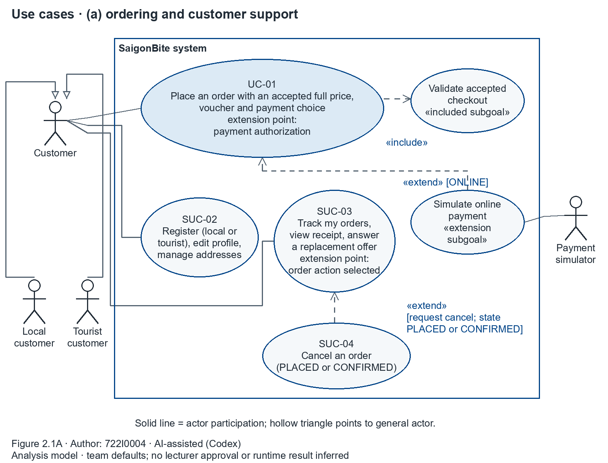
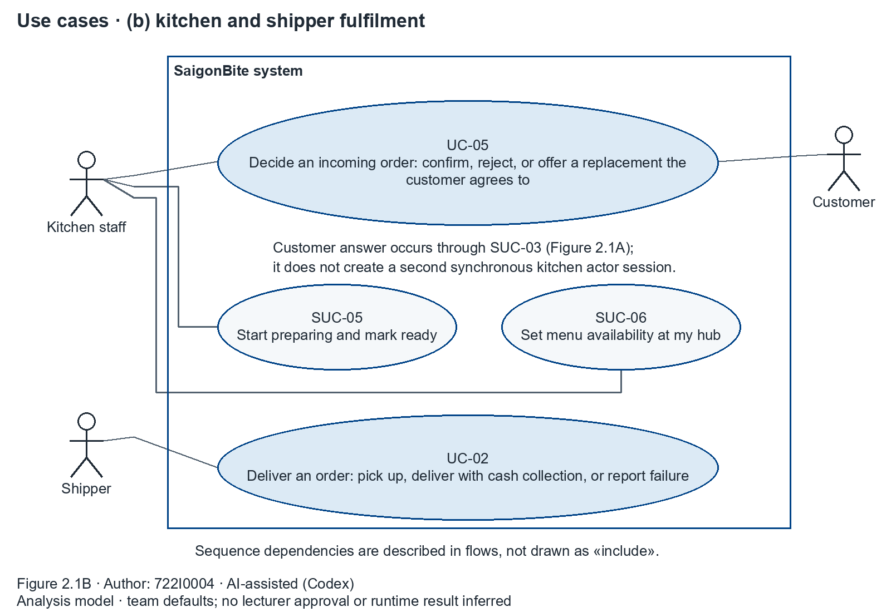
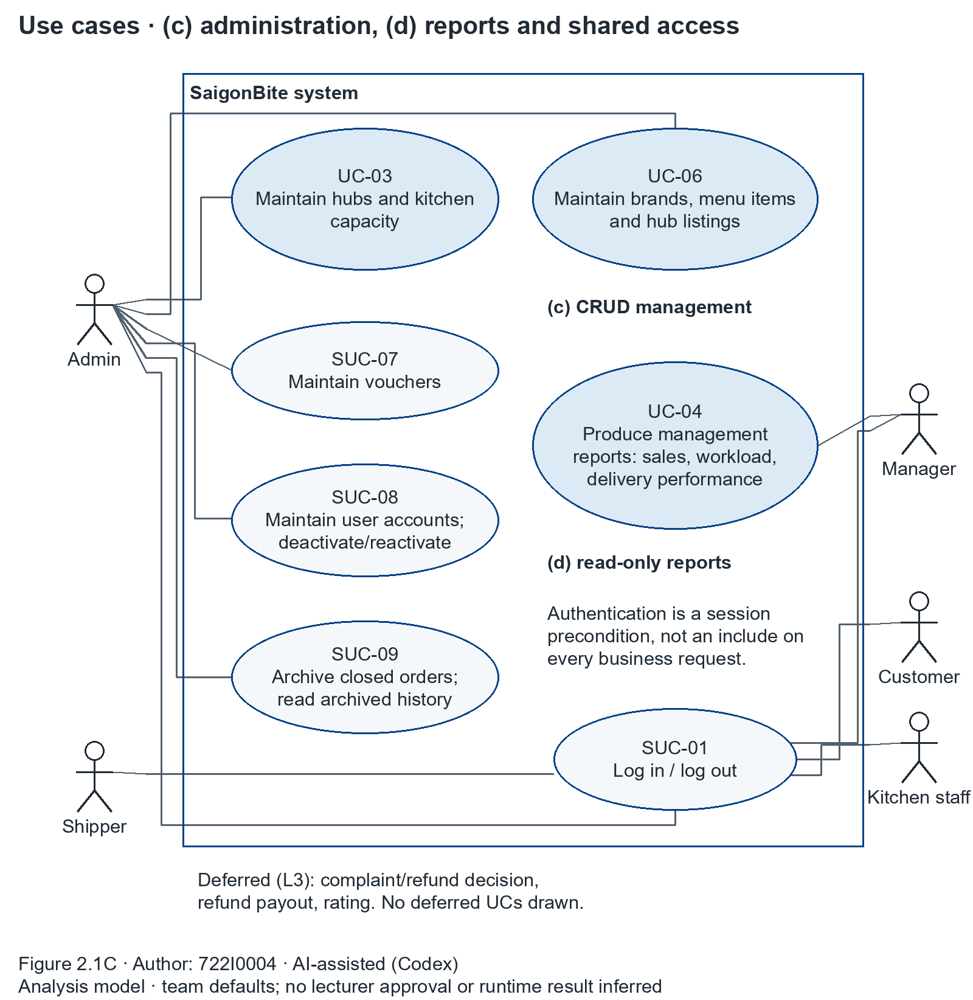
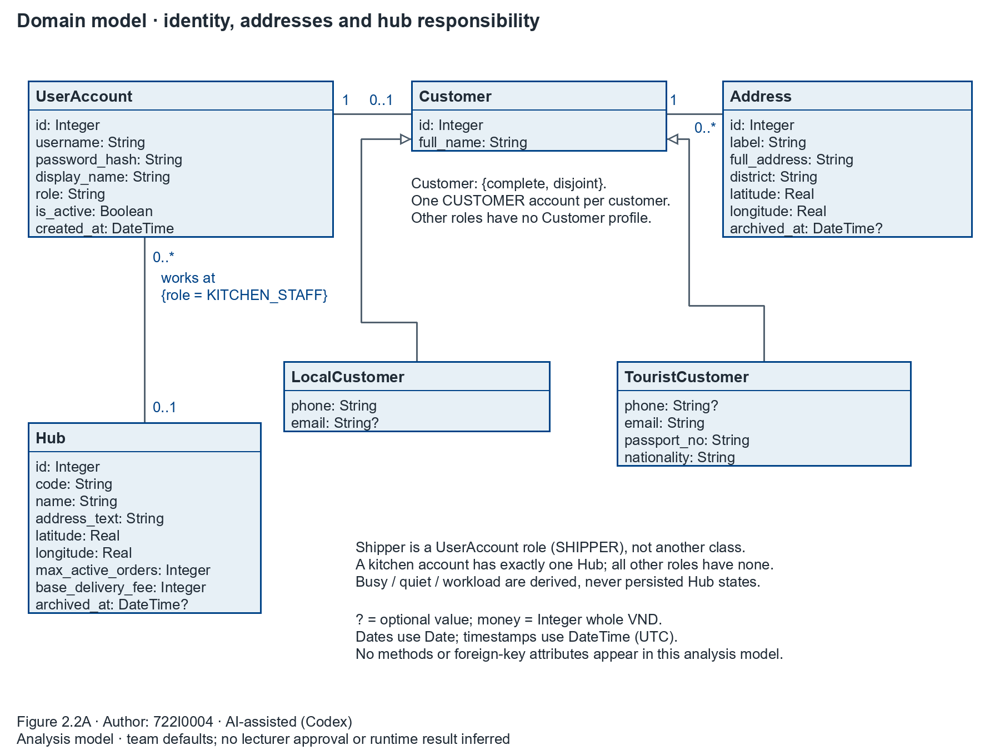
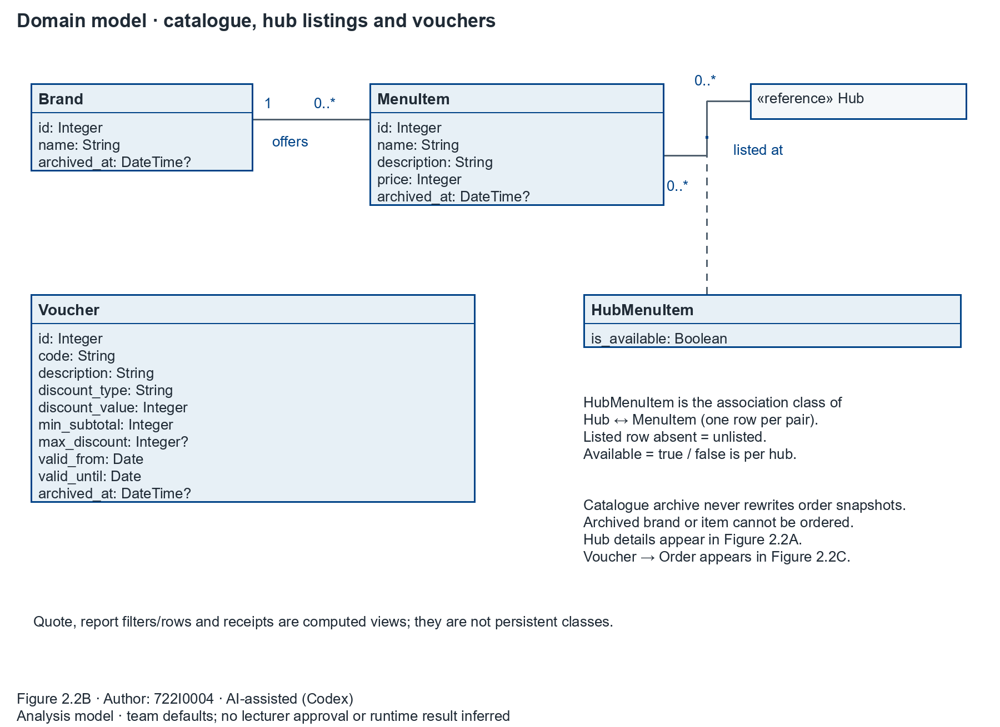
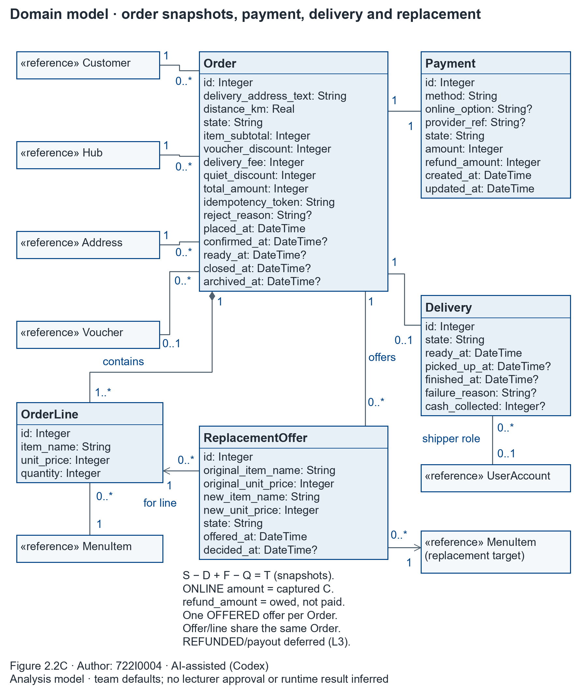

## 2.1.6 Use Case Diagram

Author: 722I0004 · AI-assisted (Codex)

Figure 2.1 is one logical system model presented in three readable views. Every view uses the same **SaigonBite system** boundary; actors remain outside it. Local customer and Tourist customer specialise Customer and inherit its participation. The five human actor roles and the explicitly labelled Payment simulator are external participants. The simulator represents the team simulation contract (business rule BR-14; course clarification L2); it does not claim a real payment provider integration.

Figure 2.1A. Use case diagram: (a) ordering and customer support — Author: 722I0004 · AI-assisted (Codex)

Figure 2.1B. Use case diagram: (b) kitchen and shipper fulfilment — Author: 722I0004 · AI-assisted (Codex)

Figure 2.1C. Use case diagram: (c) CRUD management, (d) reports and shared access — Author: 722I0004 · AI-assisted (Codex)

The three views contain all six main use cases and all nine supporting use cases. Group (a) ordering is UC-01; group (b) fulfilment is UC-02 and UC-05; group (c) CRUD management is UC-03 and UC-06; group (d) reports is UC-04. Owners are listed in 2.1.5; every diagram here was drawn by 722I0004.

The model makes only these reuse/extension claims:

| Relation | Direction and condition | Meaning |
|---|---|---|
| «include» | UC-01 → **Validate accepted checkout** | Each attempt to create a new checkout validates the accepted full quote and business guards, including a refused creation attempt. An authorized existing-token replay returns the existing order before this validation; it does not reprice or reauthorize. This factored subgoal represents BR-01–14 and the validation part of the existing checkout operations; it is not an additional user goal, SSD operation or persistent object. |
| «extend» | **Simulate online payment** → UC-01; `[ONLINE]`; extension point **payment authorization** | The base goal also completes through COD. The conditional simulator behaviour uses the existing `simulatorOutcome`/checkout contract (BR-14), and introduces no external network call. |
| «extend» | SUC-04 → SUC-03; `[request cancel; state PLACED or CONFIRMED]`; extension point **order action selected** | Cancellation is an optional customer action from the own-order view. BR-15/17 still guard the actual request; seeing the action is not permission to bypass the state check. |

The two named subgoals in the first view decompose UC-01; the portfolio remains **six main UCs plus nine SUCs**. Associations indicate participation, not calls or execution order. Login is a session precondition rather than an include on every business request. Preparation, availability maintenance, catalogue administration, tracking and reporting are independently initiated goals, so sequence dependencies are not represented as include arrows. Customer acceptance/decline of an offer occurs through SUC-03 and the existing replacement operations, referenced by UC-05. Complaint/refund decision, refund payout and rating appear only in the deferred-items note (deferred under A-09). The current scope does record refund obligations under business rule BR-17; it does not pay them out.

Editable source: `models/shared/use_case_diagram.drawio` (three pages, one per figure above).

## 2.1.7 Domain Class Model Diagram

Author: 722I0004 · AI-assisted (Codex)

Figure 2.2 presents exactly **13 persistent base classes**: Hub, Brand, MenuItem, HubMenuItem, UserAccount, Customer, Address, Voucher, Order, OrderLine, Payment, Delivery and ReplacementOffer. LocalCustomer and TouristCustomer are the two complete, disjoint Customer subclasses. A box marked «reference» repeats a class defined in another view; it adds no persistent class. The diagram uses simple attribute types, optional values marked `?`, and associations in place of foreign-key attributes. It contains no methods, controllers or DAOs.

Figure 2.2A. Domain model: identity, addresses and hub responsibility — Author: 722I0004 · AI-assisted (Codex)

Figure 2.2B. Domain model: catalogue, association-class listings and vouchers — Author: 722I0004 · AI-assisted (Codex)

Figure 2.2C. Domain model: order snapshots, payment, delivery and replacement — Author: 722I0004 · AI-assisted (Codex)

Both ends of each ordinary association have multiplicities. Each Customer has one UserAccount; an account has zero or one Customer profile (one when its role is CUSTOMER). A Customer has zero or more Addresses; every Address has one owner. A kitchen account has one Hub, while other account roles have none. Brand owns the catalogue affiliation of zero or more MenuItems. Hub and MenuItem have a many-to-many **listed at** association, with **HubMenuItem as its association class** and availability belonging to that pair.

An Order belongs to one Customer, Hub and selected Address; an Address may subsequently be archived without changing the stored delivery-address snapshot. An Order optionally uses one Voucher. Order **composes** one or more OrderLines; each line belongs to exactly one Order and refers to one MenuItem while retaining its own name/price/quantity snapshots. Each Order has exactly one Payment, zero or one Delivery, and zero or more historical ReplacementOffers. Each offer points to exactly one line of that same Order and one replacement-target MenuItem. A line or target item can appear in many historical offers; at most one offer is OFFERED for an Order at a time.

The Delivery assignment refers to zero or one UserAccount of role SHIPPER; a shipper account can have many deliveries, including concurrent assignments under BR-25. No Shipper class is added. Quote, report filters/rows and receipts are computed views and are not persisted. Archive visibility of dependent transaction records follows the parent Order; separate archive attributes on every child are unnecessary. Busy/quiet/workload and waiting for customer are derived classifications. Payment `amount` is captured C for ONLINE; `refund_amount` records an obligation, including a partial obligation while PAID. REFUNDED/payout remains future scope.

Editable source: `models/shared/domain_model.drawio` (three pages, one per figure above). Section 4.3.1 maps each class to its database table, and the state machines in 2.2 refine the `state` attributes of Order, Payment, Delivery, ReplacementOffer, Hub, HubMenuItem and UserAccount.
