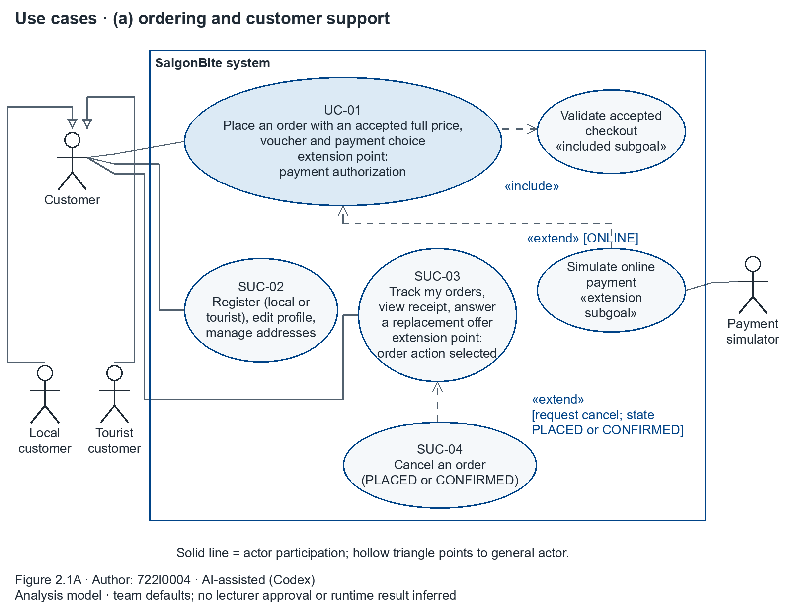
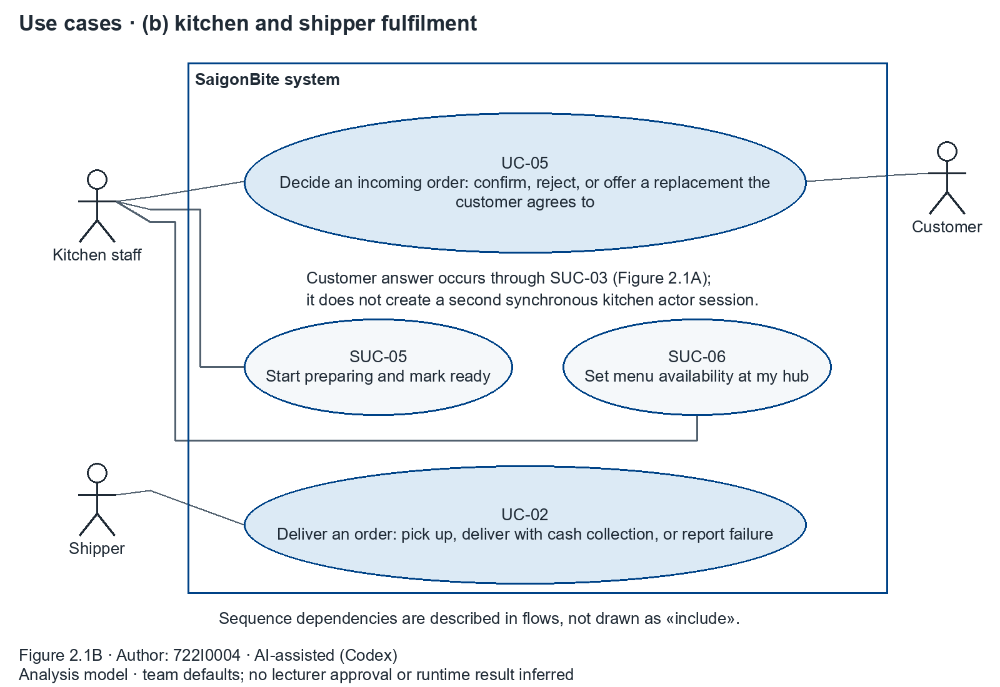
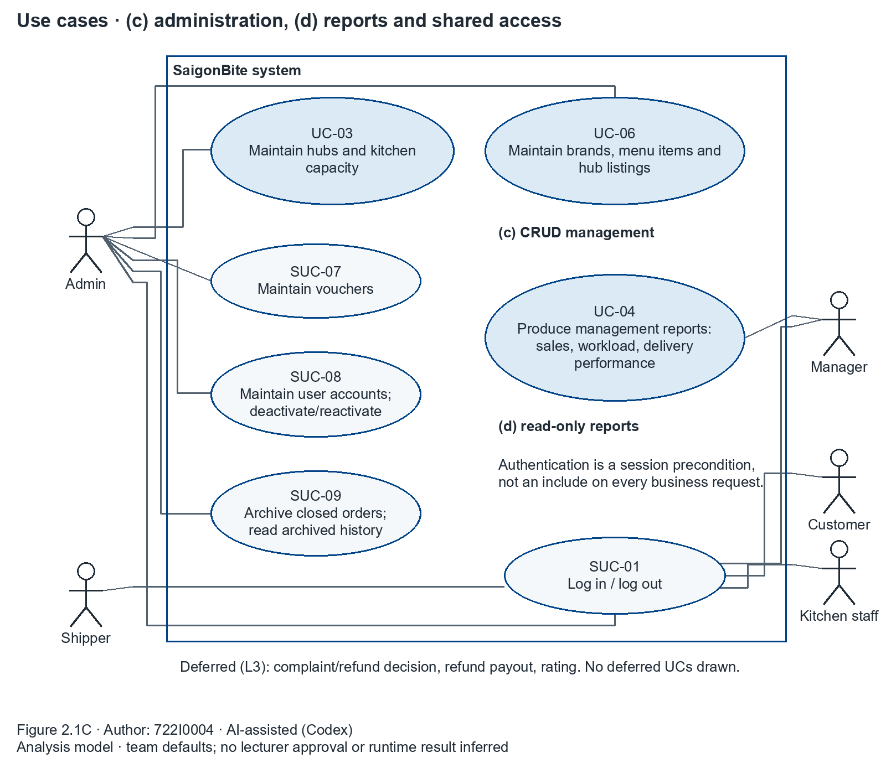
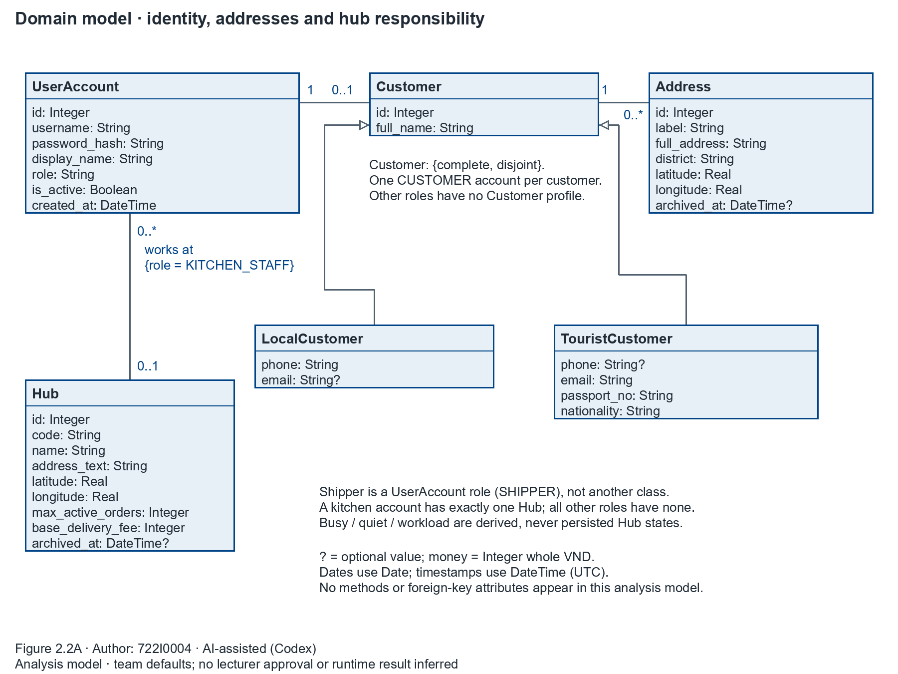
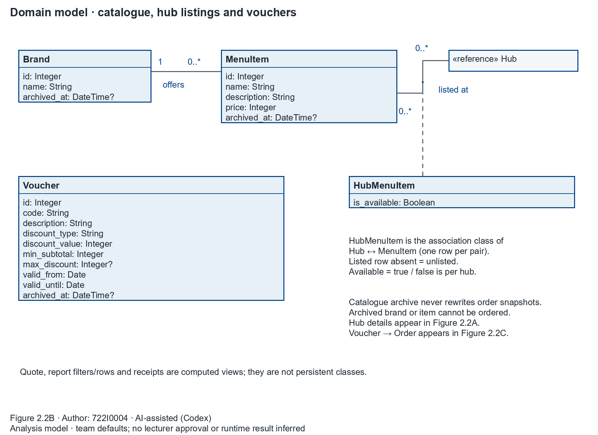
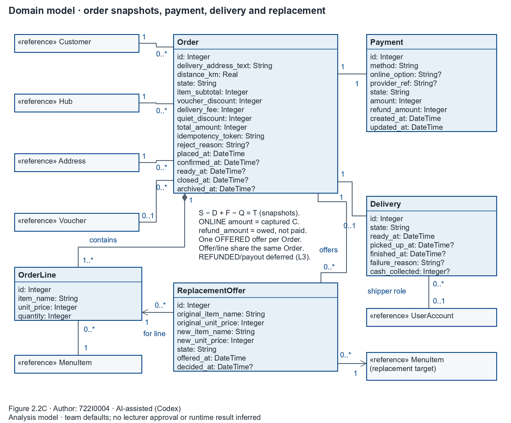

## 2.1.6 Use Case Diagram

Author: 722I0004 · AI-assisted (Codex)

Figure 2.1 is one logical system model presented in three readable views. Every view uses the same **SaigonBite system** boundary; actors remain outside it. Local customer and Tourist customer specialise Customer and inherit its participation. The five human actor roles and the explicitly labelled Payment simulator are external participants. The simulator represents the team simulation contract (BR-14/L2); it does not claim a real payment provider integration.

<!-- Figure placement: every image below requires an A4 landscape page at 230 mm width. Do not reduce to 170 mm portrait. -->

Figure 2.1A. Use case diagram: (a) ordering and customer support — Author: 722I0004 · AI-assisted (Codex)

Figure 2.1B. Use case diagram: (b) kitchen and shipper fulfilment — Author: 722I0004 · AI-assisted (Codex)

Figure 2.1C. Use case diagram: (c) CRUD management, (d) reports and shared access — Author: 722I0004 · AI-assisted (Codex)

The views contain all six main goals with the exact names in plan §2.1 and all nine supporting goals from §2.2. UC-01 belongs to group (a); UC-02/05 to (b); UC-03/06 to (c); UC-04 to (d). Supporting customer/profile, preparation, availability, voucher, account and archive functions complete the scoped portfolio. Proposal ownership is recorded separately in 2.1.5; the actual author of every model here is 722I0004.

The model makes only these reuse/extension claims:

| Relation | Direction and condition | Meaning |
|---|---|---|
| «include» | UC-01 → **Validate accepted checkout** | Every attempt must validate the accepted full quote and business guards, including a refused attempt. This factored subgoal represents BR-01–14 and the validation part of the existing checkout operations; it is not an additional user goal, SSD operation or persistent object. |
| «extend» | **Simulate online payment** → UC-01; `[ONLINE]`; extension point **payment authorization** | The base goal also completes through COD. The conditional simulator behaviour uses the existing `simulatorOutcome`/checkout contract (BR-14), and introduces no external network call. |
| «extend» | SUC-04 → SUC-03; `[request cancel; state PLACED or CONFIRMED]`; extension point **order action selected** | Cancellation is an optional customer action from the own-order view. BR-15/17 still guard the actual request; seeing the action is not permission to bypass the state check. |

The two named subgoals in the first view decompose UC-01; the portfolio remains **six main UCs plus nine SUCs**. Associations indicate participation, not calls or execution order. Login is a session precondition rather than an include on every business request. Preparation, availability maintenance, catalogue administration, tracking and reporting are independently initiated goals, so sequence dependencies are not represented as include arrows. Customer acceptance/decline of an offer occurs through SUC-03 and the existing replacement operations, referenced by UC-05. Complaint/refund decision, refund payout and rating appear only in the deferred-items note (L3). The current scope does record refund obligations under BR-17 and plan §3.3; it does not pay them out.

Editable source: `models/shared/use_case_diagram.drawio` contains all three pages. Each `_PartA`/`_PartB`/`_PartC` has a matching `.drawio`, `.svg`, `.png`, `.json` and regeneration `.py`. The unsuffixed PNG/SVG are explicitly first-page aliases, not a complete single-page overview; use the three figures above together.

## 2.1.7 Domain Class Model Diagram

Author: 722I0004 · AI-assisted (Codex)

Figure 2.2 presents exactly **13 persistent base classes**: Hub, Brand, MenuItem, HubMenuItem, UserAccount, Customer, Address, Voucher, Order, OrderLine, Payment, Delivery and ReplacementOffer. LocalCustomer and TouristCustomer are the two complete, disjoint Customer subclasses. A box marked «reference» repeats a class defined in another view; it adds no persistent class. The diagram uses simple attribute types, optional values marked `?`, and associations in place of foreign-key attributes. It contains no methods, controllers or DAOs.

<!-- Figure placement: every image below requires an A4 landscape page at 230 mm width. Do not reduce to 170 mm portrait. -->

Figure 2.2A. Domain model: identity, addresses and hub responsibility — Author: 722I0004 · AI-assisted (Codex)

Figure 2.2B. Domain model: catalogue, association-class listings and vouchers — Author: 722I0004 · AI-assisted (Codex)

Figure 2.2C. Domain model: order snapshots, payment, delivery and replacement — Author: 722I0004 · AI-assisted (Codex)

Both ends of each ordinary association have multiplicities. Each Customer has one UserAccount; an account has zero or one Customer profile (one when its role is CUSTOMER). A Customer has zero or more Addresses; every Address has one owner. A kitchen account has one Hub, while other account roles have none. Brand owns the catalogue affiliation of zero or more MenuItems. Hub and MenuItem have a many-to-many **listed at** association, with **HubMenuItem as its association class** and availability belonging to that pair.

An Order belongs to one Customer, Hub and selected Address; an Address may subsequently be archived without changing the stored delivery-address snapshot. An Order optionally uses one Voucher. Order **composes** one or more OrderLines; each line belongs to exactly one Order and refers to one MenuItem while retaining its own name/price/quantity snapshots. Each Order has exactly one Payment, zero or one Delivery, and zero or more historical ReplacementOffers. Each offer points to exactly one line of that same Order and one replacement-target MenuItem. A line or target item can appear in many historical offers; at most one offer is OFFERED for an Order at a time.

The Delivery assignment refers to zero or one UserAccount of role SHIPPER; a shipper account can have many deliveries, including concurrent assignments under BR-25. No Shipper class is added. Quote, report filters/rows and receipts are computed views and are not persisted. Archive visibility of dependent transaction records follows the parent Order; separate archive attributes on every child are unnecessary. Busy/quiet/workload and waiting for customer are derived classifications. Payment `amount` is captured C for ONLINE; `refund_amount` records an obligation, including a partial obligation while PAID. REFUNDED/payout remains future scope.

Editable source: `models/shared/domain_model.drawio` contains all three pages. The suffix/source conventions and first-page alias rule are the same as Figure 2.1. These are analysis artifacts. The following comparison is **Static**, based on reading the current draft; it is neither a test result nor a claim that the application meets these contracts.

### Static class and attribute mapping to schema v2

The table checks every drawn attribute against `db/schema.sql`. Same-name mappings preserve the stated meaning; Integer money means whole VND, Boolean maps to constrained INTEGER, Real to REAL, Date/DateTime to ISO TEXT. `id` attributes map to primary keys; foreign-key columns are shown here as implementation mappings and are deliberately absent from the analysis attributes.

| Analysis class | SQL table and all drawn attributes | Association/subtype implementation and Static differences |
|---|---|---|
| Hub | `hub`: `id`, `code`, `name`, `address_text`, `latitude`, `longitude`, `max_active_orders`, `base_delivery_fee`, `archived_at` | All attributes exist. Workload is derived from orders, not a stored field. Kitchen assignment uses `user_account.hub_id`; Order uses `orders.hub_id`. |
| Brand | `brand`: `id`, `name`, `archived_at` | All attributes exist. `menu_item.brand_id` implements affiliation. |
| MenuItem | `menu_item`: `id`, `name`, `description`, `price`, `archived_at` | All attributes exist. `brand_id` is the association. Python `brand_name` is a joined display value, not an additional persisted attribute. |
| HubMenuItem | `hub_menu_item`: `is_available` | Attribute exists. Composite PK (`hub_id`, `menu_item_id`) implements the unique association-class instance. Python contains an `item` object and `hub_id`; these are implementation references. |
| UserAccount | `user_account`: `id`, `username`, `password_hash`, `display_name`, `role`, `is_active`; model `created_at` | **`created_at` is required in plan §5.3 but absent in both draft SQL and dataclass.** Hub association maps to nullable `hub_id` with kitchen-role equivalence CHECK. |
| Customer; LocalCustomer; TouristCustomer | `customer`: inherited `id`, `full_name`; Local `phone`, optional `email`; Tourist optional `phone`, required `email`, `passport_no`, `nationality` | Single-table inheritance: `customer_type` discriminator (`LOCAL`/`TOURIST`); `user_id` implements the one-account association. No subtype tables. **SQL permits a TOURIST with NULL nationality**, unlike BR-12. SQL also does not require the linked account's role to be CUSTOMER. Python stores profile fields on the base dataclass and uses subclass class attributes/factory for type. |
| Address | `address`: `id`, `label`, `full_address`, `district`, `latitude`, `longitude`, `archived_at` | All attributes exist. `customer_id` implements ownership. Coordinates represent the district centroid approximation, BR-05/A-14. The draft comment refers to older A-12; that is stale provenance, not a changed rule. |
| Voucher | `voucher`: `id`, `code`, `description`, `discount_type`, `discount_value`, `min_subtotal`, `max_discount`, `valid_from`, `valid_until`, `archived_at` | All attributes exist. An Order's optional link uses `voucher_id`; inclusive dates are Vietnam calendar dates. |
| Order | `orders`: `id`, `delivery_address_text`, `distance_km`, `state`, `item_subtotal`, `voucher_discount`, `delivery_fee`, `quiet_discount`, `total_amount`, `idempotency_token`, `reject_reason`, `placed_at`, `confirmed_at`, `ready_at`, `closed_at`, `archived_at` | All stored attributes exist. FKs: `customer_id`, `hub_id`, `address_id`, `voucher_id`. Python derives `item_subtotal` and `total` from lines/rules; `total` corresponds to SQL `total_amount`. Stored-vs-derived agreement needs transaction tests in P4. |
| OrderLine | `order_line`: `id`, `item_name`, `unit_price`, `quantity` | All attributes exist. `order_id` implements composition; `menu_item_id` identifies the current/snapshot-associated dish. UNIQUE (`order_id`, `menu_item_id`) prevents duplicate dish lines. |
| Payment | `payment`: `id`, `method`, `online_option`, `provider_ref`, `state`, `amount`, `refund_amount`, `created_at`, `updated_at` | All attributes exist. UNIQUE `order_id` gives at most one per Order; mandatory creation is a checkout transaction contract. Python `updated_at` is optional although SQL is NOT NULL. SQL permits FAILED/REFUNDED, while the scoped lifecycle never persists a declined attempt or executes payout. |
| Delivery | `delivery`: `id`, `state`, `ready_at`, `picked_up_at`, `finished_at`, `failure_reason`, `cash_collected` | All attributes exist. UNIQUE `order_id` implements zero-or-one per Order; nullable `shipper_id` points to `user_account`. SQL requires an assignment after AWAITING_PICKUP but does not enforce SHIPPER role/active status or paired Order transitions. |
| ReplacementOffer | `replacement_offer`: `id`, `original_item_name`, `original_unit_price`, `new_item_name`, `new_unit_price`, `state`, `offered_at`, `decided_at` | The invalid-target withdrawal reason is a displayed operation result under §3.3(5); no new persistent reason field is required by this analysis. `order_id`, `order_line_id`, `new_menu_item_id` implement associations. The partial unique index enforces one OFFERED offer per Order. Independent FKs do not prove the line belongs to that Order. |

### P4 inputs from the Static comparison

1. Add/map UserAccount `created_at` under plan §5.3, or obtain an explicit contract disposition before removing the analysis requirement. It is absent from the draft SQL and dataclass.
2. Enforce Tourist nationality and the CUSTOMER-profile/account-role relationship. Validate all BR-12 type-specific fields; the current SQL CHECK only requires Tourist passport/email and Local phone. Keep passport visibility restricted to customer/admin.
3. Return the invalid-target withdrawal reason with the operation result. Root rejected an extra persistent withdrawal_reason attribute: §3.3(5) requires a reason to be shown, and does not require new reason-history storage. P3 confirms the result/API mapping; the diagram adds no column.
4. Reconcile Payment `updated_at` optionality between dataclass and SQL; ensure no persisted FAILED/REFUNDED path for this release. SQL's permissive state vocabulary alone is not proof that such a path runs.
5. Verify cross-row invariants in transactions: exactly one Payment and at least one line on successful checkout; offer/line same Order; valid target at the same Hub; active SHIPPER assignment; paired Order/Delivery/Payment effects. Existing FK/UNIQUE constraints express only part of these contracts.
6. Preserve archived history and snapshots without physical child deletion. SQL comments say most records are archived, but many transaction children are hidden through Order archive rather than their own archive column; spell this out in P3.2 mapping.
7. Keep the locked plan's existing F-02/F-05/F-07 money, target-recheck and consent repairs as P4 work. The present domain dataclasses do not establish BR-17 amount effects, target availability validation or quote fingerprint correctness. No code or schema was changed here.

The worker's original per-column comparison, AST field inventory and source hashes remain at `Part2/notes/P2-B/static_mapping.json` and `source_audit.json` as pre-integration evidence. The root's final inventory at `Part2/notes/P2-root/domain_model_final_audit.json` reflects removal of the proposed withdrawal_reason attribute; the only remaining drawn attribute absent from SQL is UserAccount.created_at. SQL was inspected using a transient in-memory schema, never an application database. P3.1 must add real responsibilities/method signatures and reconcile them to code; those design details do not belong in this analysis figure.

Readability was checked at **230 mm landscape placement**: minimum diagram text is 26 units, equivalent to **10.59 pt** in Figure 2.1 and **9.42 pt** in Figure 2.2. The models are split into three parts each to meet this threshold. The PNG and SVG exports were opened for visual QA; XML parses and edge endpoint references were checked programmatically. Native draw.io editing and application correctness remain unverified by this workstream.
