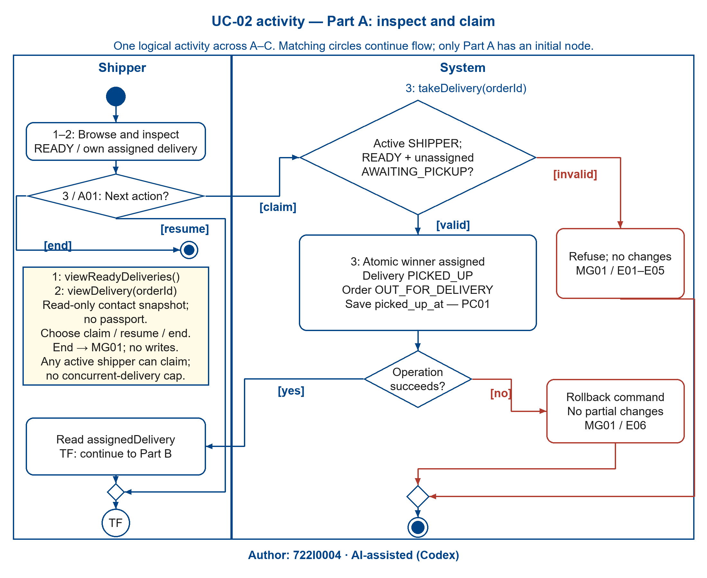
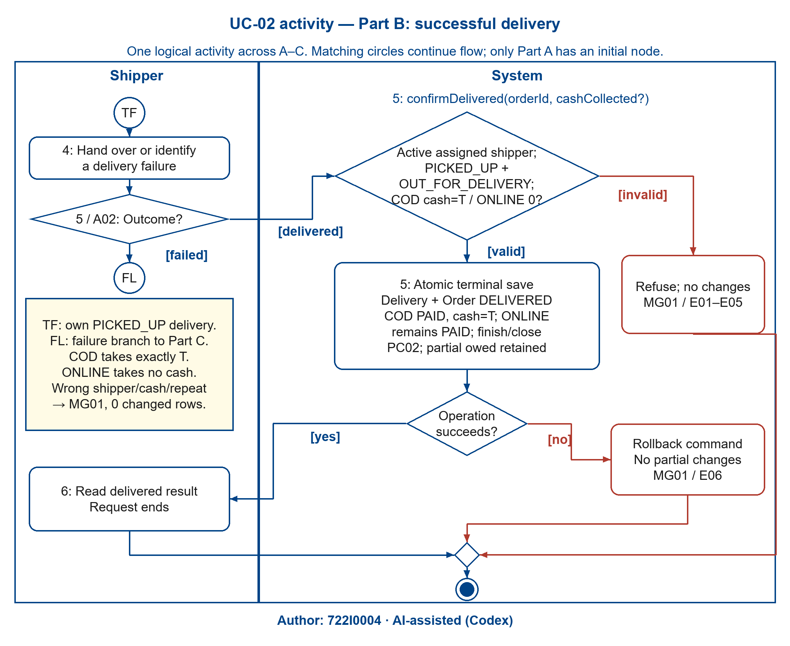
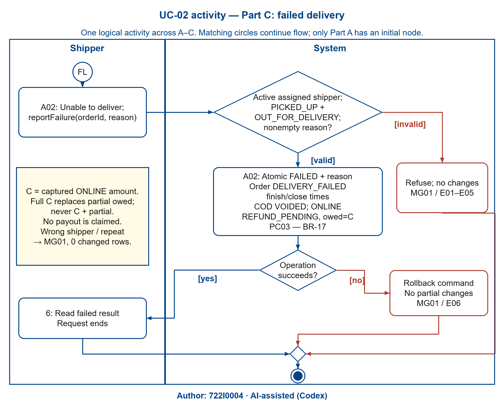
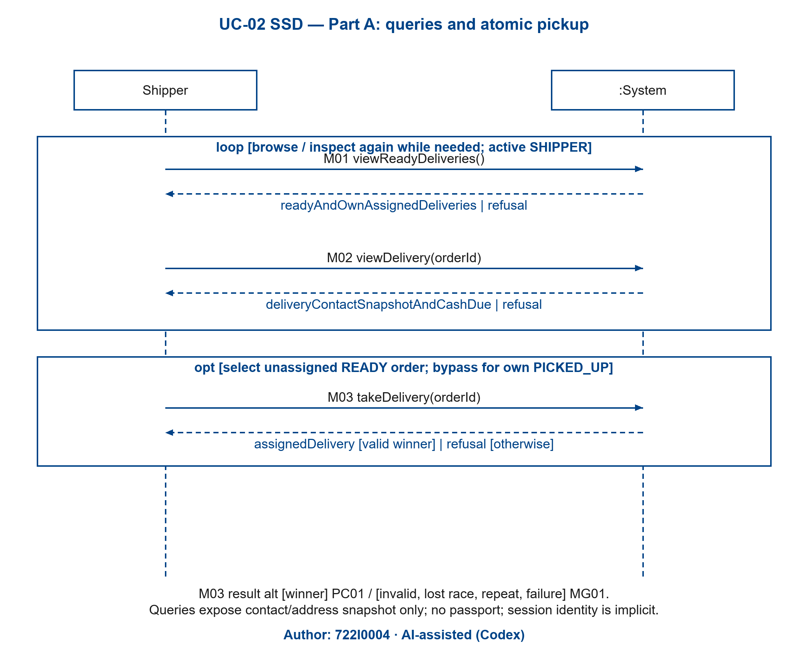
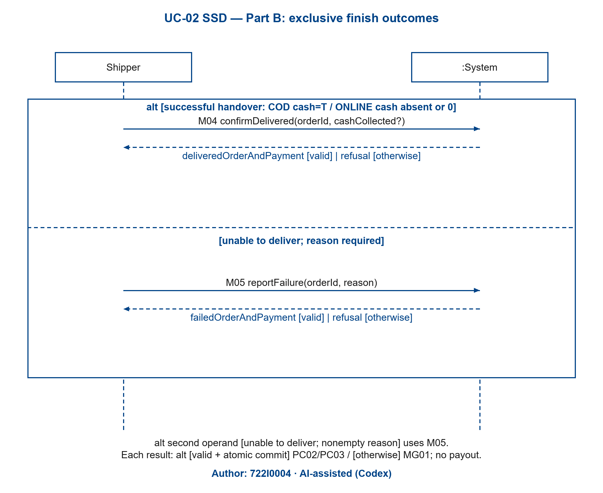

# 2.2.2 Use Case 2: Deliver an order: pick up, deliver with cash collection, or report failure (author: 722I0004)

Author: 722I0004 · AI-assisted (Codex)

### i. Fully developed use case description

<!-- include: ../UC-02/description.md -->

### ii. Activity diagram for Use Case 2

Author: 722I0004 · AI-assisted (Codex)

One logical activity spans Parts A–C. Part A is the sole entry: browse/inspect, then choose a new claim, resume an own PICKED_UP assignment, or end empty/read-only with UC02-MG01. Successful pickup and resume merge before TF, which enters Part B; no transaction spans travel. Part B selects delivered versus failed, with FL continuing to Part C. Activity finals end this delivery attempt after a complete outcome or refusal. [claim], [resume], [end] are mutually exclusive choices; [delivered]/[failed] are exclusive outcomes. [valid]/[invalid] are complementary guards, and [yes]/[no] distinguish atomic success from rollback.

<!-- Figure placement: A4 landscape, 230 mm width; minimum text 10.67 pt. -->

Figure 2.12A. UC-02 activity: inspect and claim a delivery — Author: 722I0004 · AI-assisted (Codex)

Figure 2.12B. UC-02 activity: successful delivery and exact cash — Author: 722I0004 · AI-assisted (Codex)

Figure 2.12C. UC-02 activity: failure reason and full refund obligation — Author: 722I0004 · AI-assisted (Codex)

Each figure has adjacent editable `.drawio`, `.svg`, `.json` and a self-contained `.py` generator under the same stem. Guard validation includes active session, ownership, live state and the applicable cash/reason condition; a claim is atomic, with no one-active-delivery cap. Physical travel, cash handover and food return are actor work, not new system operations.

### iii. System sequence diagram for Use Case 2

Author: 722I0004 · AI-assisted (Codex)

Only Shipper and `:System` participate. M01/M02 are catalogue OP-21/22 queries; M03 is OP-10 pickup; M04/M05 are OP-11/12 terminal commands. Every request appears in the description, with session identity implicit. Dashed arrows are responses; the alternative result on a response is guarded by accepted versus refused command. The loop permits browsing/inspection again; the opt bypasses pickup when resuming an owned delivery. Part B's alt chooses successful handover versus failure. Each command rechecks guards and commits all paired facts or none.

Figure 2.13A. UC-02 SSD: read requests and atomic pickup — Author: 722I0004 · AI-assisted (Codex)

Figure 2.13B. UC-02 SSD: exclusive delivery completion outcomes — Author: 722I0004 · AI-assisted (Codex)

### iv. State machine diagram for Use Case 2

Author: 722I0004 · AI-assisted (Codex)

UC-02 owns the Delivery state machine (Figures 2.5A–B). Root assembly inserts the existing `STATE_MACHINE DELIVERY` block here once. Shared Order transitions are already drawn under UC-01 in Figures 2.3D–E and Payment under UC-01 in Figures 2.4A–B; they are cross-references, not duplicate state figures. `markReady` belongs to SUC-05 and creates AWAITING_PICKUP before this use case.

| Anchor | Transition / stored fact / refusal invariant |
|---|---|
| UC02-PC01 | `takeDelivery`: AWAITING_PICKUP→PICKED_UP; one assigned active shipper and picked_up_at; paired Order READY→OUT_FOR_DELIVERY (2.5A/2.3D). |
| UC02-PC02 | `confirmDelivered`: PICKED_UP→DELIVERED and Order OUT_FOR_DELIVERY→DELIVERED; finished_at/closed_at; COD PENDING→PAID with cash_collected=T. ONLINE PAID/C/partial owed retained (2.5B/2.3E/2.4A–B). |
| UC02-PC03 | `reportFailure`: PICKED_UP→FAILED with failure_reason/finished_at; paired DELIVERY_FAILED/closed_at; COD VOIDED or ONLINE REFUND_PENDING and full owed=C replacing partial (same figures). |
| UC02-MG01 | Invalid/lost claim, wrong assigned shipper, cash mismatch, repeat or failed atomic save has no transition and changes zero rows. Earlier committed facts remain. |
