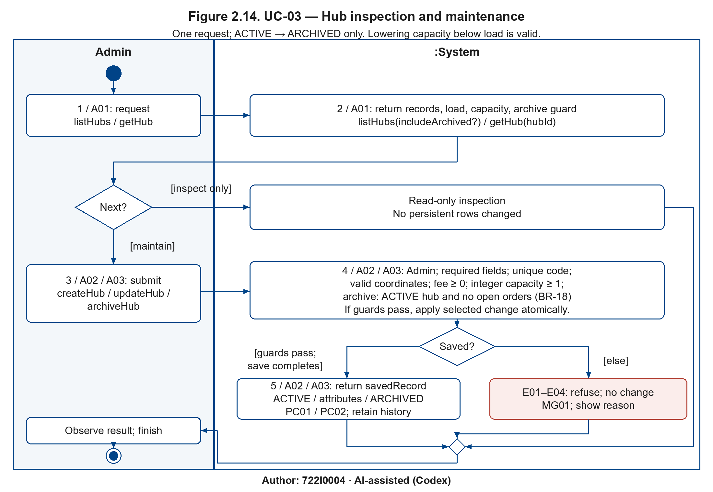
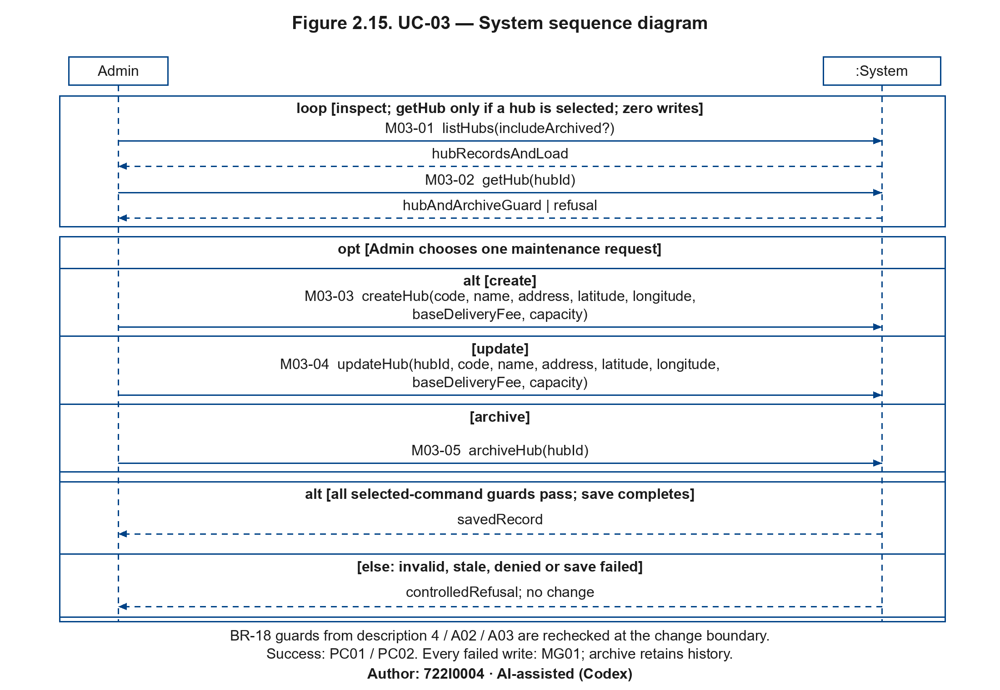

# 2.2.3 Use Case 3: Maintain hubs and kitchen capacity (author: 722I0004)

Author: 722I0004 · AI-assisted (Codex)

### i. Fully developed use case description

Author: 722I0004 · AI-assisted (Codex)

<!-- include: ../UC-03/description.md -->

### ii. Activity diagram for Use Case 3

Author: 722I0004 · AI-assisted (Codex)

Figure 2.14. UC-03 — Hub inspection and maintenance — Author: 722I0004 · AI-assisted (Codex)

Each page models one independently initiated request in Admin | System partitions; alternatives merge before the result is observed. The bullseye ends the whole request. There is no fork or concurrent flow. Guard checks include session authorization and save completion; the else edge covers every failed guard and rollback. Repeating an inspection starts another request.

### iii. System sequence diagram for Use Case 3

Author: 722I0004 · AI-assisted (Codex)

Figure 2.15. UC-03 — System sequence diagram — Author: 722I0004 · AI-assisted (Codex)

Only Admin and :System participate. Solid calls use the frozen operation catalogue with its parameters; dashed arrows are returned values. The inspection loop is read-only; the optional maintenance request selects exactly one command in an alt, followed by guarded savedRecord versus controlledRefusal outcomes. Query refusal/denial is represented by its returned refusal where defined; denied sessions reveal no protected data.

<!-- Figure placement: 230 mm landscape, minimum 9.48 pt. Split catalogue pages must not be reduced to portrait width. -->

### iv. State machine diagram for Use Case 3

Author: 722I0004 · AI-assisted (Codex)

The Hub state machine is Figure 2.6, owned here (source `models/UC-03/sm_hub.*`; canonical block in `II_state_machines.md`). The shared UserAccount model Figure 2.9 is placed here once for SUC-08; it does not add account-write operations to UC-03. Busy/quiet are derived inside ACTIVE. Archived hubs keep their historical references; there is no reactivation command.

| Anchor | Transition or stored fact |
|---|---|
| UC03-PC01 | createHub → ACTIVE or updateHub ACTIVE self-transition stores validated code/coordinates/fee/capacity. |
| UC03-PC02 | archiveHub ACTIVE → ARCHIVED only with no open orders; archived_at hides browse/checkout while history/report references survive. |
| UC03-MG01 | Failed create/update/archive has no transition or attribute change; unique code, capacity ≥ 1 and no-open-order archive guards protect the stored fact. |

The root assembler inserts the canonical state-machine block once beneath this subsection; this package cross-references it without copying shared images. These are analysis contracts, not measured application results.

Editable models: each base .drawio contains all its pages; the adjacent JSON and Python regenerate the models. Catalogue base PNG/SVG are first-page aliases; use all A–C figures above together.
