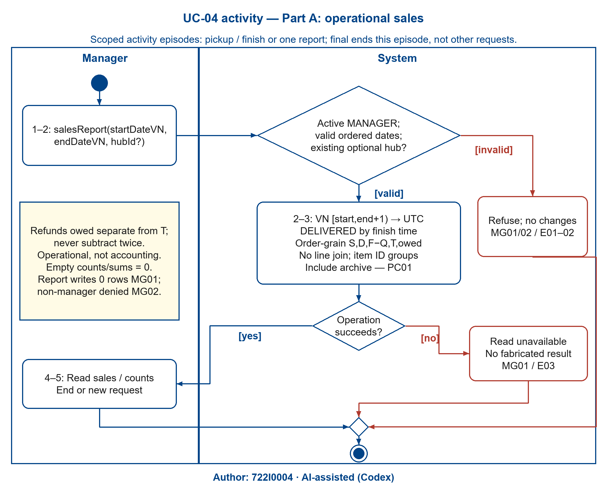
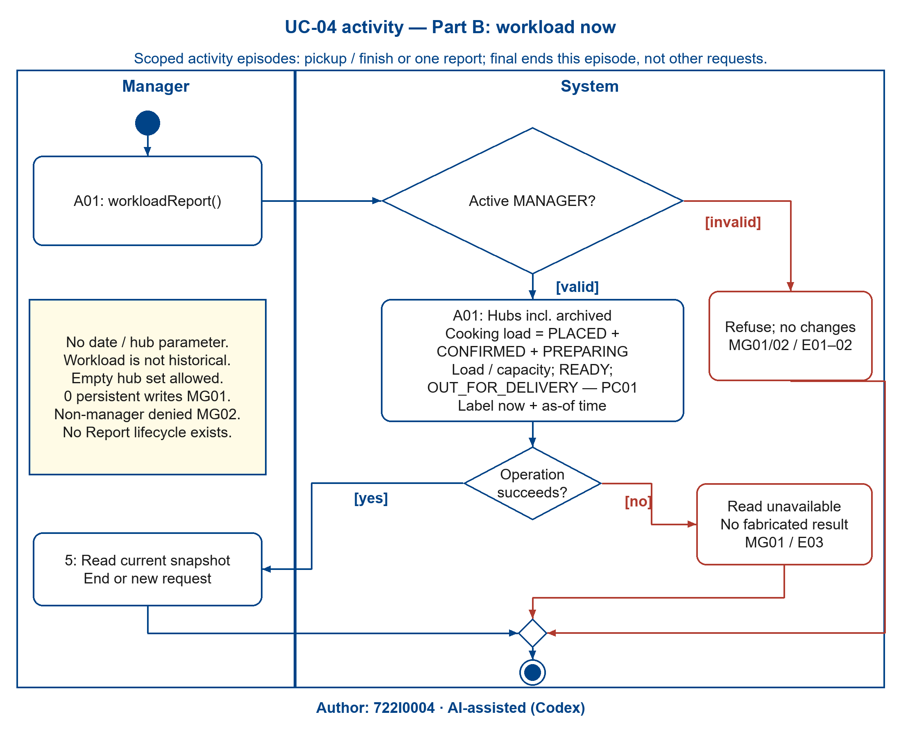
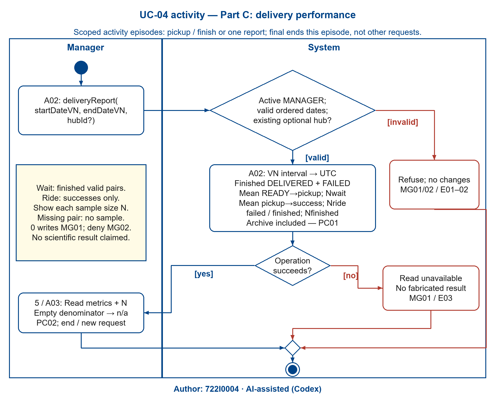
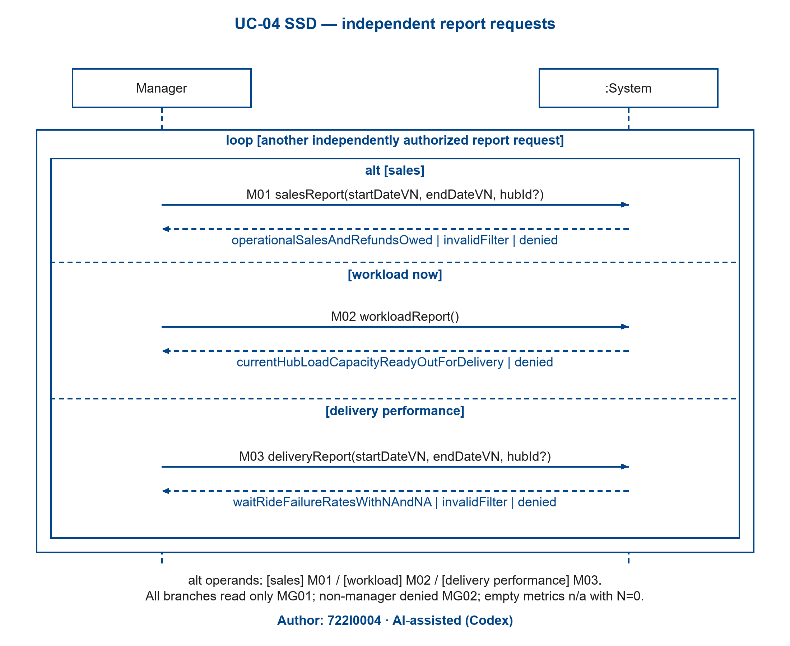

# 2.2.4 Use Case 4: Produce management reports: sales, workload, delivery performance (author: 722I0004)

Author: 722I0004 · AI-assisted (Codex)

### i. Fully developed use case description

<!-- include: ../UC-04/description.md -->

### ii. Activity diagram for Use Case 4

Author: 722I0004 · AI-assisted (Codex)

The manager chooses one of three independently initiated report episodes. Part A is sales, B workload now and C delivery performance. All requests recheck the role. `[valid]` means every displayed role/filter condition holds; `[invalid]` is its complement. Read failures return unavailable without fabricated totals. Success and refusal paths explicitly merge before the episode's activity final; no lifecycle event or persistent write is produced. A new request restarts its own episode.

<!-- Figure placement: A4 landscape, 230 mm width; minimum text 10.67 pt. -->

Figure 2.16A. UC-04 activity: operational sales — Author: 722I0004 · AI-assisted (Codex)

Figure 2.16B. UC-04 activity: current hub workload — Author: 722I0004 · AI-assisted (Codex)

Figure 2.16C. UC-04 activity: delivery performance and sample sizes — Author: 722I0004 · AI-assisted (Codex)

Adjacent `.drawio`, `.svg`, `.json` and self-contained `.py` files preserve each figure's editable model and generation inputs. Archived transaction history is included; workload remains a current operational snapshot, not a date-filtered historical count.

### iii. System sequence diagram for Use Case 4

Author: 722I0004 · AI-assisted (Codex)

Manager and `:System` are the only lifelines. M01/M02/M03 are exactly catalogue OP-26/27/28, recorded in description step 2/A01/A02. The loop represents further independently authorized requests and the nested alt selects sales, workload or performance. Dashed responses return only read results, invalidFilter or denied as applicable. No controller, query language, database or widget appears. Missing/inactive authorization is denied on every report request; every outcome preserves zero writes.

Figure 2.17. UC-04 SSD: independent report queries — Author: 722I0004 · AI-assisted (Codex)

### iv. State machine diagram for Use Case 4

Author: 722I0004 · AI-assisted (Codex)

UC-04 has **zero own Report states**: a filter and returned rows are computed views. It reads Order and Payment facts in Figures 2.3A–E/2.4A–B, Delivery facts in Figures 2.5A–B, and Hub capacity/current load referenced by Figure 2.6. It fires none of these transitions and does not create a fake Report state machine. History remains readable after archive.

| Anchor | Read fact / computed outcome / invariant |
|---|---|
| UC04-PC01 | Sales reads DELIVERED/finish time, stored S/D/F/Q/T and owed amounts; workload reads live Order states and Hub capacity; performance reads finished Delivery states/timestamp pairs. The filtered values must equal the independent hand oracle in later verification. This is required behaviour, not a measured result here. |
| UC04-PC02 | Mean wait/ride and failure-rate denominators are computed; zero returns n/a and N=0. No stored Report state exists. |
| UC04-MG01 | The report's footprint is read-only over Order/OrderLine, Payment, Delivery and Hub; zero inserts, updates or archive writes for successful, empty, refused or failed requests. |
| UC04-MG02 | Active Manager role is checked before disclosure; non-manager denied, with no lifecycle transition. |

BR-20 uses Vietnam calendar boundaries converted to UTC `[start,end+1)`. BR-21 keeps owed refunds separate from T. BR-24 preserves order-level aggregation without a line join and item-level grouping by identity; equal dish names do not collapse distinct IDs. BR-22's workload ignores dates; BR-23 displays each N and n/a for empty denominators.
