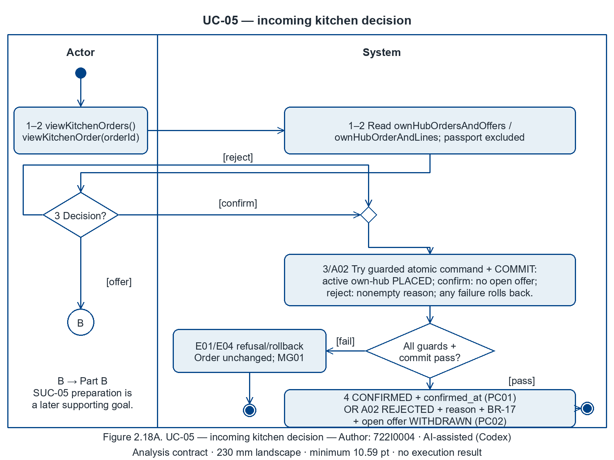
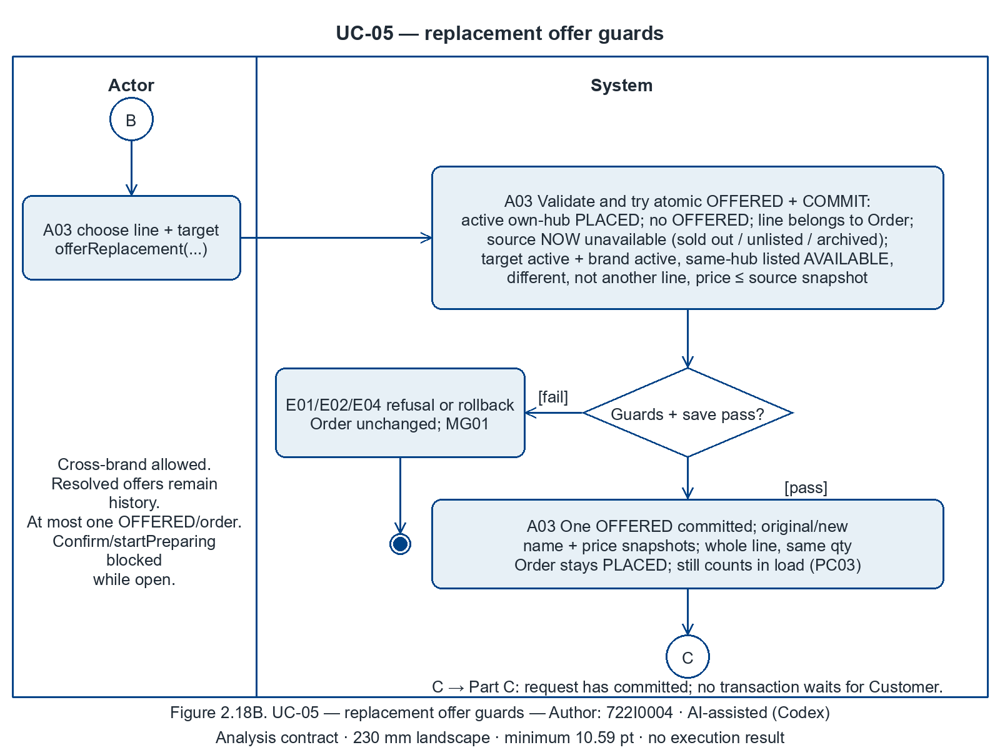
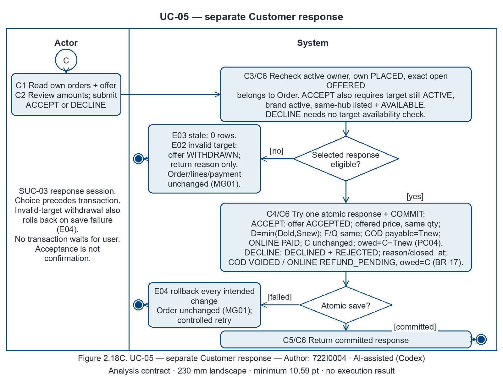
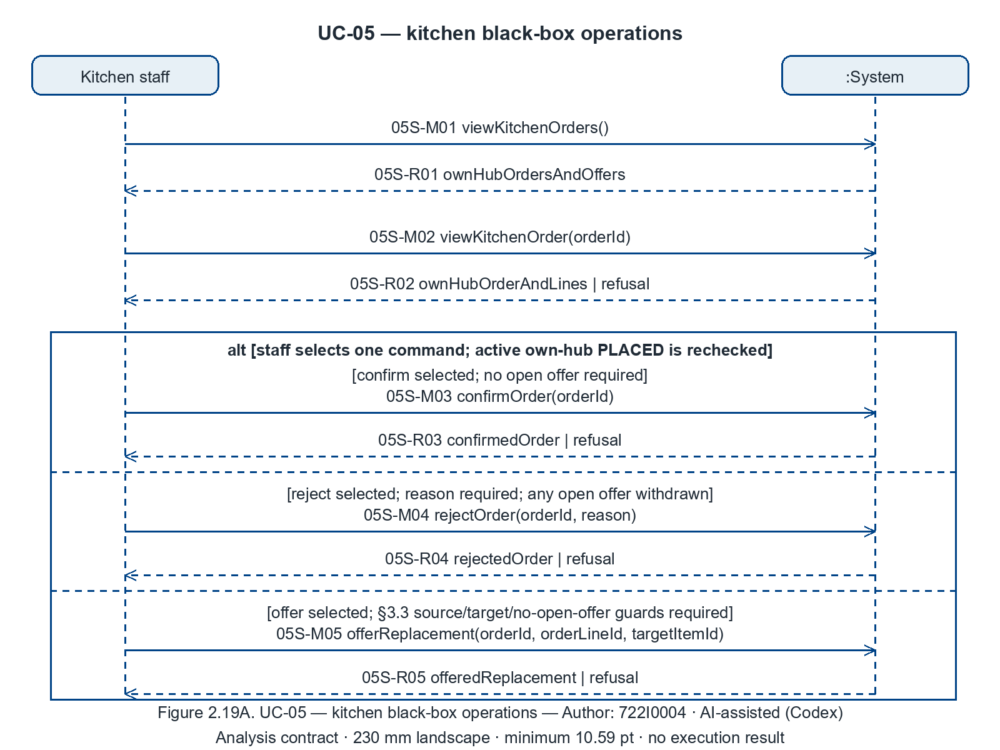
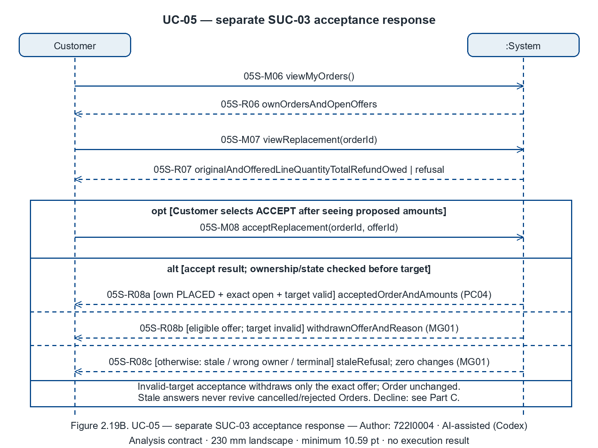
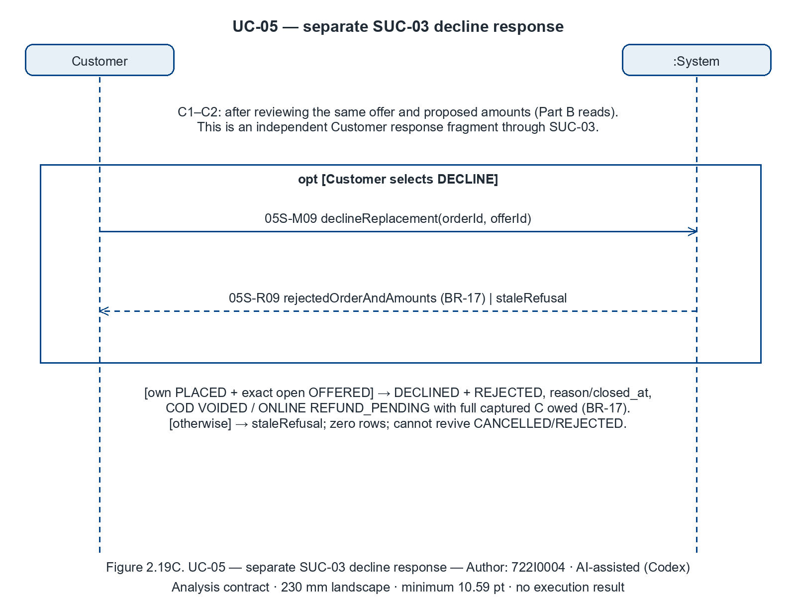

# 2.2.5 Use Case 5: Decide an incoming order: confirm, reject, or offer a replacement the customer agrees to (author: 722I0004)

Author: 722I0004 · AI-assisted (Codex)

## i. Fully developed use case description

<!-- include: ../UC-05/description.md -->

## ii. Activity diagram for Use Case 5

Author: 722I0004 · AI-assisted (Codex)

One activity is projected across Parts A–C. Paired connector references continue the same control flow; only Part A has an initial node. All end markers are activity finals for this sequential request scope, not Order lifecycle termination. There is no concurrency or join. Decisions have exclusive complete guarded exits and explicit merges where paths rejoin. Place every view at **230 mm width on A4 landscape** (minimum 26 px on 1600 px = **10.59 pt**).

Figure 2.18A. UC-05 — kitchen decision — Author: 722I0004 · AI-assisted (Codex)

[Editable draw.io](../../../models/UC-05/activity_uc05_PartA.drawio) · [SVG](../../../models/UC-05/activity_uc05_PartA.svg)

Figure 2.18B. UC-05 — replacement creation — Author: 722I0004 · AI-assisted (Codex)

[Editable draw.io](../../../models/UC-05/activity_uc05_PartB.drawio) · [SVG](../../../models/UC-05/activity_uc05_PartB.svg)

Figure 2.18C. UC-05 — Customer response through SUC-03 — Author: 722I0004 · AI-assisted (Codex)

[Editable draw.io](../../../models/UC-05/activity_uc05_PartC.drawio) · [SVG](../../../models/UC-05/activity_uc05_PartC.svg)

## iii. System sequence diagram for Use Case 5

Author: 722I0004 · AI-assisted (Codex)

Black-box messages use the frozen operation catalogue verbatim; dashed arrows are returns. Part A is Kitchen staff + :System; Parts B and C are independent Customer + :System acceptance and decline companions through SUC-03. The kitchen request finishes before the customer session; no synchronous two-human session or transaction wait is implied. Place at **230 mm landscape**, minimum **10.59 pt**.

Figure 2.19A. UC-05 — kitchen commands — Author: 722I0004 · AI-assisted (Codex)

[Editable draw.io](../../../models/UC-05/ssd_uc05_PartA.drawio) · [SVG](../../../models/UC-05/ssd_uc05_PartA.svg)

Figure 2.19B. UC-05 — separate Customer acceptance response (SUC-03) — Author: 722I0004 · AI-assisted (Codex)

[Editable draw.io](../../../models/UC-05/ssd_uc05_PartB.drawio) · [SVG](../../../models/UC-05/ssd_uc05_PartB.svg)

Figure 2.19C. UC-05 — separate Customer decline response (SUC-03) — Author: 722I0004 · AI-assisted (Codex)

[Editable draw.io](../../../models/UC-05/ssd_uc05_PartC.drawio) · [SVG](../../../models/UC-05/ssd_uc05_PartC.svg)

## iv. State machine diagram for Use Case 5

Author: 722I0004 · AI-assisted (Codex)

This subsection owns the **ReplacementOffer** machine (Figures **2.7A–B**), rendered once by root assembly from the shared state block. It cross-references **Order Figures 2.3A–C** and **Payment Figures 2.4A–B** under UC-01. Offer acceptance retains PLACED; only an explicit later kitchen confirm reaches CONFIRMED. Cancelled/rejected Orders never return to PLACED.

| Anchor | Verbatim PC/MG text | State transition / stored fact / invariant |
|---|---|---|
| UC05-PC01 | confirm: own-hub PLACED → CONFIRMED | Figure 2.3A confirmOrder: PLACED → CONFIRMED, confirmed_at. |
| UC05-PC02 | reject: REJECTED + reason + BR-17 + offer WITHDRAWN | Figure 2.3A rejectOrder: REJECTED, reason/closed_at; Figure 2.7B offer WITHDRAWN; Figures 2.4A/B BR-17 payment+full C. |
| UC05-PC03 | offer: one OFFERED offer per §3.3 | Figure 2.7A creates exactly one OFFERED; Figure 2.3B retains PLACED. |
| UC05-PC04 | accepted offer applied per §3.3 5–7 | Figures 2.7A/2.3B acceptance: ACCEPTED plus offered-price line/unchanged qty, D=min(D_old,S_new), unchanged F/Q; Figures 2.4A/B COD new T / ONLINE PAID with unchanged C and owed=C−T_new. |
| UC05-MG01 | wrong hub / open offer / stale / invalid target → order unchanged | Figure 2.3B: no Order transition for wrong hub/open offer/stale/invalid target. Figure 2.7B permits only exact-offer WITHDRAWN and returned reason on invalid-target acceptance. |

Shared-state source: [II_state_machines.md](II_state_machines.md). Generator/data for the owned activity and SSD files are stored beside their images. All statements here are analysis contracts; Static candidate controller gaps remain P4 inputs in P2-root.md. No app execution or correctness result is inferred.
