# Shared state machine blocks for report II

Author: 722I0004 · AI-assisted (Codex)

The blocks below belong under the corresponding main UC’s **iv. State machine diagram** subsection. Each machine is drawn once; cross-references reuse it. Base filenames hold part A when split, with `_PartB` onward for subsequent views. Every view has an adjacent generator `.py` and data `.json`, plus editable `.drawio`, SVG and PNG. The diamond in Figure 2.8C is a transient choice pseudostate: its complementary guards complete the same listItemAtHub operation; it is not a persisted lifecycle state.

Place every image at **230 mm wide on an A4 landscape page**. The 1100 × 760 logical canvas uses a minimum 16 px font: `16 × 230 / 25.4 × 72 / 1100 = 9.48 pt`. Do not fit these exports into a 170 mm portrait column (that would yield 7.01 pt). These are analysis models and Static comparisons; they do not claim app execution or test results.

Notation: a filled dot enters the modeled object lifecycle; a bullseye completes its modeled scope and never deletes history. A named terminal Order state retains its stored value after completion. Split views are projections of one machine, not extra independent lifecycles. Labels read `event [guard] / effect`; `|` separates alternative event names, not effects. All modifying operations also require an active, authorised actor and ownership/hub checks where applicable. A refused guard takes no transition; explicit invariants below cover no-write outcomes.

<!-- BEGIN STATE_MACHINE ORDER -->

## Order — owning placement: UC-01; UC-05/UC-02/SUC-03/04/05 cross-reference

Author: 722I0004 · AI-assisted (Codex)

All nine stored Order states and all twelve §4.1 event names are represented in A–E. Terminal states are DELIVERED, DELIVERY_FAILED, REJECTED and CANCELLED. Waiting for customer is derived from PLACED + an open OFFERED offer; cooking load still counts it. BR-17 always changes payment state and refund amount together. There is no rollback or redelivery loop.

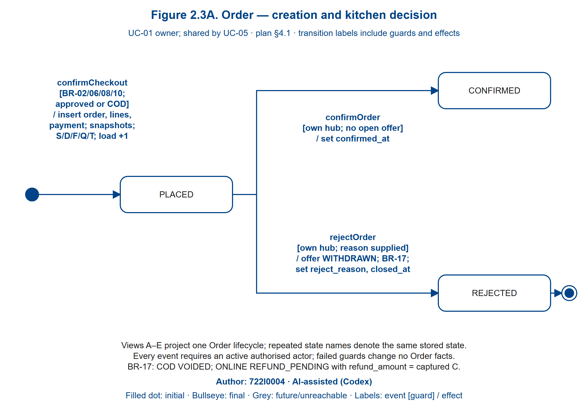

Figure 2.3A. Order — creation and kitchen decision — Author: 722I0004 · AI-assisted (Codex)

[Editable draw.io](../../../models/shared/sm_order.drawio) · [SVG](../../../models/shared/sm_order.svg) · [Generator](../../../models/shared/sm_order.py) · [Data](../../../models/shared/sm_order.json)

| PC/MG anchor | Contract text (verbatim) | Transition / retained fact / refusal invariant |
|---|---|---|
| UC01-PC01 | one PLACED order owned by the customer | confirmCheckout inserts one customer-owned PLACED Order. |
| UC01-PC02 | lines with snapshot names/prices | confirmCheckout inserts OrderLine snapshot name/price/quantity. |
| UC01-PC03 | address snapshot + distance | confirmCheckout stores address snapshot and checked distance. |
| UC01-PC04 | S/D/F/Q/T stored and consistent | confirmCheckout stores the agreed S/D/F/Q/T; BR-09 total identity. |
| UC01-PC05 | payment PENDING (COD) or PAID (ONLINE, amount C) | confirmCheckout creates exactly one COD PENDING or ONLINE PAID payment; see Figure 2.4. |
| UC01-PC06 | hub load +1 | PLACED enters the BR-01 load set; capacity is rechecked in the write transaction. |
| UC01-MG01 | refused/declined/invalid → no order, no payment, no line | Failed checkout guard or declined simulator outcome has no creation transition and saves no Order/Payment/OrderLine. |
| UC01-MG02 | replay → same single order | Replay returns the existing token-owned Order; it never fires the creation transition twice. |
| UC01-MG03 | busy → suggestions, nothing saved | Busy guard refuses creation and returns suggestions; no transition or saved rows. |
| UC05-PC01 | confirm: own-hub PLACED → CONFIRMED | confirmOrder reaches CONFIRMED and sets confirmed_at. |
| UC05-PC02 | reject: REJECTED + reason + BR-17 + offer WITHDRAWN | rejectOrder reaches terminal REJECTED, saves reason/closed_at, withdraws any open offer and applies BR-17. |

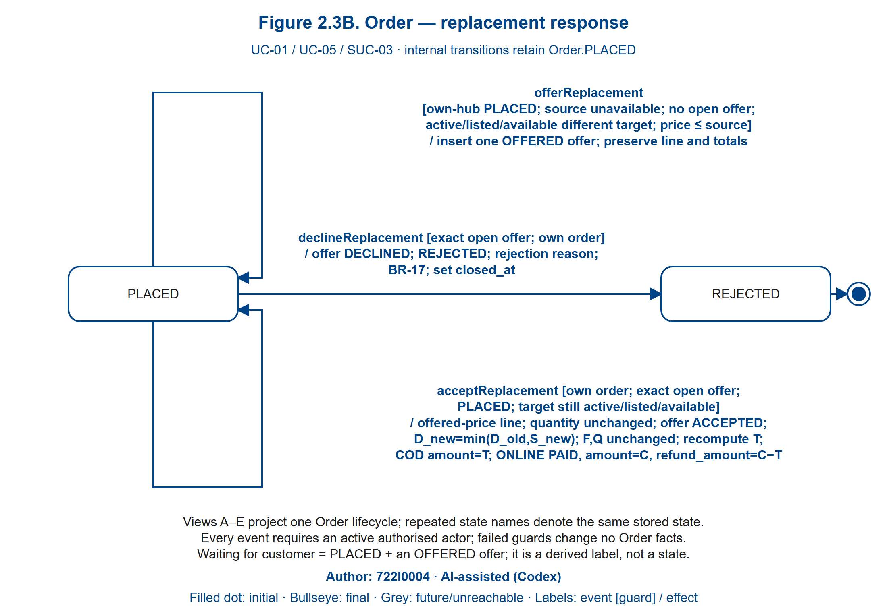

Figure 2.3B. Order — replacement response — Author: 722I0004 · AI-assisted (Codex)

[Editable draw.io](../../../models/shared/sm_order_PartB.drawio) · [SVG](../../../models/shared/sm_order_PartB.svg) · [Generator](../../../models/shared/sm_order_PartB.py) · [Data](../../../models/shared/sm_order_PartB.json)

| PC/MG anchor | Contract text (verbatim) | Transition / retained fact / refusal invariant |
|---|---|---|
| UC05-PC03 | offer: one OFFERED offer per §3.3 | offerReplacement retains PLACED and creates one OFFERED offer. |
| UC05-PC04 | accepted offer applied per §3.3 5–7 | acceptReplacement retains PLACED, applies offered-price line, unchanged quantity, D=min(D_old,S_new), unchanged F/Q, T and payment amounts in one transaction. |
| UC05-MG01 | wrong hub / open offer / stale / invalid target → order unchanged | Wrong hub/open offer/stale request: no Order transition. Invalid target: only the exact offer is WITHDRAWN (Figure 2.7B); Order remains unchanged. |

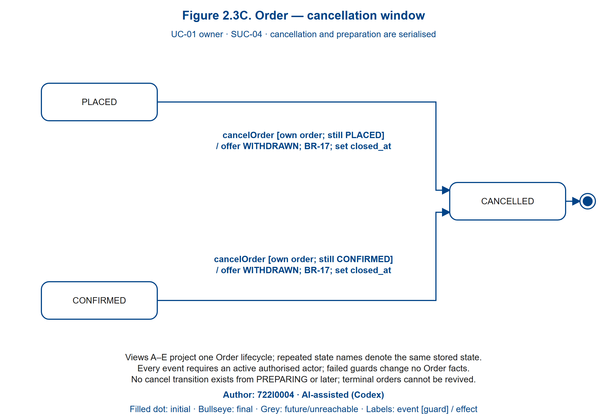

Figure 2.3C. Order — cancellation window — Author: 722I0004 · AI-assisted (Codex)

[Editable draw.io](../../../models/shared/sm_order_PartC.drawio) · [SVG](../../../models/shared/sm_order_PartC.svg) · [Generator](../../../models/shared/sm_order_PartC.py) · [Data](../../../models/shared/sm_order_PartC.json)

| PC/MG anchor / supporting rule | Transition / retained fact / refusal invariant |
|---|---|
| BR-15; BR-17 (SUC-04; no dedicated cancellation anchor in the main-UC P2.3 register) | cancelOrder from own PLACED or CONFIRMED reaches CANCELLED; withdraws an open offer; sets closed_at and COD VOIDED / ONLINE REFUND_PENDING with owed=C. No cancellation transition exists from PREPARING or later. |
| UC01-PC01 / UC01-PC05 (creation-boundary provenance) | Cancellation retains the original Order identity and Payment row; it changes their lifecycle facts. These checkout PCs describe the earlier checkout boundary, not a claim that a cancelled Order remains PLACED/PENDING. |

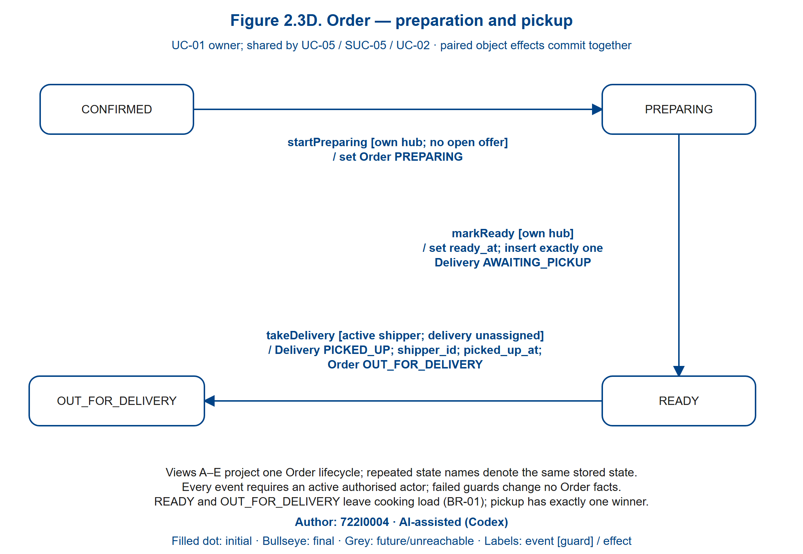

Figure 2.3D. Order — preparation and pickup — Author: 722I0004 · AI-assisted (Codex)

[Editable draw.io](../../../models/shared/sm_order_PartD.drawio) · [SVG](../../../models/shared/sm_order_PartD.svg) · [Generator](../../../models/shared/sm_order_PartD.py) · [Data](../../../models/shared/sm_order_PartD.json)

| PC/MG anchor | Contract text (verbatim) | Transition / retained fact / refusal invariant |
|---|---|---|
| UC02-PC01 | one shipper assigned, Delivery PICKED_UP, order OUT_FOR_DELIVERY | takeDelivery pairs READY → OUT_FOR_DELIVERY with Delivery PICKED_UP, one shipper and picked_up_at. |
| UC02-MG01 | second shipper / wrong shipper / wrong cash / repeat → 0 rows changed | Unassigned guard and atomic claim prevent a second pickup; a refused request changes 0 rows. |

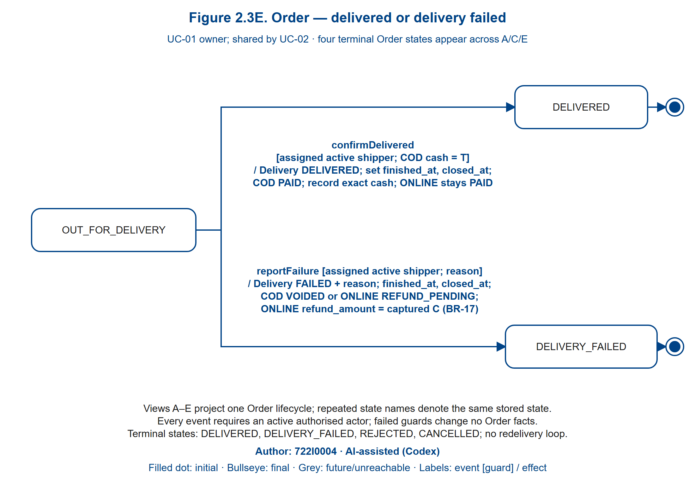

Figure 2.3E. Order — delivered or delivery failed — Author: 722I0004 · AI-assisted (Codex)

[Editable draw.io](../../../models/shared/sm_order_PartE.drawio) · [SVG](../../../models/shared/sm_order_PartE.svg) · [Generator](../../../models/shared/sm_order_PartE.py) · [Data](../../../models/shared/sm_order_PartE.json)

| PC/MG anchor | Contract text (verbatim) | Transition / retained fact / refusal invariant |
|---|---|---|
| UC02-PC02 | delivered: Delivery DELIVERED, order DELIVERED, COD PAID with cash = T | confirmDelivered pairs the two DELIVERED states with finished_at/closed_at and exact COD cash/PAID. |
| UC02-PC03 | failed: Delivery FAILED + reason, order DELIVERY_FAILED, BR-17 | reportFailure pairs DELIVERY_FAILED/FAILED with reason, timestamps and BR-17. |
| UC02-MG01 | second shipper / wrong shipper / wrong cash / repeat → 0 rows changed | Assigned active shipper, exact cash, reason and current-state guards; stale/repeat/wrong actor changes 0 rows. |

<!-- END STATE_MACHINE ORDER -->

<!-- BEGIN STATE_MACHINE PAYMENT -->

## Payment — owning placement: UC-01; UC-02/UC-05/SUC-03/04 cross-reference

Author: 722I0004 · AI-assisted (Codex)

The two payment methods have separate views. C is the original captured ONLINE amount; T is the current payable Order total. A cheaper accepted replacement keeps ONLINE PAID with a partial amount owed as an attribute. Any later unfulfilled terminal outcome replaces that amount with full C. REFUNDED is grey and unreachable because payout is deferred under L3. A declined simulator attempt is shown/logged outside this object lifecycle and creates no Payment.

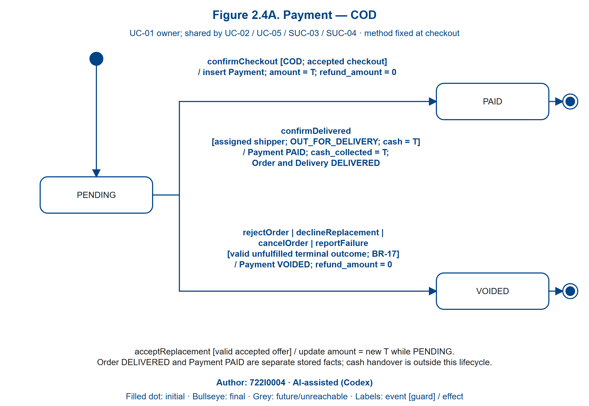

Figure 2.4A. Payment — COD — Author: 722I0004 · AI-assisted (Codex)

[Editable draw.io](../../../models/shared/sm_payment.drawio) · [SVG](../../../models/shared/sm_payment.svg) · [Generator](../../../models/shared/sm_payment.py) · [Data](../../../models/shared/sm_payment.json)

| PC/MG anchor | Contract text (verbatim) | Transition / retained fact / refusal invariant |
|---|---|---|
| UC01-PC05 | payment PENDING (COD) or PAID (ONLINE, amount C) | Accepted COD checkout inserts PENDING with amount=T; valid replacement updates amount to new T without another state. |
| UC01-MG01 | refused/declined/invalid → no order, no payment, no line | A refused checkout has no initial Payment creation transition. |
| UC02-PC02 | delivered: Delivery DELIVERED, order DELIVERED, COD PAID with cash = T | confirmDelivered with exact cash=T changes PENDING → PAID and records cash_collected. |
| UC02-PC03 | failed: Delivery FAILED + reason, order DELIVERY_FAILED, BR-17 | Valid failed delivery changes PENDING → VOIDED under BR-17. |

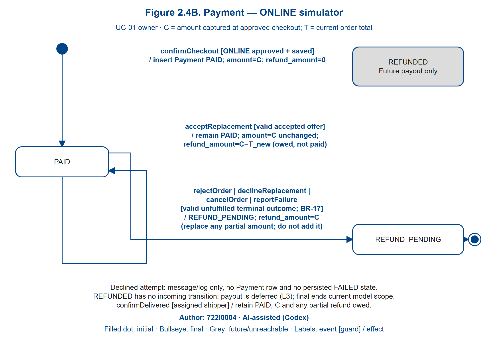

Figure 2.4B. Payment — ONLINE simulator — Author: 722I0004 · AI-assisted (Codex)

[Editable draw.io](../../../models/shared/sm_payment_PartB.drawio) · [SVG](../../../models/shared/sm_payment_PartB.svg) · [Generator](../../../models/shared/sm_payment_PartB.py) · [Data](../../../models/shared/sm_payment_PartB.json)

| PC/MG anchor | Contract text (verbatim) | Transition / retained fact / refusal invariant |
|---|---|---|
| UC01-PC05 | payment PENDING (COD) or PAID (ONLINE, amount C) | Approved ONLINE checkout saves PAID and amount=C (captured), refund_amount=0. |
| UC01-MG01 | refused/declined/invalid → no order, no payment, no line | A decline creates no Payment row; there is no persisted FAILED attempt state. |
| UC05-PC04 | accepted offer applied per §3.3 5–7 | Valid accepted replacement is a PAID self-transition: C unchanged; refund_amount=C−T_new owed. |
| UC05-PC02 | reject: REJECTED + reason + BR-17 + offer WITHDRAWN | Rejection moves PAID → REFUND_PENDING and overwrites refund_amount with full C. |
| UC02-PC03 | failed: Delivery FAILED + reason, order DELIVERY_FAILED, BR-17 | Failed delivery also moves PAID → REFUND_PENDING and sets owed=C, replacing any partial amount. |

<!-- END STATE_MACHINE PAYMENT -->

<!-- BEGIN STATE_MACHINE DELIVERY -->

## Delivery — owning placement: UC-02

Author: 722I0004 · AI-assisted (Codex)

Creation by markReady, pickup and completion are paired with the exact Order transition. Order, Delivery, Payment effects and timestamps succeed together or the operation changes nothing. No redelivery is introduced.

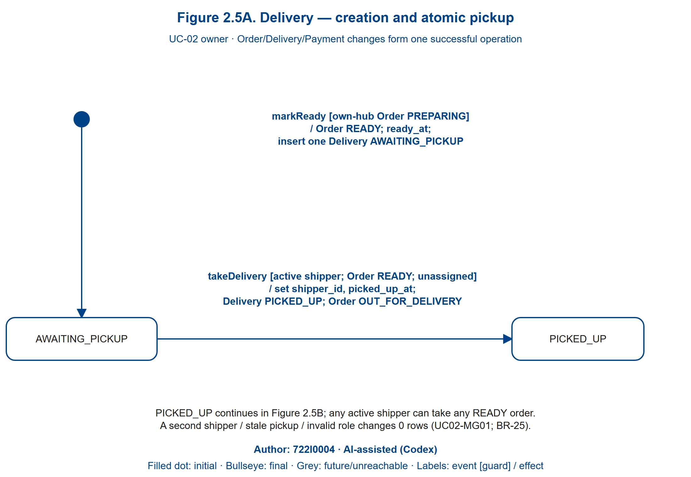

Figure 2.5A. Delivery — creation and atomic pickup — Author: 722I0004 · AI-assisted (Codex)

[Editable draw.io](../../../models/UC-02/sm_delivery.drawio) · [SVG](../../../models/UC-02/sm_delivery.svg) · [Generator](../../../models/UC-02/sm_delivery.py) · [Data](../../../models/UC-02/sm_delivery.json)

| PC/MG anchor | Contract text (verbatim) | Transition / retained fact / refusal invariant |
|---|---|---|
| UC02-PC01 | one shipper assigned, Delivery PICKED_UP, order OUT_FOR_DELIVERY | takeDelivery assigns exactly one active shipper, PICKED_UP, picked_up_at and Order OUT_FOR_DELIVERY together. |
| UC02-MG01 | second shipper / wrong shipper / wrong cash / repeat → 0 rows changed | Second claim / invalid actor / stale state has no transition and changes 0 rows. |

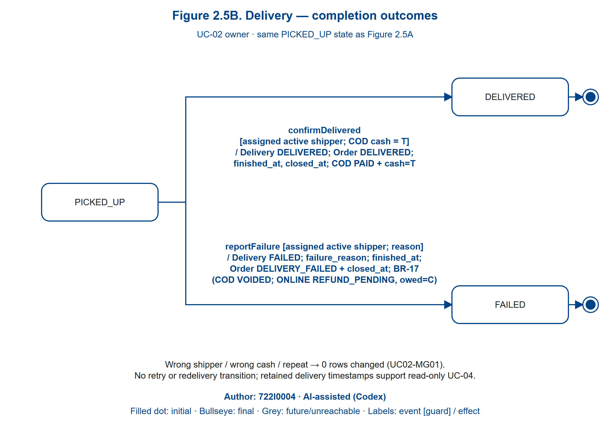

Figure 2.5B. Delivery — completion outcomes — Author: 722I0004 · AI-assisted (Codex)

[Editable draw.io](../../../models/UC-02/sm_delivery_PartB.drawio) · [SVG](../../../models/UC-02/sm_delivery_PartB.svg) · [Generator](../../../models/UC-02/sm_delivery_PartB.py) · [Data](../../../models/UC-02/sm_delivery_PartB.json)

| PC/MG anchor | Contract text (verbatim) | Transition / retained fact / refusal invariant |
|---|---|---|
| UC02-PC02 | delivered: Delivery DELIVERED, order DELIVERED, COD PAID with cash = T | confirmDelivered: Delivery DELIVERED + finished_at; Order DELIVERED + closed_at; exact COD PAID/cash. |
| UC02-PC03 | failed: Delivery FAILED + reason, order DELIVERY_FAILED, BR-17 | reportFailure: Delivery FAILED + failure_reason/finished_at; Order DELIVERY_FAILED + closed_at; BR-17 Payment effect. |
| UC02-MG01 | second shipper / wrong shipper / wrong cash / repeat → 0 rows changed | Wrong shipper, wrong cash, repeated completion: no transition and 0 rows changed. |

<!-- END STATE_MACHINE DELIVERY -->

<!-- BEGIN STATE_MACHINE HUB -->

## Hub — owning placement: UC-03

Author: 722I0004 · AI-assisted (Codex)

BUSY and QUIET are derived classifications inside ACTIVE, not persisted lifecycle values. Lowering capacity below current load is allowed; lowering it below one is refused. Archive requires no open order (every state outside the four terminal Order states is open).

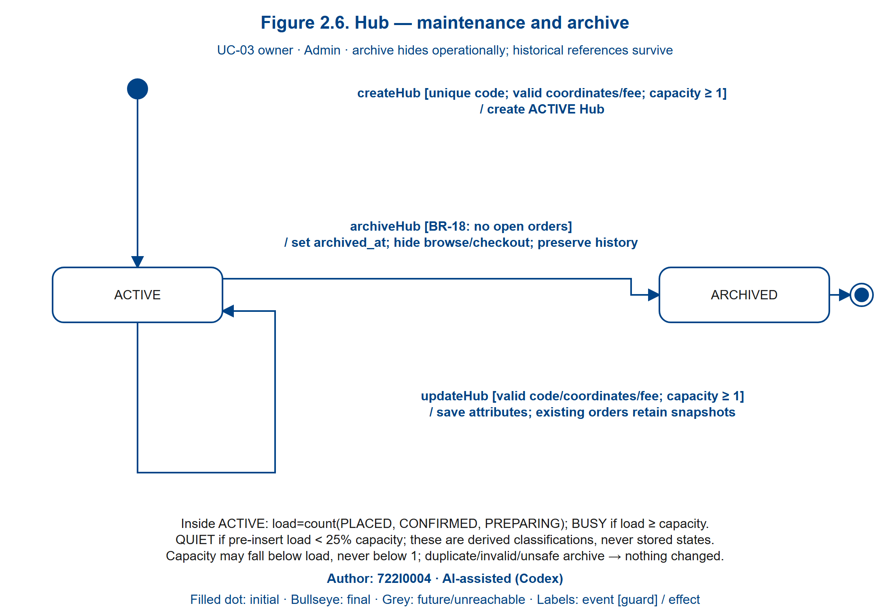

Figure 2.6. Hub — maintenance and archive — Author: 722I0004 · AI-assisted (Codex)

[Editable draw.io](../../../models/UC-03/sm_hub.drawio) · [SVG](../../../models/UC-03/sm_hub.svg) · [Generator](../../../models/UC-03/sm_hub.py) · [Data](../../../models/UC-03/sm_hub.json)

| PC/MG anchor | Contract text (verbatim) | Transition / retained fact / refusal invariant |
|---|---|---|
| UC03-PC01 | hub created/updated with valid code, coordinates, fee, capacity | createHub enters ACTIVE; updateHub self-transition saves validated code/coordinates/fee/capacity. |
| UC03-PC02 | archived hub hidden from browse/checkout, visible in history/reports | archiveHub enters ARCHIVED (archived_at); operational browse/checkout excludes it; historical/report records remain. |
| UC03-MG01 | duplicate code / capacity < 1 / archive with open order → nothing changed | Uniqueness, capacity≥1 and no-open-orders guards prevent mutation on refusal. |

<!-- END STATE_MACHINE HUB -->

<!-- BEGIN STATE_MACHINE REPLACEMENT_OFFER -->

## Replacement Offer — owning placement: UC-05; SUC-03 customer answer

Author: 722I0004 · AI-assisted (Codex)

Each offer has its own identity and history. At most one may be OFFERED for an Order. ACCEPTED, DECLINED and WITHDRAWN are terminal for that offer. Invalid-target acceptance withdraws the offer only; the minimum guarantee concerns the unchanged Order.

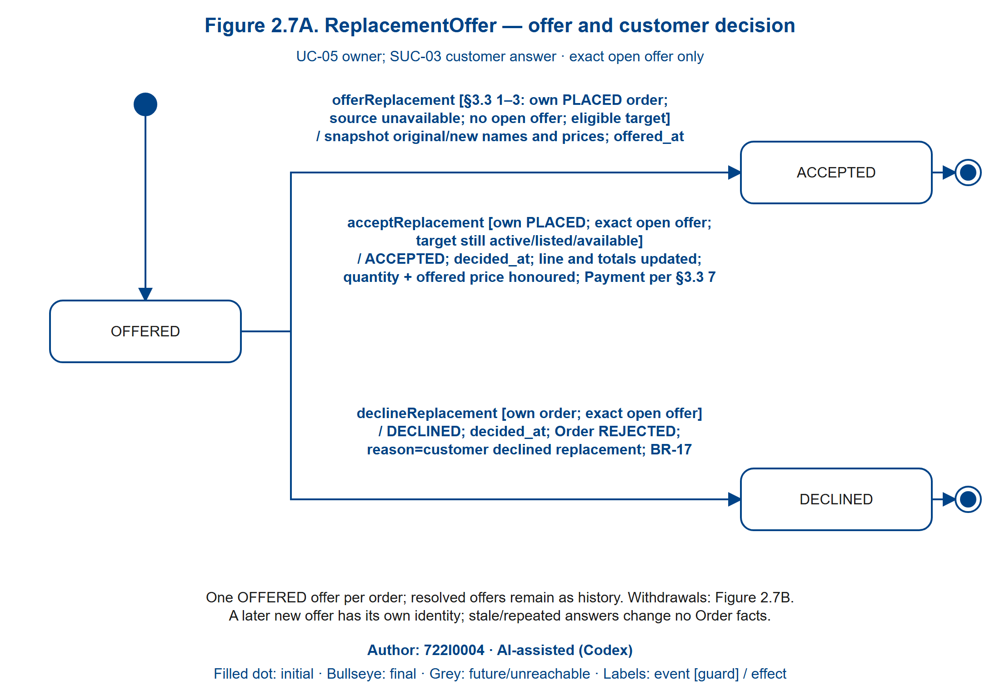

Figure 2.7A. ReplacementOffer — offer and customer decision — Author: 722I0004 · AI-assisted (Codex)

[Editable draw.io](../../../models/UC-05/sm_replacement_offer.drawio) · [SVG](../../../models/UC-05/sm_replacement_offer.svg) · [Generator](../../../models/UC-05/sm_replacement_offer.py) · [Data](../../../models/UC-05/sm_replacement_offer.json)

| PC/MG anchor | Contract text (verbatim) | Transition / retained fact / refusal invariant |
|---|---|---|
| UC05-PC03 | offer: one OFFERED offer per §3.3 | offerReplacement creates one OFFERED offer, original/new snapshot values and offered_at. |
| UC05-PC04 | accepted offer applied per §3.3 5–7 | acceptReplacement enters ACCEPTED, sets decided_at and applies Order/payment effects from §3.3 5–7. |
| UC05-MG01 | wrong hub / open offer / stale / invalid target → order unchanged | Stale/repeated answer or wrong owner leaves Order unchanged; the valid-target recheck routes invalid target to Figure 2.7B. |

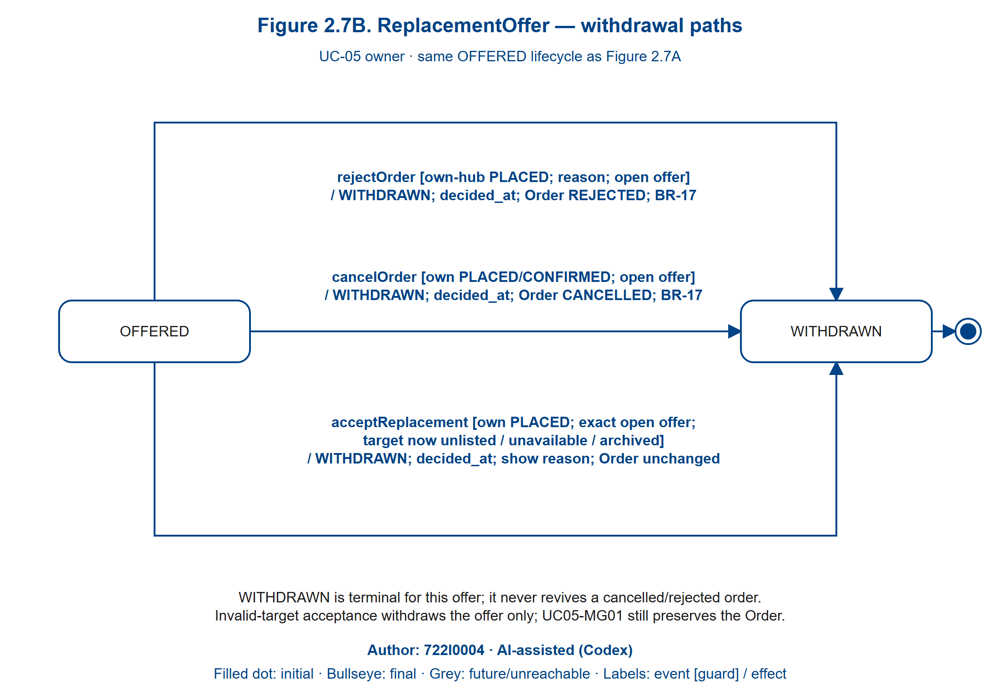

Figure 2.7B. ReplacementOffer — withdrawal paths — Author: 722I0004 · AI-assisted (Codex)

[Editable draw.io](../../../models/UC-05/sm_replacement_offer_PartB.drawio) · [SVG](../../../models/UC-05/sm_replacement_offer_PartB.svg) · [Generator](../../../models/UC-05/sm_replacement_offer_PartB.py) · [Data](../../../models/UC-05/sm_replacement_offer_PartB.json)

| PC/MG anchor | Contract text (verbatim) | Transition / retained fact / refusal invariant |
|---|---|---|
| UC05-PC02 | reject: REJECTED + reason + BR-17 + offer WITHDRAWN | rejectOrder withdraws an open offer with decided_at while Order reaches REJECTED, reason and BR-17. |
| UC05-MG01 | wrong hub / open offer / stale / invalid target → order unchanged | Invalid target on exact-open accept withdraws only the offer with a reason, without changing Order lines/state/totals. |

<!-- END STATE_MACHINE REPLACEMENT_OFFER -->

<!-- BEGIN STATE_MACHINE CATALOGUE -->

## Catalogue — owning placement: UC-06; SUC-06 availability support

Author: 722I0004 · AI-assisted (Codex)

Brand and MenuItem each have ACTIVE → ARCHIVED lifecycles; HubMenuItem owns availability per hub and ends when unlisted. An archived parent is excluded operationally regardless of a retained listing flag. Existing OrderLine snapshot prices/names survive catalogue maintenance.

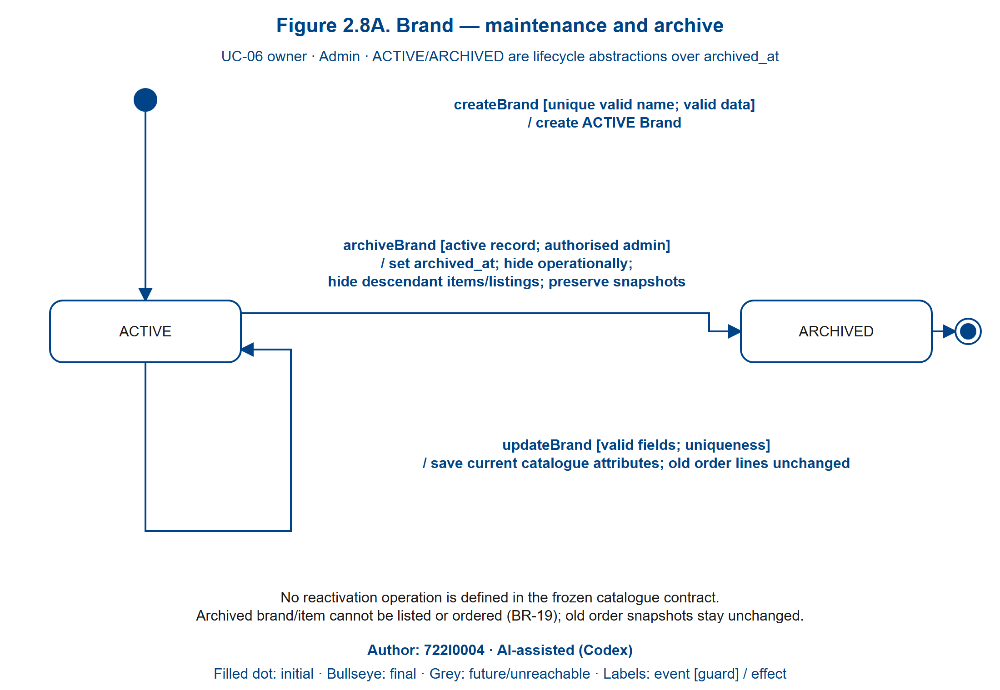

Figure 2.8A. Brand — maintenance and archive — Author: 722I0004 · AI-assisted (Codex)

[Editable draw.io](../../../models/UC-06/sm_catalogue.drawio) · [SVG](../../../models/UC-06/sm_catalogue.svg) · [Generator](../../../models/UC-06/sm_catalogue.py) · [Data](../../../models/UC-06/sm_catalogue.json)

| PC/MG anchor | Contract text (verbatim) | Transition / retained fact / refusal invariant |
|---|---|---|
| UC06-PC01 | brand/item created, updated, archived | createBrand/updateBrand/archiveBrand: ACTIVE creation, ACTIVE self-update, terminal ARCHIVED. |
| UC06-PC03 | archived/sold-out items not orderable | Archived Brand and descendant items/listings are hidden from operational ordering. |
| UC06-MG01 | old order lines unchanged after price change/archive | Archive/update touches catalogue facts only; existing OrderLine snapshots are retained. |
| UC06-MG02 | duplicates/invalid prices refused | Uniqueness and validity guards refuse duplicate/invalid creates/updates. |

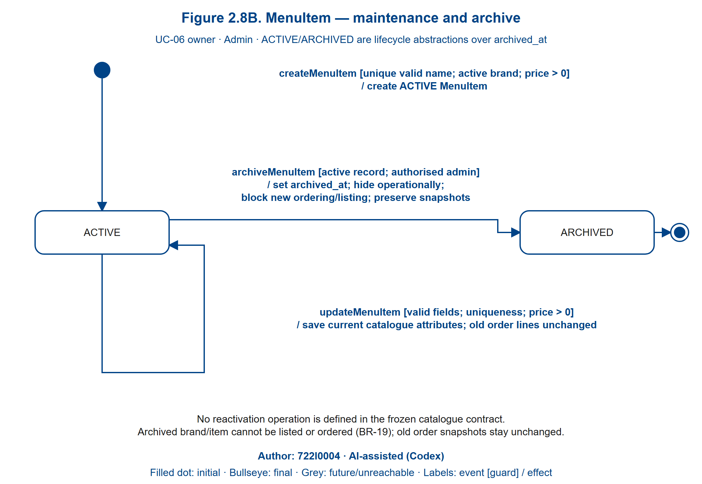

Figure 2.8B. MenuItem — maintenance and archive — Author: 722I0004 · AI-assisted (Codex)

[Editable draw.io](../../../models/UC-06/sm_catalogue_PartB.drawio) · [SVG](../../../models/UC-06/sm_catalogue_PartB.svg) · [Generator](../../../models/UC-06/sm_catalogue_PartB.py) · [Data](../../../models/UC-06/sm_catalogue_PartB.json)

| PC/MG anchor | Contract text (verbatim) | Transition / retained fact / refusal invariant |
|---|---|---|
| UC06-PC01 | brand/item created, updated, archived | createMenuItem/updateMenuItem/archiveMenuItem: ACTIVE creation, update and ARCHIVED. |
| UC06-PC03 | archived/sold-out items not orderable | Archived item cannot be listed or ordered even if a retained listing flag is true. |
| UC06-MG01 | old order lines unchanged after price change/archive | Price/archive changes never rewrite OrderLine snapshots. |
| UC06-MG02 | duplicates/invalid prices refused | Active-parent, unique name and price>0 guards refuse invalid writes. |

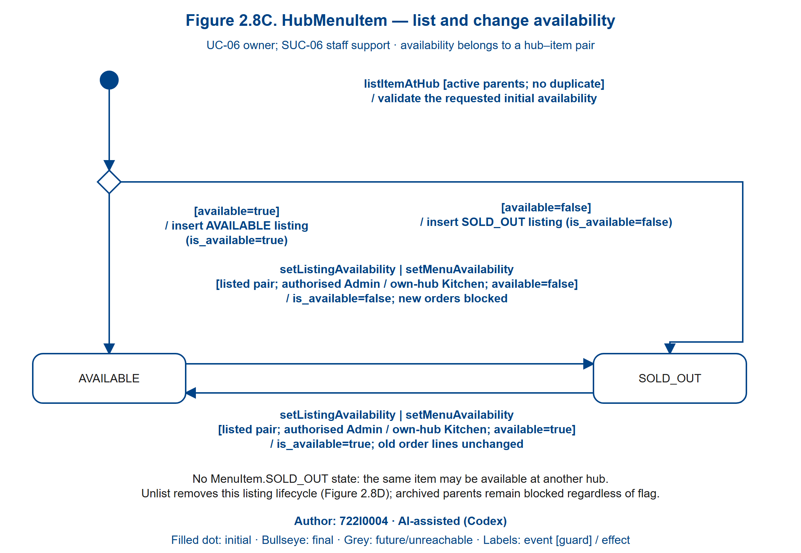

Figure 2.8C. HubMenuItem — list and change availability — Author: 722I0004 · AI-assisted (Codex)

[Editable draw.io](../../../models/UC-06/sm_catalogue_PartC.drawio) · [SVG](../../../models/UC-06/sm_catalogue_PartC.svg) · [Generator](../../../models/UC-06/sm_catalogue_PartC.py) · [Data](../../../models/UC-06/sm_catalogue_PartC.json)

| PC/MG anchor | Contract text (verbatim) | Transition / retained fact / refusal invariant |
|---|---|---|
| UC06-PC02 | listing added/removed, availability per hub | listItemAtHub creates a per-hub listing; setListingAvailability / setMenuAvailability switches AVAILABLE ↔ SOLD_OUT. |
| UC06-PC03 | archived/sold-out items not orderable | New ordering requires active parents and AVAILABLE listing; SOLD_OUT or archived parents fail the ordering guard. |
| UC06-MG01 | old order lines unchanged after price change/archive | Availability changes do not rewrite existing OrderLine snapshots. |
| UC06-MG02 | duplicates/invalid prices refused | Duplicate pair / inactive parent / invalid listing inputs do not create a listing. |

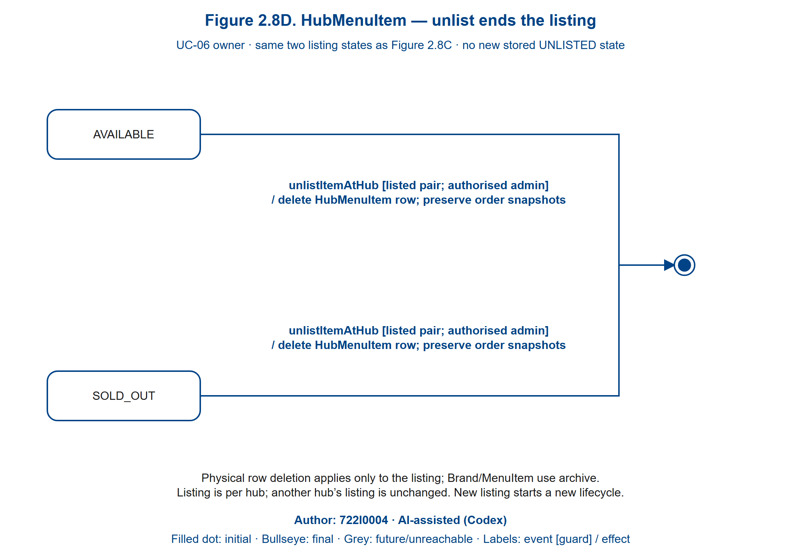

Figure 2.8D. HubMenuItem — unlist ends the listing — Author: 722I0004 · AI-assisted (Codex)

[Editable draw.io](../../../models/UC-06/sm_catalogue_PartD.drawio) · [SVG](../../../models/UC-06/sm_catalogue_PartD.svg) · [Generator](../../../models/UC-06/sm_catalogue_PartD.py) · [Data](../../../models/UC-06/sm_catalogue_PartD.json)

| PC/MG anchor | Contract text (verbatim) | Transition / retained fact / refusal invariant |
|---|---|---|
| UC06-PC02 | listing added/removed, availability per hub | unlistItemAtHub ends the listing by row deletion; no stored UNLISTED state. |
| UC06-MG01 | old order lines unchanged after price change/archive | Unlist preserves existing OrderLine snapshots and does not alter another hub’s listing. |

<!-- END STATE_MACHINE CATALOGUE -->

<!-- BEGIN STATE_MACHINE USER_ACCOUNT -->

## User Account — owning placement: UC-03 placement; shared SUC-08/SUC-02 account support

Author: 722I0004 · AI-assisted (Codex)

This is shared supporting account behaviour, placed under UC-03 as instructed by the assembly contract; Hub does not own UserAccount. SUC-02 registration and SUC-08 staff creation start ACTIVE; SUC-08 changes ACTIVE ↔ INACTIVE. BR-25 forbids deactivating a shipper holding a PICKED_UP delivery. An inactive account’s existing session is refused on the next request. No account termination event exists in Part 2, so the shown final pseudostate is explicitly unreachable; no deletion transition is invented.

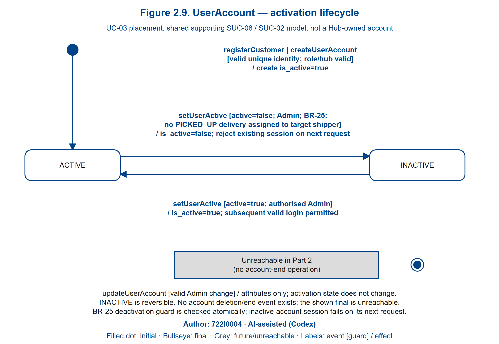

Figure 2.9. UserAccount — activation lifecycle — Author: 722I0004 · AI-assisted (Codex)

[Editable draw.io](../../../models/shared/sm_user_account.drawio) · [SVG](../../../models/shared/sm_user_account.svg) · [Generator](../../../models/shared/sm_user_account.py) · [Data](../../../models/shared/sm_user_account.json)

| PC/MG anchor | Contract text (verbatim) | Transition / retained fact / refusal invariant |
|---|---|---|
| UC02-MG01 | second shipper / wrong shipper / wrong cash / repeat → 0 rows changed | Active-role checks are prerequisite guards for pickup/completion; refused inactive actor changes no delivery/order/payment rows. |

| Supporting rule | Transition / fact / invariant |
|---|---|
| BR-25 / SUC-08 | setUserActive(false) is refused while the target shipper holds a PICKED_UP delivery; no account mutation occurs. Recheck at the mutation boundary. |
| Plan §4.4 / SUC-01 | is_active=false rejects an existing session on its next request; logIn/logOut change the session, not persisted account activation state. |
| OP-47/55/56/57 | registerCustomer/createUserAccount create ACTIVE; updateUserAccount edits attributes only; setUserActive toggles the activation flag. No new operation name is introduced. |

<!-- END STATE_MACHINE USER_ACCOUNT -->

<!-- BEGIN STATE_MACHINE UC04_READ_ONLY -->

## UC-04 — read-only cross-reference; no Report lifecycle

Author: 722I0004 · AI-assisted (Codex)

UC-04 reads Order (Figures 2.3A–E), Payment (2.4A–B), Delivery (2.5A–B) and Hub workload facts (2.6). ReportFilter, rows and receipt are computed views. A report request does not create a persistent Report object or fire any lifecycle transition.

| PC/MG anchor | Contract text (verbatim) | Transition / retained fact / refusal invariant |
|---|---|---|
| UC04-PC01 | sales, workload, performance equal the hand oracle for the filter | salesReport/workloadReport/deliveryReport read stored Order totals, terminal states, timestamps, Payment owed amounts and Delivery facts; query result must later match the independent hand oracle. |
| UC04-PC02 | n/a on empty denominators | A computed zero-denominator delivery metric returns n/a; no stored state is required. |
| UC04-MG01 | 0 rows written by any report request | Every report operation reads only; no state transition, insert, update or archive. |
| UC04-MG02 | non-manager denied | Role guard refuses a non-manager before a report result; no state transition. |

<!-- END STATE_MACHINE UC04_READ_ONLY -->

## Static representation cross-check and P4 inputs

The locked analysis contract controls the diagrams. The following observations come from direct reads of `saigonbite/business/domain/enums.py`, `models.py` and `db/schema.sql`; no code/schema was changed and no application correctness is inferred.

| Object | Diagram vocabulary | Draft enum / SQL representation | Static difference / P4 input |
|---|---|---|---|
| Order | All nine §4.1 states | OrderState and orders.state CHECK contain the same nine strings. | No state-name mismatch. Domain transition table models state changes; offer/accept PLACED self-effects remain operation effects. |
| Payment | COD PENDING→PAID/VOIDED; ONLINE PAID→REFUND_PENDING; grey future REFUNDED | PaymentState and payment.state CHECK additionally allow FAILED and REFUNDED. models.py PAYMENT_TRANSITIONS permits REFUND_PENDING→REFUNDED. | FAILED must remain attempt-only with no row; future REFUNDED must be unreachable in current scope. P4 must prove method-specific legality and no payout dispatch; generic table/SQL allow broader combinations. |
| Payment owed amount | BR-17 sets refund_amount=C atomically | models.py release_for_unfulfilled_order() changes state only. | Confirmed Static F-02: full owed amount is not set here; reject/cancel/decline/failure after any partial amount need P4 correction and tests. |
| Delivery | AWAITING_PICKUP/PICKED_UP/DELIVERED/FAILED | DeliveryState and delivery.state CHECK match exactly. | SQL checks assignment when not AWAITING_PICKUP and requires a failure reason, but paired Order/Payment effects, exact cash and timestamp atomicity are behavioural obligations for P4. |
| ReplacementOffer | OFFERED/ACCEPTED/DECLINED/WITHDRAWN | OfferState, SQL CHECK and OFFER_TRANSITIONS match. | SQL partial UNIQUE limits one OFFERED/order; source unavailability and target revalidation are behavioural P4 obligations (plan F-05). Withdrawal reason is shown as an operation result; there is no dedicated reason attribute/column in the draft offer, so persisted withdrawal-reason history is not asserted. |
| Hub / Brand / MenuItem | ACTIVE/ARCHIVED | No lifecycle enum/SQL state CHECK; nullable archived_at in dataclasses and tables. | Intentional representation: NULL→ACTIVE, non-NULL→ARCHIVED; no need to invent a state column. Parent archive visibility and Hub no-open-order guard require P4 verification. |
| HubMenuItem | AVAILABLE/SOLD_OUT; final on unlist | No availability enum; HubMenuItem.is_available / SQL hub_menu_item.is_available CHECK IN(0,1); composite pair key; row deletion on unlist. | Intentional representation: 1→AVAILABLE, 0→SOLD_OUT. Plan §5.3 shorthand `available` differs from actual `is_available`; P3/P4 must retain the explicit mapping. |
| UserAccount | ACTIVE/INACTIVE | No activation enum; UserAccount.is_active / SQL user_account.is_active CHECK IN(0,1). | Intentional representation: 1→ACTIVE, 0→INACTIVE. Plan §5.3 shorthand `active` differs from `is_active`; next-request invalidation and BR-25 guard require P4 verification. Plan §5.3 also names created_at, which the draft UserAccount/dataclass/table omit. |

Lifecycle completion does not archive or delete Order, Payment, Delivery or ReplacementOffer. SUC-09 adds an archive visibility fact after terminal Order states, preserving history/receipt/reports; archive is not another Order.state enum value.

Primary authority: locked plan §§2–5/P2.3; report template §2.2; requirements PDF §2.1 and state-machine checklist; marking workbook Checklist item 17/Rubric Guide P2-II. Authorship follows D-1/J2: 722I0004 authored all seven models with Codex assistance; per-student item 17 remains Partial for the team, not satisfied for the other two members.
