# II. System Requirements Analysis (15 marks)

Author: 722I0004 · AI-assisted (Codex)

## 2.1 Translate from Business Use Case

Author: 722I0004 · AI-assisted (Codex)

This section describes the proposed Part 2 system contract. It does not claim that planned features are already implemented. Use-case serving links below record scope coverage; Figure 2.1 owns any UML «include» or «extend» choices.

### 2.1.1 System Narrative

Author: 722I0004 · AI-assisted (Codex)

SaigonBite's proposed platform coordinates a delivery order from customer selection through a cloud kitchen and a shipper, then gives managers read-only views of the same operational records. A Customer can register as a local customer or tourist, maintain a profile and delivery addresses, browse active hubs and their brands and available items, and request a full quote for one hub and address. The quote shows the item subtotal (S), voucher discount (D), delivery fee (F), quiet-hub incentive (Q), total (T), and chosen payment method. At most one voucher can be used. Local customers require a Vietnamese mobile number and may choose COD, an e-wallet, or bank QR; tourists provide passport number, nationality and email, may use an optional phone and a hotel address label, and may choose COD or an international card. Passport information is visible only to the customer and Admin, not kitchen or shipper screens. Tourist menu translation is outside this release.

Before checkout saves anything, the system rechecks hub capacity, distance, availability, voucher validity, payment choice and the quote fingerprint. The distance shown is approximate, from hub coordinates to the delivery district's centroid; the raw value is checked before display rounding. The current team default accepts a raw distance of at most 8.0 km and refuses a greater distance; a busy hub may suggest up to three active, non-busy alternatives within range. These figures and related pricing rules are team defaults, not client-confirmed values. A busy result, out-of-range address, invalid or expired voucher, unavailable item, or changed quote does not create an order; a changed quote is shown again for consent. COD creates a pending payment. Online payment uses the team's labelled simulator, not a live provider or card processing: a decline creates no order, payment or line and lets the customer retry or switch to COD. The customer chooses approve/decline before the transaction; its short deterministic decision and all writes occur inside checkout. A failure through COMMIT releases simulated authorization and saves nothing (BR-14). If the simulator approves and the accepted quote still matches, checkout records one PLACED order with item and address snapshots, the full S/D/F/Q/T breakdown, the payment result, and one increase in hub load. Replaying the same customer's checkout token returns that customer's existing order rather than creating another.

Kitchen staff work only on orders for their own hub. For a PLACED order they can confirm it or reject it with a reason. Rejection ends the order as REJECTED and withdraws an open replacement offer; COD is voided, while an online amount is recorded as fully owed back in REFUND_PENDING. If an item becomes unavailable after placement, kitchen staff may offer one eligible replacement for a line. The customer sees the original and proposed item, quantity, revised total and any online refund owed before answering. A valid acceptance changes the line at the offered price; COD payable becomes the new total, while ONLINE remains PAID with the difference recorded as refund owed, not paid out. If the target is no longer valid, the offer is withdrawn and the order is unchanged. A decline ends the order as REJECTED with the same unfulfilled-payment handling. Kitchen staff cannot confirm or start preparation while an offer is open. Customers can track their own orders, view a receipt and cancel only while an order is PLACED or CONFIRMED. Cancellation withdraws any open offer; COD is voided and an online amount is fully owed back. Cancellation is unavailable once preparation has started.

After confirmation, kitchen staff move an order to PREPARING and then READY. Marking it ready creates a delivery waiting for pickup. An active Shipper may take an unassigned READY order; that assignment moves the order to OUT_FOR_DELIVERY. The assigned shipper records delivery completion or a failure reason. For COD, delivery is completed only when the cash collected equals T; success sets the order and delivery to DELIVERED and the payment to PAID. Failure sets the order to DELIVERY_FAILED and delivery to FAILED; the shipper returns the food, COD is voided and an online amount is fully owed back. A separate end-of-shift cash handover and office reconciliation remain outside the software scope.

Admin maintains hubs and capacity, brands, menu items and hub listings, vouchers, and user accounts; Admin can archive closed orders and retrieve their history. Hub archiving is refused while it has an open order, and catalogue changes do not alter existing order snapshots. Kitchen staff can change availability only for listings at their own hub. A Manager requests sales, current workload, or delivery-performance reports; the reports read shared records, apply the stated filters, and write no business rows. Complaint handling and refund decisions, paying out refunds, and customer ratings remain deferred core features under the proposed L3 default. This is a pending scope decision, not lecturer approval. Future loyalty, subscriptions, group orders and scheduled orders are outside the current release.

The analysis follows the locked plan's defaults while the planned lecturer clarifications remain unanswered in the preflight record. Defaults are not approvals: in particular, strict CRUD paths for every persistent class (L1), the online simulator (L2), the proposed deferral of complaint/refund/rating work (L3), and full AI disclosure (L6) must not be described as lecturer-confirmed.

### 2.1.2 Users and Their Goals

Author: 722I0004 · AI-assisted (Codex)

| User | Goals | Use cases |
|---|---|---|
| Customer — local or tourist | Register and maintain the correct customer details and addresses; browse hub-specific availability; see and accept a full price before ordering; pay by an eligible method; track orders, answer a replacement offer, view a receipt, and cancel while permitted. | UC-01; SUC-01–SUC-04 |
| Kitchen staff | See incoming orders for their own hub; confirm, reject or offer an eligible replacement; prepare orders, mark them ready, and maintain that hub's item availability. | UC-05; SUC-01, SUC-05, SUC-06 |
| Shipper | See ready work, take an unassigned delivery, record delivery and exact COD cash, or report a failure. | UC-02; SUC-01 |
| Admin | Maintain hub capacity, brands, menu items, hub listings, vouchers and staff accounts; deactivate/reactivate accounts; archive closed orders and read their history. | UC-03, UC-06; SUC-01, SUC-07–SUC-09 |
| Manager | Review operational sales, current hub workload and delivery performance from shared order and delivery records. | UC-04; SUC-01 |

### 2.1.3 List of Events

Author: 722I0004 · AI-assisted (Codex)

The 12 lifecycle rows use the exact operation names in plan §4. They are **External** events because an actor command triggers each change; the new state is the response, not an autonomous state-event handler. Voucher date boundaries are temporal conditions checked on demand. No scheduler, independent state-event handler or database actor is assumed.

| # | Event | Type | Trigger | Source | Use case | Response | Destination |
|---:|---|---|---|---|---|---|---|
| 1 | `browseHubs` / `selectHub` / `requestQuote` | External | Customer selects an address, hub and lines and asks for a quote. | Customer | UC-01 | Show active hubs, hub-specific availability and a full quote; refuse out-of-range or invalid selections; for a busy hub show eligible alternatives, possibly none. | Customer |
| 2 | Online simulator decline | External | Customer previously chooses the simulated decline outcome; confirmCheckout evaluates that deterministic decision before persistence. | Customer; Payment simulator | UC-01 | Show the decline; create no order, payment or line; allow retry or a COD choice. | Customer |
| 3 | `confirmCheckout` → order becomes PLACED | External | Customer confirms the full quote and chooses COD or ONLINE; the deterministic simulator decision and all guards are evaluated within checkout before persistence. | Customer; Payment simulator for ONLINE | UC-01 | Save one PLACED order, snapshots, S/D/F/Q/T and payment; increase hub load once, or return the existing order on same-customer replay. | Customer; Kitchen staff at the order's hub |
| 4 | `confirmOrder` → order becomes CONFIRMED | External | Kitchen staff confirms an own-hub PLACED order with no open offer. | Kitchen staff | UC-05 | Save CONFIRMED and show the updated order status. | Customer; Kitchen staff |
| 5 | `rejectOrder` → order becomes REJECTED | External | Kitchen staff rejects an own-hub PLACED order and gives a reason. | Kitchen staff | UC-05 | Save REJECTED and the reason; withdraw an open offer; void COD or record the full online refund as REFUND_PENDING. | Customer |
| 6 | `offerReplacement` → offer becomes OFFERED | External | Kitchen staff selects an eligible replacement for a currently unavailable line on an own-hub PLACED order. | Kitchen staff | UC-05 | Save one open offer with original and proposed snapshots; block confirm/preparation until it is resolved. | Customer; Kitchen staff |
| 7 | `acceptReplacement` → offer becomes ACCEPTED | External | Customer accepts the exact open offer while the order is PLACED and the target remains valid. | Customer | SUC-03; UC-05 | Apply the offered price and recalculate the order under §3.3; if the target became invalid, withdraw the offer and leave the order unchanged. | Customer; Kitchen staff |
| 8 | `declineReplacement` → order becomes REJECTED | External | Customer declines the exact open offer. | Customer | SUC-03; UC-05 | Save REJECTED; apply BR-17 to payment; reject stale or repeated answers without changing rows. | Customer |
| 9 | `cancelOrder` → order becomes CANCELLED | External | Customer cancels their own PLACED or CONFIRMED order. | Customer | SUC-04; UC-01 | Save CANCELLED, withdraw an open offer, and apply BR-17; refuse cancellation after PREPARING. | Customer; Kitchen staff |
| 10 | `startPreparing` → order becomes PREPARING | External | Kitchen staff starts an own-hub CONFIRMED order with no open offer. | Kitchen staff | SUC-05; UC-05 | Save PREPARING; refuse an order in another state or hub. | Customer; Kitchen staff |
| 11 | `markReady` → order READY; delivery AWAITING_PICKUP | External | Kitchen staff marks an own-hub PREPARING order ready. | Kitchen staff | SUC-05; UC-02 | Save READY and create its delivery as AWAITING_PICKUP. | Shipper; Customer |
| 12 | `takeDelivery` → order OUT_FOR_DELIVERY; delivery PICKED_UP | External | Active shipper takes an unassigned READY order. | Shipper | UC-02 | Assign one shipper and save pickup time; refuse a competing or repeated pickup without changing rows. | Assigned Shipper; Customer |
| 13 | `confirmDelivered` → order and delivery DELIVERED | External | Assigned shipper records successful delivery; COD cash, if applicable, equals T. | Assigned Shipper | UC-02 | Save DELIVERED and finish time; set COD PAID only for the exact amount. | Customer; Manager's reports |
| 14 | `reportFailure` → order DELIVERY_FAILED; delivery FAILED | External | Assigned shipper reports a failed delivery with a reason. | Assigned Shipper | UC-02 | Save failure reason and finish time; apply BR-17; refuse wrong-shipper or repeated completion without changes. | Customer; Manager's reports |
| 15 | `logIn` / `logOut`; `registerCustomer` / `updateProfile` / address management | External | A human actor authenticates or ends a session; a Customer registers or changes their own profile/address. | Human actor; Customer | SUC-01; SUC-02 | Establish or end the role session; validate Local/Tourist fields and save only the customer's own records. | Requesting actor; Customer |
| 16 | `viewMyOrders` / `viewReceipt` / `viewReplacement` | External | Customer requests only their own order history, receipt or open offer details. | Customer | SUC-03; UC-01; UC-05 | Show authorized status, receipt fields, or replacement comparison and amount owed; deny another customer's order. | Customer |
| 17 | Hub, capacity, catalogue and listing maintenance | External | Admin changes a hub or catalogue/listing; Kitchen staff changes availability at their own hub. | Admin; Kitchen staff | UC-03; UC-06; SUC-06 | Save valid changes; refuse hub archive with open orders; preserve order snapshots and restrict kitchen availability changes to the actor's hub. | Admin; Kitchen staff; affected customer browsing/checkout |
| 18 | Voucher, user-account and closed-order maintenance | External | Admin creates/updates/archives a voucher or account, changes account status, or archives/retrieves a closed order. | Admin | SUC-07; SUC-08; SUC-09 | Apply BR-08, BR-12, BR-25 and terminal-order guards; preserve authorized archived history. | Admin; Customer or staff on their next request |
| 19 | Voucher `valid_from` / `valid_until` boundary | Temporal | A quote, checkout or Admin voucher request arrives on a relevant Vietnam calendar date. | Vietnam calendar date | UC-01; SUC-07 | Check inclusive validity on demand; an invalid voucher is refused for that request. No scheduled job or automatic state change runs. | Customer; Admin |
| 20 | `salesReport` / `workloadReport` / `deliveryReport` | External | Manager requests a report with permitted filters. | Manager | UC-04 | Return the read-only operational figures or a controlled filter/access response; write no business rows. | Manager |

### 2.1.4 List of Actors

Author: 722I0004 · AI-assisted (Codex)

| Actor | Description |
|---|---|
| Customer | General actor for a person using the customer-facing functions; it is specialized into Local customer and Tourist customer, which inherit the Customer goals. |
| Local customer | A Customer who must register a Vietnamese mobile number and may pay COD, by e-wallet, or by bank QR. |
| Tourist customer | A Customer who registers passport number, nationality and email, may provide a phone and label an address as a hotel, and may pay COD or by international card. Passport details are withheld from kitchen and shipper views. |
| Kitchen staff | An authenticated worker assigned to a hub; may view and change orders only for that hub and may set its listing availability. |
| Shipper | An active delivery worker who may take any unassigned READY order; only the assigned shipper may complete it or report its failure. |
| Admin | An authenticated administrator responsible for hub, catalogue, voucher and user-account maintenance and closed-order archiving. |
| Manager | An authenticated read-only report user for sales, workload and delivery performance. |
| Payment simulator | An external system boundary representing the team's deterministic online-payment stub. It returns approve or decline for an eligible option; it is not a live provider and does not process real card data or real funds. |

There is no time-based actor: voucher dates are checked on demand and no scheduler performs expiry work. Office staff are not actors in this release because complaint/refund decisions and cash reconciliation are outside the proposed system scope; the deferral of complaint and refund features remains pending L3, not approved.

### 2.1.5 List of Use Cases and Ownership

Author: 722I0004 · AI-assisted (Codex)

The proposal-owner column preserves the six use-case selections made in the proposal. The actual-author column records the work completed for this Part 2 analysis. The six artifacts in this section are authored by 722I0004; this does not claim work by another team member. Use-case serving links are coverage references only; see Figure 2.1 for any UML relationship choices.

| ID | Use case | Main actor | Group | Short description | Proposal owner | Actual author |
|---|---|---|---|---|---|---|
| UC-01 | Place an order with an accepted full price, voucher and payment choice | Customer | (a) Ordering | Select a hub, available lines and address; review the full price and place only after accepting it and the permitted payment result. | 722I0004 | 722I0004 |
| UC-02 | Deliver an order: pick up, deliver with cash collection, or report failure | Shipper | (b) Fulfilment | Take a READY delivery, record successful delivery and exact cash when due, or report a failure reason. | 523K0049 | 722I0004 |
| UC-03 | Maintain hubs and kitchen capacity | Admin | (c) CRUD management | Create, read, update and archive hubs under the open-order guard; maintain capacity used by ordering decisions. | 722I0004 | 722I0004 |
| UC-04 | Produce management reports: sales, workload, delivery performance | Manager | (d) Reports | Read operational sales, current workload and delivery-performance reports from shared records. | 523K0049 | 722I0004 |
| UC-05 | Decide an incoming order: confirm, reject, or offer a replacement the customer agrees to | Kitchen staff | (b) Fulfilment | Decide an own-hub PLACED order; when a line is unavailable, offer an eligible replacement for the customer's decision. | 523K0050 | 722I0004 |
| UC-06 | Maintain brands, menu items and hub listings | Admin | (c) CRUD management | Maintain brands, items and per-hub listings while preserving order snapshots. | 523K0050 | 722I0004 |

**Group coverage:** (a) Ordering — UC-01; (b) Fulfilment — UC-02 and UC-05; (c) CRUD management — UC-03 and UC-06; (d) Reports — UC-04.

| Supporting UC | Goal | Actor | Main UC served | Actual author |
|---|---|---|---|---|
| SUC-01 Log in / log out | Establish or end the role-based session used by human actors. | All human actors | UC-01–UC-06 | 722I0004 |
| SUC-02 Register (local or tourist), edit profile, manage addresses | Maintain the customer subtype's own registration details, profile and delivery addresses. | Customer | UC-01 | 722I0004 |
| SUC-03 Track my orders, view receipt, answer a replacement offer | Read own orders and receipts and answer an exact open replacement offer. | Customer | UC-01; UC-05 | 722I0004 |
| SUC-04 Cancel an order (PLACED or CONFIRMED) | Cancel the customer's own order before preparation starts. | Customer | UC-01 | 722I0004 |
| SUC-05 Start preparing and mark ready | Move a confirmed own-hub order through preparation to READY and create its pickup delivery. | Kitchen staff | UC-05; UC-02 | 722I0004 |
| SUC-06 Set menu availability at my hub | Change availability of a listing at the kitchen staff member's own hub. | Kitchen staff | UC-05; UC-06 | 722I0004 |
| SUC-07 Maintain vouchers | Create, read, update and archive vouchers used by checkout. | Admin | UC-01 | 722I0004 |
| SUC-08 Maintain user accounts; deactivate/reactivate | Maintain authorized staff accounts and active status. | Admin | UC-01–UC-06 | 722I0004 |
| SUC-09 Archive closed orders; read archived history | Hide terminal orders from operational lists while retaining authorized historical access. | Admin | UC-04 | 722I0004 |

### 2.1.6 Use Case Diagram

Author: 722I0004 · AI-assisted (Codex)

Figure 2.1 is one logical system model presented in three readable views. Every view uses the same **SaigonBite system** boundary; actors remain outside it. Local customer and Tourist customer specialise Customer and inherit its participation. The five human actor roles and the explicitly labelled Payment simulator are external participants. The simulator represents the team simulation contract (BR-14/L2); it does not claim a real payment provider integration.

<!-- Figure placement: every image below requires an A4 landscape page at 230 mm width. Do not reduce to 170 mm portrait. -->

Figure 2.1A. Use case diagram: (a) ordering and customer support — Author: 722I0004 · AI-assisted (Codex)

Figure 2.1B. Use case diagram: (b) kitchen and shipper fulfilment — Author: 722I0004 · AI-assisted (Codex)

Figure 2.1C. Use case diagram: (c) CRUD management, (d) reports and shared access — Author: 722I0004 · AI-assisted (Codex)

The views contain all six main goals with the exact names in plan §2.1 and all nine supporting goals from §2.2. UC-01 belongs to group (a); UC-02/05 to (b); UC-03/06 to (c); UC-04 to (d). Supporting customer/profile, preparation, availability, voucher, account and archive functions complete the scoped portfolio. Proposal ownership is recorded separately in 2.1.5; the actual author of every model here is 722I0004.

The model makes only these reuse/extension claims:

| Relation | Direction and condition | Meaning |
|---|---|---|
| «include» | UC-01 → **Validate accepted checkout** | Every attempt must validate the accepted full quote and business guards, including a refused attempt. This factored subgoal represents BR-01–14 and the validation part of the existing checkout operations; it is not an additional user goal, SSD operation or persistent object. |
| «extend» | **Simulate online payment** → UC-01; `[ONLINE]`; extension point **payment authorization** | The base goal also completes through COD. The conditional simulator behaviour uses the existing `simulatorOutcome`/checkout contract (BR-14), and introduces no external network call. |
| «extend» | SUC-04 → SUC-03; `[request cancel; state PLACED or CONFIRMED]`; extension point **order action selected** | Cancellation is an optional customer action from the own-order view. BR-15/17 still guard the actual request; seeing the action is not permission to bypass the state check. |

The two named subgoals in the first view decompose UC-01; the portfolio remains **six main UCs plus nine SUCs**. Associations indicate participation, not calls or execution order. Login is a session precondition rather than an include on every business request. Preparation, availability maintenance, catalogue administration, tracking and reporting are independently initiated goals, so sequence dependencies are not represented as include arrows. Customer acceptance/decline of an offer occurs through SUC-03 and the existing replacement operations, referenced by UC-05. Complaint/refund decision, refund payout and rating appear only in the deferred-items note (L3). The current scope does record refund obligations under BR-17 and plan §3.3; it does not pay them out.

Editable source: `models/shared/use_case_diagram.drawio` contains all three pages. Each `_PartA`/`_PartB`/`_PartC` has a matching `.drawio`, `.svg`, `.png`, `.json` and regeneration `.py`. The unsuffixed PNG/SVG are explicitly first-page aliases, not a complete single-page overview; use the three figures above together.

### 2.1.7 Domain Class Model Diagram

Author: 722I0004 · AI-assisted (Codex)

Figure 2.2 presents exactly **13 persistent base classes**: Hub, Brand, MenuItem, HubMenuItem, UserAccount, Customer, Address, Voucher, Order, OrderLine, Payment, Delivery and ReplacementOffer. LocalCustomer and TouristCustomer are the two complete, disjoint Customer subclasses. A box marked «reference» repeats a class defined in another view; it adds no persistent class. The diagram uses simple attribute types, optional values marked `?`, and associations in place of foreign-key attributes. It contains no methods, controllers or DAOs.

<!-- Figure placement: every image below requires an A4 landscape page at 230 mm width. Do not reduce to 170 mm portrait. -->

Figure 2.2A. Domain model: identity, addresses and hub responsibility — Author: 722I0004 · AI-assisted (Codex)

Figure 2.2B. Domain model: catalogue, association-class listings and vouchers — Author: 722I0004 · AI-assisted (Codex)

Figure 2.2C. Domain model: order snapshots, payment, delivery and replacement — Author: 722I0004 · AI-assisted (Codex)

Both ends of each ordinary association have multiplicities. Each Customer has one UserAccount; an account has zero or one Customer profile (one when its role is CUSTOMER). A Customer has zero or more Addresses; every Address has one owner. A kitchen account has one Hub, while other account roles have none. Brand owns the catalogue affiliation of zero or more MenuItems. Hub and MenuItem have a many-to-many **listed at** association, with **HubMenuItem as its association class** and availability belonging to that pair.

An Order belongs to one Customer, Hub and selected Address; an Address may subsequently be archived without changing the stored delivery-address snapshot. An Order optionally uses one Voucher. Order **composes** one or more OrderLines; each line belongs to exactly one Order and refers to one MenuItem while retaining its own name/price/quantity snapshots. Each Order has exactly one Payment, zero or one Delivery, and zero or more historical ReplacementOffers. Each offer points to exactly one line of that same Order and one replacement-target MenuItem. A line or target item can appear in many historical offers; at most one offer is OFFERED for an Order at a time.

The Delivery assignment refers to zero or one UserAccount of role SHIPPER; a shipper account can have many deliveries, including concurrent assignments under BR-25. No Shipper class is added. Quote, report filters/rows and receipts are computed views and are not persisted. Archive visibility of dependent transaction records follows the parent Order; separate archive attributes on every child are unnecessary. Busy/quiet/workload and waiting for customer are derived classifications. Payment `amount` is captured C for ONLINE; `refund_amount` records an obligation, including a partial obligation while PAID. REFUNDED/payout remains future scope.

Editable source: `models/shared/domain_model.drawio` contains all three pages. The suffix/source conventions and first-page alias rule are the same as Figure 2.1. These are analysis artifacts. The following comparison is **Static**, based on reading the current draft; it is neither a test result nor a claim that the application meets these contracts.

##### Static class and attribute mapping to schema v2

The table checks every drawn attribute against `db/schema.sql`. Same-name mappings preserve the stated meaning; Integer money means whole VND, Boolean maps to constrained INTEGER, Real to REAL, Date/DateTime to ISO TEXT. `id` attributes map to primary keys; foreign-key columns are shown here as implementation mappings and are deliberately absent from the analysis attributes.

| Analysis class | SQL table and all drawn attributes | Association/subtype implementation and Static differences |
|---|---|---|
| Hub | `hub`: `id`, `code`, `name`, `address_text`, `latitude`, `longitude`, `max_active_orders`, `base_delivery_fee`, `archived_at` | All attributes exist. Workload is derived from orders, not a stored field. Kitchen assignment uses `user_account.hub_id`; Order uses `orders.hub_id`. |
| Brand | `brand`: `id`, `name`, `archived_at` | All attributes exist. `menu_item.brand_id` implements affiliation. |
| MenuItem | `menu_item`: `id`, `name`, `description`, `price`, `archived_at` | All attributes exist. `brand_id` is the association. Python `brand_name` is a joined display value, not an additional persisted attribute. |
| HubMenuItem | `hub_menu_item`: `is_available` | Attribute exists. Composite PK (`hub_id`, `menu_item_id`) implements the unique association-class instance. Python contains an `item` object and `hub_id`; these are implementation references. |
| UserAccount | `user_account`: `id`, `username`, `password_hash`, `display_name`, `role`, `is_active`; model `created_at` | **`created_at` is required in plan §5.3 but absent in both draft SQL and dataclass.** Hub association maps to nullable `hub_id` with kitchen-role equivalence CHECK. |
| Customer; LocalCustomer; TouristCustomer | `customer`: inherited `id`, `full_name`; Local `phone`, optional `email`; Tourist optional `phone`, required `email`, `passport_no`, `nationality` | Single-table inheritance: `customer_type` discriminator (`LOCAL`/`TOURIST`); `user_id` implements the one-account association. No subtype tables. **SQL permits a TOURIST with NULL nationality**, unlike BR-12. SQL also does not require the linked account's role to be CUSTOMER. Python stores profile fields on the base dataclass and uses subclass class attributes/factory for type. |
| Address | `address`: `id`, `label`, `full_address`, `district`, `latitude`, `longitude`, `archived_at` | All attributes exist. `customer_id` implements ownership. Coordinates represent the district centroid approximation, BR-05/A-14. The draft comment refers to older A-12; that is stale provenance, not a changed rule. |
| Voucher | `voucher`: `id`, `code`, `description`, `discount_type`, `discount_value`, `min_subtotal`, `max_discount`, `valid_from`, `valid_until`, `archived_at` | All attributes exist. An Order's optional link uses `voucher_id`; inclusive dates are Vietnam calendar dates. |
| Order | `orders`: `id`, `delivery_address_text`, `distance_km`, `state`, `item_subtotal`, `voucher_discount`, `delivery_fee`, `quiet_discount`, `total_amount`, `idempotency_token`, `reject_reason`, `placed_at`, `confirmed_at`, `ready_at`, `closed_at`, `archived_at` | All stored attributes exist. FKs: `customer_id`, `hub_id`, `address_id`, `voucher_id`. Python derives `item_subtotal` and `total` from lines/rules; `total` corresponds to SQL `total_amount`. Stored-vs-derived agreement needs transaction tests in P4. |
| OrderLine | `order_line`: `id`, `item_name`, `unit_price`, `quantity` | All attributes exist. `order_id` implements composition; `menu_item_id` identifies the current/snapshot-associated dish. UNIQUE (`order_id`, `menu_item_id`) prevents duplicate dish lines. |
| Payment | `payment`: `id`, `method`, `online_option`, `provider_ref`, `state`, `amount`, `refund_amount`, `created_at`, `updated_at` | All attributes exist. UNIQUE `order_id` gives at most one per Order; mandatory creation is a checkout transaction contract. Python `updated_at` is optional although SQL is NOT NULL. SQL permits FAILED/REFUNDED, while the scoped lifecycle never persists a declined attempt or executes payout. |
| Delivery | `delivery`: `id`, `state`, `ready_at`, `picked_up_at`, `finished_at`, `failure_reason`, `cash_collected` | All attributes exist. UNIQUE `order_id` implements zero-or-one per Order; nullable `shipper_id` points to `user_account`. SQL requires an assignment after AWAITING_PICKUP but does not enforce SHIPPER role/active status or paired Order transitions. |
| ReplacementOffer | `replacement_offer`: `id`, `original_item_name`, `original_unit_price`, `new_item_name`, `new_unit_price`, `state`, `offered_at`, `decided_at` | The invalid-target withdrawal reason is a displayed operation result under §3.3(5); no new persistent reason field is required by this analysis. `order_id`, `order_line_id`, `new_menu_item_id` implement associations. The partial unique index enforces one OFFERED offer per Order. Independent FKs do not prove the line belongs to that Order. |

##### P4 inputs from the Static comparison

1. Add/map UserAccount `created_at` under plan §5.3, or obtain an explicit contract disposition before removing the analysis requirement. It is absent from the draft SQL and dataclass.
2. Enforce Tourist nationality and the CUSTOMER-profile/account-role relationship. Validate all BR-12 type-specific fields; the current SQL CHECK only requires Tourist passport/email and Local phone. Keep passport visibility restricted to customer/admin.
3. Return the invalid-target withdrawal reason with the operation result. Root rejected an extra persistent withdrawal_reason attribute: §3.3(5) requires a reason to be shown, and does not require new reason-history storage. P3 confirms the result/API mapping; the diagram adds no column.
4. Reconcile Payment `updated_at` optionality between dataclass and SQL; ensure no persisted FAILED/REFUNDED path for this release. SQL's permissive state vocabulary alone is not proof that such a path runs.
5. Verify cross-row invariants in transactions: exactly one Payment and at least one line on successful checkout; offer/line same Order; valid target at the same Hub; active SHIPPER assignment; paired Order/Delivery/Payment effects. Existing FK/UNIQUE constraints express only part of these contracts.
6. Preserve archived history and snapshots without physical child deletion. SQL comments say most records are archived, but many transaction children are hidden through Order archive rather than their own archive column; spell this out in P3.2 mapping.
7. Keep the locked plan's existing F-02/F-05/F-07 money, target-recheck and consent repairs as P4 work. The present domain dataclasses do not establish BR-17 amount effects, target availability validation or quote fingerprint correctness. No code or schema was changed here.

The worker's original per-column comparison, AST field inventory and source hashes remain at `Part2/notes/P2-B/static_mapping.json` and `source_audit.json` as pre-integration evidence. The root's final inventory at `Part2/notes/P2-root/domain_model_final_audit.json` reflects removal of the proposed withdrawal_reason attribute; the only remaining drawn attribute absent from SQL is UserAccount.created_at. SQL was inspected using a transient in-memory schema, never an application database. P3.1 must add real responsibilities/method signatures and reconcile them to code; those design details do not belong in this analysis figure.

Readability was checked at **230 mm landscape placement**: minimum diagram text is 26 units, equivalent to **10.59 pt** in Figure 2.1 and **9.42 pt** in Figure 2.2. The models are split into three parts each to meet this threshold. The PNG and SVG exports were opened for visual QA; XML parses and edge endpoint references were checked programmatically. Native draw.io editing and application correctness remain unverified by this workstream.

## 2.2 Use Case Descriptions

Author: 722I0004 · AI-assisted (Codex)

### 2.2.1 Use Case 1: Place an order with an accepted full price, voucher and payment choice (author: 722I0004)

Author: 722I0004 · AI-assisted (Codex)

#### i. Fully developed use case description

##### UC-01 — Place an order with an accepted full price, voucher and payment choice (author: 722I0004)

Author: 722I0004 · AI-assisted (Codex)

| Item | Content |
|---|---|
| Use case name | UC-01 — Place an order with an accepted full price, voucher and payment choice. Author: 722I0004 · AI-assisted (Codex) |
| Scenario / trigger | A Customer chooses a hub and dishes and requests a full quote, then submits explicit consent to its content and total. The goal ends with a durable PLACED order or a controlled outcome; receipt and cancellation are supporting follow-up paths. |
| Actors | Primary: Customer, specialized as Local customer or Tourist customer. Payment simulator supports the optional simulated ONLINE payment subgoal. The simulator is local/deterministic; no real provider or card data. |
| Related use cases | Figure 2.1A: UC-01 «include» Validate accepted checkout (mandatory); Simulate online payment «extend» UC-01 at **payment authorization**, guard ONLINE. SUC-04 «extend» SUC-03 at **order action selected**, guard customer requests cancellation and state PLACED or CONFIRMED. SUC-01 authentication, SUC-02 profile/addresses, SUC-03 tracking/receipt, SUC-07 vouchers and UC-03/UC-06 maintained data serve this goal; those serving links do not assert additional include/extend relations. UC-05 handles later kitchen decisions. |
| Stakeholders and interests | Customer: an explicit, accurate full price, own-order privacy, one order per token and clear refund-owed wording. Kitchen: capacity not oversold. Operator: atomic snapshots and payment facts with no partial order. Local and Tourist customers: valid type-specific payment choices. |
| Pre-conditions | An active authenticated Customer session exists (SUC-01), with a valid Local/Tourist profile (BR-12) and an own active address available through SUC-02. Hubs, menus and vouchers may change; eligibility, ownership and capacity are request-time guards, not assumed preconditions. |
| Post-conditions | **UC01-PC01** one PLACED order owned by the customer **UC01-PC02** lines with snapshot names/prices **UC01-PC03** address snapshot + distance **UC01-PC04** S/D/F/Q/T stored and consistent **UC01-PC05** payment PENDING (COD) or PAID (ONLINE, amount C) **UC01-PC06** hub load +1 **UC01-MG01** refused/declined/invalid → no order, no payment, no line **UC01-MG02** replay → same single order **UC01-MG03** busy → suggestions, nothing saved PC01–PC06 describe the successful checkout boundary; later supported lifecycle changes do not assert that a cancelled order remains PLACED. MG01 concerns the refused attempt; previously saved orders are retained. |
| Flow of activities | Numbered Actor / System main flow and A01–A05 / E01–E05 below form this field. Steps 1–8 achieve the goal. Step 9 links a read-only receipt; follow-up F01 is SUC-03/SUC-04. |
| Exception conditions | E01 identity/input/menu/radius/voucher/payment refusal; E02 busy capacity; E03 fingerprint or total changed; E04 simulator decline; E05 transaction/commit failure. Each branch below states its point of departure and rejoin/end and the applicable MG. No failed attempt leaves a saved Order, Payment or OrderLine. |

##### Flow of activities — main success (COD)

| Actor | System |
|---|---|
| 1. Customer requests `browseHubs()`. | Returns `activeHubsWithLoadAndCapacity`: ACTIVE hubs with BR-01 load (PLACED, CONFIRMED, PREPARING), capacity and derived busy/quiet labels. No writes. |
| 2. Selects a hub using `selectHub(hubId)`. | Returns `availableMenuAndOwnAddresses`; exposes only active brand/item listings AVAILABLE at that hub and own addresses. No writes. |
| 3. Chooses own address, nonempty item/quantity lines, zero or one voucher and COD; submits `requestQuote(hubId, addressId, lines(itemId, quantity), voucherCode?, paymentMethod, onlineOption?)`. | Validates active actor/address ownership, hub/item/listing eligibility, positive quantities and payment choice. Uses raw Haversine district-centroid distance for d ≤ 8.0 and the fee, rounding only display/storage after the check (BR-05–07). Rechecks load/capacity; validates voucher dates inclusively in Vietnam and its limits. Returns `quoteWithFingerprintAndSDFQT`, or E01/E02. |
| 4. Reviews and accepts the full quoted content and total. | Shows approximate distance and fee rule; S, D, F, Q and T=S−D+F−Q. D is FIXED or floor(percent×S/100), subject to minimum, max discount and S; 0≤D≤S. Quiet load before insertion gives Q=min(5,000,F) when load <25% capacity; otherwise Q=0. The full fingerprint covers hub, address, item/quantity/unit price, voucher code+D, F, Q, payment method/option. No quote row is stored. |
| 5. Submits `confirmCheckout(hubId, addressId, lines(itemId, quantity), voucherCode?, paymentMethod, onlineOption?, simulatorOutcome?, quoteFingerprint, quotedTotal, checkoutToken)`. | Begins the short checkout transaction and revalidates active session/role; token is distinct from CSRF. Checks token ownership inside that same atomic boundary: same customer returns the existing order (A01), another customer is denied without disclosure (E01). |
| 6. Waits for the result; no further interaction is required. | **Validate accepted checkout**: continuing the same short write transaction from step 5, rechecks all step-3 guards and capacity, recomputes content fingerprint and T from trusted current facts and compares both to consent (BR-02/10). Busy → E02; invalid → E01; changed → E03. COD needs no simulator authorization. |
| 7. — | Creates exactly one customer-owned PLACED Order, ≥1 OrderLine with snapshot names/prices/quantities, address snapshot+checked distance, S/D/F/Q/T, voucher reference and unique token; exactly one COD PENDING Payment with payable=T. Commits as one unit. PLACED enters hub load (+1). ONLINE uses A02. Any failure through COMMIT uses E05. |
| 8. Receives confirmation. | Returns `placedOrderAndReceipt` only after commit (UC01-PC01–PC06). A replay returns `existingOrder` without another write. |
| 9. Requests `viewReceipt(orderId)` through SUC-03. | Returns `ownOrderReceipt` (read only): order ID/date/hub, address and line snapshots, S/D/F/Q/T, method/option, payment state and refund owed; ONLINE explicitly says “Simulated payment”. Foreign-order requests use E01 without disclosure or mutation. |

##### Alternate flows

| ID | Branch point | Actor / System behaviour | Rejoin / end |
|---|---|---|---|
| A01 | Step 5, token already belongs to this customer | System returns the same single existing order and its authorized receipt; does not rerun authorization or insert any row. | Rejoin 8 with `existingOrder`; UC01-MG02. |
| A02 | Step 3/4, Customer chooses ONLINE | Local chooses E_WALLET or BANK_QR; Tourist chooses INTERNATIONAL_CARD. The labelled simulator page collects approve/decline **before** step 6's transaction. At step 6 after validation, Simulate online payment extends at payment authorization: the short deterministic in-process decision runs inside the transaction. Approval creates ONLINE PAID with captured amount C=T alongside all step-7 writes; decline uses E04. No network/provider call or user wait holds the transaction. | Rejoin 7 then 8; UC01-PC05. |
| A03 | E02 busySuggestions result | System gives up to 3 other ACTIVE, non-busy hubs within raw radius, ordered by load ratio, distance, ID; explicitly says menus may differ and a new quote is needed. Empty suggestion list is shown. Customer may select another hub and request a fresh quote or stop. | Rejoin 2 then 3 for a new attempt, or end; refused attempt UC01-MG03 and MG01. |
| A04 | E03 revisedQuote or E04 decline | Customer may accept the revised full fingerprint+T, change basket/voucher/payment, retry ONLINE or choose COD. Any changed choice requires another `requestQuote(...)`; approval choice precedes a new checkout transaction. | Rejoin 3/4 before another 5, or end; failed attempt UC01-MG01. |
| A05 | Step 2, no eligible item/address or no active hub at 1 | Customer uses SUC-02 to maintain an address or ends; menu/catalogue administration remains separate. Browse/selection itself writes zero rows. | Rejoin 1/2 after support or end; no checkout save, UC01-MG01. |

##### Exception flows and minimum guarantees

| ID | Branch point and guard | System response | Rejoin / end |
|---|---|---|---|
| E01 | Steps 2,3,5,6: inactive/wrong role, missing/foreign address, invalid quantity, archived/unlisted/sold-out item, d>8.0 raw, invalid voucher or payment option, invalid token; step 9 foreign order | Controlled refusal; does not expose another customer's order, passport or address. Existing orders are retained; this attempt saves no Order/Payment/OrderLine. Queries never write. | End refused attempt: UC01-MG01. Input correction may start again at 2/3. |
| E02 | Step 3 or 6: load ≥ capacity (including a race for the last slot) | Returns `busySuggestions`; nothing saved; no new payment capture. Follows A03 only on a fresh attempt. | End busy attempt: UC01-MG03 and MG01. |
| E03 | Step 6: full fingerprint differs **or** T differs (including same-total content changes) | Returns `revisedQuote`; nothing saved and no authorization retained. Never trusts posted prices. | End changed-consent attempt: UC01-MG01; A04 may rejoin 3/4. |
| E04 | A02 inside step 6: simulator declines | Returns refusal and explains “No order was placed”; no persisted FAILED Payment. | End declined attempt: UC01-MG01; A04 permits a fresh attempt. |
| E05 | Steps 6–7: lock failure, write failure or COMMIT failure | Controlled retry message; rolls back all order/line/payment writes and releases any simulated authorization, including a failure at COMMIT. Nothing saved; no success receipt. | End failed attempt: UC01-MG01. A fresh request/replay still enforces BR-11. |

##### F01 — supported follow-up (SUC-03 / SUC-04)

From step 8/9 the Customer may call `viewMyOrders()` to read `ownOrdersAndOpenOffers` and `viewReceipt(orderId)` to read the current authorized receipt. From SUC-03's **order action selected** extension point, `cancelOrder(orderId)` is permitted for own PLACED/CONFIRMED only: Order→CANCELLED, open offer→WITHDRAWN, COD→VOIDED or ONLINE→REFUND_PENDING with refund_amount=C, saved together (BR-15/17). After a prior partial refund owed, the owed amount becomes C, never C+partial. Returns `cancelledOrderAndAmounts`; wrong owner/state or stale repeated cancellation returns refusal with zero lifecycle rows changed under SUC-04's own failure invariant. UC01-MG01 remains a checkout-attempt guarantee; it does not erase a previously saved Order. This supporting path has its own scope and cannot be used to revive an order. Replacement answers use UC-05's SUC-03 companion, not a second checkout.

Source: locked plan §§2–5/P2.3; BR-01–19; Figure 2.1A relations; operation catalogue OP-01, OP-07, OP-13–17. All numeric rules are team defaults pending Q/L answers; this is analysis, not tested application behaviour.

#### ii. Activity diagram for Use Case 1

Author: 722I0004 · AI-assisted (Codex)

One activity is projected across Parts A–C. Paired connector references continue the same control flow; only Part A has an initial node. All end markers are activity finals for this sequential request scope, not Order lifecycle termination. There is no concurrency or join. Decisions have exclusive complete guarded exits and explicit merges where paths rejoin. Place every view at **230 mm width on A4 landscape** (minimum 26 px on 1600 px = **10.59 pt**).

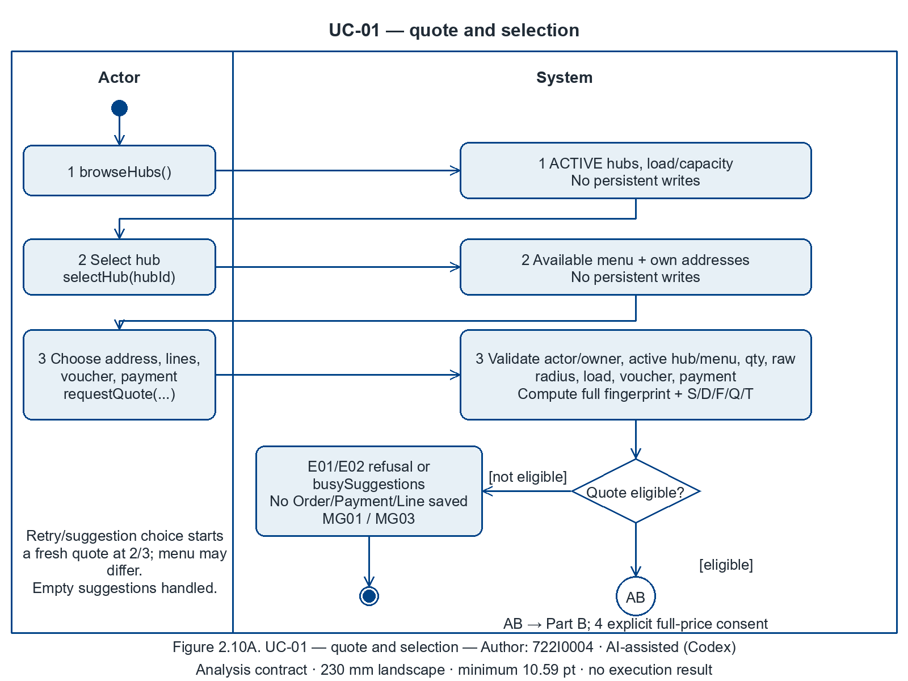

Figure 2.10A. UC-01 — selection and validation — Author: 722I0004 · AI-assisted (Codex)

[Editable draw.io](../../../models/UC-01/activity_uc01_PartA.drawio) · [SVG](../../../models/UC-01/activity_uc01_PartA.svg)

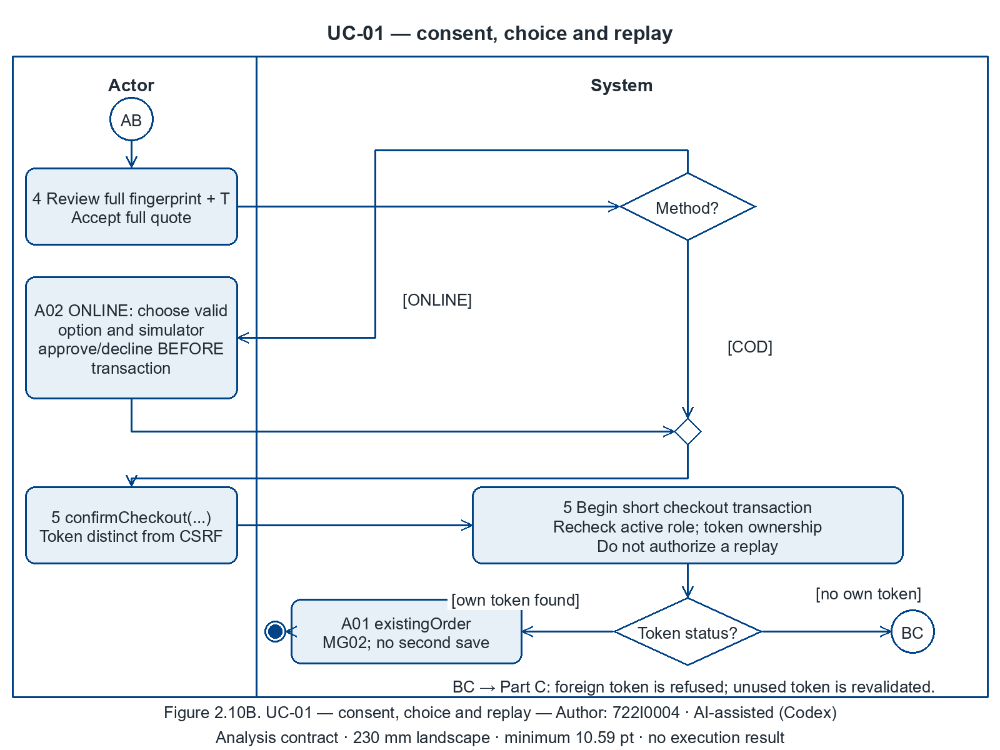

Figure 2.10B. UC-01 — checkout revalidation — Author: 722I0004 · AI-assisted (Codex)

[Editable draw.io](../../../models/UC-01/activity_uc01_PartB.drawio) · [SVG](../../../models/UC-01/activity_uc01_PartB.svg)

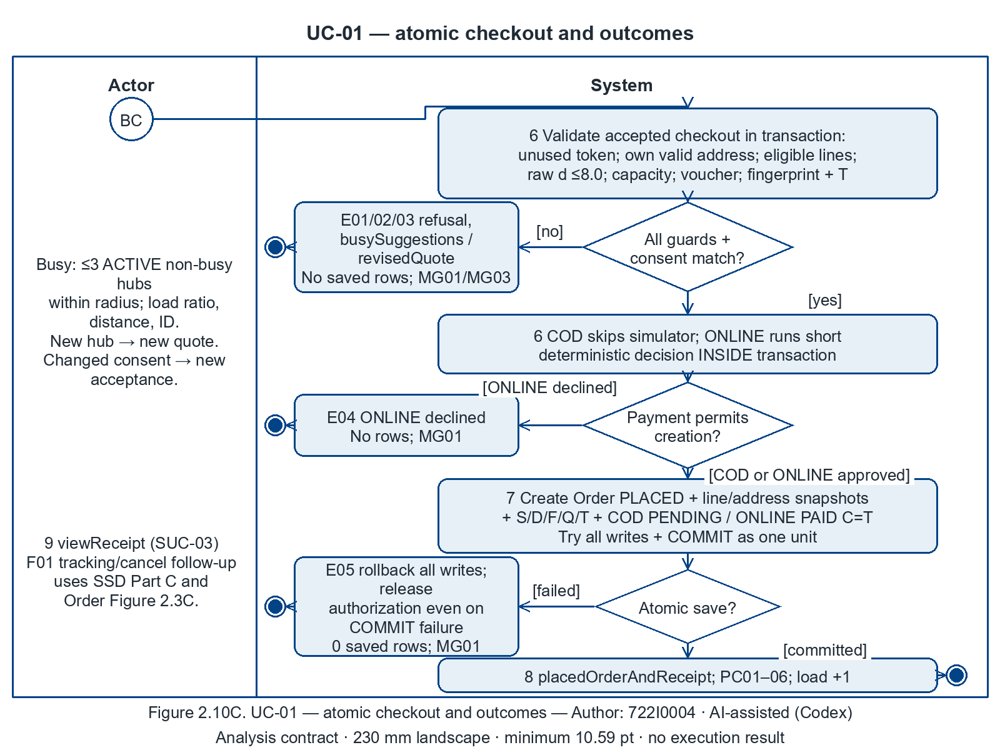

Figure 2.10C. UC-01 — payment, commit and outcomes — Author: 722I0004 · AI-assisted (Codex)

[Editable draw.io](../../../models/UC-01/activity_uc01_PartC.drawio) · [SVG](../../../models/UC-01/activity_uc01_PartC.svg)

#### iii. System sequence diagram for Use Case 1

Author: 722I0004 · AI-assisted (Codex)

Black-box messages use the frozen operation catalogue verbatim; dashed arrows are returns. Frames cover alternatives and optional supporting reads. Each fragment has one human actor and one :System lifeline. ONLINE simulation is inside confirmCheckout: no unregistered simulator operation is added. Parts A–B show quote and checkout; Part C contains optional supporting follow-up. Place at **230 mm landscape**, minimum **10.59 pt**.

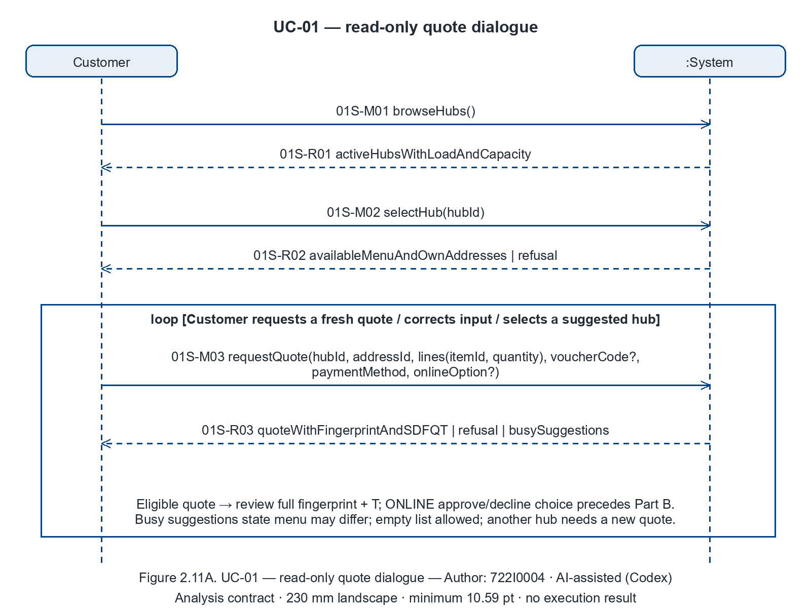

Figure 2.11A. UC-01 — read-only quote dialogue — Author: 722I0004 · AI-assisted (Codex)

[Editable draw.io](../../../models/UC-01/ssd_uc01_PartA.drawio) · [SVG](../../../models/UC-01/ssd_uc01_PartA.svg)

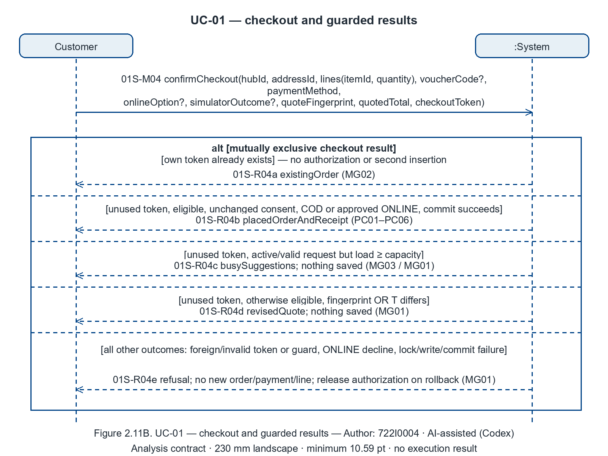

Figure 2.11B. UC-01 — checkout and guarded results — Author: 722I0004 · AI-assisted (Codex)

[Editable draw.io](../../../models/UC-01/ssd_uc01_PartB.drawio) · [SVG](../../../models/UC-01/ssd_uc01_PartB.svg)

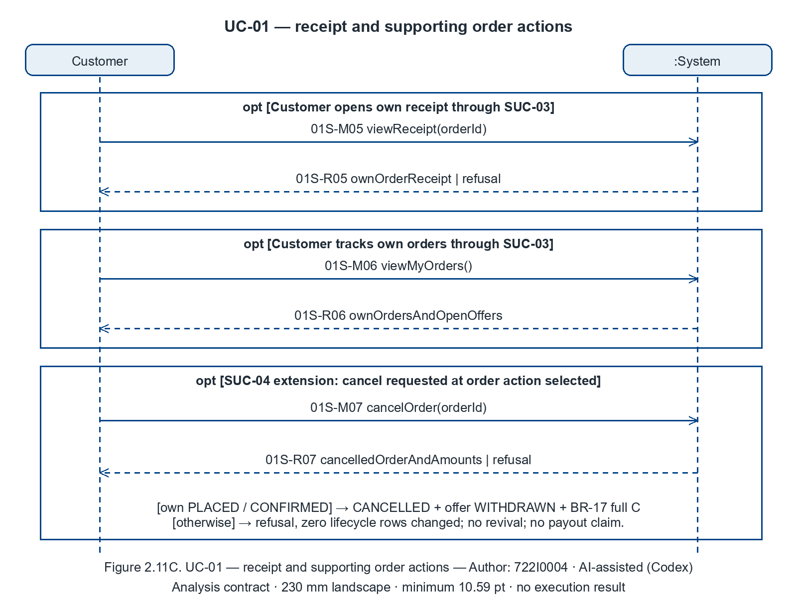

Figure 2.11C. UC-01 — receipt and supporting order actions — Author: 722I0004 · AI-assisted (Codex)

[Editable draw.io](../../../models/UC-01/ssd_uc01_PartC.drawio) · [SVG](../../../models/UC-01/ssd_uc01_PartC.svg)

#### iv. State machine diagram for Use Case 1

Author: 722I0004 · AI-assisted (Codex)

This subsection owns the **Order** machine (Figures **2.3A–E**) and **Payment** machine (Figures **2.4A–B**), rendered once from the shared state blocks. The root assembles those named blocks here. PLACED + OFFERED means waiting for a customer and still contributes to load; it is not another stored state. Checkout PCs refer to creation, while later cancellation/rejection changes state without deleting identity/snapshots.

| Anchor | Verbatim PC/MG text | State transition / stored fact / invariant |
|---|---|---|
| UC01-PC01 | one PLACED order owned by the customer | Figure 2.3A confirmCheckout → one customer-owned PLACED Order. |
| UC01-PC02 | lines with snapshot names/prices | Figure 2.3A creation stores immutable line name/price snapshots. |
| UC01-PC03 | address snapshot + distance | Figure 2.3A creation stores address snapshot and checked distance. |
| UC01-PC04 | S/D/F/Q/T stored and consistent | Figure 2.3A creation stores consented S/D/F/Q/T with BR-09 identity. |
| UC01-PC05 | payment PENDING (COD) or PAID (ONLINE, amount C) | Figures 2.4A/B initial creation: COD PENDING or ONLINE PAID, C=T. |
| UC01-PC06 | hub load +1 | Figure 2.3A PLACED enters the BR-01 cooking-load set (+1). |
| UC01-MG01 | refused/declined/invalid → no order, no payment, no line | Figures 2.3A/2.4: no creation transition on invalid/refused/declined/rollback, including commit failure. |
| UC01-MG02 | replay → same single order | Figure 2.3A: replay returns the retained token-owned Order, no second creation. |
| UC01-MG03 | busy → suggestions, nothing saved | Figure 2.3A busy guard has no creation transition; suggestions are a computed result. |

Shared-state source: [II_state_machines.md](II_state_machines.md). Generator/data for the owned activity and SSD files are stored beside their images. All statements here are analysis contracts; Static candidate controller gaps remain P4 inputs in P2-root.md. No app execution or correctness result is inferred.

All shared state figures below require **230 mm A4 landscape** placement (minimum 9.48 pt); do not shrink them into a portrait column.

<!-- BEGIN STATE_MACHINE ORDER -->

##### Order — owning placement: UC-01; UC-05/UC-02/SUC-03/04/05 cross-reference

Author: 722I0004 · AI-assisted (Codex)

All nine stored Order states and all twelve §4.1 event names are represented in A–E. Terminal states are DELIVERED, DELIVERY_FAILED, REJECTED and CANCELLED. Waiting for customer is derived from PLACED + an open OFFERED offer; cooking load still counts it. BR-17 always changes payment state and refund amount together. There is no rollback or redelivery loop.

Figure 2.3A. Order — creation and kitchen decision — Author: 722I0004 · AI-assisted (Codex)

[Editable draw.io](../../../models/shared/sm_order.drawio) · [SVG](../../../models/shared/sm_order.svg) · [Generator](../../../models/shared/sm_order.py) · [Data](../../../models/shared/sm_order.json)

| PC/MG anchor | Contract text (verbatim) | Transition / retained fact / refusal invariant |
|---|---|---|
| UC01-PC01 | one PLACED order owned by the customer | confirmCheckout inserts one customer-owned PLACED Order. |
| UC01-PC02 | lines with snapshot names/prices | confirmCheckout inserts OrderLine snapshot name/price/quantity. |
| UC01-PC03 | address snapshot + distance | confirmCheckout stores address snapshot and checked distance. |
| UC01-PC04 | S/D/F/Q/T stored and consistent | confirmCheckout stores the agreed S/D/F/Q/T; BR-09 total identity. |
| UC01-PC05 | payment PENDING (COD) or PAID (ONLINE, amount C) | confirmCheckout creates exactly one COD PENDING or ONLINE PAID payment; see Figure 2.4. |
| UC01-PC06 | hub load +1 | PLACED enters the BR-01 load set; capacity is rechecked in the write transaction. |
| UC01-MG01 | refused/declined/invalid → no order, no payment, no line | Failed checkout guard or declined simulator outcome has no creation transition and saves no Order/Payment/OrderLine. |
| UC01-MG02 | replay → same single order | Replay returns the existing token-owned Order; it never fires the creation transition twice. |
| UC01-MG03 | busy → suggestions, nothing saved | Busy guard refuses creation and returns suggestions; no transition or saved rows. |
| UC05-PC01 | confirm: own-hub PLACED → CONFIRMED | confirmOrder reaches CONFIRMED and sets confirmed_at. |
| UC05-PC02 | reject: REJECTED + reason + BR-17 + offer WITHDRAWN | rejectOrder reaches terminal REJECTED, saves reason/closed_at, withdraws any open offer and applies BR-17. |

Figure 2.3B. Order — replacement response — Author: 722I0004 · AI-assisted (Codex)

[Editable draw.io](../../../models/shared/sm_order_PartB.drawio) · [SVG](../../../models/shared/sm_order_PartB.svg) · [Generator](../../../models/shared/sm_order_PartB.py) · [Data](../../../models/shared/sm_order_PartB.json)

| PC/MG anchor | Contract text (verbatim) | Transition / retained fact / refusal invariant |
|---|---|---|
| UC05-PC03 | offer: one OFFERED offer per §3.3 | offerReplacement retains PLACED and creates one OFFERED offer. |
| UC05-PC04 | accepted offer applied per §3.3 5–7 | acceptReplacement retains PLACED, applies offered-price line, unchanged quantity, D=min(D_old,S_new), unchanged F/Q, T and payment amounts in one transaction. |
| UC05-MG01 | wrong hub / open offer / stale / invalid target → order unchanged | Wrong hub/open offer/stale request: no Order transition. Invalid target: only the exact offer is WITHDRAWN (Figure 2.7B); Order remains unchanged. |

Figure 2.3C. Order — cancellation window — Author: 722I0004 · AI-assisted (Codex)

[Editable draw.io](../../../models/shared/sm_order_PartC.drawio) · [SVG](../../../models/shared/sm_order_PartC.svg) · [Generator](../../../models/shared/sm_order_PartC.py) · [Data](../../../models/shared/sm_order_PartC.json)

| PC/MG anchor / supporting rule | Transition / retained fact / refusal invariant |
|---|---|
| BR-15; BR-17 (SUC-04; no dedicated cancellation anchor in the main-UC P2.3 register) | cancelOrder from own PLACED or CONFIRMED reaches CANCELLED; withdraws an open offer; sets closed_at and COD VOIDED / ONLINE REFUND_PENDING with owed=C. No cancellation transition exists from PREPARING or later. |
| UC01-PC01 / UC01-PC05 (creation-boundary provenance) | Cancellation retains the original Order identity and Payment row; it changes their lifecycle facts. These checkout PCs describe the earlier checkout boundary, not a claim that a cancelled Order remains PLACED/PENDING. |

Figure 2.3D. Order — preparation and pickup — Author: 722I0004 · AI-assisted (Codex)

[Editable draw.io](../../../models/shared/sm_order_PartD.drawio) · [SVG](../../../models/shared/sm_order_PartD.svg) · [Generator](../../../models/shared/sm_order_PartD.py) · [Data](../../../models/shared/sm_order_PartD.json)

| PC/MG anchor | Contract text (verbatim) | Transition / retained fact / refusal invariant |
|---|---|---|
| UC02-PC01 | one shipper assigned, Delivery PICKED_UP, order OUT_FOR_DELIVERY | takeDelivery pairs READY → OUT_FOR_DELIVERY with Delivery PICKED_UP, one shipper and picked_up_at. |
| UC02-MG01 | second shipper / wrong shipper / wrong cash / repeat → 0 rows changed | Unassigned guard and atomic claim prevent a second pickup; a refused request changes 0 rows. |

Figure 2.3E. Order — delivered or delivery failed — Author: 722I0004 · AI-assisted (Codex)

[Editable draw.io](../../../models/shared/sm_order_PartE.drawio) · [SVG](../../../models/shared/sm_order_PartE.svg) · [Generator](../../../models/shared/sm_order_PartE.py) · [Data](../../../models/shared/sm_order_PartE.json)

| PC/MG anchor | Contract text (verbatim) | Transition / retained fact / refusal invariant |
|---|---|---|
| UC02-PC02 | delivered: Delivery DELIVERED, order DELIVERED, COD PAID with cash = T | confirmDelivered pairs the two DELIVERED states with finished_at/closed_at and exact COD cash/PAID. |
| UC02-PC03 | failed: Delivery FAILED + reason, order DELIVERY_FAILED, BR-17 | reportFailure pairs DELIVERY_FAILED/FAILED with reason, timestamps and BR-17. |
| UC02-MG01 | second shipper / wrong shipper / wrong cash / repeat → 0 rows changed | Assigned active shipper, exact cash, reason and current-state guards; stale/repeat/wrong actor changes 0 rows. |

<!-- BEGIN STATE_MACHINE PAYMENT -->

##### Payment — owning placement: UC-01; UC-02/UC-05/SUC-03/04 cross-reference

Author: 722I0004 · AI-assisted (Codex)

The two payment methods have separate views. C is the original captured ONLINE amount; T is the current payable Order total. A cheaper accepted replacement keeps ONLINE PAID with a partial amount owed as an attribute. Any later unfulfilled terminal outcome replaces that amount with full C. REFUNDED is grey and unreachable because payout is deferred under L3. A declined simulator attempt is shown/logged outside this object lifecycle and creates no Payment.

Figure 2.4A. Payment — COD — Author: 722I0004 · AI-assisted (Codex)

[Editable draw.io](../../../models/shared/sm_payment.drawio) · [SVG](../../../models/shared/sm_payment.svg) · [Generator](../../../models/shared/sm_payment.py) · [Data](../../../models/shared/sm_payment.json)

| PC/MG anchor | Contract text (verbatim) | Transition / retained fact / refusal invariant |
|---|---|---|
| UC01-PC05 | payment PENDING (COD) or PAID (ONLINE, amount C) | Accepted COD checkout inserts PENDING with amount=T; valid replacement updates amount to new T without another state. |
| UC01-MG01 | refused/declined/invalid → no order, no payment, no line | A refused checkout has no initial Payment creation transition. |
| UC02-PC02 | delivered: Delivery DELIVERED, order DELIVERED, COD PAID with cash = T | confirmDelivered with exact cash=T changes PENDING → PAID and records cash_collected. |
| UC02-PC03 | failed: Delivery FAILED + reason, order DELIVERY_FAILED, BR-17 | Valid failed delivery changes PENDING → VOIDED under BR-17. |

Figure 2.4B. Payment — ONLINE simulator — Author: 722I0004 · AI-assisted (Codex)

[Editable draw.io](../../../models/shared/sm_payment_PartB.drawio) · [SVG](../../../models/shared/sm_payment_PartB.svg) · [Generator](../../../models/shared/sm_payment_PartB.py) · [Data](../../../models/shared/sm_payment_PartB.json)

| PC/MG anchor | Contract text (verbatim) | Transition / retained fact / refusal invariant |
|---|---|---|
| UC01-PC05 | payment PENDING (COD) or PAID (ONLINE, amount C) | Approved ONLINE checkout saves PAID and amount=C (captured), refund_amount=0. |
| UC01-MG01 | refused/declined/invalid → no order, no payment, no line | A decline creates no Payment row; there is no persisted FAILED attempt state. |
| UC05-PC04 | accepted offer applied per §3.3 5–7 | Valid accepted replacement is a PAID self-transition: C unchanged; refund_amount=C−T_new owed. |
| UC05-PC02 | reject: REJECTED + reason + BR-17 + offer WITHDRAWN | Rejection moves PAID → REFUND_PENDING and overwrites refund_amount with full C. |
| UC02-PC03 | failed: Delivery FAILED + reason, order DELIVERY_FAILED, BR-17 | Failed delivery also moves PAID → REFUND_PENDING and sets owed=C, replacing any partial amount. |

### 2.2.2 Use Case 2: Deliver an order: pick up, deliver with cash collection, or report failure (author: 722I0004)

Author: 722I0004 · AI-assisted (Codex)

#### i. Fully developed use case description

##### UC-02 — Deliver an order: pick up, deliver with cash collection, or report failure (author: 722I0004)

Author: 722I0004 · AI-assisted (Codex)

##### Use case name

UC-02 — Deliver an order: pick up, deliver with cash collection, or report failure.

##### Scenario / trigger

A shipper requests ready deliveries, claims an unassigned READY order, and later records either successful handover or a failed delivery. Pickup and finish are separate requests; leaving the session does not undo a successful pickup. Main success below uses COD; ONLINE and failure are explicit alternatives.

##### Actors

Primary: Shipper, an authenticated ACTIVE UserAccount with role SHIPPER. The customer receives the food in the business process but does not send a system message in this use case. No payment provider participates: ONLINE was captured by the simulator during UC-01.

##### Related use cases

Figure 2.1B associates Shipper with UC-02. It defines no include/extend relation for UC-02. SUC-05 supplies READY orders and their AWAITING_PICKUP Delivery; UC-01 supplies Order/Payment and immutable delivery-address snapshots; SUC-01 supplies authentication; SUC-08 maintains active accounts; UC-04 reads the outcome. These are serving references, not invented UML include/extend relations.

##### Stakeholders and interests

Shipper needs a fair atomic claim, minimum necessary contact details and exact cash due. Customer needs correct delivery and no duplicate collection. Kitchen needs an unambiguous handover. Management needs paired Order/Delivery states, times, cash and refund obligations for reports. Admin must not deactivate a shipper holding a PICKED_UP delivery (BR-25).

##### Pre-conditions

Every request rechecks the authenticated active SHIPPER context (BR-25); identity comes from the session. Pickup requires Order READY and its single unassigned Delivery AWAITING_PICKUP. Any active shipper can claim any READY order, including while holding other deliveries; there is no one-active-delivery cap. Finish requires the same Order OUT_FOR_DELIVERY, Delivery PICKED_UP and the authenticated shipper assigned to it. Order retains S/D/F/Q/T, address snapshot and Payment; COD is PENDING and due T; ONLINE is already PAID with captured amount C. A prior accepted replacement may leave a partial refund owed while ONLINE remains PAID.

##### Post-conditions

The following register text is verbatim. PC01 is the committed pickup milestone; PC02 and PC03 are exclusive terminal outcomes.

| ID | Guarantee |
|---|---|
| UC02-PC01 | one shipper assigned, Delivery PICKED_UP, order OUT_FOR_DELIVERY |
| UC02-PC02 | delivered: Delivery DELIVERED, order DELIVERED, COD PAID with cash = T |
| UC02-PC03 | failed: Delivery FAILED + reason, order DELIVERY_FAILED, BR-17 |
| UC02-MG01 | second shipper / wrong shipper / wrong cash / repeat → 0 rows changed |

Each accepted command saves related state/time/payment facts atomically. Successful ONLINE delivery keeps PAID, C and any partial refund owed; it takes no cash. Failed delivery saves a nonempty failureReason and finished/closed timestamps; COD becomes VOIDED; ONLINE becomes REFUND_PENDING with refund_amount=C, replacing any partial obligation, in the same change (BR-17). Refund payout is deferred, never claimed completed. A refused command changes no rows, preserving any previously committed pickup or finish. Read requests write nothing. BR-12 exposes only delivery contact and the stored address snapshot; passport is excluded from shipper views and logs.

##### Flow of activities

| Actor | System |
|---|---|
| 1. Request available and own deliveries: `viewReadyDeliveries()`. | Recheck active role; return `readyAndOwnAssignedDeliveries`. Ready candidates are not reservations. |
| 2. Select an order: `viewDelivery(orderId)`. | Recheck visibility; return `deliveryContactSnapshotAndCashDue`, with permitted contact, address snapshot, status and cash due T for COD or zero for ONLINE; never passport. |
| 3. Pick up the ready order: `takeDelivery(orderId)`. | Atomically recheck active shipper, READY, unassigned AWAITING_PICKUP and win the claim; assign exactly this shipper, record picked_up_at, set PICKED_UP / OUT_FOR_DELIVERY; return `assignedDelivery` (UC02-PC01). |
| 4. Travel to the stored destination and hand over the food. When resuming, use `viewReadyDeliveries()` and `viewDelivery(orderId)` as steps 1–2 to find and inspect an own PICKED_UP delivery; do not claim it again. | Preserve the committed assignment across requests; show the same snapshot and current payment summary. |
| 5. Choose successful delivery; collect exactly T VND for COD and send `confirmDelivered(orderId, cashCollected=T)`. | Recheck active assigned shipper, live states and exact cash. Atomically set Delivery/Order DELIVERED, COD PENDING→PAID, cash_collected=T and finished_at/closed_at; return `deliveredOrderAndPayment` (UC02-PC02). |
| 6. Read the delivery outcome. | Show recorded cash/payment/refund obligation; end successfully. No second charge or refund payout occurs. |

Alternatives (branch and continuation are explicit):

| ID | Branch step | Actor and system behaviour | Rejoin / end |
|---|---|---|---|
| A01 | 5, ONLINE already PAID | Shipper takes no cash and sends `confirmDelivered(orderId, cashCollected=0)` (optional parameter may instead be omitted). System rechecks assignment/states and zero-or-absent cash, saves Delivery/Order DELIVERED and finish/close times, leaves ONLINE PAID/C/refund owed unchanged; returns `deliveredOrderAndPayment`. | Rejoin 6; UC02-PC02's COD clause applies only to COD. |
| A02 | 5, unable to complete delivery | Shipper sends `reportFailure(orderId, reason)` with a nonempty reason. System rechecks active assigned shipper and live states, saves Delivery FAILED + failureReason, Order DELIVERY_FAILED, finish/close times and BR-17 payment effects atomically; returns `failedOrderAndPayment`. | Rejoin 6; end with UC02-PC03. Physical return of food is outside this system interaction. |
| A03 | 1–2, own delivery already PICKED_UP | Inspect own assignment via `viewDelivery(orderId)`, then continue travel. | Rejoin 4, bypass 3; prior UC02-PC01 remains. |
| A04 | 1, no ready or own assignment | System returns an empty set; shipper may end or make a fresh step-1 query. | End read-only, UC02-MG01 (0 rows changed), or rejoin 1. |

##### Exception conditions

| ID | Branch step | Condition / response | Rejoin / guaranteed end |
|---|---|---|---|
| E01 | 1–5 and A02 | Missing/inactive/non-SHIPPER session: return `refusal`; disclose no delivery contact and change no rows. | End; UC02-MG01. A fresh authenticated attempt is separate. |
| E02 | 2–3 | Missing/non-ready order, another shipper's assignment, or simultaneous claim lost: return `refusal`; the winner alone retains assignment. | End; UC02-MG01. Refresh via a new step-1 query. |
| E03 | 5 or A01/A02 | Wrong shipper, stale state, repeated finish/failure, or contradictory terminal request: return `refusal`; no payment or lifecycle mutation. | End; UC02-MG01; earlier committed outcome remains. |
| E04 | 5/A01 | COD cash missing, malformed, negative or unequal to T; or nonzero ONLINE cash: return `refusal`; do not mark delivered or paid. | End; UC02-MG01. Corrected submission is a new request from 5. |
| E05 | A02 | Missing/blank failure reason: return `refusal`; no failure or refund obligation is saved. | End; UC02-MG01. Corrected request starts at A02. |
| E06 | 3/5/A01/A02 | Atomic persistence fails: reject/roll back this command's complete change; do not present a success before commit. | End; UC02-MG01; no partial paired update. |

#### ii. Activity diagram for Use Case 2

Author: 722I0004 · AI-assisted (Codex)

The three views are scoped episodes: pickup commits PC01, then the assigned shipper later selects the exclusive success or failure episode. A resumed own assignment bypasses pickup. A final ends this episode; it neither cancels a committed assignment nor terminates other deliveries. There is no fork/join concurrency; diamonds merge alternatives before the final. `[valid]` means every condition in the decision holds; `[invalid]` is its complete logical complement. The second decision separates committed success from operation failure and rollback. Queries in Part A are read-only; no selected candidate/empty board ends without a command or mutation.

<!-- Figure placement: A4 landscape, 230 mm width; minimum text 10.67 pt. -->

Figure 2.12A. UC-02 activity: inspect and claim a delivery — Author: 722I0004 · AI-assisted (Codex)

Figure 2.12B. UC-02 activity: successful delivery and exact cash — Author: 722I0004 · AI-assisted (Codex)

Figure 2.12C. UC-02 activity: failure reason and full refund obligation — Author: 722I0004 · AI-assisted (Codex)

Each figure has adjacent editable `.drawio`, `.svg`, `.json` and a self-contained `.py` generator under the same stem. Guard validation includes active session, ownership, live state and the applicable cash/reason condition; a claim is atomic, with no one-active-delivery cap. Physical travel, cash handover and food return are actor work, not new system operations.

#### iii. System sequence diagram for Use Case 2

Author: 722I0004 · AI-assisted (Codex)

Only Shipper and `:System` participate. M01/M02 are catalogue OP-21/22 queries; M03 is OP-10 pickup; M04/M05 are OP-11/12 terminal commands. Every request appears in the description, with session identity implicit. Dashed arrows are responses; the alternative result on a response is guarded by accepted versus refused command. The loop permits browsing/inspection again; the opt bypasses pickup when resuming an owned delivery. Part B's alt chooses successful handover versus failure. Each command rechecks guards and commits all paired facts or none.

Figure 2.13A. UC-02 SSD: read requests and atomic pickup — Author: 722I0004 · AI-assisted (Codex)

Figure 2.13B. UC-02 SSD: exclusive delivery completion outcomes — Author: 722I0004 · AI-assisted (Codex)

#### iv. State machine diagram for Use Case 2

Author: 722I0004 · AI-assisted (Codex)

UC-02 owns the Delivery state machine (Figures 2.5A–B). Root assembly inserts the existing `STATE_MACHINE DELIVERY` block here once. Shared Order transitions are already drawn under UC-01 in Figures 2.3D–E and Payment under UC-01 in Figures 2.4A–B; they are cross-references, not duplicate state figures. `markReady` belongs to SUC-05 and creates AWAITING_PICKUP before this use case.

| Anchor | Transition / stored fact / refusal invariant |
|---|---|
| UC02-PC01 | `takeDelivery`: AWAITING_PICKUP→PICKED_UP; one assigned active shipper and picked_up_at; paired Order READY→OUT_FOR_DELIVERY (2.5A/2.3D). |
| UC02-PC02 | `confirmDelivered`: PICKED_UP→DELIVERED and Order OUT_FOR_DELIVERY→DELIVERED; finished_at/closed_at; COD PENDING→PAID with cash_collected=T. ONLINE PAID/C/partial owed retained (2.5B/2.3E/2.4A–B). |
| UC02-PC03 | `reportFailure`: PICKED_UP→FAILED with failure_reason/finished_at; paired DELIVERY_FAILED/closed_at; COD VOIDED or ONLINE REFUND_PENDING and full owed=C replacing partial (same figures). |
| UC02-MG01 | Invalid/lost claim, wrong assigned shipper, cash mismatch, repeat or failed atomic save has no transition and changes zero rows. Earlier committed facts remain. |

All shared state figures below require **230 mm A4 landscape** placement (minimum 9.48 pt); do not shrink them into a portrait column.

<!-- BEGIN STATE_MACHINE DELIVERY -->

##### Delivery — owning placement: UC-02

Author: 722I0004 · AI-assisted (Codex)

Creation by markReady, pickup and completion are paired with the exact Order transition. Order, Delivery, Payment effects and timestamps succeed together or the operation changes nothing. No redelivery is introduced.

Figure 2.5A. Delivery — creation and atomic pickup — Author: 722I0004 · AI-assisted (Codex)

[Editable draw.io](../../../models/UC-02/sm_delivery.drawio) · [SVG](../../../models/UC-02/sm_delivery.svg) · [Generator](../../../models/UC-02/sm_delivery.py) · [Data](../../../models/UC-02/sm_delivery.json)

| PC/MG anchor | Contract text (verbatim) | Transition / retained fact / refusal invariant |
|---|---|---|
| UC02-PC01 | one shipper assigned, Delivery PICKED_UP, order OUT_FOR_DELIVERY | takeDelivery assigns exactly one active shipper, PICKED_UP, picked_up_at and Order OUT_FOR_DELIVERY together. |
| UC02-MG01 | second shipper / wrong shipper / wrong cash / repeat → 0 rows changed | Second claim / invalid actor / stale state has no transition and changes 0 rows. |

Figure 2.5B. Delivery — completion outcomes — Author: 722I0004 · AI-assisted (Codex)

[Editable draw.io](../../../models/UC-02/sm_delivery_PartB.drawio) · [SVG](../../../models/UC-02/sm_delivery_PartB.svg) · [Generator](../../../models/UC-02/sm_delivery_PartB.py) · [Data](../../../models/UC-02/sm_delivery_PartB.json)

| PC/MG anchor | Contract text (verbatim) | Transition / retained fact / refusal invariant |
|---|---|---|
| UC02-PC02 | delivered: Delivery DELIVERED, order DELIVERED, COD PAID with cash = T | confirmDelivered: Delivery DELIVERED + finished_at; Order DELIVERED + closed_at; exact COD PAID/cash. |
| UC02-PC03 | failed: Delivery FAILED + reason, order DELIVERY_FAILED, BR-17 | reportFailure: Delivery FAILED + failure_reason/finished_at; Order DELIVERY_FAILED + closed_at; BR-17 Payment effect. |
| UC02-MG01 | second shipper / wrong shipper / wrong cash / repeat → 0 rows changed | Wrong shipper, wrong cash, repeated completion: no transition and 0 rows changed. |

### 2.2.3 Use Case 3: Maintain hubs and kitchen capacity (author: 722I0004)

Author: 722I0004 · AI-assisted (Codex)

#### i. Fully developed use case description

Author: 722I0004 · AI-assisted (Codex)

##### UC-03 — Maintain hubs and kitchen capacity (author: 722I0004)

Author: 722I0004 · AI-assisted (Codex)

**Use case name**

UC-03 — Maintain hubs and kitchen capacity.

**Scenario / trigger**

An Admin inspects hubs or submits a create, update or archive request to maintain the available kitchens and their capacity. The main success scenario creates a hub; alternatives cover read, update and archive.

**Actors**

Primary: Admin. The authenticated session supplies identity and role; posted actor identifiers are not trusted.

**Related use cases**

UC-01 consumes active hubs and capacity; UC-04 reads retained hub history and workload. SUC-08 maintains accounts attached to hubs independently. These are supporting dependencies, not include/extend relationships: Figure 2.1C gives UC-03 no such relation. SUC-01 login is a precondition.

**Stakeholders and interests**

Admin needs accurate hub records and controlled refusals; customers need valid hub choices; kitchen staff need truthful capacity; managers need retained reporting history.

**Pre-conditions**

An active Admin session is required for every request. An update or archive identifies an existing ACTIVE hub; reads may inspect archived records. Required data is available for validation; no capacity reservation is created by this use case.

**Post-conditions**

The selected command produces its applicable success guarantee. Read-only inspection writes zero persistent rows. Minimum guarantees apply to failures and also preserve unrelated records.

- **UC03-PC01**: hub created/updated with valid code, coordinates, fee, capacity
- **UC03-PC02**: archived hub hidden from browse/checkout, visible in history/reports
- **UC03-MG01**: duplicate code / capacity < 1 / archive with open order → nothing changed

Additional refusal detail: invalid coordinates, negative fee, missing/stale records, authorization failure or failed persistence leave all records unchanged under UC03-MG01. A successful create starts ACTIVE. Capacity is an integer at least 1, even when lower than current cooking load. Busy/quiet are derived from load, not stored lifecycle states. Archive retains the hub and historical references.

**Flow of activities**

| Actor | System |
|---|---|
| 1. Request `listHubs(includeArchived?)`. |  |
|  | 2. Return `hubRecordsAndLoad`, including capacity and derived load/busy context. No write occurs. |
| 3. Submit `createHub(code, name, address, latitude, longitude, baseDeliveryFee, capacity)`. |  |
|  | 4. Check active Admin context, nonempty required fields, unique hub code, valid finite latitude/longitude, nonnegative whole-VND base fee and integer capacity ≥ 1. Recheck guards at the change boundary. |
|  | 5. Save one ACTIVE hub and return `savedRecord`; UC03-PC01 holds. Existing orders are unchanged. |
| 6. Read the saved result and finish. | Show the saved record and capacity/load context. |

- **A01 — Inspect (branch at 3; end at 6):** Admin submits `getHub(hubId)`; System returns `hubAndArchiveGuard` (record, current load/capacity and whether open orders prevent archive). Admin may finish without a mutation. `listHubs` and `getHub` never write; a further chosen command starts A02/A03 or main step 3.
- **A02 — Update (branch at 3; rejoin 6):** Admin first uses A01 and submits `updateHub(hubId, code, name, address, latitude, longitude, baseDeliveryFee, capacity)`. System rechecks active record and step 4 validation, excluding this same hub from duplicate-code comparison; saves attributes and returns `savedRecord` under UC03-PC01. Capacity may be lowered below current load: the ACTIVE hub is then busy and checkout refuses until load falls. This does not cancel or reprice existing orders.
- **A03 — Archive (branch at 3; rejoin 6):** Admin first uses A01 and submits `archiveHub(hubId)`. System rechecks active Admin and ACTIVE hub, and counts open orders: every state except DELIVERED, DELIVERY_FAILED, REJECTED and CANCELLED is open (READY and OUT_FOR_DELIVERY still block archive). If none exist, set ARCHIVED, return `savedRecord`, hide the hub from browse/checkout, retain it in history/reports: UC03-PC02. No restore command is defined.
- **A04 — More inspection (branch at 6; rejoin 1):** Admin may start another independent request; each request rechecks session and guards. There is no automatic background update.

**Exception conditions**

- **E01 — Invalid create/update (branch at 4 or A02 validation; end):** duplicate code, capacity < 1 or malformed coordinates/fee/required data returns `controlledRefusal` with a reason; UC03-MG01, nothing changed. A correction is a new request at 3/A02, not a partially saved record.
- **E02 — Unsafe archive (branch at A03 guard; end):** any open order returns `controlledRefusal`; UC03-MG01, nothing changed. Lowering capacity itself is not this failure.
- **E03 — Missing, stale, archived target or denied context (branch at any request; end):** return `refusal` for `getHub`, or `controlledRefusal` for a mutation; no data disclosure to a denied actor and UC03-MG01, nothing changed. No update revives an archived hub.
- **E04 — Persistence failure (branch at 5/A02/A03 save; end):** return a controlled failure after rollback; UC03-MG01, nothing changed. No partial hub change is claimed.

#### ii. Activity diagram for Use Case 3

Author: 722I0004 · AI-assisted (Codex)

Figure 2.14. UC-03 — Hub inspection and maintenance — Author: 722I0004 · AI-assisted (Codex)

Each page models one independently initiated request in Admin | System partitions; alternatives merge before the result is observed. The bullseye ends the whole request. There is no fork or concurrent flow. Guard checks include session authorization and save completion; the else edge covers every failed guard and rollback. Repeating an inspection starts another request.

#### iii. System sequence diagram for Use Case 3

Author: 722I0004 · AI-assisted (Codex)

Figure 2.15. UC-03 — System sequence diagram — Author: 722I0004 · AI-assisted (Codex)

Only Admin and :System participate. Solid calls use the frozen operation catalogue with its parameters; dashed arrows are returned values. The inspection loop is read-only; the optional maintenance request selects exactly one command in an alt, followed by guarded savedRecord versus controlledRefusal outcomes. Query refusal/denial is represented by its returned refusal where defined; denied sessions reveal no protected data.

<!-- Figure placement: 230 mm landscape, minimum 9.48 pt. Split catalogue pages must not be reduced to portrait width. -->

#### iv. State machine diagram for Use Case 3

Author: 722I0004 · AI-assisted (Codex)

The Hub state machine is Figure 2.6, owned here (source `models/UC-03/sm_hub.*`; canonical block in `II_state_machines.md`). The shared UserAccount model Figure 2.9 is placed here once for SUC-08; it does not add account-write operations to UC-03. Busy/quiet are derived inside ACTIVE. Archived hubs keep their historical references; there is no reactivation command.

| Anchor | Transition or stored fact |
|---|---|
| UC03-PC01 | createHub → ACTIVE or updateHub ACTIVE self-transition stores validated code/coordinates/fee/capacity. |
| UC03-PC02 | archiveHub ACTIVE → ARCHIVED only with no open orders; archived_at hides browse/checkout while history/report references survive. |
| UC03-MG01 | Failed create/update/archive has no transition or attribute change; unique code, capacity ≥ 1 and no-open-order archive guards protect the stored fact. |

The root assembler inserts the canonical state-machine block once beneath this subsection; this package cross-references it without copying shared images. These are analysis contracts, not measured application results.

Editable models: each base .drawio contains all its pages; the adjacent JSON and Python regenerate the models. Catalogue base PNG/SVG are first-page aliases; use all A–C figures above together.

All shared state figures below require **230 mm A4 landscape** placement (minimum 9.48 pt); do not shrink them into a portrait column.

<!-- BEGIN STATE_MACHINE HUB -->

##### Hub — owning placement: UC-03

Author: 722I0004 · AI-assisted (Codex)

BUSY and QUIET are derived classifications inside ACTIVE, not persisted lifecycle values. Lowering capacity below current load is allowed; lowering it below one is refused. Archive requires no open order (every state outside the four terminal Order states is open).

Figure 2.6. Hub — maintenance and archive — Author: 722I0004 · AI-assisted (Codex)

[Editable draw.io](../../../models/UC-03/sm_hub.drawio) · [SVG](../../../models/UC-03/sm_hub.svg) · [Generator](../../../models/UC-03/sm_hub.py) · [Data](../../../models/UC-03/sm_hub.json)

| PC/MG anchor | Contract text (verbatim) | Transition / retained fact / refusal invariant |
|---|---|---|
| UC03-PC01 | hub created/updated with valid code, coordinates, fee, capacity | createHub enters ACTIVE; updateHub self-transition saves validated code/coordinates/fee/capacity. |
| UC03-PC02 | archived hub hidden from browse/checkout, visible in history/reports | archiveHub enters ARCHIVED (archived_at); operational browse/checkout excludes it; historical/report records remain. |
| UC03-MG01 | duplicate code / capacity < 1 / archive with open order → nothing changed | Uniqueness, capacity≥1 and no-open-orders guards prevent mutation on refusal. |

<!-- BEGIN STATE_MACHINE USER_ACCOUNT -->

##### User Account — owning placement: UC-03 placement; shared SUC-08/SUC-02 account support

Author: 722I0004 · AI-assisted (Codex)

This is shared supporting account behaviour, placed under UC-03 as instructed by the assembly contract; Hub does not own UserAccount. SUC-02 registration and SUC-08 staff creation start ACTIVE; SUC-08 changes ACTIVE ↔ INACTIVE. BR-25 forbids deactivating a shipper holding a PICKED_UP delivery. An inactive account’s existing session is refused on the next request. No account termination event exists in Part 2, so the shown final pseudostate is explicitly unreachable; no deletion transition is invented.

Figure 2.9. UserAccount — activation lifecycle — Author: 722I0004 · AI-assisted (Codex)

[Editable draw.io](../../../models/shared/sm_user_account.drawio) · [SVG](../../../models/shared/sm_user_account.svg) · [Generator](../../../models/shared/sm_user_account.py) · [Data](../../../models/shared/sm_user_account.json)

| PC/MG anchor | Contract text (verbatim) | Transition / retained fact / refusal invariant |
|---|---|---|
| UC02-MG01 | second shipper / wrong shipper / wrong cash / repeat → 0 rows changed | Active-role checks are prerequisite guards for pickup/completion; refused inactive actor changes no delivery/order/payment rows. |

| Supporting rule | Transition / fact / invariant |
|---|---|
| BR-25 / SUC-08 | setUserActive(false) is refused while the target shipper holds a PICKED_UP delivery; no account mutation occurs. Recheck at the mutation boundary. |
| Plan §4.4 / SUC-01 | is_active=false rejects an existing session on its next request; logIn/logOut change the session, not persisted account activation state. |
| OP-47/55/56/57 | registerCustomer/createUserAccount create ACTIVE; updateUserAccount edits attributes only; setUserActive toggles the activation flag. No new operation name is introduced. |

### 2.2.4 Use Case 4: Produce management reports: sales, workload, delivery performance (author: 722I0004)

Author: 722I0004 · AI-assisted (Codex)

#### i. Fully developed use case description

##### UC-04 — Produce management reports: sales, workload, delivery performance (author: 722I0004)

Author: 722I0004 · AI-assisted (Codex)

##### Use case name

UC-04 — Produce management reports: sales, workload, delivery performance.

##### Scenario / trigger

A manager asks for operational sales for Vietnam calendar dates, the current hub workload, or delivery performance. Reports read shared records; no Report entity or lifecycle is created. Main flow is sales; A01/A02 cover the other report requests.

##### Actors

Primary: Manager with an authenticated ACTIVE MANAGER account. Other roles, including Admin, are denied these operations. No database, clock, controller or report object is an actor.

##### Related use cases

Figure 2.1C associates Manager with UC-04 and has no UC-04 include/extend relation. UC-01/02/05 and SUC-05 supply Order, Payment and Delivery facts; UC-03 supplies hubs; SUC-09 preserves archived history for reporting; SUC-01 supplies authentication. These are serving/data references only.

##### Stakeholders and interests

Manager needs comparable definitions, visible filters, sample sizes and honest empty outcomes. Client needs workload for staffing and delivery trends. Customers and management need retained archived history and refunds owed reported separately without double subtraction. Data owners need a read-only operation with no accidental archive or lifecycle changes.

##### Pre-conditions

Each report request rechecks the session's active MANAGER role. Order/OrderLine, Payment, Delivery and Hub facts follow their owning contracts; an empty data set is valid. Sales/performance requests require valid `startDateVN`, `endDateVN`, start≤end and, if supplied, an existing `hubId` (archived hubs are permitted historical filters). The workload request takes no dates or hub parameter; it is the current per-hub snapshot labelled “now.” Defaults are team assumptions pending Q5, never recorded as client approval.

##### Post-conditions

Verbatim register text:

| ID | Guarantee |
|---|---|
| UC04-PC01 | sales, workload, performance equal the hand oracle for the filter |
| UC04-PC02 | n/a on empty denominators |
| UC04-MG01 | 0 rows written by any report request |
| UC04-MG02 | non-manager denied |

PC01 states required expected behaviour, not an executed test result. Every accepted report labels its definitions, period or “now”, hub scope and sample counts. Every refusal/empty outcome preserves MG01. Nothing saves a Report, updates a timestamp on a domain row, changes an archive flag, or mutates lifecycle/payment facts.

##### Flow of activities

| Actor | System |
|---|---|
| 1. Choose sales and enter Vietnam calendar dates and optional hub. | Explain that sales are operational, not accounting; dates use Asia/Ho_Chi_Minh and include both selected days. |
| 2. Send `salesReport(startDateVN, endDateVN, hubId?)`. | Recheck active Manager, date validity/order and hub existence. Convert `[start 00:00 VN, end+1 00:00 VN)` to UTC against stored UTC timestamps (BR-20). |
| 3. Await report. | Select DELIVERED orders by Delivery finish time in that half-open interval and optional hub. Include archived records (BR-21/24). Sum order count, S, D, F−Q, T and refunds owed at order grain, without an OrderLine join; show refunds owed separately, never subtract them again from T. Item detail groups by menu_item_id and displays snapshot names, keeping equal-name distinct items separate. |
| 4. Inspect `operationalSalesAndRefundsOwed`. | Return filter labels, operational totals, item detail and order sample count, without persistent writes (UC04-PC01/MG01). |
| 5. Choose to finish or request another report. | End, or repeat from step 1 / A01 / A02; each request independently rechecks authorization. |

| ID | Branch step | Actor and system behaviour | Rejoin / end |
|---|---|---|---|
| A01 | 1, choose workload | Manager sends `workloadReport()`. System rechecks active Manager and reads the current snapshot per hub, retaining archived hub identities for reporting (BR-18 / UC03-PC02): cooking load=PLACED+CONFIRMED+PREPARING (including PLACED awaiting an offer), capacity, READY count and OUT_FOR_DELIVERY count. Label “now” with as-of time; no date or hub filter is applied (BR-01/22). Return `currentHubLoadCapacityReadyOutForDelivery`; historical archive flags do not remove relevant retained facts. An archived hub has zero open cooking/READY/OUT_FOR_DELIVERY work under BR-18; identify its archived status rather than hiding it from reports. | Rejoin 5; UC04-PC01/MG01. |
| A02 | 1, choose delivery performance | Manager sends `deliveryReport(startDateVN, endDateVN, hubId?)`. System rechecks role/filter as step 2 and reads Delivery DELIVERED or FAILED with finished_at in the UTC interval, including archived orders. Wait samples are READY→PICKED_UP for finished deliveries with both timestamps; ride samples are PICKED_UP→DELIVERED for successes only. Show mean wait and its N, mean ride and its N, and failed/(delivered+failed) with finished N. Missing timestamp pairs contribute no duration sample; expose the corresponding N. Return `waitRideFailureRatesWithNAndNA`. | Rejoin 5; UC04-PC01/MG01; PC02 where a denominator is zero. |
| A03 | 3/A01/A02, no matching rows or no valid metric samples | Return a labelled empty/zero-count report. Counts and sums are zero; a mean or failure-rate denominator of zero is shown as “n/a” with N=0, never 0% or a fabricated duration (BR-23). | Rejoin 5; UC04-PC02/MG01. |

Calculation definitions are part of the required response. Order totals remain T=S−D+F−Q. Refunds owed is a separate column of obligations for the selected delivered orders, not a second reduction of operational sales; this report does not pretend to be a global refund ledger. Workload has no historic period and does not reinterpret archived history as new work. The hand oracle must independently apply the same filter, grain and formulas in later verification; none is measured here.

##### Exception conditions

| ID | Branch step | Condition / response | Rejoin / guaranteed end |
|---|---|---|---|
| E01 | 2/A01/A02 | Missing/inactive/non-MANAGER session: return `denied` with no report disclosure. | End; UC04-MG02 and UC04-MG01. |
| E02 | 2/A02 | Malformed/reversed date range or unknown hub: return `invalidFilter`; do not silently coerce a different period or hub. | End; UC04-MG01; corrected request starts at 1/A02. |
| E03 | 3/A01/A02 | Read unavailable or incomplete: report unavailable, do not fabricate successful totals. | End; UC04-MG01. A later retry is a new request. |

#### ii. Activity diagram for Use Case 4

Author: 722I0004 · AI-assisted (Codex)

The manager chooses one of three independently initiated report episodes. Part A is sales, B workload now and C delivery performance. All requests recheck the role. `[valid]` means every displayed role/filter condition holds; `[invalid]` is its complement. Read failures return unavailable without fabricated totals. Success and refusal paths explicitly merge before the episode's activity final; no lifecycle event or persistent write is produced. A new request restarts its own episode.

<!-- Figure placement: A4 landscape, 230 mm width; minimum text 10.67 pt. -->

Figure 2.16A. UC-04 activity: operational sales — Author: 722I0004 · AI-assisted (Codex)

Figure 2.16B. UC-04 activity: current hub workload — Author: 722I0004 · AI-assisted (Codex)

Figure 2.16C. UC-04 activity: delivery performance and sample sizes — Author: 722I0004 · AI-assisted (Codex)

Adjacent `.drawio`, `.svg`, `.json` and self-contained `.py` files preserve each figure's editable model and generation inputs. Archived transaction history is included; workload remains a current operational snapshot, not a date-filtered historical count.

#### iii. System sequence diagram for Use Case 4

Author: 722I0004 · AI-assisted (Codex)

Manager and `:System` are the only lifelines. M01/M02/M03 are exactly catalogue OP-26/27/28, recorded in description step 2/A01/A02. The loop represents further independently authorized requests and the nested alt selects sales, workload or performance. Dashed responses return only read results, invalidFilter or denied as applicable. No controller, query language, database or widget appears. Missing/inactive authorization is denied on every report request; every outcome preserves zero writes.

Figure 2.17. UC-04 SSD: independent report queries — Author: 722I0004 · AI-assisted (Codex)

#### iv. State machine diagram for Use Case 4

Author: 722I0004 · AI-assisted (Codex)

UC-04 has **zero own Report states**: a filter and returned rows are computed views. It reads Order and Payment facts in Figures 2.3A–E/2.4A–B, Delivery facts in Figures 2.5A–B, and Hub capacity/current load referenced by Figure 2.6. It fires none of these transitions and does not create a fake Report state machine. History remains readable after archive.

| Anchor | Read fact / computed outcome / invariant |
|---|---|
| UC04-PC01 | Sales reads DELIVERED/finish time, stored S/D/F/Q/T and owed amounts; workload reads live Order states and Hub capacity; performance reads finished Delivery states/timestamp pairs. The filtered values must equal the independent hand oracle in later verification. This is required behaviour, not a measured result here. |
| UC04-PC02 | Mean wait/ride and failure-rate denominators are computed; zero returns n/a and N=0. No stored Report state exists. |
| UC04-MG01 | The report's footprint is read-only over Order/OrderLine, Payment, Delivery and Hub; zero inserts, updates or archive writes for successful, empty, refused or failed requests. |
| UC04-MG02 | Active Manager role is checked before disclosure; non-manager denied, with no lifecycle transition. |

BR-20 uses Vietnam calendar boundaries converted to UTC `[start,end+1)`. BR-21 keeps owed refunds separate from T. BR-24 preserves order-level aggregation without a line join and item-level grouping by identity; equal dish names do not collapse distinct IDs. BR-22's workload ignores dates; BR-23 displays each N and n/a for empty denominators.

All shared state figures below require **230 mm A4 landscape** placement (minimum 9.48 pt); do not shrink them into a portrait column.

<!-- BEGIN STATE_MACHINE UC04_READ_ONLY -->

##### UC-04 — read-only cross-reference; no Report lifecycle

Author: 722I0004 · AI-assisted (Codex)

UC-04 reads Order (Figures 2.3A–E), Payment (2.4A–B), Delivery (2.5A–B) and Hub workload facts (2.6). ReportFilter, rows and receipt are computed views. A report request does not create a persistent Report object or fire any lifecycle transition.

| PC/MG anchor | Contract text (verbatim) | Transition / retained fact / refusal invariant |
|---|---|---|
| UC04-PC01 | sales, workload, performance equal the hand oracle for the filter | salesReport/workloadReport/deliveryReport read stored Order totals, terminal states, timestamps, Payment owed amounts and Delivery facts; query result must later match the independent hand oracle. |
| UC04-PC02 | n/a on empty denominators | A computed zero-denominator delivery metric returns n/a; no stored state is required. |
| UC04-MG01 | 0 rows written by any report request | Every report operation reads only; no state transition, insert, update or archive. |
| UC04-MG02 | non-manager denied | Role guard refuses a non-manager before a report result; no state transition. |

### 2.2.5 Use Case 5: Decide an incoming order: confirm, reject, or offer a replacement the customer agrees to (author: 722I0004)

Author: 722I0004 · AI-assisted (Codex)

#### i. Fully developed use case description

##### UC-05 — Decide an incoming order: confirm, reject, or offer a replacement the customer agrees to (author: 722I0004)

Author: 722I0004 · AI-assisted (Codex)

| Item | Content |
|---|---|
| Use case name | UC-05 — Decide an incoming order: confirm, reject, or offer a replacement the customer agrees to. Author: 722I0004 · AI-assisted (Codex) |
| Scenario / trigger | Kitchen staff opens an incoming own-hub PLACED order and chooses confirm, reject or a whole-line replacement for a dish currently unavailable. The customer answers separately through SUC-03; the kitchen request never waits inside a transaction for the answer. |
| Actors | Primary: Kitchen staff. Customer participates in the separate SUC-03 response session (companion fragment with Customer + :System). Every request rechecks active role and owner/hub authorization. |
| Related use cases | Figure 2.1B shows Kitchen staff and Customer participation, with the Customer response served by SUC-03 in Figure 2.1A. UC-01 supplies the original order. SUC-05 starts preparing/marks ready after confirmation; SUC-06 changes own-hub availability. These are serving/sequence links, not invented «include» relations. SUC-04 extends SUC-03 at order action selected when cancellation is requested from PLACED/CONFIRMED. |
| Stakeholders and interests | Kitchen: only own-hub decisions and one open offer. Customer: unchanged quantity, equal/lower offered unit price, consent to replacement amounts and preserved captured payment. Operator: atomic line/totals/offer/payment updates and explicit refund owed without a payout claim. |
| Pre-conditions | An active Kitchen staff session is assigned to a hub. A candidate incoming order exists; its own-hub PLACED state, open-offer status and current source/target eligibility are guards rechecked at each command. Customer response requires a separate active Customer session and own order. |
| Post-conditions | **UC05-PC01** confirm: own-hub PLACED → CONFIRMED **UC05-PC02** reject: REJECTED + reason + BR-17 + offer WITHDRAWN **UC05-PC03** offer: one OFFERED offer per §3.3 **UC05-PC04** accepted offer applied per §3.3 5–7 **UC05-MG01** wrong hub / open offer / stale / invalid target → order unchanged PC01–PC04 are alternative outcomes at their respective operation boundaries. MG01 preserves Order; invalid-target acceptance may still withdraw the exact offer and return a reason. Later rejection/cancellation is never reversed. |
| Flow of activities | Numbered Actor / System main flow and A01–A05 / E01–E04 below form this field. Main steps 1–5 confirm; A02 rejects; A03 creates an offer; response C1–C6 is an explicitly separate SUC-03 session. |
| Exception conditions | Wrong hub/role/state, open offer on confirm or another offer, invalid source/target, stale answer and write failure produce controlled responses. Every failure ends with UC05-MG01 (Order unchanged); invalid-target acceptance alone changes the exact offer to WITHDRAWN and shows its reason, without adding a persisted reason field. |

##### Flow of activities — main success (confirm)

| Actor | System |
|---|---|
| 1. Kitchen staff requests `viewKitchenOrders()`. | Returns `ownHubOrdersAndOffers`; only staff's hub, with PLACED/offer status and permitted kitchen details. Passport is never shown. No writes. |
| 2. Selects an order using `viewKitchenOrder(orderId)`. | Returns `ownHubOrderAndLines`; checks active kitchen role and hub. No writes. |
| 3. Reviews the lines and chooses confirm, submitting `confirmOrder(orderId)`. | Rechecks own hub, PLACED and no open OFFERED offer in the same short transaction as the change. If unavailable source requires a substitution, staff may instead choose A03; staff may reject under A02. |
| 4. — | Moves PLACED→CONFIRMED, sets confirmed_at and commits atomically; returns `confirmedOrder` (UC05-PC01). No payment or line reprice. |
| 5. Receives the confirmed decision. | The board reflects CONFIRMED. SUC-05 may later start preparation (`startPreparing(orderId)`, CONFIRMED→PREPARING, own hub, no open offer) and mark ready (`markReady(orderId)`, PREPARING→READY plus Delivery AWAITING_PICKUP); these remain separate supporting operations and are not SSD messages in this UC package. |

##### Alternate flows

| ID | Branch point | Actor / System behaviour | Rejoin / end |
|---|---|---|---|
| A01 | Step 2/5, staff refreshes board/details | Calls `viewKitchenOrders()` / `viewKitchenOrder(orderId)` again; reads current facts without mutation. | Rejoin 2 or end read session; queries never change Order (UC05-MG01 invariant). |
| A02 | Step 3, chooses reject | Staff submits `rejectOrder(orderId, reason)`. System requires own-hub PLACED and nonempty reason; atomically sets REJECTED, reason and closed_at, withdraws any open offer and applies BR-17: COD→VOIDED; ONLINE→REFUND_PENDING with refund_amount=C, replacing any prior partial amount. Returns `rejectedOrder`. | End kitchen decision: UC05-PC02. Wrong/stale/invalid reason→E01; failed save→E04. |
| A03 | Step 3, chooses replacement | Staff submits `offerReplacement(orderId, orderLineId, targetItemId)`. One transaction rechecks own-hub PLACED, no OFFERED offer and selected line belongs to this Order. Source dish must be **currently unavailable at this hub** (sold out, unlisted or archived). Target must be ACTIVE with ACTIVE brand, listed and AVAILABLE at this same hub, different from source, absent from other order lines, and unit price ≤ source snapshot price; cross-brand is allowed. Inserts exactly one OFFERED offer with original/new name and price snapshots, line link and offered_at; quantity unchanged. Returns `offeredReplacement`. Order remains PLACED and still counts toward load. | End kitchen request: UC05-PC03. Continue later in independent C1–C6. Guards fail→E01/E02. |
| A04 | After C5 accepted response | Staff refreshes current board (A01); if another dish is unavailable, another sequential offer may be made while PLACED because resolved offers remain history. If no open offer remains, staff can confirm at step 3. | Rejoin 2/3 in a new request; never automatically confirm on Customer acceptance. |
| A05 | During offer wait or after acceptance | Customer may cancel via SUC-04 from own PLACED/CONFIRMED; open offer→WITHDRAWN, Order→CANCELLED, BR-17 full C (never C+partial). Kitchen may reject PLACED under A02. A concurrent response rechecks serialized current facts. | End that supported action. Later answer uses E03 and cannot revive CANCELLED/REJECTED; UC05-MG01 for refused answer. |

##### C1–C6 — Customer response through SUC-03 (separate session)

| Actor | System |
|---|---|
| C1. Customer calls `viewMyOrders()` then `viewReplacement(orderId)`. | Returns `ownOrdersAndOpenOffers`, then `originalAndOfferedLineQuantityTotalRefundOwed`: source/new snapshots, unchanged quantity, proposed S_new, D_new=min(D_old,S_new), unchanged F/Q, T_new and ONLINE refund owed C−T_new, before an answer. Read only. |
| C2. Reviews and chooses accept or decline. | Shows the offer identity and “refund owed”, never a payout assertion. No transaction waits for this choice. |
| C3. Accepts with `acceptReplacement(orderId, offerId)` (decline uses C6). | In one transaction rechecks active Customer ownership, Order PLACED, offer belongs to Order and is the **exact open OFFERED offer**. Stale/repeated/terminal→E03. Rechecks target is still active/not archived, with active brand, listed and AVAILABLE at same hub. Invalid target→E02. |
| C4. — | Valid acceptance replaces the **whole linked line**, keeping quantity and using the **offered unit price**, even if catalogue price has changed. Sets offer ACCEPTED; Order remains PLACED. Recalculates S_new; D_new=min(D_old,S_new) without re-evaluating voucher dates/minimum/terms; F and Q unchanged; T_new=S_new−D_new+F−Q. COD payable becomes T_new. ONLINE amount stays captured C, state stays PAID, refund_amount=C−T_new. Commits all effects atomically. |
| C5. Receives `acceptedOrderAndAmounts`. | UC05-PC04. Staff can later refresh under A04. Cancellation afterwards applies full C through A05/BR-17. No path sets REFUNDED. |
| C6. Instead declines with `declineReplacement(orderId, offerId)`. | Same exact-open/own PLACED guard; atomically sets offer DECLINED, Order REJECTED, reason “customer declined replacement”, closed_at and BR-17 (COD VOIDED; ONLINE REFUND_PENDING and refund_amount=C). Returns `rejectedOrderAndAmounts`. Stale/repeat→E03; failed save→E04. End response, no implicit rejoin to confirmation. |

##### Exception flows and minimum guarantee

| ID | Branch point and guard | System response | Rejoin / end |
|---|---|---|---|
| E01 | Steps 1–4/A02/A03: inactive or wrong role, wrong hub, non-PLACED, missing reason; confirm with an open offer; offer with source still available, nonmember line, invalid target or another open offer | Controlled refusal; no Order/line/payment/offer update. Own-hub privacy enforced on reads. | End request: UC05-MG01. A new read may rejoin 1/2. |
| E02 | A03 invalid target; or C3 exact open offer whose target is now ineligible | At offer creation: refusal with no writes. At acceptance: only that offer becomes WITHDRAWN with an explanatory returned/displayed reason (`withdrawnOfferAndReason`); **Order, lines and payment unchanged**. No persisted withdrawal_reason attribute is assumed. | End request: UC05-MG01. Staff can refresh 1/2 and make a new eligible offer. |
| E03 | C3/C6: wrong owner, order no longer PLACED (including CANCELLED/REJECTED), wrong/non-open offer or stale/repeated answer | Returns `staleRefusal`; zero rows changed. Ownership failure discloses no foreign order details. Never revives a terminal order. | End response: UC05-MG01; customer may read again at C1. |
| E04 | Any modifying request: lock, write or commit failure | Controlled retry outcome; atomic rollback of every intended Order/line/offer/payment change. No partial confirmation, rejection, replacement or money change. | End request: UC05-MG01. New read at 1/C1 before retry. |

Fixed contract example (not a test result): S=100,000, D=10,000, F=15,000, Q=5,000 gives T=C=100,000. Accepted replacement S_new=90,000 gives D_new=10,000 and T_new=90,000. COD payable=90,000; ONLINE keeps C=100,000 with 10,000 owed. Later cancel owes full 100,000. A delivered order retains T_new=90,000 for operational sales; the owed 10,000 is separate, never subtracted again.

Source: locked plan §3.3(1–10), §4, BR-12/15/16/17/26; Figure 2.1A–B; operations OP-02–06 and OP-17–20. Contract and Static design inputs only; no runtime results or lecturer approval claimed.

#### ii. Activity diagram for Use Case 5

Author: 722I0004 · AI-assisted (Codex)

One activity is projected across Parts A–C. Paired connector references continue the same control flow; only Part A has an initial node. All end markers are activity finals for this sequential request scope, not Order lifecycle termination. There is no concurrency or join. Decisions have exclusive complete guarded exits and explicit merges where paths rejoin. Place every view at **230 mm width on A4 landscape** (minimum 26 px on 1600 px = **10.59 pt**).

Figure 2.18A. UC-05 — kitchen decision — Author: 722I0004 · AI-assisted (Codex)

[Editable draw.io](../../../models/UC-05/activity_uc05_PartA.drawio) · [SVG](../../../models/UC-05/activity_uc05_PartA.svg)

Figure 2.18B. UC-05 — replacement creation — Author: 722I0004 · AI-assisted (Codex)

[Editable draw.io](../../../models/UC-05/activity_uc05_PartB.drawio) · [SVG](../../../models/UC-05/activity_uc05_PartB.svg)

Figure 2.18C. UC-05 — Customer response through SUC-03 — Author: 722I0004 · AI-assisted (Codex)

[Editable draw.io](../../../models/UC-05/activity_uc05_PartC.drawio) · [SVG](../../../models/UC-05/activity_uc05_PartC.svg)

#### iii. System sequence diagram for Use Case 5

Author: 722I0004 · AI-assisted (Codex)

Black-box messages use the frozen operation catalogue verbatim; dashed arrows are returns. Part A is Kitchen staff + :System; Parts B and C are independent Customer + :System acceptance and decline companions through SUC-03. The kitchen request finishes before the customer session; no synchronous two-human session or transaction wait is implied. Place at **230 mm landscape**, minimum **10.59 pt**.

Figure 2.19A. UC-05 — kitchen commands — Author: 722I0004 · AI-assisted (Codex)

[Editable draw.io](../../../models/UC-05/ssd_uc05_PartA.drawio) · [SVG](../../../models/UC-05/ssd_uc05_PartA.svg)

Figure 2.19B. UC-05 — separate Customer acceptance response (SUC-03) — Author: 722I0004 · AI-assisted (Codex)

[Editable draw.io](../../../models/UC-05/ssd_uc05_PartB.drawio) · [SVG](../../../models/UC-05/ssd_uc05_PartB.svg)

Figure 2.19C. UC-05 — separate Customer decline response (SUC-03) — Author: 722I0004 · AI-assisted (Codex)

[Editable draw.io](../../../models/UC-05/ssd_uc05_PartC.drawio) · [SVG](../../../models/UC-05/ssd_uc05_PartC.svg)

#### iv. State machine diagram for Use Case 5

Author: 722I0004 · AI-assisted (Codex)

This subsection owns the **ReplacementOffer** machine (Figures **2.7A–B**), rendered once by root assembly from the shared state block. It cross-references **Order Figures 2.3A–C** and **Payment Figures 2.4A–B** under UC-01. Offer acceptance retains PLACED; only an explicit later kitchen confirm reaches CONFIRMED. Cancelled/rejected Orders never return to PLACED.

| Anchor | Verbatim PC/MG text | State transition / stored fact / invariant |
|---|---|---|
| UC05-PC01 | confirm: own-hub PLACED → CONFIRMED | Figure 2.3A confirmOrder: PLACED → CONFIRMED, confirmed_at. |
| UC05-PC02 | reject: REJECTED + reason + BR-17 + offer WITHDRAWN | Figure 2.3A rejectOrder: REJECTED, reason/closed_at; Figure 2.7B offer WITHDRAWN; Figures 2.4A/B BR-17 payment+full C. |
| UC05-PC03 | offer: one OFFERED offer per §3.3 | Figure 2.7A creates exactly one OFFERED; Figure 2.3B retains PLACED. |
| UC05-PC04 | accepted offer applied per §3.3 5–7 | Figures 2.7A/2.3B acceptance: ACCEPTED plus offered-price line/unchanged qty, D=min(D_old,S_new), unchanged F/Q; Figures 2.4A/B COD new T / ONLINE PAID with unchanged C and owed=C−T_new. |
| UC05-MG01 | wrong hub / open offer / stale / invalid target → order unchanged | Figure 2.3B: no Order transition for wrong hub/open offer/stale/invalid target. Figure 2.7B permits only exact-offer WITHDRAWN and returned reason on invalid-target acceptance. |

Shared-state source: [II_state_machines.md](II_state_machines.md). Generator/data for the owned activity and SSD files are stored beside their images. All statements here are analysis contracts; Static candidate controller gaps remain P4 inputs in P2-root.md. No app execution or correctness result is inferred.

All shared state figures below require **230 mm A4 landscape** placement (minimum 9.48 pt); do not shrink them into a portrait column.

<!-- BEGIN STATE_MACHINE REPLACEMENT_OFFER -->

##### Replacement Offer — owning placement: UC-05; SUC-03 customer answer

Author: 722I0004 · AI-assisted (Codex)

Each offer has its own identity and history. At most one may be OFFERED for an Order. ACCEPTED, DECLINED and WITHDRAWN are terminal for that offer. Invalid-target acceptance withdraws the offer only; the minimum guarantee concerns the unchanged Order.

Figure 2.7A. ReplacementOffer — offer and customer decision — Author: 722I0004 · AI-assisted (Codex)

[Editable draw.io](../../../models/UC-05/sm_replacement_offer.drawio) · [SVG](../../../models/UC-05/sm_replacement_offer.svg) · [Generator](../../../models/UC-05/sm_replacement_offer.py) · [Data](../../../models/UC-05/sm_replacement_offer.json)

| PC/MG anchor | Contract text (verbatim) | Transition / retained fact / refusal invariant |
|---|---|---|
| UC05-PC03 | offer: one OFFERED offer per §3.3 | offerReplacement creates one OFFERED offer, original/new snapshot values and offered_at. |
| UC05-PC04 | accepted offer applied per §3.3 5–7 | acceptReplacement enters ACCEPTED, sets decided_at and applies Order/payment effects from §3.3 5–7. |
| UC05-MG01 | wrong hub / open offer / stale / invalid target → order unchanged | Stale/repeated answer or wrong owner leaves Order unchanged; the valid-target recheck routes invalid target to Figure 2.7B. |

Figure 2.7B. ReplacementOffer — withdrawal paths — Author: 722I0004 · AI-assisted (Codex)

[Editable draw.io](../../../models/UC-05/sm_replacement_offer_PartB.drawio) · [SVG](../../../models/UC-05/sm_replacement_offer_PartB.svg) · [Generator](../../../models/UC-05/sm_replacement_offer_PartB.py) · [Data](../../../models/UC-05/sm_replacement_offer_PartB.json)

| PC/MG anchor | Contract text (verbatim) | Transition / retained fact / refusal invariant |
|---|---|---|
| UC05-PC02 | reject: REJECTED + reason + BR-17 + offer WITHDRAWN | rejectOrder withdraws an open offer with decided_at while Order reaches REJECTED, reason and BR-17. |
| UC05-MG01 | wrong hub / open offer / stale / invalid target → order unchanged | Invalid target on exact-open accept withdraws only the offer with a reason, without changing Order lines/state/totals. |

### 2.2.6 Use Case 6: Maintain brands, menu items and hub listings (author: 722I0004)

Author: 722I0004 · AI-assisted (Codex)

#### i. Fully developed use case description

Author: 722I0004 · AI-assisted (Codex)

##### UC-06 — Maintain brands, menu items and hub listings (author: 722I0004)

Author: 722I0004 · AI-assisted (Codex)

**Use case name**

UC-06 — Maintain brands, menu items and hub listings.

**Scenario / trigger**

An Admin inspects the catalogue and chooses a brand, menu-item or hub-listing maintenance command. The main scenario creates a brand. Alternative requests maintain items and listings independently.

**Actors**

Primary: Admin, authenticated by active session. Kitchen staff perform their own-hub availability goal through SUC-06; they are not granted Admin catalogue rights here.

**Related use cases**

UC-01 reads orderable catalogue entries; UC-05 reads availability for replacement. SUC-06 independently sets availability at the staff member's own hub. Figure 2.1C associates Admin with UC-06 and Figure 2.1B associates Kitchen staff with SUC-06; no include/extend is claimed between them. SUC-01 login is a precondition.

**Stakeholders and interests**

Admin needs valid catalogue records; kitchens need availability specific to their hub; customers need only eligible items; customers and managers need old order names/prices retained.

**Pre-conditions**

Every Admin request requires an active Admin session. Maintenance identifies existing records where required. Creation/listing requires active parent records; a listing is uniquely identified by its hub–item pair. An archived item or brand cannot be newly listed or ordered, regardless of a retained listing availability flag.

**Post-conditions**

The selected successful request satisfies the applicable guarantee; all inspections write zero persistent rows. Minimum guarantees preserve historical snapshots on both successful changes and refusals.

- **UC06-PC01**: brand/item created, updated, archived
- **UC06-PC02**: listing added/removed, availability per hub
- **UC06-PC03**: archived/sold-out items not orderable
- **UC06-MG01**: old order lines unchanged after price change/archive
- **UC06-MG02**: duplicates/invalid prices refused

Brand/MenuItem start ACTIVE and archive to ARCHIVED, with no undo-archive operation. Availability is AVAILABLE or SOLD_OUT on HubMenuItem, never a global MenuItem status. Unlist physically removes only that association; a later valid list is a new association lifecycle. Existing OrderLine names, prices and quantities are never rewritten by this use case.

**Flow of activities**

| Actor | System |
|---|---|
| 1. Request `listCatalogue(hubId?)` (omit hubId for the full catalogue, supply it for a hub view). |  |
|  | 2. Return `brandsItemsHubsAndListings`; show active/archive status and listing availability per hub. This is also the read path for Brand, MenuItem and HubMenuItem. No write occurs. |
| 3. Submit `createBrand(name)`. |  |
|  | 4. Check active Admin, valid required name and unique Brand name. Recheck guards at the change boundary. |
|  | 5. Save one ACTIVE brand; return `savedRecord` under UC06-PC01. Preserve old order lines (UC06-MG01). |
| 6. Inspect the result and finish. | Show the saved record or the applicable listing result. |

- **A01 — Read only (branch at 3; end at 6):** inspect the response from step 2, optionally repeat `listCatalogue(hubId?)` with another hub filter, then finish. No separate get-item/get-brand query is invented.
- **A02 — Update brand (branch at 3; rejoin 6):** submit `updateBrand(brandId, name)` after step 2 inspection. System checks active target and valid unique Brand name excluding itself; save current name and return `savedRecord`. UC06-PC01; UC06-MG01 preserves snapshots.
- **A03 — Archive brand (branch at 3; rejoin 6):** submit `archiveBrand(brandId)`. System checks active target and Admin, saves ARCHIVED and returns `savedRecord`. Descendant items become ineligible for operational menus/new listing/ordering even if their own archive or availability flag was not changed. UC06-PC01/PC03; UC06-MG01.
- **A04 — Create item (branch at 3; rejoin 6):** submit `createMenuItem(brandId, name, description, price)`. System validates active Brand, valid fields, whole-VND price > 0 and unique item name within that Brand; creates ACTIVE item and returns `savedRecord`. UC06-PC01; UC06-MG01. Nothing is listed automatically.
- **A05 — Update item (branch at 3; rejoin 6):** submit `updateMenuItem(itemId, brandId, name, description, price)`. System validates ACTIVE item and active parent, fields, price > 0 and uniqueness in that parent excluding itself; saves current catalogue attributes and returns `savedRecord`. UC06-PC01; UC06-MG01. The brandId parameter identifies the current parent; this flow does not promise reparenting. Existing OrderLine snapshot names/prices remain unchanged even after a price change.
- **A06 — Archive item (branch at 3; rejoin 6):** submit `archiveMenuItem(itemId)`; System checks ACTIVE target/Admin, saves ARCHIVED and returns `savedRecord`. Item cannot be listed or ordered, while old order lines remain unchanged: UC06-PC01/PC03 and UC06-MG01.
- **A07 — List at hub (branch at 3; rejoin 6):** inspect `listCatalogue(hubId)` then submit `listItemAtHub(hubId, itemId, available)`. System checks active Hub, Brand and MenuItem, boolean availability, no existing hub–item association; inserts the pair as AVAILABLE when true, SOLD_OUT when false; return `savedRecord`. UC06-PC02; false makes this hub's item not orderable (UC06-PC03). No other hub changes.
- **A08 — Set availability (branch at 3; rejoin 6):** inspect `listCatalogue(hubId)` then submit `setListingAvailability(hubId, itemId, available)`. System checks the existing pair and boolean flag; writes only this pair's AVAILABLE/SOLD_OUT flag and returns `savedRecord`. UC06-PC02/PC03; old lines remain unchanged (UC06-MG01). AVAILABLE alone never overrides archived-parent exclusion. This is the Admin path; SUC-06 uses `setMenuAvailability` with the staff hub from session and is only referenced here.
- **A09 — Unlist (branch at 3; rejoin 6):** inspect `listCatalogue(hubId)` then submit `unlistItemAtHub(hubId, itemId)`. System checks the pair exists and Admin context; removes only HubMenuItem, returns `savedRecord` as the catalogue's acknowledgement of removal. UC06-PC02; UC06-MG01. Do not delete Brand, MenuItem or OrderLine.
- **A10 — Another request (branch at 6; rejoin 1):** Admin may start a further command. Each request rechecks context and current guards, so concurrent changes cannot be bypassed by an old read response.

**Exception conditions**

- **E01 — Duplicate/invalid fields (branch at 4/A02/A04/A05/A07 guard; end):** duplicate name or hub–item pair, invalid required field or price ≤ 0 returns `controlledRefusal`; UC06-MG02 and UC06-MG01, no records changed. Correcting data starts another request.
- **E02 — Ineligible/stale target (branch at A02–A09 guard; end):** missing record/pair, archived record for update/archive, or archived Hub/Brand/MenuItem for creation/listing returns `controlledRefusal`; no partial change and UC06-MG01. Archive/availability eligibility continues to enforce UC06-PC03; the system cannot make an archived item orderable through a flag. Invalid boolean availability is refused with the same no-change minimum guarantee.
- **E03 — Session/role denied (branch at any request; end):** deny without catalogue disclosure or write; UC06-MG01 and, for submitted mutations, UC06-MG02's refusal discipline. No staff-to-Admin privilege escalation.
- **E04 — Persistence failure (branch at any save/remove; end):** roll back the complete selected change, return a controlled failure, and preserve UC06-MG01; no half-saved Brand/MenuItem/listing is claimed.

Duplicate checks include retained archived names in their uniqueness scope; this conservative analysis promises neither archived-name reuse nor restore/reparenting. Draft-only maximum lengths, prices, capacity and HCMC coordinate bounds are not promoted into new locked business rules.

#### ii. Activity diagram for Use Case 6

Author: 722I0004 · AI-assisted (Codex)

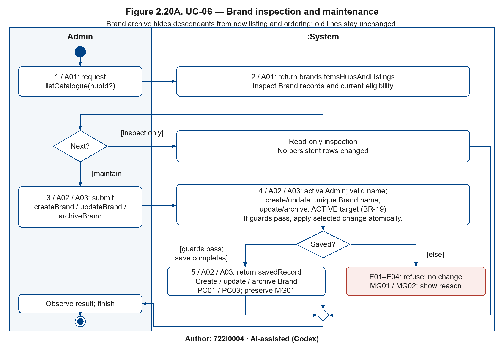

Figure 2.20A. UC-06 — Brand inspection and maintenance — Author: 722I0004 · AI-assisted (Codex)

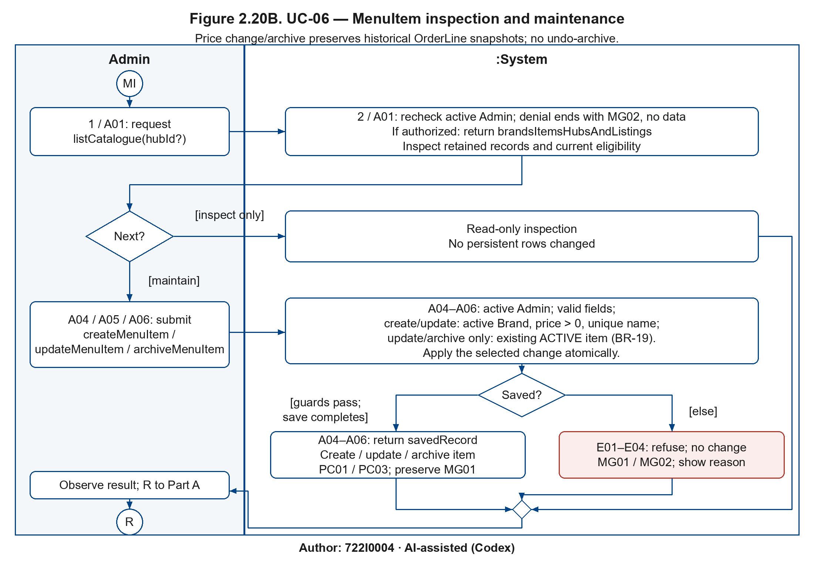

Figure 2.20B. UC-06 — MenuItem inspection and maintenance — Author: 722I0004 · AI-assisted (Codex)

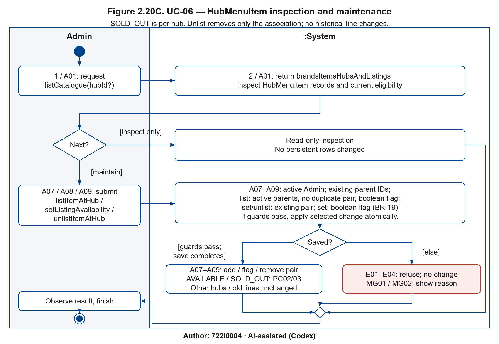

Figure 2.20C. UC-06 — HubMenuItem inspection and maintenance — Author: 722I0004 · AI-assisted (Codex)

Each page models one independently initiated request in Admin | System partitions; alternatives merge before the result is observed. The bullseye ends the whole request. There is no fork or concurrent flow. Guard checks include session authorization and save completion; the else edge covers every failed guard and rollback. Repeating an inspection starts another request.

#### iii. System sequence diagram for Use Case 6

Author: 722I0004 · AI-assisted (Codex)

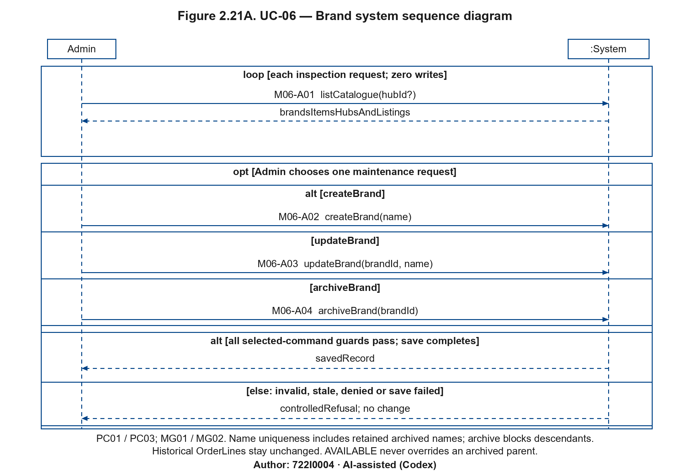

Figure 2.21A. UC-06 — Brand system sequence diagram — Author: 722I0004 · AI-assisted (Codex)

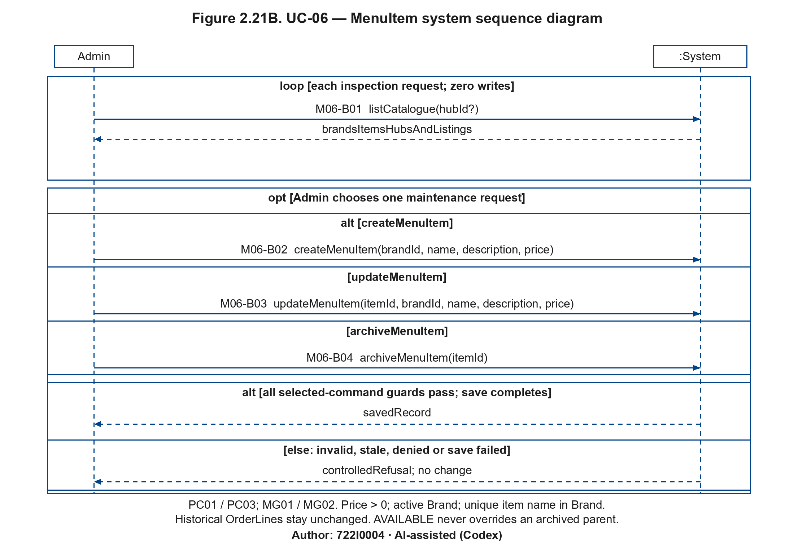

Figure 2.21B. UC-06 — MenuItem system sequence diagram — Author: 722I0004 · AI-assisted (Codex)

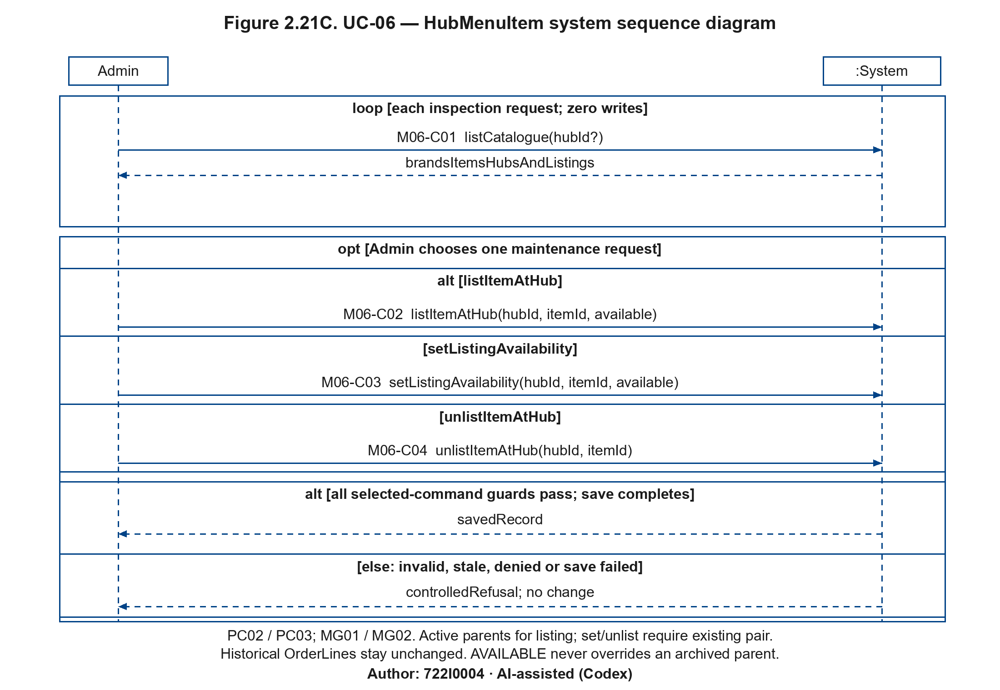

Figure 2.21C. UC-06 — HubMenuItem system sequence diagram — Author: 722I0004 · AI-assisted (Codex)

Only Admin and :System participate. Solid calls use the frozen operation catalogue with its parameters; dashed arrows are returned values. The inspection loop is read-only; the optional maintenance request selects exactly one command in an alt, followed by guarded savedRecord versus controlledRefusal outcomes. Query refusal/denial is represented by its returned refusal where defined; denied sessions reveal no protected data.

<!-- Figure placement: 230 mm landscape, minimum 9.48 pt. Split catalogue pages must not be reduced to portrait width. -->

#### iv. State machine diagram for Use Case 6

Author: 722I0004 · AI-assisted (Codex)

Catalogue machines Figures 2.8A–D are owned here (sources `models/UC-06/sm_catalogue.*`; canonical block in `II_state_machines.md`). Brand and MenuItem archive ACTIVE → ARCHIVED. HubMenuItem AVAILABLE ↔ SOLD_OUT belongs to one hub–item pair; unlist ends that association lifecycle by removing only its row. Archived parent exclusion remains effective independently of the flag. See UC-01 for Order snapshots and UC-05 for availability rechecks on replacement; neither state block is duplicated here.

| Anchor | Transition or stored fact |
|---|---|
| UC06-PC01 | createBrand/createMenuItem → ACTIVE; updateBrand/updateMenuItem self-transitions; archiveBrand/archiveMenuItem → ARCHIVED. |
| UC06-PC02 | listItemAtHub creates AVAILABLE/SOLD_OUT; setListingAvailability switches per pair; unlistItemAtHub ends the pair lifecycle. |
| UC06-PC03 | Archived parent exclusion and SOLD_OUT prohibit new ordering; no MenuItem global SOLD_OUT state exists. |
| UC06-MG01 | Historical OrderLine snapshot name/price/quantity remains a stored fact through every catalogue transition and refusal, including unlist. |
| UC06-MG02 | Duplicate-name/pair or invalid-price guards refuse with no state or attribute change. |

The root assembler inserts the canonical state-machine block once beneath this subsection; this package cross-references it without copying shared images. These are analysis contracts, not measured application results.

Editable models: each base .drawio contains all its pages; the adjacent JSON and Python regenerate the models. Catalogue base PNG/SVG are first-page aliases; use all A–C figures above together.

All shared state figures below require **230 mm A4 landscape** placement (minimum 9.48 pt); do not shrink them into a portrait column.

<!-- BEGIN STATE_MACHINE CATALOGUE -->

##### Catalogue — owning placement: UC-06; SUC-06 availability support

Author: 722I0004 · AI-assisted (Codex)

Brand and MenuItem each have ACTIVE → ARCHIVED lifecycles; HubMenuItem owns availability per hub and ends when unlisted. An archived parent is excluded operationally regardless of a retained listing flag. Existing OrderLine snapshot prices/names survive catalogue maintenance.

Figure 2.8A. Brand — maintenance and archive — Author: 722I0004 · AI-assisted (Codex)

[Editable draw.io](../../../models/UC-06/sm_catalogue.drawio) · [SVG](../../../models/UC-06/sm_catalogue.svg) · [Generator](../../../models/UC-06/sm_catalogue.py) · [Data](../../../models/UC-06/sm_catalogue.json)

| PC/MG anchor | Contract text (verbatim) | Transition / retained fact / refusal invariant |
|---|---|---|
| UC06-PC01 | brand/item created, updated, archived | createBrand/updateBrand/archiveBrand: ACTIVE creation, ACTIVE self-update, terminal ARCHIVED. |
| UC06-PC03 | archived/sold-out items not orderable | Archived Brand and descendant items/listings are hidden from operational ordering. |
| UC06-MG01 | old order lines unchanged after price change/archive | Archive/update touches catalogue facts only; existing OrderLine snapshots are retained. |
| UC06-MG02 | duplicates/invalid prices refused | Uniqueness and validity guards refuse duplicate/invalid creates/updates. |

Figure 2.8B. MenuItem — maintenance and archive — Author: 722I0004 · AI-assisted (Codex)

[Editable draw.io](../../../models/UC-06/sm_catalogue_PartB.drawio) · [SVG](../../../models/UC-06/sm_catalogue_PartB.svg) · [Generator](../../../models/UC-06/sm_catalogue_PartB.py) · [Data](../../../models/UC-06/sm_catalogue_PartB.json)

| PC/MG anchor | Contract text (verbatim) | Transition / retained fact / refusal invariant |
|---|---|---|
| UC06-PC01 | brand/item created, updated, archived | createMenuItem/updateMenuItem/archiveMenuItem: ACTIVE creation, update and ARCHIVED. |
| UC06-PC03 | archived/sold-out items not orderable | Archived item cannot be listed or ordered even if a retained listing flag is true. |
| UC06-MG01 | old order lines unchanged after price change/archive | Price/archive changes never rewrite OrderLine snapshots. |
| UC06-MG02 | duplicates/invalid prices refused | Active-parent, unique name and price>0 guards refuse invalid writes. |

Figure 2.8C. HubMenuItem — list and change availability — Author: 722I0004 · AI-assisted (Codex)

[Editable draw.io](../../../models/UC-06/sm_catalogue_PartC.drawio) · [SVG](../../../models/UC-06/sm_catalogue_PartC.svg) · [Generator](../../../models/UC-06/sm_catalogue_PartC.py) · [Data](../../../models/UC-06/sm_catalogue_PartC.json)

| PC/MG anchor | Contract text (verbatim) | Transition / retained fact / refusal invariant |
|---|---|---|
| UC06-PC02 | listing added/removed, availability per hub | listItemAtHub creates a per-hub listing; setListingAvailability / setMenuAvailability switches AVAILABLE ↔ SOLD_OUT. |
| UC06-PC03 | archived/sold-out items not orderable | New ordering requires active parents and AVAILABLE listing; SOLD_OUT or archived parents fail the ordering guard. |
| UC06-MG01 | old order lines unchanged after price change/archive | Availability changes do not rewrite existing OrderLine snapshots. |
| UC06-MG02 | duplicates/invalid prices refused | Duplicate pair / inactive parent / invalid listing inputs do not create a listing. |

Figure 2.8D. HubMenuItem — unlist ends the listing — Author: 722I0004 · AI-assisted (Codex)

[Editable draw.io](../../../models/UC-06/sm_catalogue_PartD.drawio) · [SVG](../../../models/UC-06/sm_catalogue_PartD.svg) · [Generator](../../../models/UC-06/sm_catalogue_PartD.py) · [Data](../../../models/UC-06/sm_catalogue_PartD.json)

| PC/MG anchor | Contract text (verbatim) | Transition / retained fact / refusal invariant |
|---|---|---|
| UC06-PC02 | listing added/removed, availability per hub | unlistItemAtHub ends the listing by row deletion; no stored UNLISTED state. |
| UC06-MG01 | old order lines unchanged after price change/archive | Unlist preserves existing OrderLine snapshots and does not alter another hub’s listing. |

## 2.3 Verifying Use Cases for Actor (CRUD)

Author: 722I0004 · AI-assisted (Codex)

These five actor tables implement the locked portfolio under the narrow root reconciliations below. The plan is unchanged. Cells name observable UC/SUC paths, not generic database privileges. An intentional blank grants no operation. All behavior remains an analysis contract; no running CRUD result is claimed before P4.

Scope restrictions apply to every cell: Customer reads/changes own records only; Kitchen staff work only at their hub (BR-26); Shipper sees delivery contact and the saved address snapshot and payment method/state/cash due only (BR-12/25), never passport details; Admin reads authorized account/history data. UserAccount Read SUC-01 in each actor table means own authentication/role context only, with credential verification internal: it grants neither an account-list endpoint nor access to password hashes. Address UC-02 is the saved Order address snapshot, not permission to edit or browse live addresses.

### 2.3.1 Verifying use cases for Customer

Author: 722I0004 · AI-assisted (Codex)

| Data entity / domain class | C R U D | Verified use case |
|---|---|---|
| Hub | Create | — (intentional blank) |
|  | Read / report | UC-01 |
|  | Update | — (intentional blank) |
|  | Delete (or archive) | — (intentional blank) |
| Brand | Create | — (intentional blank) |
|  | Read / report | UC-01 |
|  | Update | — (intentional blank) |
|  | Delete (or archive) | — (intentional blank) |
| MenuItem | Create | — (intentional blank) |
|  | Read / report | UC-01 |
|  | Update | — (intentional blank) |
|  | Delete (or archive) | — (intentional blank) |
| HubMenuItem | Create | — (intentional blank) |
|  | Read / report | UC-01 |
|  | Update | — (intentional blank) |
|  | Delete (or archive) | — (intentional blank) |
| UserAccount | Create | SUC-02 |
|  | Read / report | SUC-01; SUC-02 |
|  | Update | SUC-02 |
|  | Delete (or archive) | — (intentional blank) |
| Customer | Create | SUC-02 |
|  | Read / report | SUC-02; SUC-03 |
|  | Update | SUC-02 |
|  | Delete (or archive) | — (intentional blank) |
| Address | Create | SUC-02 |
|  | Read / report | SUC-02; UC-01 |
|  | Update | SUC-02 |
|  | Delete (or archive) | SUC-02 |
| Voucher | Create | — (intentional blank) |
|  | Read / report | UC-01 |
|  | Update | — (intentional blank) |
|  | Delete (or archive) | — (intentional blank) |
| Order | Create | UC-01 |
|  | Read / report | SUC-03 |
|  | Update | SUC-03; SUC-04 |
|  | Delete (or archive) | — (intentional blank) |
| OrderLine | Create | UC-01 |
|  | Read / report | SUC-03 |
|  | Update | SUC-03 |
|  | Delete (or archive) | — (intentional blank) |
| Payment | Create | UC-01 |
|  | Read / report | SUC-03 |
|  | Update | SUC-03; SUC-04 |
|  | Delete (or archive) | — (intentional blank) |
| Delivery | Create | — (intentional blank) |
|  | Read / report | SUC-03 |
|  | Update | — (intentional blank) |
|  | Delete (or archive) | — (intentional blank) |
| ReplacementOffer | Create | — (intentional blank) |
|  | Read / report | SUC-03 |
|  | Update | SUC-03; SUC-04 |
|  | Delete (or archive) | — (intentional blank) |

### 2.3.2 Verifying use cases for Kitchen staff

Author: 722I0004 · AI-assisted (Codex)

| Data entity / domain class | C R U D | Verified use case |
|---|---|---|
| MenuItem | Create | — (intentional blank) |
|  | Read / report | UC-05 |
|  | Update | — (intentional blank) |
|  | Delete (or archive) | — (intentional blank) |
| HubMenuItem | Create | — (intentional blank) |
|  | Read / report | SUC-06; UC-05 |
|  | Update | SUC-06 |
|  | Delete (or archive) | — (intentional blank) |
| UserAccount | Create | — (intentional blank) |
|  | Read / report | SUC-01 |
|  | Update | — (intentional blank) |
|  | Delete (or archive) | — (intentional blank) |
| Order | Create | — (intentional blank) |
|  | Read / report | SUC-05; UC-05 |
|  | Update | SUC-05; UC-05 |
|  | Delete (or archive) | — (intentional blank) |
| OrderLine | Create | — (intentional blank) |
|  | Read / report | UC-05 |
|  | Update | — (intentional blank) |
|  | Delete (or archive) | — (intentional blank) |
| Payment | Create | — (intentional blank) |
|  | Read / report | — (intentional blank) |
|  | Update | UC-05 |
|  | Delete (or archive) | — (intentional blank) |
| Delivery | Create | SUC-05 |
|  | Read / report | — (intentional blank) |
|  | Update | — (intentional blank) |
|  | Delete (or archive) | — (intentional blank) |
| ReplacementOffer | Create | UC-05 |
|  | Read / report | UC-05 |
|  | Update | UC-05 |
|  | Delete (or archive) | — (intentional blank) |

### 2.3.3 Verifying use cases for Shipper

Author: 722I0004 · AI-assisted (Codex)

| Data entity / domain class | C R U D | Verified use case |
|---|---|---|
| UserAccount | Create | — (intentional blank) |
|  | Read / report | SUC-01 |
|  | Update | — (intentional blank) |
|  | Delete (or archive) | — (intentional blank) |
| Customer | Create | — (intentional blank) |
|  | Read / report | UC-02 |
|  | Update | — (intentional blank) |
|  | Delete (or archive) | — (intentional blank) |
| Address | Create | — (intentional blank) |
|  | Read / report | UC-02 |
|  | Update | — (intentional blank) |
|  | Delete (or archive) | — (intentional blank) |
| Order | Create | — (intentional blank) |
|  | Read / report | UC-02 |
|  | Update | UC-02 |
|  | Delete (or archive) | — (intentional blank) |
| Payment | Create | — (intentional blank) |
|  | Read / report | UC-02 |
|  | Update | UC-02 |
|  | Delete (or archive) | — (intentional blank) |
| Delivery | Create | — (intentional blank) |
|  | Read / report | UC-02 |
|  | Update | UC-02 |
|  | Delete (or archive) | — (intentional blank) |

### 2.3.4 Verifying use cases for Admin

Author: 722I0004 · AI-assisted (Codex)

| Data entity / domain class | C R U D | Verified use case |
|---|---|---|
| Hub | Create | UC-03 |
|  | Read / report | UC-03 |
|  | Update | UC-03 |
|  | Delete (or archive) | UC-03 |
| Brand | Create | UC-06 |
|  | Read / report | UC-06 |
|  | Update | UC-06 |
|  | Delete (or archive) | UC-06 |
| MenuItem | Create | UC-06 |
|  | Read / report | UC-06 |
|  | Update | UC-06 |
|  | Delete (or archive) | UC-06 |
| HubMenuItem | Create | UC-06 |
|  | Read / report | UC-06 |
|  | Update | UC-06 |
|  | Delete (or archive) | UC-06 |
| UserAccount | Create | SUC-08 |
|  | Read / report | SUC-01; SUC-08 |
|  | Update | SUC-08 |
|  | Delete (or archive) | SUC-08 |
| Customer | Create | — (intentional blank) |
|  | Read / report | SUC-08 |
|  | Update | — (intentional blank) |
|  | Delete (or archive) | SUC-08 |
| Voucher | Create | SUC-07 |
|  | Read / report | SUC-07 |
|  | Update | SUC-07 |
|  | Delete (or archive) | SUC-07 |
| Order | Create | — (intentional blank) |
|  | Read / report | SUC-09 |
|  | Update | — (intentional blank) |
|  | Delete (or archive) | SUC-09 |
| OrderLine | Create | — (intentional blank) |
|  | Read / report | SUC-09 |
|  | Update | — (intentional blank) |
|  | Delete (or archive) | SUC-09 |
| Payment | Create | — (intentional blank) |
|  | Read / report | SUC-09 |
|  | Update | — (intentional blank) |
|  | Delete (or archive) | SUC-09 |
| Delivery | Create | — (intentional blank) |
|  | Read / report | SUC-09 |
|  | Update | — (intentional blank) |
|  | Delete (or archive) | SUC-09 |
| ReplacementOffer | Create | — (intentional blank) |
|  | Read / report | SUC-09 |
|  | Update | — (intentional blank) |
|  | Delete (or archive) | SUC-09 |

### 2.3.5 Verifying use cases for Manager

Author: 722I0004 · AI-assisted (Codex)

| Data entity / domain class | C R U D | Verified use case |
|---|---|---|
| Hub | Create | — (intentional blank) |
|  | Read / report | UC-04 |
|  | Update | — (intentional blank) |
|  | Delete (or archive) | — (intentional blank) |
| UserAccount | Create | — (intentional blank) |
|  | Read / report | SUC-01 |
|  | Update | — (intentional blank) |
|  | Delete (or archive) | — (intentional blank) |
| Order | Create | — (intentional blank) |
|  | Read / report | UC-04 |
|  | Update | — (intentional blank) |
|  | Delete (or archive) | — (intentional blank) |
| OrderLine | Create | — (intentional blank) |
|  | Read / report | UC-04 |
|  | Update | — (intentional blank) |
|  | Delete (or archive) | — (intentional blank) |
| Payment | Create | — (intentional blank) |
|  | Read / report | UC-04 |
|  | Update | — (intentional blank) |
|  | Delete (or archive) | — (intentional blank) |
| Delivery | Create | — (intentional blank) |
|  | Read / report | UC-04 |
|  | Update | — (intentional blank) |
|  | Delete (or archive) | — (intentional blank) |

##### Union and bidirectional verification

Author: 722I0004 · AI-assisted (Codex)

Every original §2.4 qualified C/R/U/D cell is held by at least one actor above. Every actor cell is in the reconciled union below. Literal omissions in the locked tables are retained as explicit plan issues, rather than claimed to be exact original equality. The six missing qualified reads found by D and the reverse-direction omissions are resolved only within existing UC/SUC scope.

| Persistent class | C | R | U | D / archive | Actors holding cells |
|---|---|---|---|---|---|
| Hub | UC-03 | UC-01; UC-03; UC-04 | UC-03 | UC-03 | Customer; Admin; Manager |
| Brand | UC-06 | UC-01; UC-06 | UC-06 | UC-06 | Customer; Admin |
| MenuItem | UC-06 | UC-01; UC-05; UC-06 | UC-06 | UC-06 | Customer; Kitchen staff; Admin |
| HubMenuItem | UC-06 | SUC-06; UC-01; UC-05; UC-06 | SUC-06; UC-06 | UC-06 | Customer; Kitchen staff; Admin |
| UserAccount | SUC-02; SUC-08 | SUC-01; SUC-02; SUC-08 | SUC-02; SUC-08 | SUC-08 | Customer; Kitchen staff; Shipper; Admin; Manager |
| Customer | SUC-02 | SUC-02; SUC-03; SUC-08; UC-02 | SUC-02 | SUC-08 | Customer; Shipper; Admin |
| Address | SUC-02 | SUC-02; UC-01; UC-02 | SUC-02 | SUC-02 | Customer; Shipper |
| Voucher | SUC-07 | SUC-07; UC-01 | SUC-07 | SUC-07 | Customer; Admin |
| Order | UC-01 | SUC-03; SUC-05; SUC-09; UC-02; UC-04; UC-05 | SUC-03; SUC-04; SUC-05; UC-02; UC-05 | SUC-09 | Customer; Kitchen staff; Shipper; Admin; Manager |
| OrderLine | UC-01 | SUC-03; SUC-09; UC-04; UC-05 | SUC-03 | SUC-09 | Customer; Kitchen staff; Admin; Manager |
| Payment | UC-01 | SUC-03; SUC-09; UC-02; UC-04 | SUC-03; SUC-04; UC-02; UC-05 | SUC-09 | Customer; Kitchen staff; Shipper; Admin; Manager |
| Delivery | SUC-05 | SUC-03; SUC-09; UC-02; UC-04 | UC-02 | SUC-09 | Customer; Kitchen staff; Shipper; Admin; Manager |
| ReplacementOffer | UC-05 | SUC-03; SUC-09; UC-05 | SUC-03; SUC-04; UC-05 | SUC-09 | Customer; Kitchen staff; Admin |

| Comparison | Result |
|---|---|
| Original §2.4 → reconciled actor tables | 0 missing qualified cells |
| Reconciled actor tables → reconciled union | 0 missing qualified cells (union derived from those tables) |
| Additional cells against literal §2.4 | Read-only cells listed below; no new create/update/archive grants |
| Persistent classes / schema tables | 13 / 13; mapping below |

##### Root dispositions for literal plan differences

| Discrepancy | Accepted conservative reconciliation |
|---|---|
| UserAccount R SUC-01 lacks an actor assignment in §2.5 | Own authentication-context read for all five human actors, already the All actor scope of SUC-01; no general account read permission. |
| Customer R SUC-03; Address R UC-01 lack matching own-read actor qualifiers | Add only the owning Customer read while tracking / selecting their checkout address. |
| MenuItem R UC-05; HubMenuItem R UC-05 / SUC-06 lack kitchen qualifiers | Read only own-hub replacement candidates/listings; no master-data update. |
| Payment R UC-02 lacks shipper read cell | Read method/state/cash due for delivery under BR-25, without other customer-private data. |
| Admin Customer R is unqualified and absent from §2.4 | Qualify already listed authorized linked-account read as SUC-08. |
| Admin Order/children history R SUC-09 absent from §2.4 | Retain the reads already stated in §2.5 and §2.2 SUC-09, through authorized closed-order history only. |
| Kitchen Order R SUC-05 stated in §2.5 but omitted from §2.4 | Retain the own-hub read required to start/finish preparation; this reverse-direction omission was added by root. |

Added Read qualifiers against literal §2.4: Customer R SUC-08; Order R SUC-09; Order R SUC-05; OrderLine R SUC-09; Payment R SUC-09; Delivery R SUC-09; ReplacementOffer R SUC-09.

No locked plan cell was removed. Proposed owner clarification: add these qualifiers to the next approved plan revision; this phase records the discrepancy without editing the locked contract.

##### Archive and persistence notes

An archived parent hides itself and its children from operational lists (boards, menus and checkout). Authorised history, receipts, reports and refund obligations still include them. Archive is an operational visibility rule, not physical child deletion or permission to erase snapshots. SUC-09 accepts only DELIVERED, DELIVERY_FAILED, REJECTED or CANCELLED orders. Customer deactivation is through the linked UserAccount; it does not erase the profile. HubMenuItem unlisting removes only that association row, and historical OrderLine snapshots survive. Seed rows are test setup, never a “Create”.

Not persisted: Quote, ReportFilter, report rows and receipt (computed views). No Shipper class/table: SHIPPER is a UserAccount role linked from Delivery.

##### Schema table coverage (Static)

| SQL table | Persistent class |
|---|---|
| `hub` | Hub |
| `brand` | Brand |
| `menu_item` | MenuItem |
| `hub_menu_item` | HubMenuItem |
| `user_account` | UserAccount |
| `customer` | Customer |
| `address` | Address |
| `voucher` | Voucher |
| `orders` | Order |
| `order_line` | OrderLine |
| `payment` | Payment |
| `delivery` | Delivery |
| `replacement_offer` | ReplacementOffer |

All 13 schema tables are covered. Local/Tourist share Customer persistence. State/attribute differences and behavioral guards remain explicitly listed as P4 inputs; this table-coverage result does not qualify the app.
