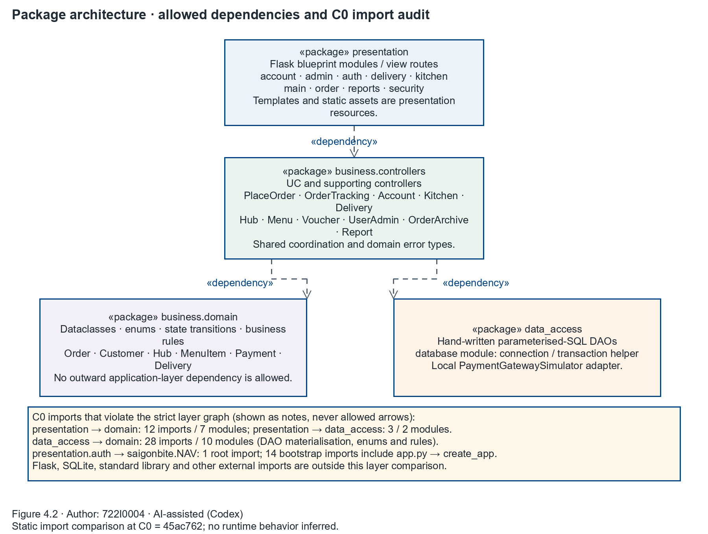
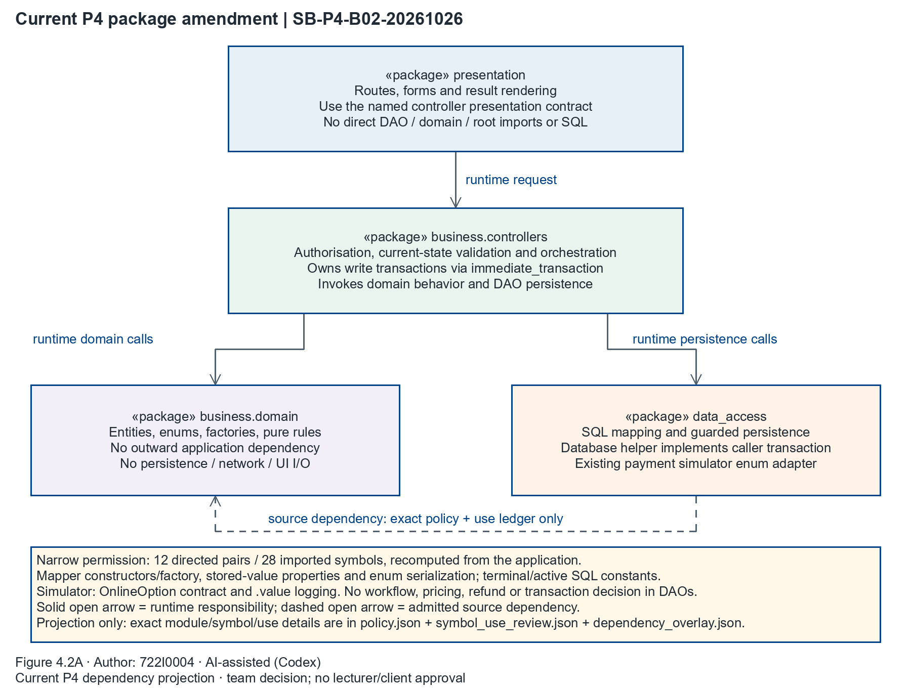

## 4.2 Package Diagram for the Subsystem

Author: 722I0004 · AI-assisted (Codex)

Figure 4.2. Package architecture and C0 dependency policy — Author: 722I0004 · AI-assisted (Codex)

The diagram shows the permitted package dependencies: presentation routes depend on controllers; controllers depend on domain objects and data access; the domain package has no outward application-layer dependency. Dashed arrows show only those permitted dependencies. The import audit beside the packages reports actual C0 violations separately, without drawing them as allowed architecture.

The comparison resolves both absolute and relative `saigonbite.*` imports in all 48 inventory modules. It accounts for 392 application-internal import records: 152 permitted cross-layer imports (24 presentation→controllers, 82 controllers→domain, 46 controllers→data_access), 182 imports within a layer, 43 strict-layer violations, and 15 root-boundary imports. Imports from Flask, Flask-Login, Werkzeug, SQLite and the Python standard library are outside the application-layer comparison.

| Strict C0 violation | Evidence from `code_inventory.json` |
|---|---|
| presentation→business.domain: 12 imports in 7 modules | `presentation/account.py` imports `Role` and `rules`; `admin.py` imports `DiscountType` and `Role`; `auth.py` imports `Role` and `UserAccount`; `delivery.py`, `kitchen.py` and `reports.py` import `Role`; `order.py` imports `OnlineOption`, `PaymentMethod` and `Role`. |
| presentation→data_access: 3 imports in 2 modules | `presentation/db.py` imports `connect`; `presentation/order.py` imports `APPROVE` and `DECLINE`. |
| data_access→business.domain: 28 imports in 10 modules | `customer_dao.py`, `delivery_dao.py`, `hub_dao.py`, `menu_dao.py`, `offer_dao.py`, `order_dao.py`, `payment_dao.py`, `payment_gateway.py`, `user_dao.py` and `voucher_dao.py` import domain objects, factories, enums or rules for row materialisation and gateway typing. |

The remaining 15 records sit at the composition boundary: `saigonbite/__init__.py` imports 3 controller error types and 10 presentation modules to assemble the application; `app.py` imports `create_app`; and `presentation/auth.py` imports the root-level `saigonbite.NAV` constant. The first two are bootstrap wiring outside the four named packages. The last is a direct view-to-root import and is called out separately because it does not match the strict package graph.

**Root disposition — accepted as P3-S04 / P4.9.** A strict-layer boundary decision is required before treating the package graph as satisfied at C0. Resolve the 12 presentation→domain imports and 3 presentation→data_access imports at the presentation/controller boundary, decide whether DAO-to-domain materialisation receives an explicit persistence-mapper exception or moves behind a lower-level mapping boundary, and resolve the `NAV` root import. No exception or architectural change is adopted in P3. The shared annotations account for all 44 finding records across 23 module pairs (43 cross-layer records plus the `NAV` root import). These are static policy findings; they do not establish a runtime failure. The figure shows three permitted arrows across four packages and keeps observed violations visible.

Evidence is Static at C0 `45ac76221b0a103174c7c01d17577e6e49cfd665`. The machine-readable import audit is in `models/shared/package_diagram.json`. No application import, execution, test, or runtime qualification was performed.

### Effective P4 amendment — 26 October 2026

**SB-P4-B02-20261026 is adopted by Dat’s actual continuation message as a bounded team implementation decision, not lecturer/client approval.** The locked plan and original C0/P3 model remain unchanged. The preceding graph/audit is historical C0 evidence, not a complete current dependency graph. Eleven presentation pairs were removed in P4; the remaining mapper/adapter dependencies are retained and explicitly dispositioned, not removed.

Figure 4.2A. Current P4 amendment — Author: 722I0004 · AI-assisted (Codex). Solid open arrows show runtime responsibilities; the dashed open arrow admits only the exact policy entries below. Native draw.io editing remains UNTESTED.

The effective current model is the frozen P3 class/method model plus the reproducible dependency overlay. Its model SHA-256 is `fe3e521d4eea7c66c2819a1acbb67101ecfd3fe49162650fb2dc273195079a6b`. Frozen DCDs are class/member/responsibility slices, not complete current import graphs; Figure 4.2A and `dependency_overlay.json` supply the named current dependency projection without rewriting any P3 signatures/statuses/PC/MG identities.

| Source (`saigonbite.data_access.*`) | Target | Exact symbols | Permitted use |
|---|---|---|---|
| customer_dao | `saigonbite.business.domain` | `Address`, `Customer`, `make_customer` | Typed entity parameters/results; row-to-correct-subtype materialisation by make_customer; address mapping and stored field serialization. |
| delivery_dao | `saigonbite.business.domain` | `Delivery`, `DeliveryState` | Delivery row reconstruction and enum serialization in guarded persistence predicates; no transition decision. |
| hub_dao | `saigonbite.business.domain` | `ACTIVE_ORDER_STATES`, `Hub`, `HubMenuItem`, `MenuItem` | Hub/menu row mapping; declared active-state set translated to SQL predicate values. |
| menu_dao | `saigonbite.business.domain` | `Brand`, `HubMenuItem`, `MenuItem` | Catalogue row/object mapping and stored persistence parameter serialization. |
| offer_dao | `saigonbite.business.domain` | `OfferState`, `ReplacementOffer` | Offer row reconstruction, enum serialization and guarded persistence updates; caller chooses outcome. |
| order_dao | `saigonbite.business.domain` | `Order`, `OrderLine`, `OrderState` | Aggregate/line row reconstruction; existing pure stored-value properties item_subtotal/total and fields serialized; caller decides transition. |
| payment_dao | `saigonbite.business.domain` | `OnlineOption`, `Payment`, `PaymentMethod`, `PaymentState` | Typed payment mapping and enum/value serialization; no authorisation/refund decision. |
| payment_gateway | `saigonbite.business.domain` | `OnlineOption` | Existing simulator option enum contract, option.value rendering/logging; simulator is not a real provider. |
| user_dao | `saigonbite.business.domain` | `Role`, `UserAccount` | Account row reconstruction and role/stored-field serialization. |
| voucher_dao | `saigonbite.business.domain` | `DiscountType`, `Voucher` | Voucher row reconstruction and type/value serialization; no checkout discount calculation. |
| hub_dao | `saigonbite.business.domain.rules` | `rules` (`TERMINAL_ORDER_STATES` member only) | Retained-order/archive SQL predicate constants. |
| order_dao | `saigonbite.business.domain.rules` | `rules` (`TERMINAL_ORDER_STATES` member only) | Terminal SQL predicates and timestamp-column selection; caller owns transition decision. |

Constructors, `make_customer`, enum conversions and existing stored-value/property reads are admitted runtime uses, not annotation-only dependencies. `rules` is restricted to `TERMINAL_ORDER_STATES`; `ACTIVE_ORDER_STATES` is translated into SQL predicates. The simulator’s `OnlineOption` dependency is an adapter enum contract, separate from row mapping. No broad data-access-to-domain permission is granted.

Domain isolation, view/controller boundary, authorisation, current-state validation, orchestration and transaction ownership are unchanged. `database.immediate_transaction` remains the infrastructure implementation of the controller-invoked context; DAOs do not own workflow commit/rollback. SQL guards and rowcounts remain defense in depth. New source/target/symbol/member/use requires explicit review and disposition; aliases/re-exports must resolve; wildcard/dynamic imports or dependency hiding are rejected. No new application-role cycle is permitted.

Validation: `p4_dependency_policy_audit.py` scans all actual application modules and bootstrap, resolves imports/re-exports, checks exact source/target/symbol/member sets and forbidden directions/cycles. `symbol_use_review.json` records each imported symbol and name-use site; `runtime_use_review.json` covers mapper methods including instance property/enum serialization. Whole-body semantic seals bind manually reviewed responsibility conclusions and fail closed on any unreviewed body/use, even when imports are unchanged. This conservative mechanism can reject harmless unreviewed edits; it does not prove arbitrary dynamic Python behavior. `tests/test_p4_dependency_policy.py` supplies parsed-only acceptance/rejection fixtures. The current results are bound by `Part2/notes/P4_B02_final_receipt.json`; no runtime qualification is inferred from this paragraph alone.

The unchanged legacy P3 checker continues to account for the old strict-policy findings as Static P4 targets; a legacy PASS is consistency/accounting evidence, not the active amendment’s authority. Original P4 BLOCKED receipt/report/audit and known-12 test remain historical evidence. The active policy audit independently determines current compliance. No P5/browser/deployment result or independent approval is claimed.
