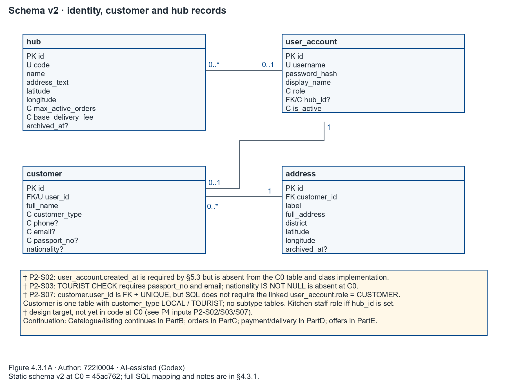
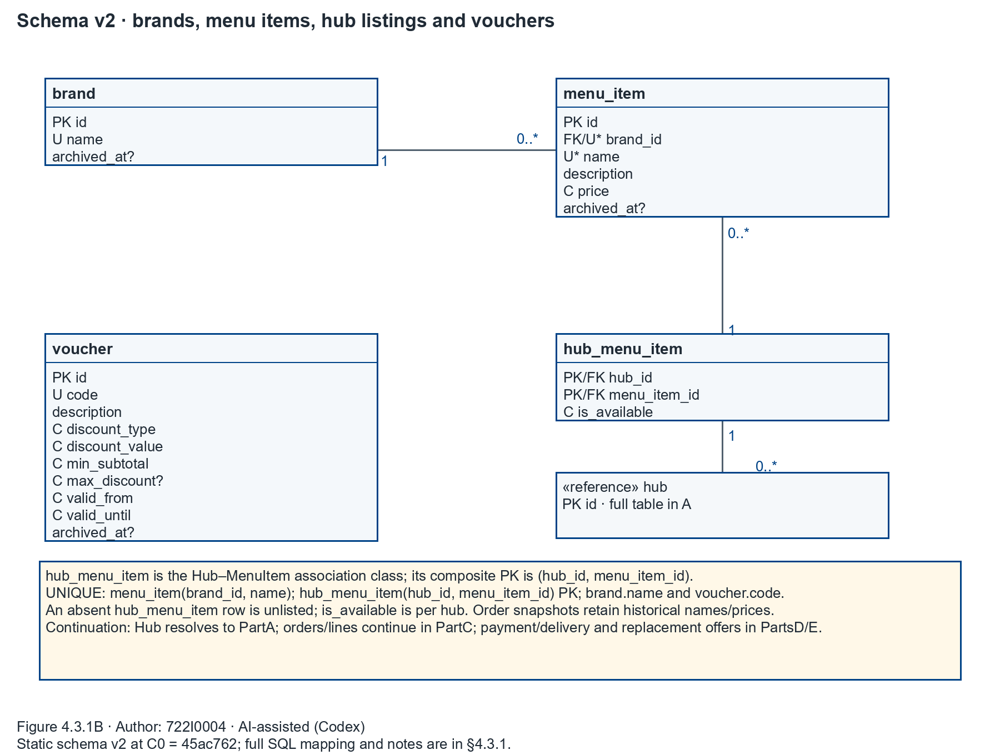
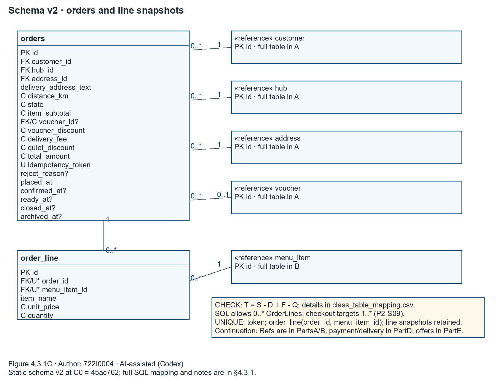
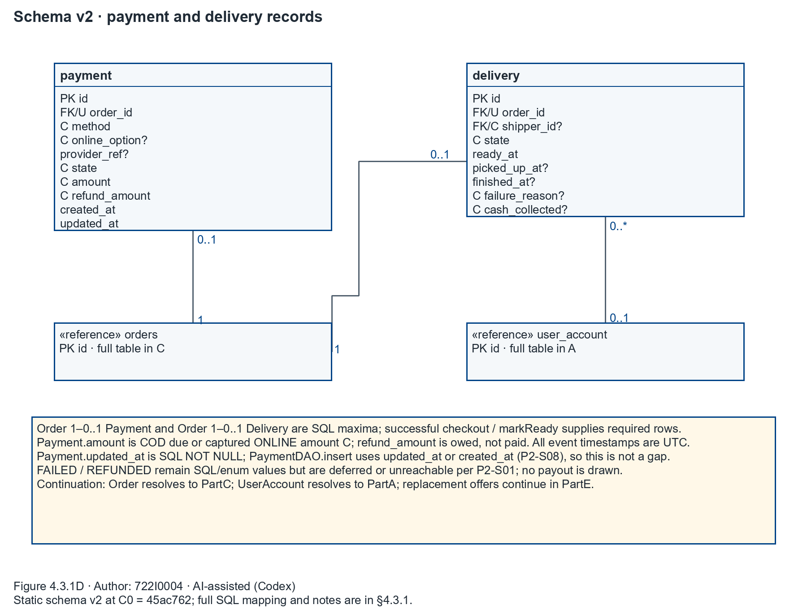
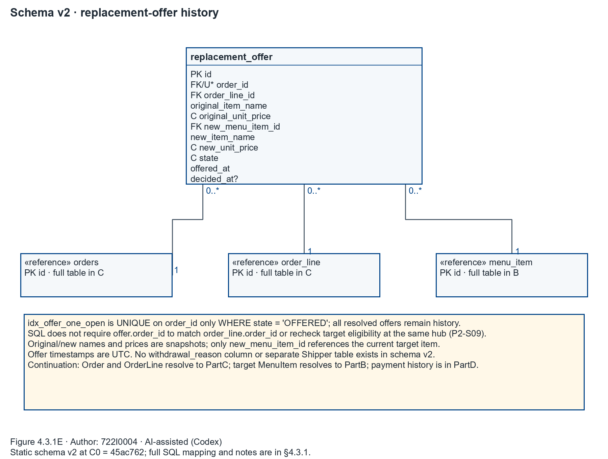

## 4.3.1 Map Persistent Objects to the Tables in a Database

Author: 722I0004 · AI-assisted (Codex)

The schema source is the parsed schema v2 in `docs/part2/design/code_inventory.json` at C0 `45ac76221b0a103174c7c01d17577e6e49cfd665`. It contains 13 tables, 110 columns, 18 foreign keys, seven indexes, and `user_version = 2`. These figures and relationships are Static schema evidence; they are not a claim that application paths or constraints passed tests.

The diagrams use UML associations with SQL multiplicities. `PK` marks primary-key columns, `FK` marks foreign keys, `U` marks a single-column UNIQUE constraint, `U*` marks membership in a composite or partial unique constraint, `C` marks a column participating in a CHECK, and `?` marks a nullable column. Full SQL types, NULL rules, CHECK expressions, key declarations, and enforcement notes are in the [class-to-table mapping](../design/class_table_mapping.csv).

Figure 4.3.1A. Schema v2: identity, customer and hub records — Author: 722I0004 · AI-assisted (Codex)

Figure 4.3.1B. Schema v2: brands, menu items, hub listings and vouchers — Author: 722I0004 · AI-assisted (Codex)

Figure 4.3.1C. Schema v2: orders and order-line snapshots — Author: 722I0004 · AI-assisted (Codex)

Figure 4.3.1D. Schema v2: payment and delivery records — Author: 722I0004 · AI-assisted (Codex)

Figure 4.3.1E. Schema v2: replacement-offer history — Author: 722I0004 · AI-assisted (Codex)

The mapping has one primary row for each of the 110 C0 columns. It also makes non-column correspondences explicit: `Order.lines` maps to the child `order_line.order_id` relationship; `HubMenuItem.item` maps to `hub_menu_item.menu_item_id`; `Order.item_subtotal` and `Order.total` are derived properties with persisted columns; `MenuItem.brand_name` is a joined projection of `brand.name`; `LocalCustomer` and `TouristCustomer` map to the same `customer.customer_type` discriminator; and `OrderLine.line_total` is computed, with no SQL column. `UserAccount.created_at` is recorded as a target gap because its model attribute is `GAP` and the column is absent at C0.

`Customer` is stored in one `customer` table. Its `customer_type` CHECK distinguishes `LOCAL` from `TOURIST`; it does not create separate subtype tables. `hub_menu_item` is the association-class table between Hub and MenuItem, with a composite primary key on `(hub_id, menu_item_id)`. There is no Shipper table: `delivery.shipper_id` references `user_account.id`, and the SHIPPER role is held by the linked account. `Quote`, report filters and rows, and receipts are computed views rather than persisted classes.

The UNIQUE rules are `hub.code`, `brand.name`, `user_account.username`, `customer.user_id`, `voucher.code`, `orders.idempotency_token`, `payment.order_id`, and `delivery.order_id`; the composite rules are `menu_item(brand_id, name)`, `hub_menu_item(hub_id, menu_item_id)` as its primary key, and `order_line(order_id, menu_item_id)`. The partial unique index `idx_offer_one_open` limits each order to one `replacement_offer` whose state is `OFFERED`; resolved offers remain stored history. The unique child FKs on `payment.order_id` and `delivery.order_id` cap each Order at one child row but do not require presence. The SQL also permits an Order with zero OrderLine rows. The contract requires checkout to create one Payment and at least one OrderLine, and `markReady` to create a Delivery; these application-path requirements are for P4 verification, not consequences of the FKs. P2-S09 records the related cross-row guards, including same-order offer/line ownership and shipper eligibility.

Money is stored as whole VND where applicable. For an Order, `item_subtotal` is S, `voucher_discount` is D, `delivery_fee` is F, `quiet_discount` is Q, and `total_amount` is T, constrained by `T = S − D + F − Q`. `payment.amount` holds the COD amount due or captured online amount C; `refund_amount` is an amount owed, not paid out. An accepted replacement can leave a partial online obligation `C − T`; an unfulfilled online order is owed the full C. `delivery.cash_collected` records cash at delivery, which must equal T for COD completion. Order-line and replacement-offer names/prices are snapshots; later catalogue edits do not rewrite the existing order history.

Event columns ending in `_at` are UTC timestamp text. `voucher.valid_from` and `valid_until` are inclusive Asia/Ho_Chi_Minh calendar dates stored as text, not UTC instants. The archive timestamps are on Hub, Brand, MenuItem, Address, Voucher and Order. `user_account.is_active` is an account lifecycle flag, not an archive timestamp; unlisting a HubMenuItem deletes the association row. Under the plan’s archive rule, an archived parent is hidden from operational lists while authorized history, receipts, reports and refund obligations remain available. Child order lines, payments, deliveries and offers remain attached to the retained Order. These retention rules are design requirements for P4 verification, not behaviors inferred from a flag alone.

The † items are design targets, not yet in code at C0. `P2-S02` requires `user_account.created_at`, which is absent from both the draft class and SQL table and is assigned to P4.1. `P2-S03` requires the Tourist CHECK to require `nationality`; the nullable column exists, and the static Phase 2 review found controller validation, but the SQL CHECK does not enforce it. `P2-S07` requires the linked Customer account to have role `CUSTOMER`; the FK and UNIQUE rule do not enforce that role. Root accepted P4.7 as the account subphase for S03/S07. The figure’s dagger legend reads: “† design target, not yet in code at C0 (see P4 inputs P2-S02/S03/S07).”

`P2-S08` is not a missing-value defect: `Payment.updated_at` is `Optional[str]` in the domain model but `NOT NULL` in SQL, and the `PaymentDAO.insert` AST body writes the supplied `updated_at` or falls back to `created_at`. The SQL CHECK also permits Payment values `FAILED` and `REFUNDED`; per P2-S01 and plan §4.3 these remain deferred or unreachable. No declined-payment row or refund-payout path is added to this mapping.

The diagrams and CSV were generated from the frozen inventory/model without importing or running the application. Structural XML and endpoint checks passed, all six PNGs and independent Edge-rasterized SVGs were opened for visual review, and the smallest placed font is 9.21 pt at 230 × 170 mm. Native draw.io editing, Excel, and final DOCX/PDF placement remain UNTESTED; no app correctness or test result is claimed.
