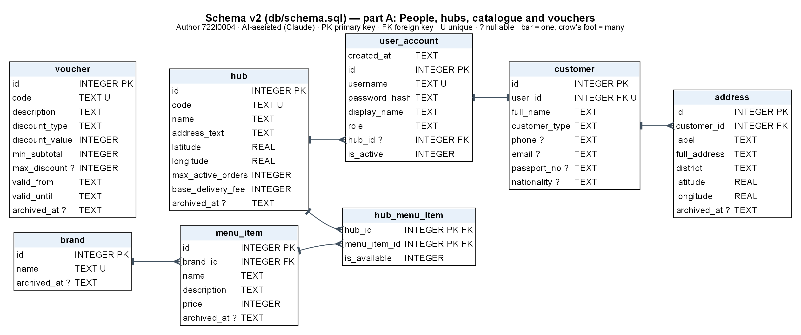
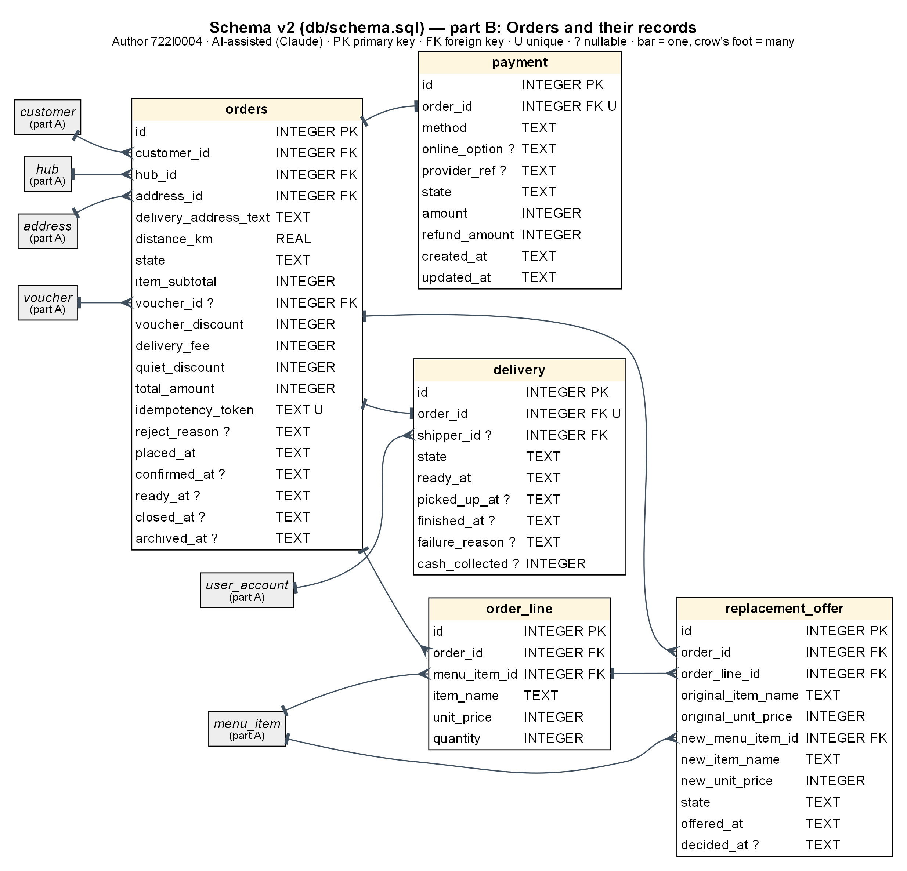

## 4.3.1 Map Persistent Objects to the Tables in a Database

Author: 722I0004 · AI-assisted (Codex, Claude)

Each of the 13 persistent domain classes of 2.1.7 is stored in one table of `db/schema.sql`. The delivered schema has **13 tables, 111 columns, 18 foreign keys, 7 indexes and 3 triggers** (`PRAGMA user_version = 2`). The diagrams below are generated from that file by `models/shared/erd_final.py`, so they show the schema exactly as it runs. Each relationship end shows its multiplicity, derived from the foreign-key column: a NOT NULL foreign key gives exactly one parent (1), a nullable one gives zero or one (0..1, for example `orders.voucher_id` and `delivery.shipper_id`, which stays empty until pickup); a UNIQUE foreign key limits the child side to zero or one (0..1, for example one `customer` row per `user_account`, and staff accounts have none), otherwise zero or many (0..*). Two rules are stronger than the schema can state and are kept by the controllers instead: `confirmCheckout` writes the order, at least one order line and its payment in one transaction, so a stored order always has exactly one payment and one or more lines.

Figure 4.3.1A. Database schema — people, hubs, catalogue and vouchers — Author: 722I0004 · AI-assisted (Claude).

Figure 4.3.1B. Database schema — orders and their records — Author: 722I0004 · AI-assisted (Claude).

**Mapping rules.**

- **One class, one table; `id` becomes the primary key.** Attributes keep their names and become columns. Money is whole VND (INTEGER), Boolean is INTEGER 0/1 with a CHECK, timestamps are UTC ISO text, and voucher dates are Vietnam calendar dates.
- **Associations become foreign keys** on the "many" side (for example `orders.customer_id`). A one-to-zero-or-one association gets a UNIQUE foreign key (`payment.order_id`, `delivery.order_id`, `customer.user_id`).
- **Composition** of OrderLine in Order (the whole owns its parts) is the NOT NULL foreign key `order_line.order_id`; lines are never deleted on their own.
- **Association class** HubMenuItem becomes the table `hub_menu_item` with the composite primary key (`hub_id`, `menu_item_id`) and the attribute `is_available` of the pair.
- **Generalization** LocalCustomer / TouristCustomer uses single-table inheritance: one `customer` table with the discriminator `customer_type` and a CHECK that requires a phone for LOCAL and passport, email and nationality for TOURIST.
- **State attributes** become TEXT columns whose CHECK lists exactly the states of the state machines in 2.2 (for example `orders.state`).
- **Derived attributes** are not stored when they can be computed (hub load, busy/quiet); the order totals S, D, F, Q and T are stored as the agreed snapshot and tied together by `CHECK (total_amount = item_subtotal − voucher_discount + delivery_fee − quiet_discount)`.
- **Archive instead of delete:** `archived_at` on Hub, Brand, MenuItem, Address, Voucher and Order; `is_active` on UserAccount. The only physical delete is unlisting an item at a hub (`MenuDAO` removes the `hub_menu_item` row); earlier orders are unaffected because order lines keep their own name and price snapshot.
- **Rules the CHECKs cannot express** are enforced by triggers: `customer_role_insert` and `customer_role_update` allow a customer profile only on a CUSTOMER account, and `linked_customer_role` stops such an account from changing role. A partial unique index `idx_offer_one_open` allows at most one OFFERED replacement per order.

**Class-to-table mapping** (generated into `models/shared/class_table_mapping.csv` from the domain dataclasses and the schema):

| Persistent class | Table | Attributes stored in columns of the same name | Associations stored as foreign keys | Columns with no same-name attribute | Attributes not stored |
|---|---|---|---|---|---|
| UserAccount | `user_account` | created_at, id, username, password_hash, display_name, role, is_active | hub_id → hub | — | — |
| Customer (LocalCustomer, TouristCustomer) | `customer` | id, full_name, phone, email, passport_no, nationality | user_id → user_account | customer_type | — |
| Address | `address` | id, label, full_address, district, latitude, longitude, archived_at | customer_id → customer | — | — |
| Hub | `hub` | id, code, name, address_text, latitude, longitude, max_active_orders, base_delivery_fee, archived_at | — | — | — |
| Brand | `brand` | id, name, archived_at | — | — | — |
| MenuItem | `menu_item` | id, name, description, price, archived_at | brand_id → brand | — | brand_name |
| HubMenuItem (association class) | `hub_menu_item` | is_available | hub_id → hub, menu_item_id → menu_item | — | item |
| Voucher | `voucher` | id, code, description, discount_type, discount_value, min_subtotal, max_discount, valid_from, valid_until, archived_at | — | — | — |
| Order | `orders` | id, delivery_address_text, distance_km, state, voucher_discount, delivery_fee, quiet_discount, idempotency_token, reject_reason, placed_at, confirmed_at, ready_at, closed_at, archived_at | customer_id → customer, hub_id → hub, address_id → address, voucher_id → voucher | item_subtotal, total_amount | lines |
| OrderLine | `order_line` | id, item_name, unit_price, quantity | order_id → orders, menu_item_id → menu_item | — | — |
| Payment | `payment` | id, method, online_option, provider_ref, state, amount, refund_amount, created_at, updated_at | order_id → orders | — | — |
| Delivery | `delivery` | id, state, ready_at, picked_up_at, finished_at, failure_reason, cash_collected | order_id → orders, shipper_id → user_account | — | — |
| ReplacementOffer | `replacement_offer` | id, original_item_name, original_unit_price, new_item_name, new_unit_price, state, offered_at, decided_at | order_id → orders, order_line_id → order_line, new_menu_item_id → menu_item | — | — |

Notes on the last two columns: `customer_type` is the inheritance discriminator; `item_subtotal` and `total_amount` are stored snapshots of Order properties computed in Python; `MenuItem.brand_name` and `HubMenuItem.item` are values joined in when an object is loaded; `Order.lines` is filled from `order_line`.
