# 4.3.3 User interface design: from the sketch to the prototype and the SSD-to-UI trace

Author: 722I0004 · AI-assisted (Claude Sonnet 5.5)

**How this section was made, in order.** The first screens of the application were built during the draft build (I1 to P4). Phase P5.1 then photographed all 47 in-scope screens, measured and criticised them (`docs/part2/ui/_before/critique.md`), authored a wireframe and a mockup for every goal screen and key alternative as HTML/CSS with AI assistance, refined the real application where a measurement or an SSD result called for it (`docs/part2/ui/refinement_log.md`, 10 commits on branch `part2`) and photographed the real screens again. This is **UI design refinement after the draft build**; the real creation date of every artifact is in the `trace.md` of its use case (27/10/2026 for all wireframes, mockups and implemented screenshots; the sketches are the owner's and are not yet drawn).

**Honest status of the progression.** Sketch: the brief for each use case exists (`UC-0x/sketch_brief.md`); the drawings are the owner's step and are `OWNER-PENDING`. Wireframe and mockup: authored as HTML/CSS and exported to PNG; they are not drawn natively in Figma. Prototype: PENDING (owner): the Figma file is built by the owner from `docs/part2/ui/figma_kit/` (steps in `FIGMA_STEPS.md`); the link is written here and in `Part2/content/links.json` only after it opens without signing in. The Figma kit (frames named `UC0x-Snn <screen name>`, `flows.csv` with 148 hotspots measured from the mockup pages, start frames) is ready in `docs/part2/ui/figma_kit/`.

**How the SSD became the UI.** Each use case has one table that follows every SSD operation occurrence (41 in all: the three `listCatalogue` occurrences are kept apart) to the screen and control that carries it, the inputs and the validation rules, the displayed result and the controller method (from the checked route/controller map; every controller call was verified against the view code). All 41 occurrences have at least one screen (`docs/part2/ui/coverage_check.md`). The implemented screens are Demonstrated by the browser run in `docs/part2/test_report/integration_2026-10-27/README.md` (60 of 60 steps, seven scenarios and the CSRF check).

## 4.3.3.1 UC-01 Place an order

Author: 722I0004 · AI-assisted (Claude Sonnet 5.5). Use case description: `docs/part2/UC-01/description.md`. Package: `docs/part2/ui/UC-01/`.

Progression: sketch (owner, `OWNER-PENDING`; brief `docs/part2/ui/UC-01/sketch_brief.md`) → wireframe → mockup → prototype (PENDING (owner)) → implemented screen. 12 screens: UC-01-S01 (goal), UC-01-S02 (alternative), UC-01-S03 (goal), UC-01-S04 (goal), UC-01-S05 (alternative), UC-01-S06 (goal (online)), UC-01-S07 (alternative), UC-01-S08 (goal), UC-01-S09 (goal), UC-01-S10 (goal), UC-01-S11 (goal), UC-01-S12 (alternative).

### UC-01-S01 Choose a kitchen hub

Role customer, 390x844, routes GET /order/hubs, SSD operations OP-13, template `order/hubs.html`.

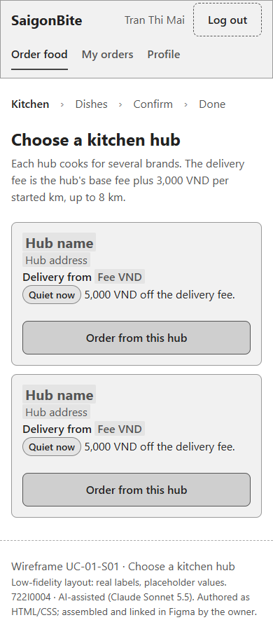

Figure 4.3.3-W01-S01. Wireframe of Choose a kitchen hub. Author: 722I0004 · AI-assisted (Claude Sonnet 5.5)

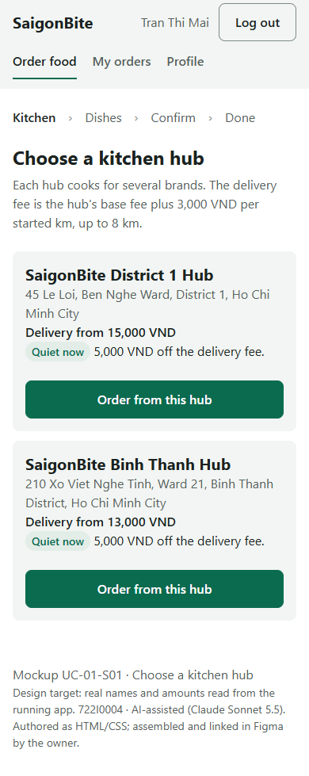

Figure 4.3.3-M01-S01. Mockup of Choose a kitchen hub (real names and amounts taken from the running app). Author: 722I0004 · AI-assisted (Claude Sonnet 5.5)

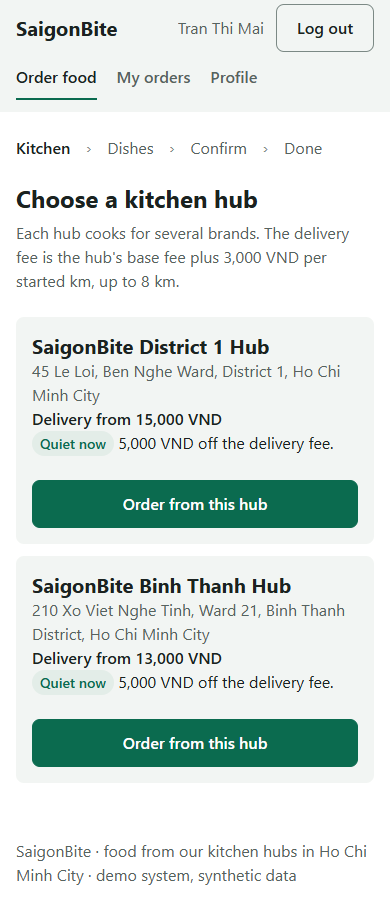

Figure 4.3.3-I01-S01. Implemented screen of Choose a kitchen hub, real application, local Flask development server, Edge, commit 252ada1. Author: 722I0004 · AI-assisted (Claude Sonnet 5.5)

### UC-01-S02 Hub is full, quieter hubs suggested

Role customer, 390x844, routes POST /order/quote -> 409, SSD operations OP-15, template `order/hubs.html`.

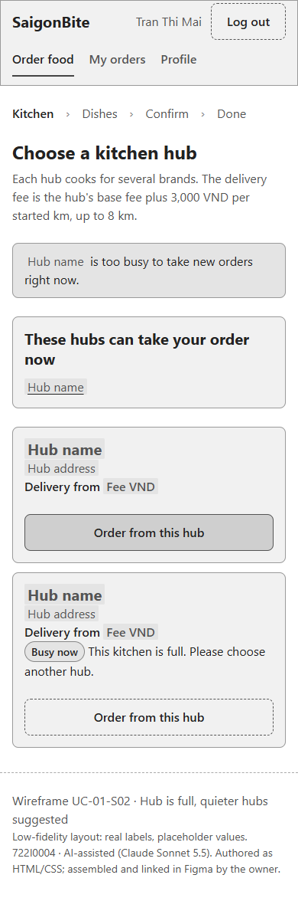

Figure 4.3.3-W01-S02. Wireframe of Hub is full, quieter hubs suggested. Author: 722I0004 · AI-assisted (Claude Sonnet 5.5)

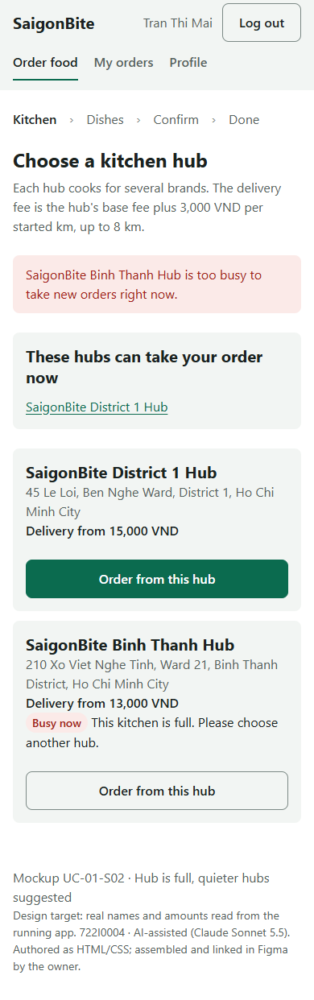

Figure 4.3.3-M01-S02. Mockup of Hub is full, quieter hubs suggested (real names and amounts taken from the running app). Author: 722I0004 · AI-assisted (Claude Sonnet 5.5)

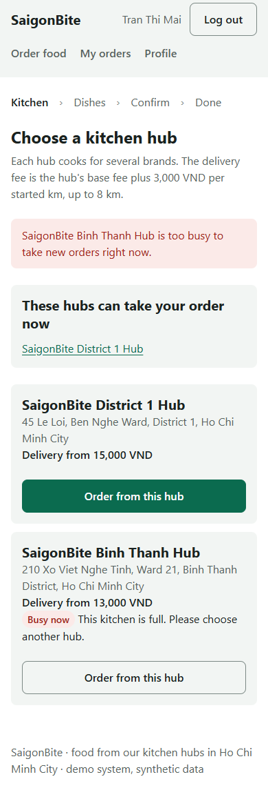

Figure 4.3.3-I01-S02. Implemented screen of Hub is full, quieter hubs suggested, real application, local Flask development server, Edge, commit 252ada1. Author: 722I0004 · AI-assisted (Claude Sonnet 5.5)

### UC-01-S03 Choose dishes, address and voucher

Role customer, 390x844, routes GET /order/hubs/<id>, SSD operations OP-14, template `order/menu.html`.

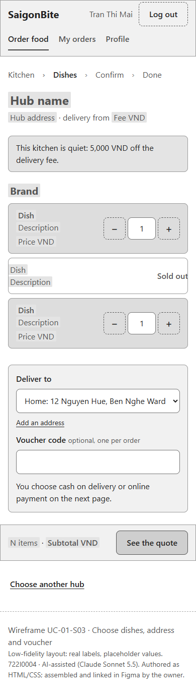

Figure 4.3.3-W01-S03. Wireframe of Choose dishes, address and voucher. Author: 722I0004 · AI-assisted (Claude Sonnet 5.5)

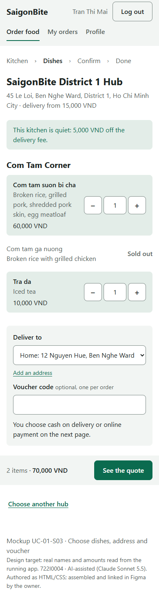

Figure 4.3.3-M01-S03. Mockup of Choose dishes, address and voucher (real names and amounts taken from the running app). Author: 722I0004 · AI-assisted (Claude Sonnet 5.5)

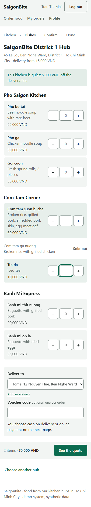

Figure 4.3.3-I01-S03. Implemented screen of Choose dishes, address and voucher, real application, local Flask development server, Edge, commit 252ada1. Author: 722I0004 · AI-assisted (Claude Sonnet 5.5)

### UC-01-S04 Check the quote and choose payment

Role customer, 390x844, routes POST /order/quote, SSD operations OP-15, template `order/quote.html`.

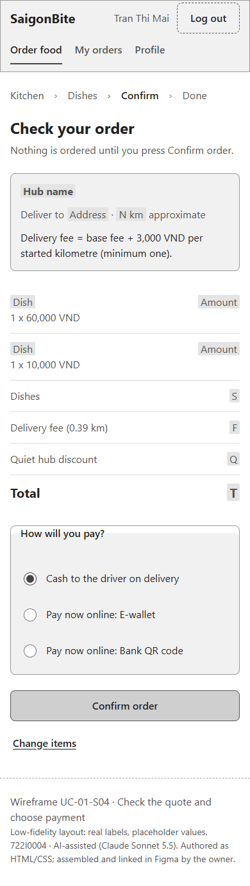

Figure 4.3.3-W01-S04. Wireframe of Check the quote and choose payment. Author: 722I0004 · AI-assisted (Claude Sonnet 5.5)

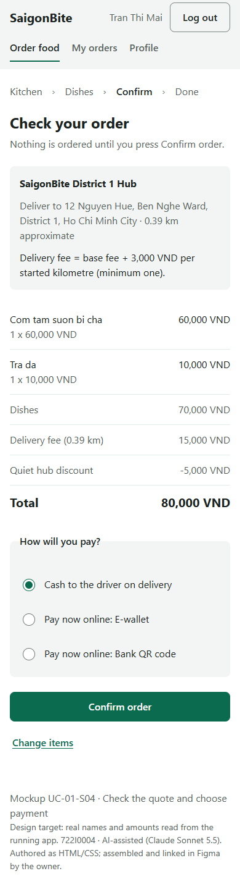

Figure 4.3.3-M01-S04. Mockup of Check the quote and choose payment (real names and amounts taken from the running app). Author: 722I0004 · AI-assisted (Claude Sonnet 5.5)

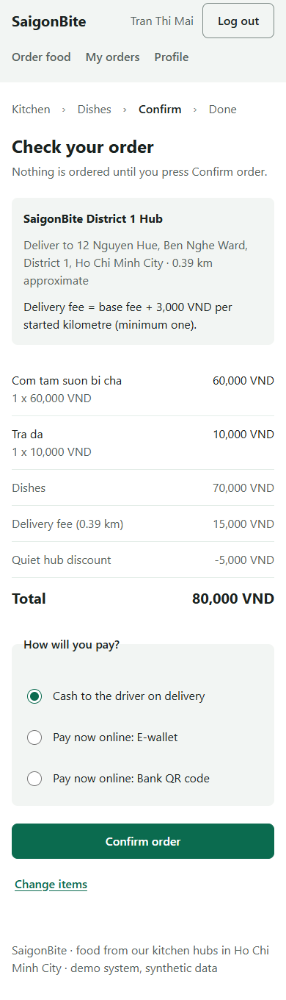

Figure 4.3.3-I01-S04. Implemented screen of Check the quote and choose payment, real application, local Flask development server, Edge, commit 252ada1. Author: 722I0004 · AI-assisted (Claude Sonnet 5.5)

### UC-01-S05 Quote changed, check it again

Role customer, 390x844, routes POST /order/confirm -> 409, SSD operations OP-01, template `order/quote.html`.

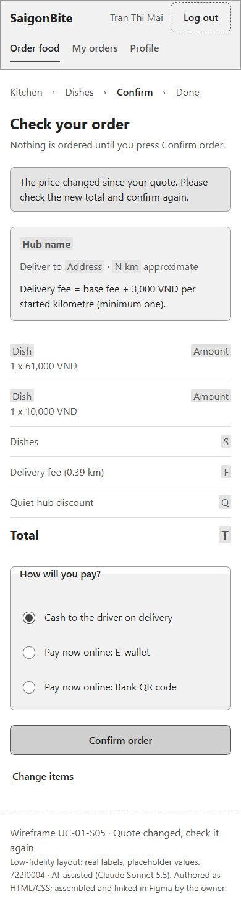

Figure 4.3.3-W01-S05. Wireframe of Quote changed, check it again. Author: 722I0004 · AI-assisted (Claude Sonnet 5.5)

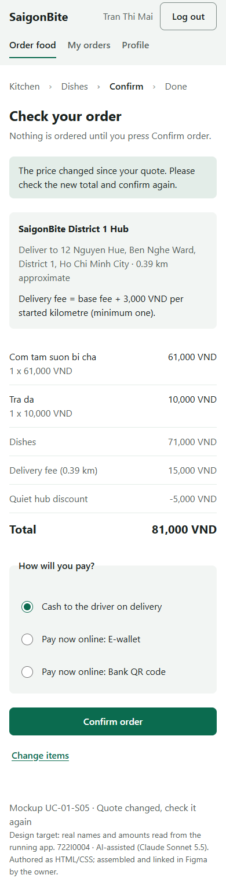

Figure 4.3.3-M01-S05. Mockup of Quote changed, check it again (real names and amounts taken from the running app). Author: 722I0004 · AI-assisted (Claude Sonnet 5.5)

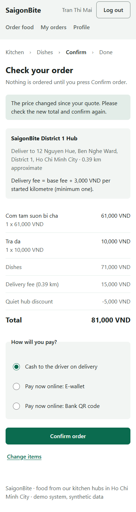

Figure 4.3.3-I01-S05. Implemented screen of Quote changed, check it again, real application, local Flask development server, Edge, commit 252ada1. Author: 722I0004 · AI-assisted (Claude Sonnet 5.5)

### UC-01-S06 Online payment simulator

Role customer, 390x844, routes POST /order/confirm (ONLINE), SSD operations OP-01, template `order/payment_simulator.html`.

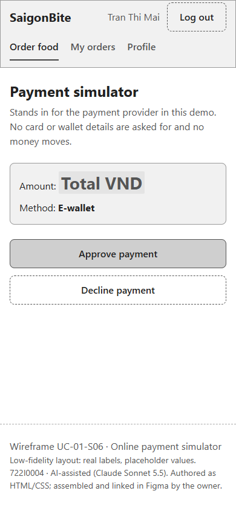

Figure 4.3.3-W01-S06. Wireframe of Online payment simulator. Author: 722I0004 · AI-assisted (Claude Sonnet 5.5)

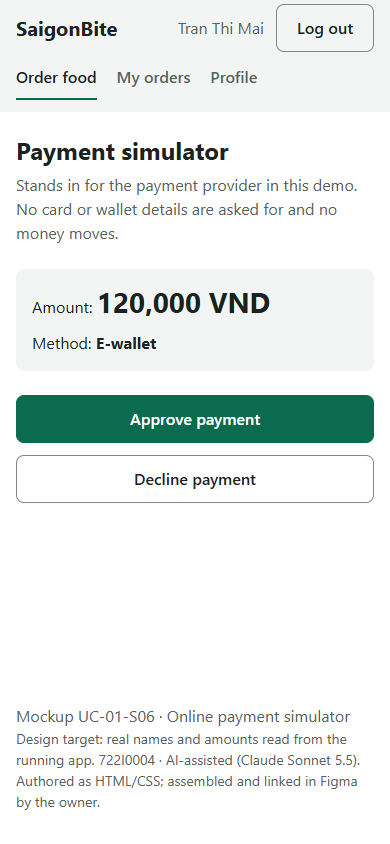

Figure 4.3.3-M01-S06. Mockup of Online payment simulator (real names and amounts taken from the running app). Author: 722I0004 · AI-assisted (Claude Sonnet 5.5)

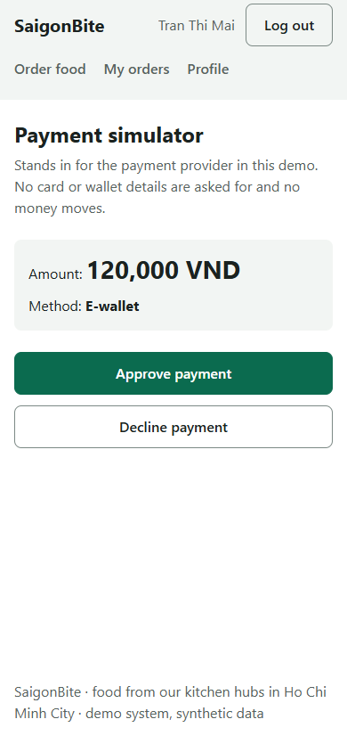

Figure 4.3.3-I01-S06. Implemented screen of Online payment simulator, real application, local Flask development server, Edge, commit 252ada1. Author: 722I0004 · AI-assisted (Claude Sonnet 5.5)

### UC-01-S07 Online payment declined

Role customer, 390x844, routes POST /order/confirm -> 402, SSD operations OP-01, template `order/quote.html`.

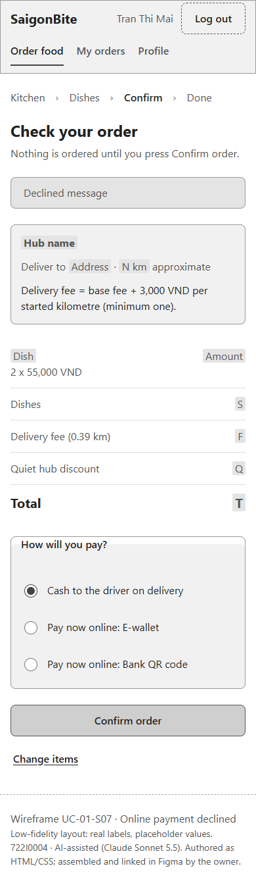

Figure 4.3.3-W01-S07. Wireframe of Online payment declined. Author: 722I0004 · AI-assisted (Claude Sonnet 5.5)

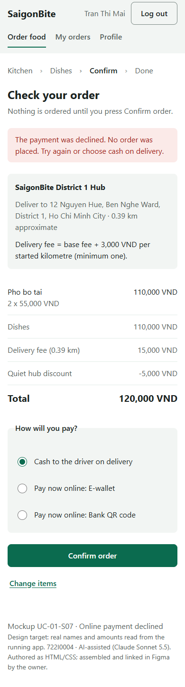

Figure 4.3.3-M01-S07. Mockup of Online payment declined (real names and amounts taken from the running app). Author: 722I0004 · AI-assisted (Claude Sonnet 5.5)

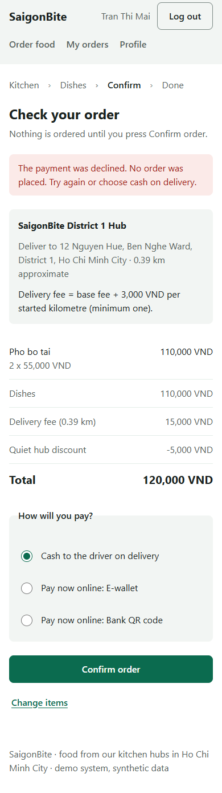

Figure 4.3.3-I01-S07. Implemented screen of Online payment declined, real application, local Flask development server, Edge, commit 252ada1. Author: 722I0004 · AI-assisted (Claude Sonnet 5.5)

### UC-01-S08 Order placed

Role customer, 390x844, routes POST /order/confirm -> GET /order/<id>/confirmation, SSD operations OP-01, template `order/confirmation.html`.

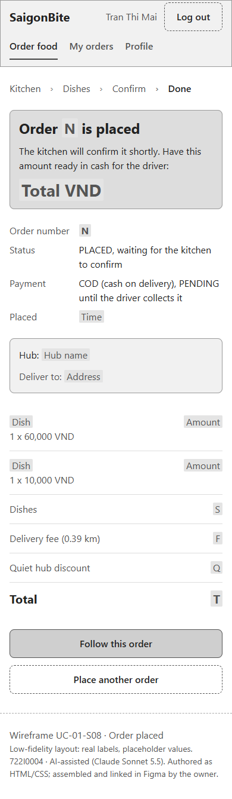

Figure 4.3.3-W01-S08. Wireframe of Order placed. Author: 722I0004 · AI-assisted (Claude Sonnet 5.5)

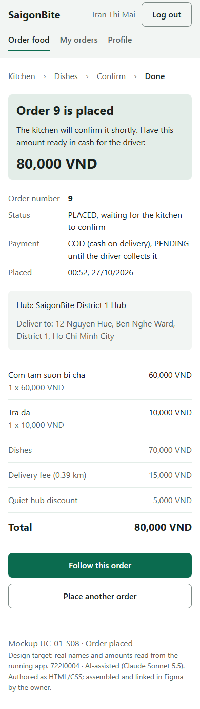

Figure 4.3.3-M01-S08. Mockup of Order placed (real names and amounts taken from the running app). Author: 722I0004 · AI-assisted (Claude Sonnet 5.5)

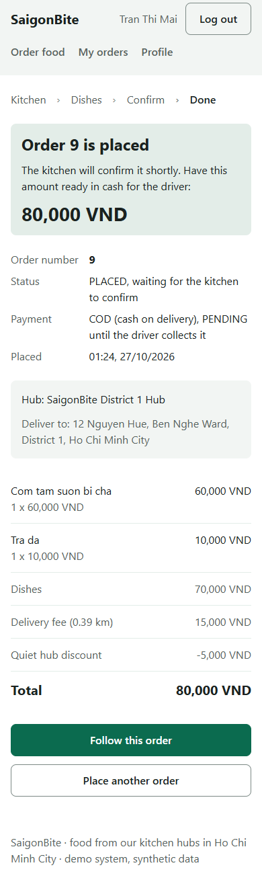

Figure 4.3.3-I01-S08. Implemented screen of Order placed, real application, local Flask development server, Edge, commit 252ada1. Author: 722I0004 · AI-assisted (Claude Sonnet 5.5)

### UC-01-S09 Follow an order

Role customer, 390x844, routes GET /order/<id>, SSD operations OP-16 OP-07, template `order/detail.html`.

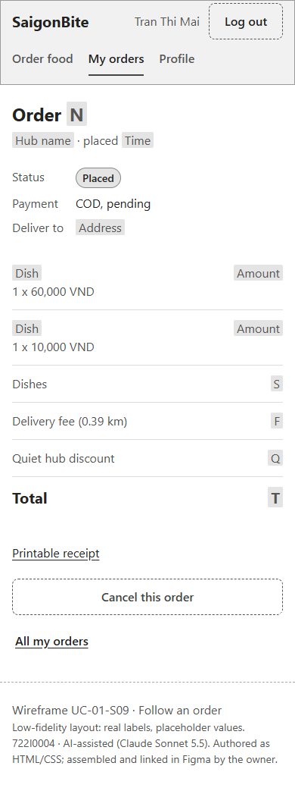

Figure 4.3.3-W01-S09. Wireframe of Follow an order. Author: 722I0004 · AI-assisted (Claude Sonnet 5.5)

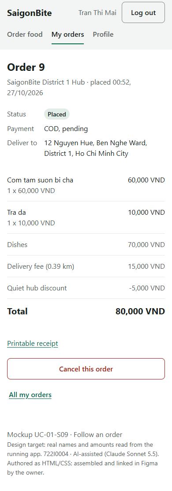

Figure 4.3.3-M01-S09. Mockup of Follow an order (real names and amounts taken from the running app). Author: 722I0004 · AI-assisted (Claude Sonnet 5.5)

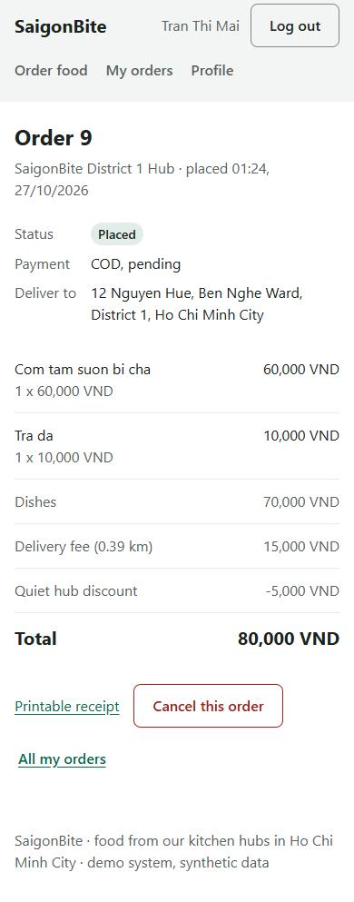

Figure 4.3.3-I01-S09. Implemented screen of Follow an order, real application, local Flask development server, Edge, commit 252ada1. Author: 722I0004 · AI-assisted (Claude Sonnet 5.5)

### UC-01-S10 Receipt

Role customer, 390x844, routes GET /order/<id>/receipt, SSD operations OP-16, template `order/receipt.html`.

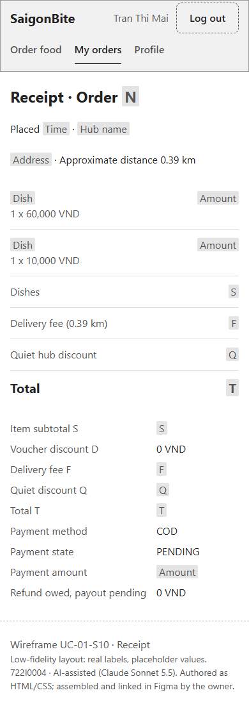

Figure 4.3.3-W01-S10. Wireframe of Receipt. Author: 722I0004 · AI-assisted (Claude Sonnet 5.5)

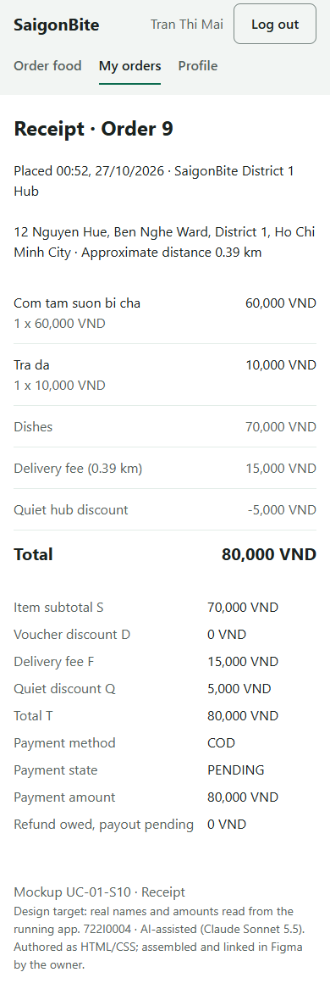

Figure 4.3.3-M01-S10. Mockup of Receipt (real names and amounts taken from the running app). Author: 722I0004 · AI-assisted (Claude Sonnet 5.5)

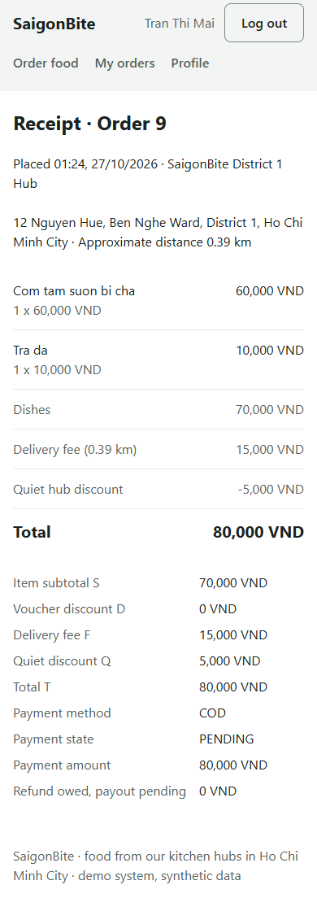

Figure 4.3.3-I01-S10. Implemented screen of Receipt, real application, local Flask development server, Edge, commit 252ada1. Author: 722I0004 · AI-assisted (Claude Sonnet 5.5)

### UC-01-S11 My orders

Role customer, 390x844, routes GET /order/mine, SSD operations OP-17, template `order/my_orders.html`.

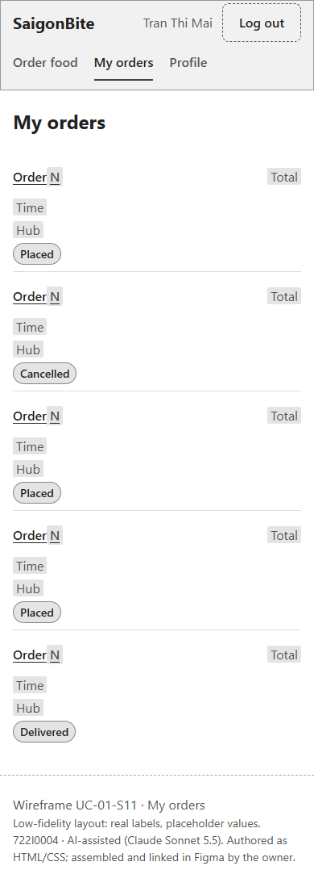

Figure 4.3.3-W01-S11. Wireframe of My orders. Author: 722I0004 · AI-assisted (Claude Sonnet 5.5)

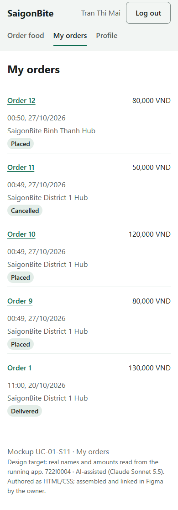

Figure 4.3.3-M01-S11. Mockup of My orders (real names and amounts taken from the running app). Author: 722I0004 · AI-assisted (Claude Sonnet 5.5)

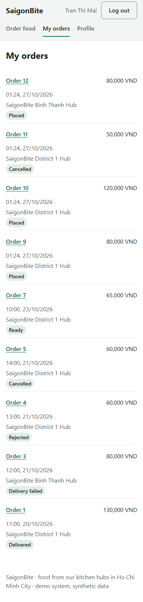

Figure 4.3.3-I01-S11. Implemented screen of My orders, real application, local Flask development server, Edge, commit 252ada1. Author: 722I0004 · AI-assisted (Claude Sonnet 5.5)

### UC-01-S12 Order cancelled

Role customer, 390x844, routes POST /order/<id>/cancel -> GET /order/<id>, SSD operations OP-07, template `order/detail.html`.

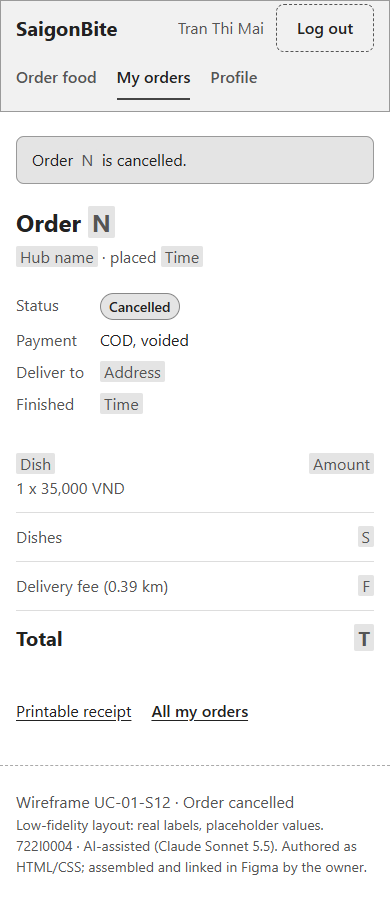

Figure 4.3.3-W01-S12. Wireframe of Order cancelled. Author: 722I0004 · AI-assisted (Claude Sonnet 5.5)

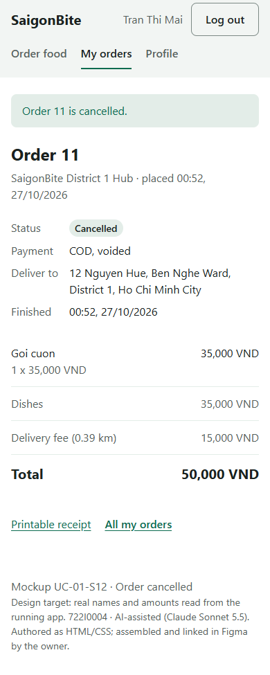

Figure 4.3.3-M01-S12. Mockup of Order cancelled (real names and amounts taken from the running app). Author: 722I0004 · AI-assisted (Claude Sonnet 5.5)

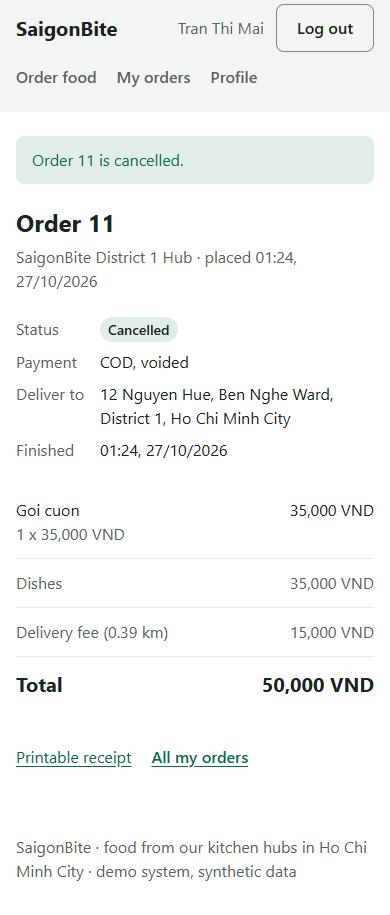

Figure 4.3.3-I01-S12. Implemented screen of Order cancelled, real application, local Flask development server, Edge, commit 252ada1. Author: 722I0004 · AI-assisted (Claude Sonnet 5.5)

### UC-01 SSD operation to UI trace

| SSD op (occurrence) | Screen / control | Inputs and validation (rules) | Displayed result | Route → controller method | In view code |
|---|---|---|---|---|---|
| OP-13 browseHubs (01S-M01) | UC-01-S01: 'Order from this hub' button on each hub card (link to GET /order/hubs/<id>) | none to type; read-only; customer role only (other roles get 403); load, capacity, busy and quiet come from BR-01..BR-03 [guards BR-01; BR-02; BR-03] | One card per active hub: name, address, 'Delivery from' base fee + 3,000 VND, and 'Busy now' or 'Quiet now, 5,000 VND off'; no row is written | GET /order/hubs → `PlaceOrderController.list_hubs` | yes |
| OP-14 selectHub (01S-M02) | UC-01-S03: hub card link; quantity steppers and number fields qty_<item>; 'Deliver to' select; voucher field | hub must exist and be active (unknown or archived hub: hub list with a message, 400); only dishes listed and available at that hub are offered, a sold-out dish shows 'Sold out' without a field (BR-19) [guards BR-19] | Menu grouped by brand with price per dish, running count and subtotal bar (progressive enhancement), own addresses, busy or quiet banner; no row is written | GET /order/hubs/<int:hub_id> → `PlaceOrderController.select_hub` | yes |
| OP-15 requestQuote (01S-M03) | UC-01-S02, UC-01-S04: 'See the quote' button of the menu form (POST /order/quote) | hub_id, address_id, qty_<item> 1..99, voucher_code, payment; own address, eligible items, radius at most 8.0 km raw (BR-05, BR-06), fee rule (BR-07), voucher dates and limits (BR-08), busy recheck (BR-01, BR-02), payment option by customer type (BR-14); refusals keep the typed values [guards BR-01–BR-10; BR-14] | Quote page: hub, address, approximate distance with two decimals, dishes, S, D, F, Q and T (BR-09), the fee rule, payment choice. Busy hub: hub list with 'too busy' message and up to three quieter hubs as links, nothing saved (BR-04) | POST /order/quote → `PlaceOrderController.request_quote` | yes |
| OP-01 confirmCheckout (01S-M04) | UC-01-S05, UC-01-S06, UC-01-S07, UC-01-S08: 'Confirm order' button (POST /order/confirm) with hidden idempotency_token, quoted_total, quote_fingerprint; ONLINE goes through the payment simulator page first | consent: fingerprint and total recomputed and compared (BR-10): changed gives the new quote with 'The price changed since your quote' and saves nothing; token replay returns the same order (BR-11); busy recheck inside the write transaction (BR-02); ONLINE approve or decline (BR-14); decline saves no order and no payment [guards BR-01–BR-14; anchors UC01-PC01; UC01-PC02; UC01-PC03; UC01-PC04; UC01-PC05; UC01-PC06; UC01-MG01; UC01-MG02; UC01-MG03] | 'Order N is placed': total, status PLACED, payment COD PENDING or ONLINE PAID, placed time, hub, address, lines. Declined: quote page with 'The payment was declined. No order was placed.' Changed: quote page with the new total | POST /order/confirm → `PlaceOrderController.confirm_order` | yes |
| OP-16 viewReceipt (01S-M05) | UC-01-S09, UC-01-S10: 'Follow this order' and 'Printable receipt' links (GET /order/<id>, GET /order/<id>/receipt) | own order only: another customer's order is refused without disclosing it (receipt answers 404); read-only [guards BR-12; BR-13] | Order page: status badge, payment line, address, lines and totals; receipt page: order, date, hub, address, lines and S, D, F, Q, T, payment method, state, captured amount and 'refund owed, payout pending' (BR-13, BR-17) | GET /order/<int:order_id> → `OrderTrackingController.get_order` | yes |
| OP-17 viewMyOrders (01S-M06) | UC-01-S11: 'My orders' link of the top bar (GET /order/mine) | none to type; own orders only; read-only [guards BR-12] | Own orders newest first: number, placed time, hub, status badge, total, and a 'Your answer needed' badge when a replacement offer is open; one row per order on a phone | GET /order/mine → `OrderTrackingController.list_my_orders` | yes |
| OP-07 cancelOrder (01S-M07) | UC-01-S09, UC-01-S12: 'Cancel this order' button on the order page (POST /order/<id>/cancel), shown only while the order is PLACED or CONFIRMED; browser confirmation 'Cancel order N?' | state must be PLACED or CONFIRMED (BR-15); an open offer is withdrawn; COD becomes voided, ONLINE becomes refund pending with the captured amount owed (BR-17); wrong owner or state is refused and nothing changes [guards BR-15; BR-17] | 'Order N is cancelled.' banner, status Cancelled, payment voided (COD) or the refund owed (ONLINE), finished time | POST /order/<int:order_id>/cancel → `OrderTrackingController.cancel_order` | yes |

### UC-01 refinement after the draft build

The mockups show the refined design; these differences between the draft and the implemented screens were implemented (commit on branch `part2`):

| Change | Commit | Screens |
|---|---|---|
| R1 tap targets of at least 44 px (role links, wordmark, action links) | 36dc8f0, 4298973 | all screens |
| R2 My orders is one row per order on a phone; the table was 449 px wide on a 390 px screen | a160bf5 | UC-01-S11 |
| R5 online options named E-wallet, Bank QR code, International card instead of 'e wallet', 'bank qr' | d86eb3b | UC-01-S04, S05, S06, S07 |
| R6 'Cancel this order' is an outline in the danger colour, still behind a confirmation | c749dce | UC-01-S09 |
| P5-D04 the quote table prints 0.39 km, not 0.38971718085988794 km | 5466f6a | UC-01-S04, S05, S07 |
| P5-D02 choosing online payment goes straight to the simulator, without a false 'price changed' notice | ce18bf6 | UC-01-S04 to S06 |

Full comparison, design notes and artifact dates: `docs/part2/ui/UC-01/mockup_vs_implemented.md` and `trace.md`.

## 4.3.3.2 UC-05 Confirm or reject an order (kitchen) and answer a replacement (customer)

Author: 722I0004 · AI-assisted (Claude Sonnet 5.5). Use case description: `docs/part2/UC-05/description.md`. Package: `docs/part2/ui/UC-05/`.

Progression: sketch (owner, `OWNER-PENDING`; brief `docs/part2/ui/UC-05/sketch_brief.md`) → wireframe → mockup → prototype (PENDING (owner)) → implemented screen. 9 screens: UC-05-S01 (goal), UC-05-S02 (goal), UC-05-S03 (goal), UC-05-S04 (alternative), UC-05-S05 (goal), UC-05-S06 (goal), UC-05-S07 (goal), UC-05-S08 (alternative), UC-05-S09 (alternative).

### UC-05-S01 Kitchen board

Role kitchen staff, 1440x900, routes GET /kitchen/, SSD operations OP-19, template `kitchen/board.html`.

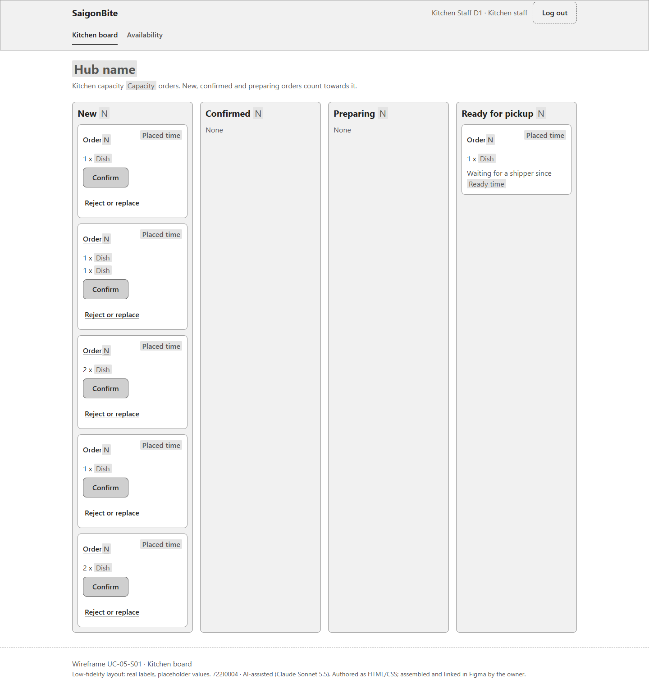

Figure 4.3.3-W05-S01. Wireframe of Kitchen board. Author: 722I0004 · AI-assisted (Claude Sonnet 5.5)

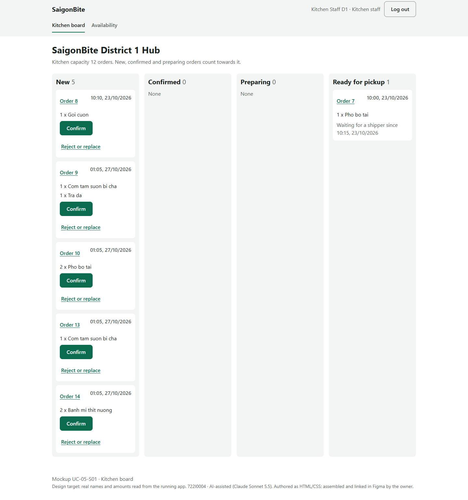

Figure 4.3.3-M05-S01. Mockup of Kitchen board (real names and amounts taken from the running app). Author: 722I0004 · AI-assisted (Claude Sonnet 5.5)

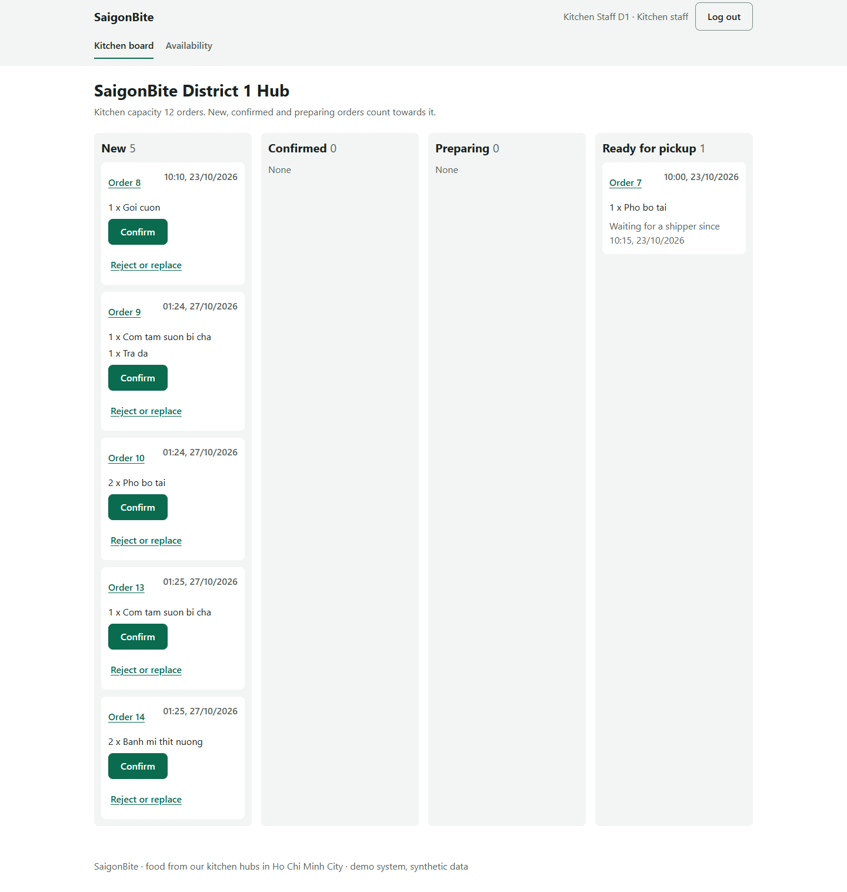

Figure 4.3.3-I05-S01. Implemented screen of Kitchen board, real application, local Flask development server, Edge, commit 252ada1. Author: 722I0004 · AI-assisted (Claude Sonnet 5.5)

### UC-05-S02 Kitchen order: confirm, offer a replacement or reject

Role kitchen staff, 1440x900, routes GET /kitchen/orders/<id>, SSD operations OP-20 OP-02 OP-03 OP-04, template `kitchen/order.html`.

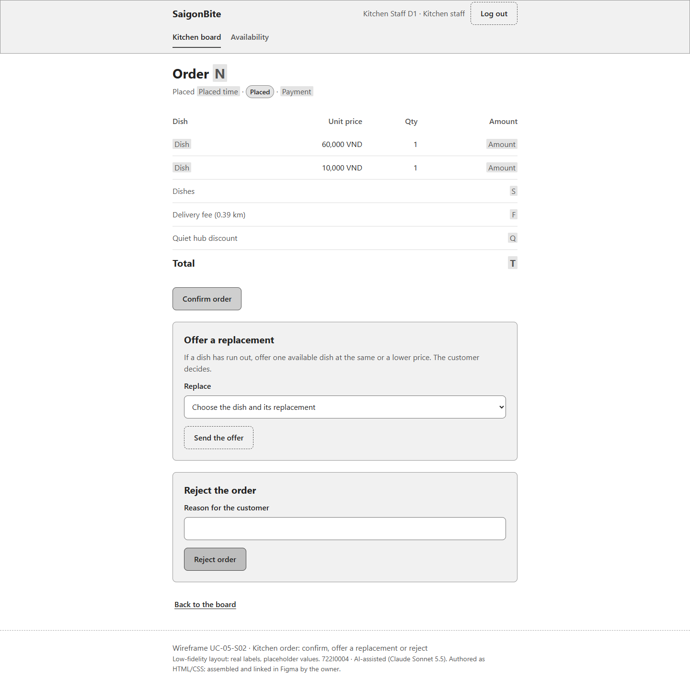

Figure 4.3.3-W05-S02. Wireframe of Kitchen order: confirm, offer a replacement or reject. Author: 722I0004 · AI-assisted (Claude Sonnet 5.5)

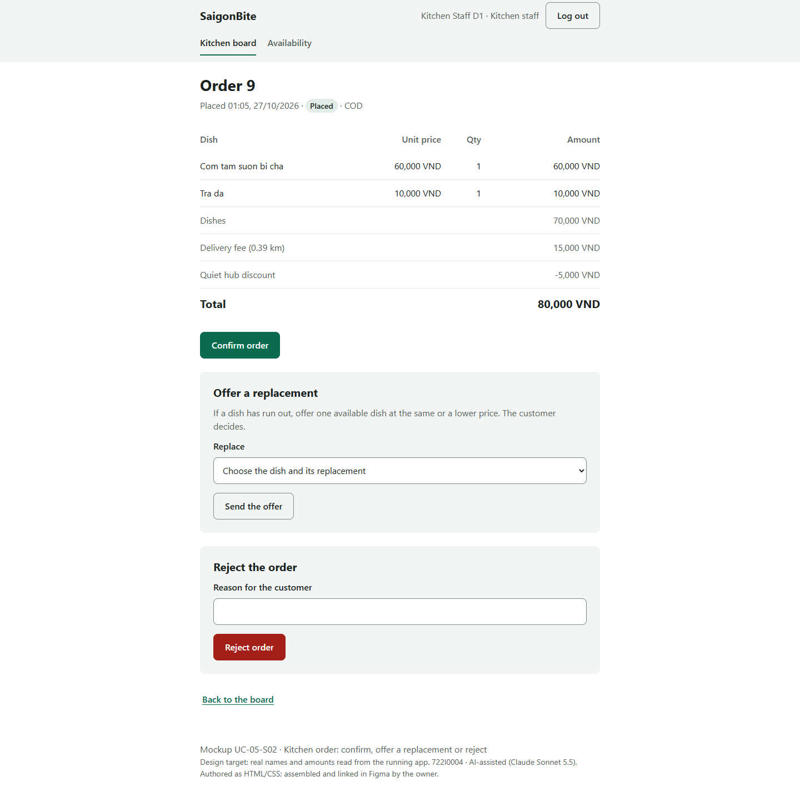

Figure 4.3.3-M05-S02. Mockup of Kitchen order: confirm, offer a replacement or reject (real names and amounts taken from the running app). Author: 722I0004 · AI-assisted (Claude Sonnet 5.5)

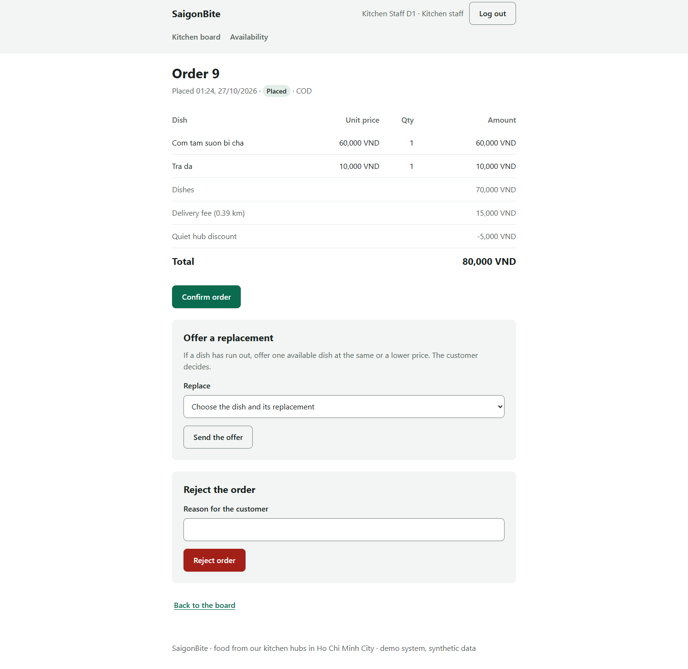

Figure 4.3.3-I05-S02. Implemented screen of Kitchen order: confirm, offer a replacement or reject, real application, local Flask development server, Edge, commit 252ada1. Author: 722I0004 · AI-assisted (Claude Sonnet 5.5)

### UC-05-S03 Replacement offered, waiting for the customer

Role kitchen staff, 1440x900, routes POST /kitchen/orders/<id>/offer, SSD operations OP-04, template `kitchen/order.html`.

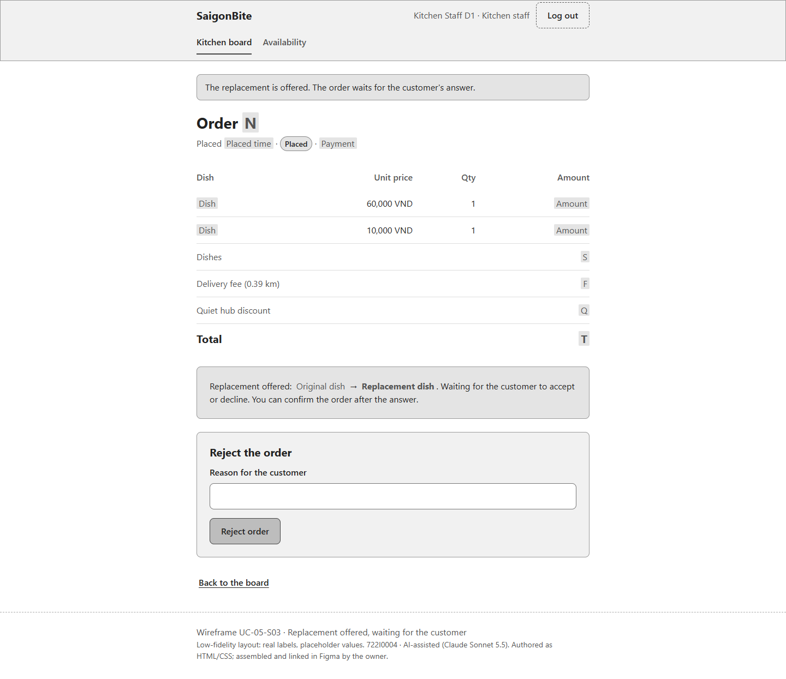

Figure 4.3.3-W05-S03. Wireframe of Replacement offered, waiting for the customer. Author: 722I0004 · AI-assisted (Claude Sonnet 5.5)

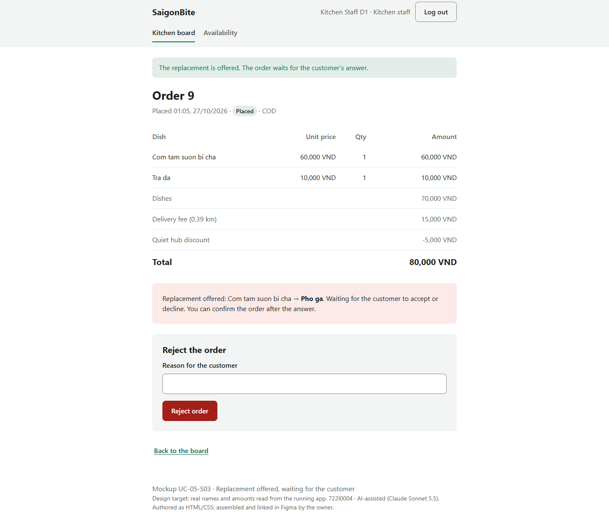

Figure 4.3.3-M05-S03. Mockup of Replacement offered, waiting for the customer (real names and amounts taken from the running app). Author: 722I0004 · AI-assisted (Claude Sonnet 5.5)

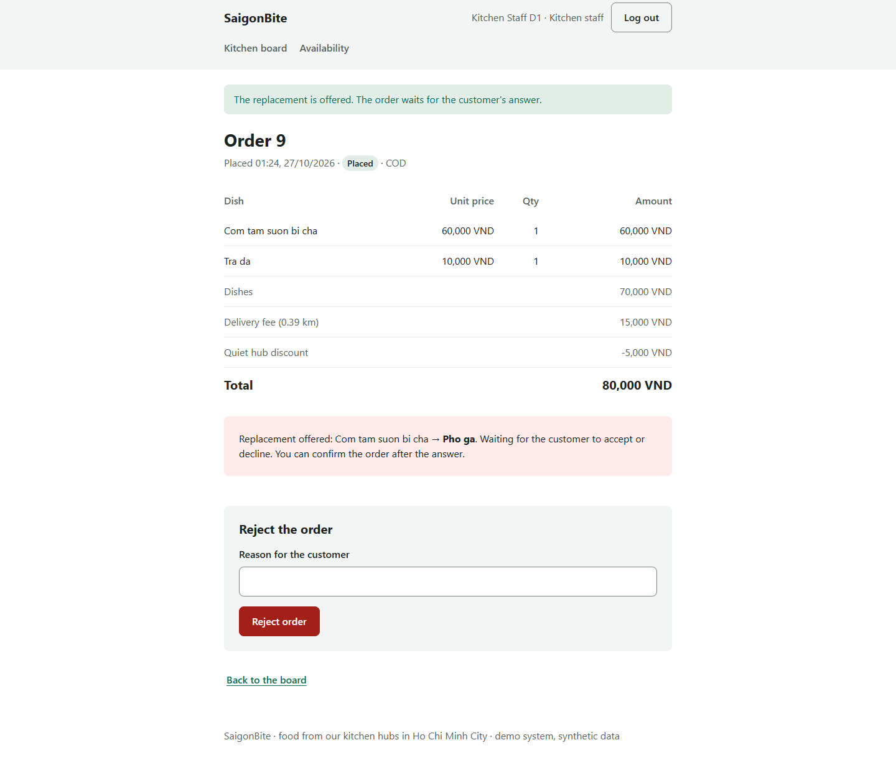

Figure 4.3.3-I05-S03. Implemented screen of Replacement offered, waiting for the customer, real application, local Flask development server, Edge, commit 252ada1. Author: 722I0004 · AI-assisted (Claude Sonnet 5.5)

### UC-05-S04 Order rejected with a reason

Role kitchen staff, 1440x900, routes POST /kitchen/orders/<id>/reject, SSD operations OP-03, template `kitchen/order.html`.

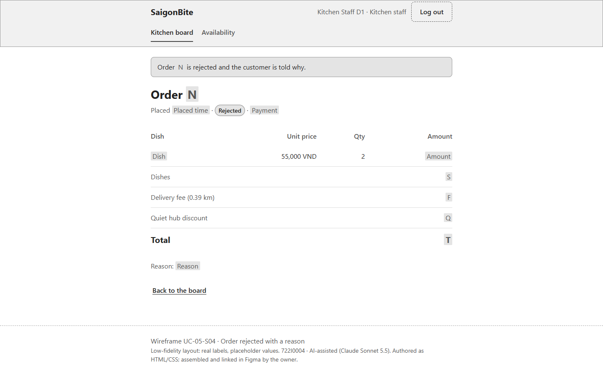

Figure 4.3.3-W05-S04. Wireframe of Order rejected with a reason. Author: 722I0004 · AI-assisted (Claude Sonnet 5.5)

Figure 4.3.3-M05-S04. Mockup of Order rejected with a reason (real names and amounts taken from the running app). Author: 722I0004 · AI-assisted (Claude Sonnet 5.5)

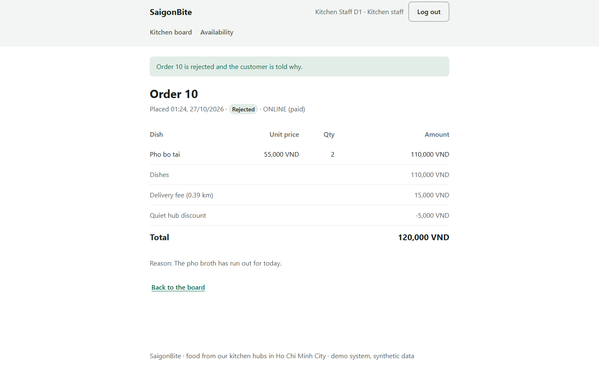

Figure 4.3.3-I05-S04. Implemented screen of Order rejected with a reason, real application, local Flask development server, Edge, commit 252ada1. Author: 722I0004 · AI-assisted (Claude Sonnet 5.5)

### UC-05-S05 My orders: your answer is needed

Role customer, 390x844, routes GET /order/mine, SSD operations OP-17, template `order/my_orders.html`.

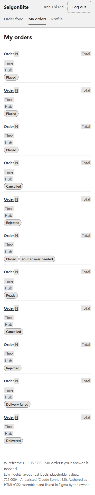

Figure 4.3.3-W05-S05. Wireframe of My orders: your answer is needed. Author: 722I0004 · AI-assisted (Claude Sonnet 5.5)

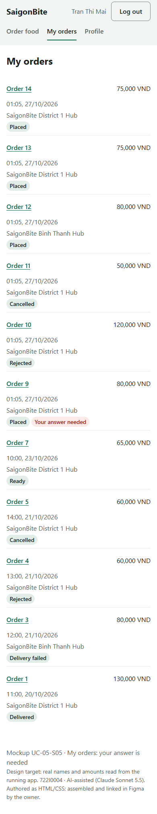

Figure 4.3.3-M05-S05. Mockup of My orders: your answer is needed (real names and amounts taken from the running app). Author: 722I0004 · AI-assisted (Claude Sonnet 5.5)

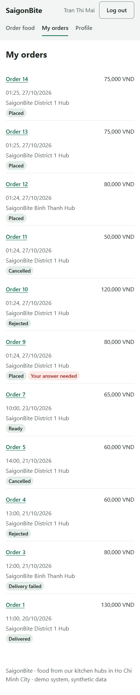

Figure 4.3.3-I05-S05. Implemented screen of My orders: your answer is needed, real application, local Flask development server, Edge, commit 252ada1. Author: 722I0004 · AI-assisted (Claude Sonnet 5.5)

### UC-05-S06 Replacement offer: accept or decline

Role customer, 390x844, routes GET /order/<id>, SSD operations OP-18 OP-05 OP-06, template `order/detail.html`.

Figure 4.3.3-W05-S06. Wireframe of Replacement offer: accept or decline. Author: 722I0004 · AI-assisted (Claude Sonnet 5.5)

Figure 4.3.3-M05-S06. Mockup of Replacement offer: accept or decline (real names and amounts taken from the running app). Author: 722I0004 · AI-assisted (Claude Sonnet 5.5)

Figure 4.3.3-I05-S06. Implemented screen of Replacement offer: accept or decline, real application, local Flask development server, Edge, commit 252ada1. Author: 722I0004 · AI-assisted (Claude Sonnet 5.5)

### UC-05-S07 Replacement accepted

Role customer, 390x844, routes POST /order/<id>/replacement (accept), SSD operations OP-05, template `order/detail.html`.

Figure 4.3.3-W05-S07. Wireframe of Replacement accepted. Author: 722I0004 · AI-assisted (Claude Sonnet 5.5)

Figure 4.3.3-M05-S07. Mockup of Replacement accepted (real names and amounts taken from the running app). Author: 722I0004 · AI-assisted (Claude Sonnet 5.5)

Figure 4.3.3-I05-S07. Implemented screen of Replacement accepted, real application, local Flask development server, Edge, commit 252ada1. Author: 722I0004 · AI-assisted (Claude Sonnet 5.5)

### UC-05-S08 Replacement declined

Role customer, 390x844, routes POST /order/<id>/replacement (decline), SSD operations OP-06, template `order/detail.html`.

Figure 4.3.3-W05-S08. Wireframe of Replacement declined. Author: 722I0004 · AI-assisted (Claude Sonnet 5.5)

Figure 4.3.3-M05-S08. Mockup of Replacement declined (real names and amounts taken from the running app). Author: 722I0004 · AI-assisted (Claude Sonnet 5.5)

Figure 4.3.3-I05-S08. Implemented screen of Replacement declined, real application, local Flask development server, Edge, commit 252ada1. Author: 722I0004 · AI-assisted (Claude Sonnet 5.5)

### UC-05-S09 Offer withdrawn: replacement ran out

Role customer, 390x844, routes POST /order/<id>/replacement (accept, dish gone), SSD operations OP-05, template `order/detail.html`.

Figure 4.3.3-W05-S09. Wireframe of Offer withdrawn: replacement ran out. Author: 722I0004 · AI-assisted (Claude Sonnet 5.5)

Figure 4.3.3-M05-S09. Mockup of Offer withdrawn: replacement ran out (real names and amounts taken from the running app). Author: 722I0004 · AI-assisted (Claude Sonnet 5.5)

Figure 4.3.3-I05-S09. Implemented screen of Offer withdrawn: replacement ran out, real application, local Flask development server, Edge, commit 252ada1. Author: 722I0004 · AI-assisted (Claude Sonnet 5.5)

### UC-05 SSD operation to UI trace

| SSD op (occurrence) | Screen / control | Inputs and validation (rules) | Displayed result | Route → controller method | In view code |
|---|---|---|---|---|---|
| OP-19 viewKitchenOrders (05S-M01) | UC-05-S01: 'Kitchen board' link of the top bar (GET /kitchen/); the page also opens after Confirm and Back to the board | none to type; read-only; kitchen role only; the board shows only the staff member's own hub (BR-26); load and capacity count PLACED, CONFIRMED and PREPARING orders (BR-01) [guards BR-26] | Hub name and 'Kitchen capacity N orders', four columns New, Confirmed, Preparing, Ready for pickup with a count; one card per order with number, placed time, lines, 'Confirm' and 'Reject or replace' (44 px), 'Waiting for the customer' when an offer is open; 'None' for an empty column; no row is written | GET /kitchen/ → `KitchenController.board` | yes |
| OP-20 viewKitchenOrder (05S-M02) | UC-05-S02: Order number link or 'Reject or replace' link on a card (GET /kitchen/orders/<id>) | order must exist (404) and belong to the staff member's hub (BR-26: another hub gives 403); read-only [guards BR-12; BR-26] | Order page: number, placed time, state badge, payment (COD or ONLINE (paid)), lines with S, F, Q and T, 'Confirm order' (hidden while an offer is open), the 'Offer a replacement' panel with one option per dish and cheaper-or-equal available dish, and the 'Reject the order' panel; no row is written | GET /kitchen/orders/<int:order_id> → `KitchenController.get_order` | yes |
| OP-02 confirmOrder (05S-M03) | UC-05-S02: 'Confirm' button on a board card or 'Confirm order' button on the order page (POST /kitchen/orders/<id>/confirm) | order must be PLACED and of the staff member's hub (BR-26); refused with 'The customer has not answered the replacement offer yet.' while an offer is open; nothing is recomputed or repriced [guards BR-26; no open offer; anchors UC05-PC01; UC05-MG01] | Back on the board with 'Order N is confirmed.'; the card moves from New to Confirmed; a refusal shows the red message on the board and changes nothing | POST /kitchen/orders/<int:order_id>/confirm → `KitchenController.confirm_order` | yes |
| OP-03 rejectOrder (05S-M04) | UC-05-S02, UC-05-S04: 'Reject order' button of the 'Reject the order' form with the field 'Reason for the customer' (POST /kitchen/orders/<id>/reject); browser confirmation 'Reject order N?' | reason required and at most 200 characters ('Please give the reason for rejecting the order.'); order must be PLACED and of the own hub (BR-16, BR-26); an open offer is withdrawn; COD becomes voided, ONLINE becomes refund pending with the captured amount owed (BR-17) [guards BR-16; BR-17; BR-26; anchors UC05-PC02] | Order page with 'Order N is rejected and the customer is told why.', state badge Rejected, payment shown as ONLINE (paid) or COD, the reason line, and only 'Back to the board' | POST /kitchen/orders/<int:order_id>/reject → `KitchenController.reject_order` | yes |
| OP-04 offerReplacement (05S-M05) | UC-05-S02, UC-05-S03: 'Send the offer' button of the 'Offer a replacement' form, select 'Replace' with 'dish -> replacement (price)' options (POST /kitchen/orders/<id>/offer) | a line and a target must be chosen; order PLACED, own hub and no other open offer (BR-26); the source dish must be sold out or unlisted at the hub; the target must be available at the hub, not already in the order and priced the same or lower (plan section 3.3); quantity is unchanged [guards plan §3.3 1–3; BR-26; anchors UC05-PC03; UC05-MG01] | Order page with 'The replacement is offered. The order waits for the customer's answer.', a highlighted box 'Replacement offered: A -> B. Waiting for the customer to accept or decline.', 'Confirm order' and the offer form hidden, the reject form still available; the order stays PLACED and still counts toward the load (BR-01) | POST /kitchen/orders/<int:order_id>/offer → `KitchenController.offer_replacement` | yes |
| OP-17 viewMyOrders (05S-M06) | UC-05-S05: 'My orders' link of the customer top bar (GET /order/mine) | none to type; own orders only; read-only (BR-12 customer role); open replacement offers are marked [guards BR-12] | Own orders newest first, one row per order on a phone (number, placed time, hub, status badge, total); an order with an open offer carries the badge 'Your answer needed' on the same row (it was off screen before the refinement) | GET /order/mine → `OrderTrackingController.list_my_orders` | yes |
| OP-18 viewReplacement (05S-M07) | UC-05-S06: Order link in My orders (GET /order/<id>) | own order only: another customer's order is refused without disclosing it; read-only; the offer is shown only while it is OFFERED [guards plan §3.3 4] | Order page: a highlighted 'The kitchen asks about a replacement' box with the dish that ran out, the offered dish and both unit prices, the new total next to the current total and the consequence of declining ('the order is not cooked'), buttons 'Accept <dish>' and 'Decline'; below it status, payment, address, lines and totals | GET /order/<int:order_id> → `OrderTrackingController.get_order` | yes |
| OP-05 acceptReplacement (05S-M08) | UC-05-S06, UC-05-S07, UC-05-S09: 'Accept <dish>' button of the offer box (POST /order/<id>/replacement with decision=accept and the offer id) | decision must be accept or decline (else 400 'Choose accept or decline.'); own PLACED order and the exact open offer (stale or repeated answer refused: 'This replacement offer is no longer open. Nothing was changed.'); the target must still be available (BR-19 keeps old lines as snapshots); if it is not, only the offer is WITHDRAWN and the order and payment stay unchanged; accepted: whole line replaced at the offered price, S and T recomputed, F and Q unchanged, ONLINE amount stays captured [guards plan §3.3 5–7; anchors UC05-PC04; UC05-MG01] | Accepted: order page with 'Replacement accepted. The kitchen may now confirm your order.', new lines and totals, 'Replacement history: A -> B (accepted)'. Dish gone: the notice 'The replacement is no longer available. The offer was withdrawn; your order and payment are unchanged.', old lines kept, history shows 'withdrawn' | POST /order/<int:order_id>/replacement → `OrderTrackingController.answer_replacement` | yes |
| OP-06 declineReplacement (05S-M09) | UC-05-S06, UC-05-S08: 'Decline' button of the offer box (POST /order/<id>/replacement with decision=decline) | own PLACED order and the exact open offer; stale answer refused; atomically offer DECLINED and order REJECTED with the reason 'The customer declined the replacement.' (BR-17: COD voided, ONLINE refund pending for the full captured amount) [guards plan §3.3 8; BR-17] | Order page with 'Replacement declined. An online captured payment is owed back in full; payout is pending.', status Rejected with the reason, payment 'COD, voided' (or the refund owed for ONLINE), a Finished time, history '(declined)', and no Cancel button | POST /order/<int:order_id>/replacement → `OrderTrackingController.answer_replacement` | yes |

### UC-05 refinement after the draft build

The mockups show the refined design; these differences between the draft and the implemented screens were implemented (commit on branch `part2`):

| Change | Commit | Screens |
|---|---|---|
| R1 kitchen card buttons and order links at least 44 px | 36dc8f0, 4298973 | UC-05-S01 |
| R2 My orders one row per order; the 'Your answer needed' badge stays on the screen (the table was 449 px wide) | a160bf5 | UC-05-S05 |
| R6 'Cancel this order' danger outline | c749dce | UC-05-S06 to S09 |
| R5 readable payment option names on the order pages | d86eb3b | order pages of online orders |
| P5-D05 a rejected online payment is a 'refund owed, payout pending' | 252ada1 | order page of a rejected online order |

Full comparison, design notes and artifact dates: `docs/part2/ui/UC-05/mockup_vs_implemented.md` and `trace.md`.

## 4.3.3.3 UC-02 Deliver an order

Author: 722I0004 · AI-assisted (Claude Sonnet 5.5). Use case description: `docs/part2/UC-02/description.md`. Package: `docs/part2/ui/UC-02/`.

Progression: sketch (owner, `OWNER-PENDING`; brief `docs/part2/ui/UC-02/sketch_brief.md`) → wireframe → mockup → prototype (PENDING (owner)) → implemented screen. 7 screens: UC-02-S01 (goal), UC-02-S02 (goal), UC-02-S03 (goal), UC-02-S04 (alternative), UC-02-S05 (alternative), UC-02-S06 (goal), UC-02-S07 (alternative).

### UC-02-S01 Deliveries: ready for pickup

Role shipper, 390x844, routes GET /delivery/, SSD operations OP-21, template `delivery/board.html`.

Figure 4.3.3-W02-S01. Wireframe of Deliveries: ready for pickup. Author: 722I0004 · AI-assisted (Claude Sonnet 5.5)

Figure 4.3.3-M02-S01. Mockup of Deliveries: ready for pickup (real names and amounts taken from the running app). Author: 722I0004 · AI-assisted (Claude Sonnet 5.5)

Figure 4.3.3-I02-S01. Implemented screen of Deliveries: ready for pickup, real application, local Flask development server, Edge, commit 252ada1. Author: 722I0004 · AI-assisted (Claude Sonnet 5.5)

### UC-02-S02 Delivery waiting for pickup

Role shipper, 390x844, routes GET /delivery/orders/<id>, SSD operations OP-22 OP-10, template `delivery/detail.html`.

Figure 4.3.3-W02-S02. Wireframe of Delivery waiting for pickup. Author: 722I0004 · AI-assisted (Claude Sonnet 5.5)

Figure 4.3.3-M02-S02. Mockup of Delivery waiting for pickup (real names and amounts taken from the running app). Author: 722I0004 · AI-assisted (Claude Sonnet 5.5)

Figure 4.3.3-I02-S02. Implemented screen of Delivery waiting for pickup, real application, local Flask development server, Edge, commit 252ada1. Author: 722I0004 · AI-assisted (Claude Sonnet 5.5)

### UC-02-S03 Picked up: deliver or report a problem

Role shipper, 390x844, routes POST /delivery/orders/<id>/pickup, SSD operations OP-10 OP-11 OP-12, template `delivery/detail.html`.

Figure 4.3.3-W02-S03. Wireframe of Picked up: deliver or report a problem. Author: 722I0004 · AI-assisted (Claude Sonnet 5.5)

Figure 4.3.3-M02-S03. Mockup of Picked up: deliver or report a problem (real names and amounts taken from the running app). Author: 722I0004 · AI-assisted (Claude Sonnet 5.5)

Figure 4.3.3-I02-S03. Implemented screen of Picked up: deliver or report a problem, real application, local Flask development server, Edge, commit 252ada1. Author: 722I0004 · AI-assisted (Claude Sonnet 5.5)

### UC-02-S04 Pick-up lost to another shipper

Role shipper, 390x844, routes POST /delivery/orders/<id>/pickup -> conflict, SSD operations OP-10, template `error.html`.

Figure 4.3.3-W02-S04. Wireframe of Pick-up lost to another shipper. Author: 722I0004 · AI-assisted (Claude Sonnet 5.5)

Figure 4.3.3-M02-S04. Mockup of Pick-up lost to another shipper (real names and amounts taken from the running app). Author: 722I0004 · AI-assisted (Claude Sonnet 5.5)

Figure 4.3.3-I02-S04. Implemented screen of Pick-up lost to another shipper, real application, local Flask development server, Edge, commit 252ada1. Author: 722I0004 · AI-assisted (Claude Sonnet 5.5)

### UC-02-S05 Cash amount refused

Role shipper, 390x844, routes POST /delivery/orders/<id>/delivered -> error, SSD operations OP-11, template `delivery/detail.html`.

Figure 4.3.3-W02-S05. Wireframe of Cash amount refused. Author: 722I0004 · AI-assisted (Claude Sonnet 5.5)

Figure 4.3.3-M02-S05. Mockup of Cash amount refused (real names and amounts taken from the running app). Author: 722I0004 · AI-assisted (Claude Sonnet 5.5)

Figure 4.3.3-I02-S05. Implemented screen of Cash amount refused, real application, local Flask development server, Edge, commit 252ada1. Author: 722I0004 · AI-assisted (Claude Sonnet 5.5)

### UC-02-S06 Delivered, cash collected

Role shipper, 390x844, routes POST /delivery/orders/<id>/delivered, SSD operations OP-11, template `delivery/detail.html`.

Figure 4.3.3-W02-S06. Wireframe of Delivered, cash collected. Author: 722I0004 · AI-assisted (Claude Sonnet 5.5)

Figure 4.3.3-M02-S06. Mockup of Delivered, cash collected (real names and amounts taken from the running app). Author: 722I0004 · AI-assisted (Claude Sonnet 5.5)

Figure 4.3.3-I02-S06. Implemented screen of Delivered, cash collected, real application, local Flask development server, Edge, commit 252ada1. Author: 722I0004 · AI-assisted (Claude Sonnet 5.5)

### UC-02-S07 Failed delivery recorded

Role shipper, 390x844, routes POST /delivery/orders/<id>/failed, SSD operations OP-12, template `delivery/detail.html`.

Figure 4.3.3-W02-S07. Wireframe of Failed delivery recorded. Author: 722I0004 · AI-assisted (Claude Sonnet 5.5)

Figure 4.3.3-M02-S07. Mockup of Failed delivery recorded (real names and amounts taken from the running app). Author: 722I0004 · AI-assisted (Claude Sonnet 5.5)

Figure 4.3.3-I02-S07. Implemented screen of Failed delivery recorded, real application, local Flask development server, Edge, commit 252ada1. Author: 722I0004 · AI-assisted (Claude Sonnet 5.5)

### UC-02 SSD operation to UI trace

| SSD op (occurrence) | Screen / control | Inputs and validation (rules) | Displayed result | Route → controller method | In view code |
|---|---|---|---|---|---|
| OP-21 viewReadyDeliveries (M01) | UC-02-S01: 'Deliveries' link of the shipper top bar (GET /delivery/) | none to type; read-only; shipper role only; any active shipper sees every READY order and the orders it holds (BR-25); customer contact is not shown here (BR-12) [guards BR-12; BR-25] | Three groups: 'On my bike' (own picked-up orders, or 'Nothing picked up.'), 'Ready for pickup' (one card per order: number, ready-since time, hub -> address with distance, 'Cash on delivery' with the amount in bold, full-width 'Pick up this order') and 'My recent deliveries' (order, finished, result, cash); no row is written | GET /delivery/ → `DeliveryController.board` | yes |
| OP-22 viewDelivery (M02) | UC-02-S02: Order page of a waiting delivery (GET /delivery/orders/<id>) | order must have a delivery (404 'There is no delivery for this order. It may not be ready yet.'); an order held by another shipper is refused with 403 'Another shipper is delivering this order.'; the customer's name and phone are shown only to the shipper who holds the order (BR-12, BR-25); read-only [guards BR-12; BR-25] | Order number, badge 'Awaiting pickup', hub, delivery address with distance, 'Collect <amount> in cash' (or 'Paid online: take no cash'), ready time, the dishes as '1 x name' and 'Pick up this order'; no customer contact yet | GET /delivery/orders/<int:order_id> → `DeliveryController.get_delivery` | yes |
| OP-10 takeDelivery (M03) | UC-02-S02, UC-02-S03, UC-02-S04: 'Pick up this order' button (POST /delivery/orders/<id>/pickup) | delivery must be AWAITING_PICKUP and unassigned; the claim is atomic so only the first of two shippers wins (BR-25); the loser gets 'Order N has already been picked up. Nothing was changed.' and a 403 page 'Not allowed / Another shipper is delivering this order.' with 'Back to deliveries' [guards BR-25; unassigned; anchors UC02-PC01; UC02-MG01] | Winner: order page with 'You picked up order N.', badge 'Picked up', the customer's name and phone link, picked-up time, and the two forms 'Delivered' and 'Could not deliver'. Loser: the red message above an error page and a 44 px 'Back to deliveries' button; nothing is changed | POST /delivery/orders/<int:order_id>/pickup → `DeliveryController.pick_up` | yes |
| OP-11 confirmDelivered (M04) | UC-02-S03, UC-02-S05, UC-02-S06: 'Confirm delivery' button with the field 'Cash collected (VND)' (POST /delivery/orders/<id>/delivered) | only the shipper who holds the order (BR-25); COD: the amount must be a whole VND number, not negative, and exactly equal to the order total ('Collect exactly N VND in cash and enter that amount.'); ONLINE: the field is not shown and no cash may be taken ('This order was paid online. Do not take cash from the customer.'); a second finish is refused (BR-17 and BR-25 keep the committed outcome) [guards BR-25; assigned; COD cash = T; anchors UC02-PC02; UC02-MG01] | Success: 'Order N is delivered.', badge 'Delivered', finished time and 'Cash collected' with the amount; the forms disappear. Wrong amount: the same page with the red message and no state change | POST /delivery/orders/<int:order_id>/delivered → `DeliveryController.confirm_delivered` | yes |
| OP-12 reportFailure (M05) | UC-02-S03, UC-02-S07: 'Report failed delivery' button with the field 'What happened' (POST /delivery/orders/<id>/failed); browser confirmation 'Report that order N could not be delivered?' | reason required and at most 200 characters ('Please say why the delivery failed.'); only the shipper who holds the order and only while it is picked up (BR-25); BR-17: COD voided, ONLINE refund pending for the full captured amount [guards BR-17; BR-25; assigned; anchors UC02-PC03; UC02-MG01] | 'The failed delivery of order N is recorded. Bring the food back to the hub.', badge 'Failed', finished time and a 'Problem' line with the reason; the forms disappear and only 'All deliveries' remains | POST /delivery/orders/<int:order_id>/failed → `DeliveryController.report_failure` | yes |

### UC-02 refinement after the draft build

The mockups show the refined design; these differences between the draft and the implemented screens were implemented (commit on branch `part2`):

| Change | Commit | Screens |
|---|---|---|
| R4 shipper cards are surfaces, the cash to collect is a 20 px bold figure, the action is full width on a phone, 'Order 3' no longer wraps | d053ca5 | UC-02-S01 |
| The order number on a waiting card opens the delivery page (OP-22 viewDelivery was not reachable from the board) | 0a594bf | UC-02-S01 to S02 |
| A finished delivery no longer says 'Collect 70,000 VND in cash' | 6970f0f | UC-02-S06, S07 |
| P5-D03 the error page after a lost pick-up links to 'Back to deliveries' | 1776293 | UC-02-S04 |
| R1 44 px targets | 36dc8f0, 4298973 | all screens |

Full comparison, design notes and artifact dates: `docs/part2/ui/UC-02/mockup_vs_implemented.md` and `trace.md`.

## 4.3.3.4 UC-03 Manage hubs and kitchen capacity

Author: 722I0004 · AI-assisted (Claude Sonnet 5.5). Use case description: `docs/part2/UC-03/description.md`. Package: `docs/part2/ui/UC-03/`.

Progression: sketch (owner, `OWNER-PENDING`; brief `docs/part2/ui/UC-03/sketch_brief.md`) → wireframe → mockup → prototype (PENDING (owner)) → implemented screen. 6 screens: UC-03-S01 (goal), UC-03-S02 (goal), UC-03-S03 (goal), UC-03-S04 (goal), UC-03-S05 (alternative), UC-03-S06 (goal).

### UC-03-S01 Hubs and kitchen capacity

Role admin, 1440x900, routes GET /admin/hubs, SSD operations OP-23, template `admin/hubs.html`.

Figure 4.3.3-W03-S01. Wireframe of Hubs and kitchen capacity. Author: 722I0004 · AI-assisted (Claude Sonnet 5.5)

Figure 4.3.3-M03-S01. Mockup of Hubs and kitchen capacity (real names and amounts taken from the running app). Author: 722I0004 · AI-assisted (Claude Sonnet 5.5)

Figure 4.3.3-I03-S01. Implemented screen of Hubs and kitchen capacity, real application, local Flask development server, Edge, commit 252ada1. Author: 722I0004 · AI-assisted (Claude Sonnet 5.5)

### UC-03-S02 Edit a hub

Role admin, 1440x900, routes GET /admin/hubs/<id>, SSD operations OP-24 OP-35, template `admin/hub_form.html`.

Figure 4.3.3-W03-S02. Wireframe of Edit a hub. Author: 722I0004 · AI-assisted (Claude Sonnet 5.5)

Figure 4.3.3-M03-S02. Mockup of Edit a hub (real names and amounts taken from the running app). Author: 722I0004 · AI-assisted (Claude Sonnet 5.5)

Figure 4.3.3-I03-S02. Implemented screen of Edit a hub, real application, local Flask development server, Edge, commit 252ada1. Author: 722I0004 · AI-assisted (Claude Sonnet 5.5)

### UC-03-S03 Hub saved

Role admin, 1440x900, routes POST /admin/hubs/<id> -> GET /admin/hubs, SSD operations OP-35, template `admin/hubs.html`.

Figure 4.3.3-W03-S03. Wireframe of Hub saved. Author: 722I0004 · AI-assisted (Claude Sonnet 5.5)

Figure 4.3.3-M03-S03. Mockup of Hub saved (real names and amounts taken from the running app). Author: 722I0004 · AI-assisted (Claude Sonnet 5.5)

Figure 4.3.3-I03-S03. Implemented screen of Hub saved, real application, local Flask development server, Edge, commit 252ada1. Author: 722I0004 · AI-assisted (Claude Sonnet 5.5)

### UC-03-S04 New hub

Role admin, 1440x900, routes GET /admin/hubs/new, SSD operations OP-34, template `admin/hub_form.html`.

Figure 4.3.3-W03-S04. Wireframe of New hub. Author: 722I0004 · AI-assisted (Claude Sonnet 5.5)

Figure 4.3.3-M03-S04. Mockup of New hub (real names and amounts taken from the running app). Author: 722I0004 · AI-assisted (Claude Sonnet 5.5)

Figure 4.3.3-I03-S04. Implemented screen of New hub, real application, local Flask development server, Edge, commit 252ada1. Author: 722I0004 · AI-assisted (Claude Sonnet 5.5)

### UC-03-S05 Hub form refused: capacity out of range

Role admin, 1440x900, routes POST /admin/hubs/new -> 400, SSD operations OP-34 OP-35, template `admin/hub_form.html`.

Figure 4.3.3-W03-S05. Wireframe of Hub form refused: capacity out of range. Author: 722I0004 · AI-assisted (Claude Sonnet 5.5)

Figure 4.3.3-M03-S05. Mockup of Hub form refused: capacity out of range (real names and amounts taken from the running app). Author: 722I0004 · AI-assisted (Claude Sonnet 5.5)

Figure 4.3.3-I03-S05. Implemented screen of Hub form refused: capacity out of range, real application, local Flask development server, Edge, commit 252ada1. Author: 722I0004 · AI-assisted (Claude Sonnet 5.5)

### UC-03-S06 Hub archived

Role admin, 1440x900, routes POST /admin/hubs/<id>/archive, SSD operations OP-36, template `admin/hubs.html`.

Figure 4.3.3-W03-S06. Wireframe of Hub archived. Author: 722I0004 · AI-assisted (Claude Sonnet 5.5)

Figure 4.3.3-M03-S06. Mockup of Hub archived (real names and amounts taken from the running app). Author: 722I0004 · AI-assisted (Claude Sonnet 5.5)

Figure 4.3.3-I03-S06. Implemented screen of Hub archived, real application, local Flask development server, Edge, commit 252ada1. Author: 722I0004 · AI-assisted (Claude Sonnet 5.5)

### UC-03 SSD operation to UI trace

| SSD op (occurrence) | Screen / control | Inputs and validation (rules) | Displayed result | Route → controller method | In view code |
|---|---|---|---|---|---|
| OP-23 listHubs (M03-01) | UC-03-S01: 'Hubs' link of the admin top bar (GET /admin/hubs); also reached after every save or archive | none to type; admin role only (other roles get 403); includeArchived is true unless the query says 0 or false; load counts orders still to cook (BR-01), busy or quiet is derived from capacity (BR-02, BR-03), never stored [guards BR-18] | Table of every hub, archived ones too: code, name, 'Load / capacity', Now (Quiet, Busy, Normal or Archived), base fee, open orders; 'Edit' and 'Menu' on active rows and 'archived <time>' on archived rows; the 'New hub' button; no row is written | GET /admin/hubs; GET /admin/ → `HubController.list_hubs` | yes |
| OP-24 getHub (M03-02) | UC-03-S02: 'Edit' link of a hub row (GET /admin/hubs/<id>) | hub id in the URL; an unknown id gives 'Hub not found.' (404); archived hubs can be opened but not saved; read only [guards BR-18] | Form filled with the saved code, name, address, latitude, longitude, capacity and base fee; 'Load now 1 of 12 · 2 open order(s)'; the 'Archive this hub' button only when there are no open orders, otherwise the sentence 'This hub can be archived once its 2 open order(s) are finished.' (BR-18) | GET /admin/hubs/<int:hub_id>; POST /admin/hubs/<int:hub_id> → `HubController.get_hub` | yes |
| OP-34 createHub (M03-03) | UC-03-S04, UC-03-S05: 'New hub' button (GET /admin/hubs/new) and 'Save hub' button of the empty form (POST /admin/hubs/new) | code HUB- plus 2 to 8 letters or digits, name up to 80, address up to 200, latitude 10.3 to 11.2, longitude 106.3 to 107.1, capacity 1 to 500, base fee 0 to 100,000; code and name must be new (archived hubs keep theirs); every refusal keeps the typed values and writes nothing (BR-18 bounds the capacity) [guards BR-18; anchors UC03-PC01; UC03-MG01] | Valid: redirect to the hub list with 'The hub is created. Add dishes to its menu before it can take orders.'; refused (400): the same form with a red box, for example 'The kitchen capacity must be between 1 and 500.' and the typed values | GET /admin/hubs/new; POST /admin/hubs/new → `HubController.create_hub` | yes |
| OP-35 updateHub (M03-04) | UC-03-S02, UC-03-S03, UC-03-S05: 'Save hub' button of the edit form (POST /admin/hubs/<id>) | same field rules as a new hub; the code and name may stay but not clash with another hub; an archived hub cannot be changed ('is archived and can no longer be changed'); capacity may go below the current load, the hub then refuses new orders until the load falls (BR-18, BR-02) [guards BR-18; anchors UC03-PC01; UC03-MG01] | Redirect to the hub list with 'The hub is saved.' and the new 'Load / capacity' in the row (for example 1 / 10); a refusal shows the red box above the form with the typed values (400) | GET /admin/hubs/<int:hub_id>; POST /admin/hubs/<int:hub_id> → `HubController.update_hub` | yes |
| OP-36 archiveHub (M03-05) | UC-03-S06: 'Archive' button of an active hub that has no open orders (confirm dialog, POST /admin/hubs/<id>/archive) | hub must exist, not be archived already and have no open order (any state other than delivered, failed, rejected or cancelled) (BR-18); a refusal says how many orders are open and archives nothing [guards BR-18; no open orders; anchors UC03-PC02; UC03-MG01] | Redirect to the hub list with 'The hub is archived. It no longer takes orders; its history is kept.'; the row is muted with the Archived badge and 'archived <time>', no Edit or Menu; a refusal shows a red 'still has N open order(s)' message | POST /admin/hubs/<int:hub_id>/archive → `HubController.archive_hub` | yes |

### UC-03 refinement after the draft build

The mockups show the refined design; these differences between the draft and the implemented screens were implemented (commit on branch `part2`):

| Change | Commit | Screens |
|---|---|---|
| R1 44 px targets for the role links and the Edit, Menu and Archive row actions | 36dc8f0, 4298973 | UC-03-S01, S03, S06 |
| P5-D01 the numeric fields of the hub form accept their saved values (checked in the browser run) | b68bfef (dish form; hub form was already correct) | UC-03-S02 |

Full comparison, design notes and artifact dates: `docs/part2/ui/UC-03/mockup_vs_implemented.md` and `trace.md`.

## 4.3.3.5 UC-06 Manage brands and menu items

Author: 722I0004 · AI-assisted (Claude Sonnet 5.5). Use case description: `docs/part2/UC-06/description.md`. Package: `docs/part2/ui/UC-06/`.

Progression: sketch (owner, `OWNER-PENDING`; brief `docs/part2/ui/UC-06/sketch_brief.md`) → wireframe → mockup → prototype (PENDING (owner)) → implemented screen. 8 screens: UC-06-S01 (goal), UC-06-S02 (goal), UC-06-S03 (goal), UC-06-S04 (goal), UC-06-S05 (alternative), UC-06-S06 (goal), UC-06-S07 (goal), UC-06-S08 (alternative).

### UC-06-S01 Brands and dishes

Role admin, 1440x900, routes GET /admin/menu, SSD operations OP-25 OP-25 OP-37 OP-38 OP-39 OP-42, template `admin/catalogue.html`.

Figure 4.3.3-W06-S01. Wireframe of Brands and dishes. Author: 722I0004 · AI-assisted (Claude Sonnet 5.5)

Figure 4.3.3-M06-S01. Mockup of Brands and dishes (real names and amounts taken from the running app). Author: 722I0004 · AI-assisted (Claude Sonnet 5.5)

Figure 4.3.3-I06-S01. Implemented screen of Brands and dishes, real application, local Flask development server, Edge, commit 252ada1. Author: 722I0004 · AI-assisted (Claude Sonnet 5.5)

### UC-06-S02 Brand created and renamed

Role admin, 1440x900, routes POST /admin/brands, POST /admin/brands/<id>, SSD operations OP-37 OP-38, template `admin/catalogue.html`.

Figure 4.3.3-W06-S02. Wireframe of Brand created and renamed. Author: 722I0004 · AI-assisted (Claude Sonnet 5.5)

Figure 4.3.3-M06-S02. Mockup of Brand created and renamed (real names and amounts taken from the running app). Author: 722I0004 · AI-assisted (Claude Sonnet 5.5)

Figure 4.3.3-I06-S02. Implemented screen of Brand created and renamed, real application, local Flask development server, Edge, commit 252ada1. Author: 722I0004 · AI-assisted (Claude Sonnet 5.5)

### UC-06-S03 New dish

Role admin, 1440x900, routes GET /admin/items/new, SSD operations OP-40, template `admin/item_form.html`.

Figure 4.3.3-W06-S03. Wireframe of New dish. Author: 722I0004 · AI-assisted (Claude Sonnet 5.5)

Figure 4.3.3-M06-S03. Mockup of New dish (real names and amounts taken from the running app). Author: 722I0004 · AI-assisted (Claude Sonnet 5.5)

Figure 4.3.3-I06-S03. Implemented screen of New dish, real application, local Flask development server, Edge, commit 252ada1. Author: 722I0004 · AI-assisted (Claude Sonnet 5.5)

### UC-06-S04 Edit a dish

Role admin, 1440x900, routes GET /admin/items/<id>, SSD operations OP-41, template `admin/item_form.html`.

Figure 4.3.3-W06-S04. Wireframe of Edit a dish. Author: 722I0004 · AI-assisted (Claude Sonnet 5.5)

Figure 4.3.3-M06-S04. Mockup of Edit a dish (real names and amounts taken from the running app). Author: 722I0004 · AI-assisted (Claude Sonnet 5.5)

Figure 4.3.3-I06-S04. Implemented screen of Edit a dish, real application, local Flask development server, Edge, commit 252ada1. Author: 722I0004 · AI-assisted (Claude Sonnet 5.5)

### UC-06-S05 Dish form refused: price

Role admin, 1440x900, routes POST /admin/items/new -> 400, SSD operations OP-40 OP-41, template `admin/item_form.html`.

Figure 4.3.3-W06-S05. Wireframe of Dish form refused: price. Author: 722I0004 · AI-assisted (Claude Sonnet 5.5)

Figure 4.3.3-M06-S05. Mockup of Dish form refused: price (real names and amounts taken from the running app). Author: 722I0004 · AI-assisted (Claude Sonnet 5.5)

Figure 4.3.3-I06-S05. Implemented screen of Dish form refused: price, real application, local Flask development server, Edge, commit 252ada1. Author: 722I0004 · AI-assisted (Claude Sonnet 5.5)

### UC-06-S06 Menu of a hub

Role admin, 1440x900, routes GET /admin/hubs/<id>/menu, SSD operations OP-25 OP-43 OP-44 OP-45, template `admin/hub_menu.html`.

Figure 4.3.3-W06-S06. Wireframe of Menu of a hub. Author: 722I0004 · AI-assisted (Claude Sonnet 5.5)

Figure 4.3.3-M06-S06. Mockup of Menu of a hub (real names and amounts taken from the running app). Author: 722I0004 · AI-assisted (Claude Sonnet 5.5)

Figure 4.3.3-I06-S06. Implemented screen of Menu of a hub, real application, local Flask development server, Edge, commit 252ada1. Author: 722I0004 · AI-assisted (Claude Sonnet 5.5)

### UC-06-S07 Dish added to the hub menu and marked sold out

Role admin, 1440x900, routes POST /admin/hubs/<id>/menu, POST .../availability, SSD operations OP-43 OP-44, template `admin/hub_menu.html`.

Figure 4.3.3-W06-S07. Wireframe of Dish added to the hub menu and marked sold out. Author: 722I0004 · AI-assisted (Claude Sonnet 5.5)

Figure 4.3.3-M06-S07. Mockup of Dish added to the hub menu and marked sold out (real names and amounts taken from the running app). Author: 722I0004 · AI-assisted (Claude Sonnet 5.5)

Figure 4.3.3-I06-S07. Implemented screen of Dish added to the hub menu and marked sold out, real application, local Flask development server, Edge, commit 252ada1. Author: 722I0004 · AI-assisted (Claude Sonnet 5.5)

### UC-06-S08 Archived brand and dish stay listed as archived

Role admin, 1440x900, routes POST /admin/brands/<id>/archive, POST /admin/items/<id>/archive, SSD operations OP-39 OP-42 OP-45, template `admin/catalogue.html`.

Figure 4.3.3-W06-S08. Wireframe of Archived brand and dish stay listed as archived. Author: 722I0004 · AI-assisted (Claude Sonnet 5.5)

Figure 4.3.3-M06-S08. Mockup of Archived brand and dish stay listed as archived (real names and amounts taken from the running app). Author: 722I0004 · AI-assisted (Claude Sonnet 5.5)

Figure 4.3.3-I06-S08. Implemented screen of Archived brand and dish stay listed as archived, real application, local Flask development server, Edge, commit 252ada1. Author: 722I0004 · AI-assisted (Claude Sonnet 5.5)

### UC-06 SSD operation to UI trace

| SSD op (occurrence) | Screen / control | Inputs and validation (rules) | Displayed result | Route → controller method | In view code |
|---|---|---|---|---|---|
| OP-25 listCatalogue (M06-A01) | UC-06-S01: 'Brands and menu' link of the admin top bar (GET /admin/menu): the catalogue part | none to type; admin only; read only; archived brands and dishes are listed too (BR-19) [guards BR-19] | Brand table (name, Rename field and button, Archive), dish table (name with description, brand, price, Edit and Archive), the 'Menus per hub' links and the forms 'Add brand' and 'New dish'; archived rows are muted with an Archived badge and no actions | GET /admin/menu → `MenuController.list_catalogue` | yes |
| OP-37 createBrand (M06-A02) | UC-06-S01, UC-06-S02: 'Add brand' button (POST /admin/brands) | name required, at most 60 characters; no other brand, archived ones included, may have the same name (BR-19 keeps archived names) [guards BR-19; anchors UC06-PC01; UC06-MG02] | Redirect to the catalogue with 'The brand is created.' and the new brand row; a refusal such as 'A brand called X already exists.' shows as a red message on the catalogue and writes nothing | POST /admin/brands → `MenuController.create_brand` | yes |
| OP-38 updateBrand (M06-A03) | UC-06-S01, UC-06-S02: 'Rename' button of a brand row (POST /admin/brands/<id>) | name required, at most 60 characters, not used by another brand; the brand must be active; orders already placed keep the old name (BR-19) [guards BR-19; anchors UC06-PC01; UC06-MG02] | Redirect to the catalogue with 'The brand is renamed.' and the new name in the row and in the dish table | POST /admin/brands/<int:brand_id> → `MenuController.rename_brand` | yes |
| OP-39 archiveBrand (M06-A04) | UC-06-S01, UC-06-S08: 'Archive' button of a brand row (confirm dialog, POST /admin/brands/<id>/archive) | brand must be active; its dishes can no longer be listed or ordered, past order lines are not touched (BR-19) [guards BR-19; anchors UC06-PC01; UC06-PC03; UC06-MG01] | Redirect to the catalogue with 'The brand is archived. Its dishes can no longer be ordered.'; the brand row stays, muted, with the Archived badge and no Rename or Archive | POST /admin/brands/<int:brand_id>/archive → `MenuController.archive_brand` | yes |
| OP-25 listCatalogue (M06-B01) | UC-06-S01: 'New dish' button and 'Edit' links (GET /admin/menu): the catalogue part before a dish form opens | none to type; admin only; read only [guards BR-19] | The same catalogue page as A01, from where the 'New dish' button opens the empty dish form and 'Edit' opens the form of one dish | GET /admin/menu → `MenuController.list_catalogue` | yes |
| OP-40 createMenuItem (M06-B02) | UC-06-S03, UC-06-S05: 'Save dish' button of the new dish form (GET and POST /admin/items/new) | brand chosen and active; dish name required, at most 60 characters, new within the brand; description at most 200; price a whole number of 1 to 1,000,000 VND (BR-19); refusals keep the typed values and write nothing [guards BR-19; anchors UC06-PC01; UC06-MG02] | Valid: redirect to the catalogue with 'The dish is created. List it at a hub so customers can order it.'; refused (400): the form with a red box, for example 'The price must be between 1 and 1,000,000 VND.' | GET /admin/items/new; POST /admin/items/new → `MenuController.create_item` | yes |
| OP-41 updateMenuItem (M06-B03) | UC-06-S04, UC-06-S05: 'Edit' link of a dish row and 'Save dish' button (GET and POST /admin/items/<id>) | the dish and its brand must be active; the hidden brand field must match the current brand, a dish never moves to another brand; name, description and price rules as for a new dish; a new price applies to new orders only, existing lines keep their snapshot (BR-19) [guards BR-19; anchors UC06-PC01; UC06-MG01; UC06-MG02] | Form filled with the saved values and the line 'Com Tam Corner · a new price applies to new orders only'; after saving, redirect to the catalogue with 'The dish is saved. Orders already placed keep their old name and price.' | GET /admin/items/<int:item_id>; POST /admin/items/<int:item_id> → `MenuController.update_item` | yes |
| OP-42 archiveMenuItem (M06-B04) | UC-06-S01, UC-06-S08: 'Archive' button of a dish row (confirm dialog, POST /admin/items/<id>/archive) | dish must exist and be active; past order lines are not touched (BR-19) [guards BR-19; anchors UC06-PC01; UC06-PC03; UC06-MG01] | Redirect to the catalogue with 'The dish is archived. It can no longer be ordered.'; the dish row stays, muted, with the Archived badge and no Edit or Archive | POST /admin/items/<int:item_id>/archive → `MenuController.archive_item` | yes |
| OP-25 listCatalogue (M06-C01) | UC-06-S06: 'Menus per hub' links (GET /admin/hubs/<id>/menu) | hub id in the URL; unknown id gives 'Hub not found.' (404); read only; archived dishes still listed at the hub show an Archived badge [guards BR-19] | 'Menu of <hub>': table of listed dishes with brand, price, status (Available, Sold out, Archived), 'Sold out' or 'Available' and 'Remove from menu'; the 'Add to menu' form offers only active dishes of active brands that are not listed yet; an empty menu says the hub cannot take orders | GET /admin/menu → `MenuController.list_catalogue` | yes |
| OP-43 listItemAtHub (M06-C02) | UC-06-S06, UC-06-S07: 'Add to menu' button with 'Initial availability' (POST /admin/hubs/<id>/menu) | hub active, dish active, its brand active, dish not on this hub's menu yet; availability 1 or 0 (BR-19, active parents) [guards BR-19; active parents; anchors UC06-PC02; UC06-MG02] | Redirect to the hub menu with 'The dish is on the hub's menu.' and the new row Available or Sold out; a refusal such as 'already on the menu of <hub>' shows as a red message | POST /admin/hubs/<int:hub_id>/menu → `MenuController.list_item_at_hub` | yes |
| OP-44 setListingAvailability (M06-C03) | UC-06-S06, UC-06-S07: 'Sold out' / 'Available' link-button of a listed dish (POST /admin/hubs/<id>/menu/<item>/availability) | available is 0 or 1 (anything else is refused); hub not archived; dish and brand active; the dish must be listed (BR-19) [guards BR-19; anchors UC06-PC02; UC06-PC03] | Redirect to the hub menu with 'Availability updated.'; the status badge changes (Available green, Sold out red) and the button shows the opposite action | POST /admin/hubs/<int:hub_id>/menu/<int:item_id>/availability → `MenuController.set_availability` | yes |
| OP-45 unlistItemAtHub (M06-C04) | UC-06-S06, UC-06-S08: 'Remove from menu' button of a listed dish (POST /admin/hubs/<id>/menu/<item>/remove) | hub must exist; the dish must be listed or 'This dish is not on the hub's menu.' (404); the listing row is the only thing deleted, orders keep their lines (BR-19) [guards BR-19; anchors UC06-PC02; UC06-MG01] | Redirect to the hub menu with 'The dish is off the hub's menu.'; the row is gone and the dish appears again in the 'Add to menu' choices | POST /admin/hubs/<int:hub_id>/menu/<int:item_id>/remove → `MenuController.unlist_item_at_hub` | yes |

### UC-06 refinement after the draft build

The mockups show the refined design; these differences between the draft and the implemented screens were implemented (commit on branch `part2`):

| Change | Commit | Screens |
|---|---|---|
| R1 44 px targets for the 20 or more Edit and Archive row actions | 36dc8f0, 4298973 | UC-06-S01, S02, S06, S07, S08 |
| P5-D01 the dish price field accepts 60,000 VND and every other seed price | b68bfef | UC-06-S03, S04, S05 |

Full comparison, design notes and artifact dates: `docs/part2/ui/UC-06/mockup_vs_implemented.md` and `trace.md`.

## 4.3.3.6 UC-04 Produce management reports

Author: 722I0004 · AI-assisted (Claude Sonnet 5.5). Use case description: `docs/part2/UC-04/description.md`. Package: `docs/part2/ui/UC-04/`.

Progression: sketch (owner, `OWNER-PENDING`; brief `docs/part2/ui/UC-04/sketch_brief.md`) → wireframe → mockup → prototype (PENDING (owner)) → implemented screen. 5 screens: UC-04-S01 (goal), UC-04-S02 (goal), UC-04-S03 (goal), UC-04-S04 (alternative), UC-04-S05 (alternative).

### UC-04-S01 Sales report

Role manager, 1440x900, routes GET /reports/sales, SSD operations OP-26, template `reports/sales.html`.

Figure 4.3.3-W04-S01. Wireframe of Sales report. Author: 722I0004 · AI-assisted (Claude Sonnet 5.5)

Figure 4.3.3-M04-S01. Mockup of Sales report (real names and amounts taken from the running app). Author: 722I0004 · AI-assisted (Claude Sonnet 5.5)

Figure 4.3.3-I04-S01. Implemented screen of Sales report, real application, local Flask development server, Edge, commit 252ada1. Author: 722I0004 · AI-assisted (Claude Sonnet 5.5)

### UC-04-S02 Hub workload now

Role manager, 1440x900, routes GET /reports/workload, SSD operations OP-27, template `reports/workload.html`.

Figure 4.3.3-W04-S02. Wireframe of Hub workload now. Author: 722I0004 · AI-assisted (Claude Sonnet 5.5)

Figure 4.3.3-M04-S02. Mockup of Hub workload now (real names and amounts taken from the running app). Author: 722I0004 · AI-assisted (Claude Sonnet 5.5)

Figure 4.3.3-I04-S02. Implemented screen of Hub workload now, real application, local Flask development server, Edge, commit 252ada1. Author: 722I0004 · AI-assisted (Claude Sonnet 5.5)

### UC-04-S03 Delivery performance

Role manager, 1440x900, routes GET /reports/delivery, SSD operations OP-28, template `reports/delivery.html`.

Figure 4.3.3-W04-S03. Wireframe of Delivery performance. Author: 722I0004 · AI-assisted (Claude Sonnet 5.5)

Figure 4.3.3-M04-S03. Mockup of Delivery performance (real names and amounts taken from the running app). Author: 722I0004 · AI-assisted (Claude Sonnet 5.5)

Figure 4.3.3-I04-S03. Implemented screen of Delivery performance, real application, local Flask development server, Edge, commit 252ada1. Author: 722I0004 · AI-assisted (Claude Sonnet 5.5)

### UC-04-S04 Empty period shows n/a

Role manager, 1440x900, routes GET /reports/sales?from=..&to=.., SSD operations OP-26 OP-28, template `reports/sales.html`.

Figure 4.3.3-W04-S04. Wireframe of Empty period shows n/a. Author: 722I0004 · AI-assisted (Claude Sonnet 5.5)

Figure 4.3.3-M04-S04. Mockup of Empty period shows n/a (real names and amounts taken from the running app). Author: 722I0004 · AI-assisted (Claude Sonnet 5.5)

Figure 4.3.3-I04-S04. Implemented screen of Empty period shows n/a, real application, local Flask development server, Edge, commit 252ada1. Author: 722I0004 · AI-assisted (Claude Sonnet 5.5)

### UC-04-S05 Filter refused: From is after To

Role manager, 1440x900, routes GET /reports/sales -> 400, SSD operations OP-26, template `reports/sales.html`.

Figure 4.3.3-W04-S05. Wireframe of Filter refused: From is after To. Author: 722I0004 · AI-assisted (Claude Sonnet 5.5)

Figure 4.3.3-M04-S05. Mockup of Filter refused: From is after To (real names and amounts taken from the running app). Author: 722I0004 · AI-assisted (Claude Sonnet 5.5)

Figure 4.3.3-I04-S05. Implemented screen of Filter refused: From is after To, real application, local Flask development server, Edge, commit 252ada1. Author: 722I0004 · AI-assisted (Claude Sonnet 5.5)

### UC-04 SSD operation to UI trace

| SSD op (occurrence) | Screen / control | Inputs and validation (rules) | Displayed result | Route → controller method | In view code |
|---|---|---|---|---|---|
| OP-26 salesReport (M01) | UC-04-S01, UC-04-S04, UC-04-S05: 'Sales' link of the manager top bar and 'Show' button of the filter (GET /reports/sales?from=&to=&hub=) | manager role only; From and To are calendar days in Ho Chi Minh City time, default the last 7 days; From not after To; at most 366 days; hub from the list or empty; report is read only (BR-20, BR-21, BR-24) [guards BR-20; BR-21; BR-24; anchors UC04-PC01; UC04-MG01; UC04-MG02] | Filter plus table 'Hub, Orders, Dishes, Vouchers, Delivery fees, Total, Refunds owed, Net' in a scroll box, an 'All hubs' total row, the note on how Total and Net are built, and 'Best-selling dishes'; an empty period shows 'No delivered orders in this period.' with zero totals; a refused filter shows a red message such as 'The first day must be on or before the last day.' (400) and no figures | GET /reports/sales; GET /reports/ → `ReportController.sales_report` | yes |
| OP-27 workloadReport (M02) | UC-04-S02: 'Workload' link of the manager top bar (GET /reports/workload) | no input and no date filter, a snapshot of now; manager only; read only; every hub is listed, archived ones marked '(Archived)' (BR-01, BR-22, BR-24) [guards BR-01; BR-22; BR-24; anchors UC04-PC01; UC04-MG01; UC04-MG02] | 'As of <time>' and one row per hub: New, Confirmed, Preparing, Load / capacity, Load %, Status (Busy, Quiet or Normal) and Ready and On the way counts | GET /reports/workload → `ReportController.workload_report` | yes |
| OP-28 deliveryReport (M03) | UC-04-S03, UC-04-S04: 'Delivery' link of the manager top bar and its 'Show' button (GET /reports/delivery?from=&to=&hub=) | same filter rules as the sales report; deliveries that ended in the period; failure rate is failed / (delivered + failed) and shows 'n/a' when nothing ended; every average shows its sample size (n=) (BR-20, BR-23, BR-24) [guards BR-20; BR-23; BR-24; anchors UC04-PC01; UC04-PC02; UC04-MG01; UC04-MG02] | Tables 'By hub' (with an 'All deliveries' row) and 'By shipper': Delivered, Failed, Failure rate, Avg wait and Avg ride in minutes with (n=...); 'n/a (n=0)' when there is no sample; an empty period shows 'No delivery ended in this period.'; an invalid filter shows a red message and no tables | GET /reports/delivery → `ReportController.delivery_report` | yes |

### UC-04 refinement after the draft build

The mockups show the refined design; these differences between the draft and the implemented screens were implemented (commit on branch `part2`):

| Change | Commit | Screens |
|---|---|---|
| R3 the sales table scrolls inside its own labelled box (967 px wide at 768 px) | 7baeb74 | UC-04-S01, S04 |
| A zero voucher total is '0 VND', not '-0 VND' | dc87741 | UC-04-S04 |
| R1 44 px targets for the report links | 36dc8f0, 4298973 | all screens |

Full comparison, design notes and artifact dates: `docs/part2/ui/UC-04/mockup_vs_implemented.md` and `trace.md`.

## 4.3.3.7 Prototype link

Prototype (Figma): PENDING (owner): the Figma file is built by the owner from `docs/part2/ui/figma_kit/` (steps in `FIGMA_STEPS.md`); the link is written here and in `Part2/content/links.json` only after it opens without signing in.

## 4.3.3.8 Integration evidence for the implemented screens

The seven integration scenarios of the plan and a CSRF check were run in the browser at commit 252ada1, one browser profile per role, following the same order across roles: `docs/part2/test_report/integration_2026-10-27/README.md` (60 of 60 steps; label Demonstrated). Five defects found on the way were fixed with a regression test (P5-D01 to P5-D05); two low items are reported to the owner (P5-D03 remainder, P5-D06). Deployment is not claimed here (phase P6).

