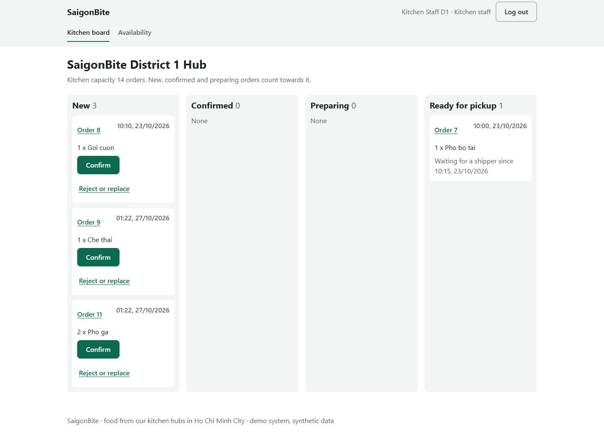
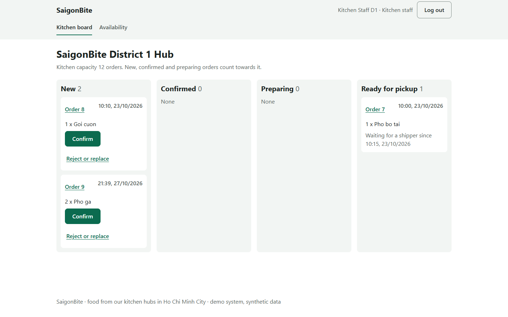

# 4.3.6 Integration of Use Cases

Author: 722I0004 · AI-assisted (Codex; evidence from Claude Sonnet 5.5 for P5)

The integration walkthrough connects the customer, kitchen and shipper paths through the same order. On 27 October 2026, the local P5 browser run at commit `252ada1` passed 60 of 60 recorded steps across eight scenarios. In its main path, customer order 11 was visible at its own kitchen; access from another hub was refused. The kitchen and customer then exercised a replacement, and the delivery path continued through pickup and delivery. Separate browser profiles represented the roles. Screenshots and the checks for each step are in `docs/part2/test_report/integration_2026-10-27/README.md` and the S3–S5 folders. This result is a browser demonstration, not proof that all possible business cases were exercised.

Figure 4.3.6A. Local P5 walkthrough: the order at its kitchen. Author: 722I0004 · AI-assisted (Claude Sonnet 5.5).

The deployed walkthrough on 27 October 2026 adapted scenarios S3–S5 to existing order 9 on the VM. The evidence records 22 of 22 steps passing, including cross-hub access checks, replacement and acceptance, kitchen transitions, a pickup race, incorrect cash and paid delivery. The original unrelated order 10 and a separate seed order 7 were checked later in supplementary browser checks; they were not asserted at the same time as the earlier isolation and pickup tests. The deployed run is therefore an adapted rerun, not a replay of the exact local sequence. Evidence: `docs/part2/test_report/deploy_2026-10-27/README.md` and `scenarios/results.json`, deployment tag `p6-deploy-20261027` at `28d6b33`.

Figure 4.3.6B. Deployed P6 walkthrough: the adapted order at its kitchen. Author: 722I0004 · AI-assisted (Codex).
