# IV. System Requirements Implementation (10 marks)

Author: 722I0004 · AI-assisted (Codex)

The filled subsections below are design sources for 4.1–4.3.2. Actual UI, SQL/method excerpts and integration evidence are delivered in the named later phases. Diagram targets retain their C0 status.

## 4.1 Design Classes for the Subsystem

Author: 722I0004 · AI-assisted (Codex)

The subsystem design joins the six main use cases and their supporting account, tracking, kitchen, voucher, user-administration and archive responsibilities. It is a set of filtered views of [the shared design model](../../../models/shared/design_model.json), at committed application baseline `C0 = 45ac76221b0a103174c7c01d17577e6e49cfd665`. Its declarations describe static correspondence and explicitly marked design targets. They do not establish application execution or completion of P4.

The 68 continued parts cover all **104 canonical class/module roles**, all **365 declared methods** and **278 displayed attributes**. Every method and every displayed attribute has one full-detail occurrence. Reference boxes in relationship parts repeat only the canonical name and stereotype; they do not repeat full member lists. No framework, exception or module role in the shared model is silently excluded. Root-annotated domain foreign-key scalars are omitted in favor of the named associations; their physical mapping remains in section 4.3.1.

**How to read the parts.** Figures 4.1A–4.1AL hold the member declarations by layer, in the order view → controller → domain → data access. Figures 4.1AM–4.1AX show twelve labelled responsibility slices for all six main use cases and shared supporting controllers. Figures 4.1AY–4.1BK draw all 38 model associations/generalizations; Figures 4.1BL–4.1BP draw domain-to-enumeration dependencies. Each part names its preceding and following part, and the member index below resolves the full declaration of every reference box.

A public `+` or convention-private `-` precedes each member. Method parameters, defaults, return types and property/static/class-method tags come from the current shared-model declaration. Implicit `self`/`cls` receivers are suppressed on the drawing; full original signatures are retained in each adjacent JSON. `Any [inferred]` marks an absent annotation rather than a new claim about the value. Attributes inferred from assignments are also labelled `[inferred]`. The renderer introduces no getters, setters, route functions or view classes.

**Status.** `MATCH` means static correspondence at C0. A `P4-TARGET` or `GAP` member carries `†` and its explicit status; the legend names the corresponding F-/P2-S-/P3-S input IDs. A reference-box dagger summarizes non-MATCH declarations of that canonical role; its member part identifies each affected declaration. The renderer resolves types, signatures and daggers from the sole model every time. A reviewed change to `MATCH` removes its dagger automatically; a signature match alone does not establish contract behavior.

The actual Flask blueprints are the «view» modules `account`, `admin`, `auth`, `delivery`, `kitchen`, `main`, `order` and `reports`. Their real route functions carry HTTP method/rule notes (63 route records, including route aliases). Presentation helpers and `SessionUser` retain their real module/value roles. Jinja templates are presentation resources, not design classes: the `account/`, `admin/`, `delivery/`, `kitchen/`, `order/` and `reports/` template areas, plus `base.html`, `home.html`, `login.html`, `error.html` and `_form.html`, serve the real routes; the per-UC detailed class sections identify their selected template resources.

The structural parts preserve `Order` composition of `OrderLine`, the `LocalCustomer`/`TouristCustomer` generalizations to `Customer` without multiplicities, and `HubMenuItem` as the association class of Hub × MenuItem. Every ordinary association has its named role, navigation and both multiplicities. A multiplicity at the left belongs to the named source; the one at the right belongs to the named target. Enumeration boxes show the real literals. `HubStatus.busy` and `quiet` remain derived properties, `archived_at` remains nullable text, and active/availability remain boolean attributes. No additional lifecycle enum is introduced.

**Dependency projection.** The relationship set contains 84 unique selected dependencies and all 38 associations/generalizations from the sole model. Responsibility slices select direct blueprint→controller and controller→domain/data-access links that explain the named area; the enum parts select every allowed domain→enumeration dependency. Other call/type/helper dependencies are retained in the shared model and the per-UC design packages. This is an explicit readability projection, not a claim that every import or call is reproduced on every sheet. Only dependencies with `allowed_on_layered_diagram = true` are selected, with downward application-layer direction. Domain dependencies remain within the domain. Actual forbidden imports are assessed separately in section 4.2 as **P3-S04 / P4.9**; no mapper exception or runtime-failure inference is adopted here.

The supporting declaration coverage includes `AccountController` profile/address operations, `VoucherController` maintenance, `UserAdminController` active-account administration and both archive granularities. In particular, **`MenuController.list_catalogue(...)` is GAP † / P2-S14 / P4.6**: it composes catalogue, hubs and optional hub listings while retaining existing helpers. **`OrderArchiveController.archive_order(user_id, order_id)` is GAP † / P2-S06 / P4.7**: it supplies the per-ID closed-order archive contract alongside the separately named batch `archive(...)`. `UserAccount.created_at` remains GAP † / P2-S02 / P4.1. These are design inputs, not existing code claims.

All parts declare a 1200 × 850 canvas and **230 mm landscape placement**, with minimum 18 px text, equivalent to **9.780 pt** at that width. Scaling them below the declared width requires another legibility check. The editable draw.io, PNG, SVG, JSON and standalone generator share each figure stem. Native draw.io editing and final DOCX/PDF placement remain UNTESTED.

**Member index**

| Canonical role | Layer | Full member figure(s) |
|---|---|---|
| `account` | view | 4.1A |
| `admin` | view | 4.1A, 4.1B, 4.1C |
| `SessionUser` | view | 4.1C |
| `auth` | view | 4.1C |
| `presentation.db` | view | 4.1C |
| `delivery` | view | 4.1D |
| `presentation.helpers` | view | 4.1D |
| `kitchen` | view | 4.1D, 4.1E |
| `main` | view | 4.1E |
| `order` | view | 4.1E, 4.1F |
| `reports` | view | 4.1F |
| `presentation.security` | view | 4.1F |
| `Profile` | controller | 4.1G |
| `AccountController` | controller | 4.1G, 4.1H |
| `AuthController` | controller | 4.1H |
| `BaseController` | controller | 4.1H |
| `controllers.common` | controller | 4.1I |
| `DeliveryView` | controller | 4.1I |
| `ShipperBoard` | controller | 4.1I |
| `DeliveryController` | controller | 4.1J |
| `BusinessError` | controller | 4.1J |
| `ValidationError` | controller | 4.1J |
| `AuthorizationError` | controller | 4.1J |
| `NotFoundError` | controller | 4.1K |
| `ConflictError` | controller | 4.1K |
| `QuoteChangedError` | controller | 4.1K |
| `HubUnavailableError` | controller | 4.1K |
| `PaymentDeclinedError` | controller | 4.1K |
| `HubAdminView` | controller | 4.1K |
| `HubController` | controller | 4.1L |
| `BoardEntry` | controller | 4.1L |
| `KitchenBoard` | controller | 4.1L |
| `KitchenOrderView` | controller | 4.1L |
| `KitchenController` | controller | 4.1M |
| `Catalogue` | controller | 4.1M |
| `HubMenu` | controller | 4.1N |
| `MenuController` | controller | 4.1N, 4.1O |
| `ArchivePreview` | controller | 4.1O |
| `OrderArchiveController` | controller | 4.1O |
| `OrderDetail` | controller | 4.1P |
| `OrderSummary` | controller | 4.1P |
| `OrderTrackingController` | controller | 4.1P |
| `HubMenuView` | controller | 4.1Q |
| `OrderConfirmation` | controller | 4.1Q |
| `PaymentChoice` | controller | 4.1Q |
| `PlaceOrderController` | controller | 4.1Q, 4.1R |
| `Period` | controller | 4.1R |
| `SalesRow` | controller | 4.1S |
| `SalesReport` | controller | 4.1S |
| `WorkloadRow` | controller | 4.1S |
| `WorkloadReport` | controller | 4.1S |
| `DeliveryRow` | controller | 4.1T |
| `DeliveryReport` | controller | 4.1T |
| `ReportController` | controller | 4.1T |
| `controllers.report_controller` | controller | 4.1U |
| `UserAdminController` | controller | 4.1U, 4.1V |
| `VoucherController` | controller | 4.1V |
| `OrderState` | domain | 4.1W |
| `PaymentMethod` | domain | 4.1W |
| `OnlineOption` | domain | 4.1W |
| `PaymentState` | domain | 4.1W |
| `DeliveryState` | domain | 4.1X |
| `OfferState` | domain | 4.1X |
| `Role` | domain | 4.1X |
| `CustomerType` | domain | 4.1X |
| `DiscountType` | domain | 4.1X |
| `InvalidTransition` | domain | 4.1Y |
| `UserAccount` | domain | 4.1Y |
| `Customer` | domain | 4.1Y |
| `LocalCustomer` | domain | 4.1Y |
| `TouristCustomer` | domain | 4.1Y |
| `Address` | domain | 4.1Z |
| `Hub` | domain | 4.1Z |
| `HubStatus` | domain | 4.1AA |
| `Brand` | domain | 4.1AA |
| `MenuItem` | domain | 4.1AA |
| `HubMenuItem` | domain | 4.1AA |
| `Voucher` | domain | 4.1AB |
| `OrderLine` | domain | 4.1AB |
| `Quote` | domain | 4.1AC |
| `Payment` | domain | 4.1AC |
| `Order` | domain | 4.1AD |
| `Delivery` | domain | 4.1AE |
| `ReplacementOffer` | domain | 4.1AE |
| `domain.models` | domain | 4.1AE |
| `domain.rules` | domain | 4.1AF |
| `CustomerDAO` | data_access | 4.1AG |
| `data_access.customer_dao` | data_access | 4.1AG |
| `data_access.database` | data_access | 4.1AG |
| `DeliveryDAO` | data_access | 4.1AH |
| `data_access.delivery_dao` | data_access | 4.1AH |
| `HubDAO` | data_access | 4.1AH |
| `MenuDAO` | data_access | 4.1AI |
| `ReplacementOfferDAO` | data_access | 4.1AI |
| `data_access.offer_dao` | data_access | 4.1AJ |
| `OrderDAO` | data_access | 4.1AJ |
| `PaymentDAO` | data_access | 4.1AK |
| `Authorisation` | data_access | 4.1AK |
| `PaymentGatewaySimulator` | data_access | 4.1AK |
| `ReportDAO` | data_access | 4.1AK |
| `UserDAO` | data_access | 4.1AL |
| `data_access.user_dao` | data_access | 4.1AL |
| `VoucherDAO` | data_access | 4.1AL |
| `data_access.voucher_dao` | data_access | 4.1AL |

**Continued subsystem figures**

Presentation member declarations.

Figure 4.1A. Shared subsystem: View members — Author: 722I0004 · AI-assisted (Codex)

Figure 4.1B. Shared subsystem: View members — Author: 722I0004 · AI-assisted (Codex)

Figure 4.1C. Shared subsystem: View members — Author: 722I0004 · AI-assisted (Codex)

Figure 4.1D. Shared subsystem: View members — Author: 722I0004 · AI-assisted (Codex)

Figure 4.1E. Shared subsystem: View members — Author: 722I0004 · AI-assisted (Codex)

Figure 4.1F. Shared subsystem: View members — Author: 722I0004 · AI-assisted (Codex)

Controller, value and error member declarations.

Figure 4.1G. Shared subsystem: Controller members — Author: 722I0004 · AI-assisted (Codex)

Figure 4.1H. Shared subsystem: Controller members — Author: 722I0004 · AI-assisted (Codex)

Figure 4.1I. Shared subsystem: Controller members — Author: 722I0004 · AI-assisted (Codex)

Figure 4.1J. Shared subsystem: Controller members — Author: 722I0004 · AI-assisted (Codex)

Figure 4.1K. Shared subsystem: Controller members — Author: 722I0004 · AI-assisted (Codex)

Figure 4.1L. Shared subsystem: Controller members — Author: 722I0004 · AI-assisted (Codex)

Figure 4.1M. Shared subsystem: Controller members — Author: 722I0004 · AI-assisted (Codex)

Figure 4.1N. Shared subsystem: Controller members — Author: 722I0004 · AI-assisted (Codex)

Figure 4.1O. Shared subsystem: Controller members — Author: 722I0004 · AI-assisted (Codex)

Figure 4.1P. Shared subsystem: Controller members — Author: 722I0004 · AI-assisted (Codex)

Figure 4.1Q. Shared subsystem: Controller members — Author: 722I0004 · AI-assisted (Codex)

Figure 4.1R. Shared subsystem: Controller members — Author: 722I0004 · AI-assisted (Codex)

Figure 4.1S. Shared subsystem: Controller members — Author: 722I0004 · AI-assisted (Codex)

Figure 4.1T. Shared subsystem: Controller members — Author: 722I0004 · AI-assisted (Codex)

Figure 4.1U. Shared subsystem: Controller members — Author: 722I0004 · AI-assisted (Codex)

Figure 4.1V. Shared subsystem: Controller members — Author: 722I0004 · AI-assisted (Codex)

Domain, rule and enum member declarations.

Figure 4.1W. Shared subsystem: Domain members — Author: 722I0004 · AI-assisted (Codex)

Figure 4.1X. Shared subsystem: Domain members — Author: 722I0004 · AI-assisted (Codex)

Figure 4.1Y. Shared subsystem: Domain members — Author: 722I0004 · AI-assisted (Codex)

Figure 4.1Z. Shared subsystem: Domain members — Author: 722I0004 · AI-assisted (Codex)

Figure 4.1AA. Shared subsystem: Domain members — Author: 722I0004 · AI-assisted (Codex)

Figure 4.1AB. Shared subsystem: Domain members — Author: 722I0004 · AI-assisted (Codex)

Figure 4.1AC. Shared subsystem: Domain members — Author: 722I0004 · AI-assisted (Codex)

Figure 4.1AD. Shared subsystem: Domain members — Author: 722I0004 · AI-assisted (Codex)

Figure 4.1AE. Shared subsystem: Domain members — Author: 722I0004 · AI-assisted (Codex)

Figure 4.1AF. Shared subsystem: Domain members — Author: 722I0004 · AI-assisted (Codex)

DAO, mapping-helper and local gateway member declarations.

Figure 4.1AG. Shared subsystem: Data access members — Author: 722I0004 · AI-assisted (Codex)

Figure 4.1AH. Shared subsystem: Data access members — Author: 722I0004 · AI-assisted (Codex)

Figure 4.1AI. Shared subsystem: Data access members — Author: 722I0004 · AI-assisted (Codex)

Figure 4.1AJ. Shared subsystem: Data access members — Author: 722I0004 · AI-assisted (Codex)

Figure 4.1AK. Shared subsystem: Data access members — Author: 722I0004 · AI-assisted (Codex)

Figure 4.1AL. Shared subsystem: Data access members — Author: 722I0004 · AI-assisted (Codex)

Selected layered responsibility links for the six main UCs and shared supporting controllers.

Figure 4.1AM. Shared subsystem: UC-01 / ordering — Author: 722I0004 · AI-assisted (Codex)

Figure 4.1AN. Shared subsystem: UC-02 / delivery — Author: 722I0004 · AI-assisted (Codex)

Figure 4.1AO. Shared subsystem: UC-03 / hubs — Author: 722I0004 · AI-assisted (Codex)

Figure 4.1AP. Shared subsystem: UC-04 / reports — Author: 722I0004 · AI-assisted (Codex)

Figure 4.1AQ. Shared subsystem: UC-05 / kitchen decisions — Author: 722I0004 · AI-assisted (Codex)

Figure 4.1AR. Shared subsystem: UC-06 / catalogue — Author: 722I0004 · AI-assisted (Codex)

Figure 4.1AS. Shared subsystem: SUC-01 / authentication — Author: 722I0004 · AI-assisted (Codex)

Figure 4.1AT. Shared subsystem: SUC-02 / profile and addresses — Author: 722I0004 · AI-assisted (Codex)

Figure 4.1AU. Shared subsystem: SUC-03 / SUC-04 / tracking — Author: 722I0004 · AI-assisted (Codex)

Figure 4.1AV. Shared subsystem: SUC-07 / vouchers — Author: 722I0004 · AI-assisted (Codex)

Figure 4.1AW. Shared subsystem: SUC-08 / accounts — Author: 722I0004 · AI-assisted (Codex)

Figure 4.1AX. Shared subsystem: SUC-09 / retained order history — Author: 722I0004 · AI-assisted (Codex)

Canonical associations, generalizations and real-enum dependencies.

Figure 4.1AY. Shared subsystem: Associations and generalizations — Author: 722I0004 · AI-assisted (Codex)

Figure 4.1AZ. Shared subsystem: Associations and generalizations — Author: 722I0004 · AI-assisted (Codex)

Figure 4.1BA. Shared subsystem: Associations and generalizations — Author: 722I0004 · AI-assisted (Codex)

Figure 4.1BB. Shared subsystem: Associations and generalizations — Author: 722I0004 · AI-assisted (Codex)

Figure 4.1BC. Shared subsystem: Associations and generalizations — Author: 722I0004 · AI-assisted (Codex)

Figure 4.1BD. Shared subsystem: Associations and generalizations — Author: 722I0004 · AI-assisted (Codex)

Figure 4.1BE. Shared subsystem: Associations and generalizations — Author: 722I0004 · AI-assisted (Codex)

Figure 4.1BF. Shared subsystem: Associations and generalizations — Author: 722I0004 · AI-assisted (Codex)

Figure 4.1BG. Shared subsystem: Associations and generalizations — Author: 722I0004 · AI-assisted (Codex)

Figure 4.1BH. Shared subsystem: Associations and generalizations — Author: 722I0004 · AI-assisted (Codex)

Figure 4.1BI. Shared subsystem: Associations and generalizations — Author: 722I0004 · AI-assisted (Codex)

Figure 4.1BJ. Shared subsystem: Associations and generalizations — Author: 722I0004 · AI-assisted (Codex)

Figure 4.1BK. Shared subsystem: Associations and generalizations — Author: 722I0004 · AI-assisted (Codex)

Figure 4.1BL. Shared subsystem: Domain enumeration dependencies — Author: 722I0004 · AI-assisted (Codex)

Figure 4.1BM. Shared subsystem: Domain enumeration dependencies — Author: 722I0004 · AI-assisted (Codex)

Figure 4.1BN. Shared subsystem: Domain enumeration dependencies — Author: 722I0004 · AI-assisted (Codex)

Figure 4.1BO. Shared subsystem: Domain enumeration dependencies — Author: 722I0004 · AI-assisted (Codex)

Figure 4.1BP. Shared subsystem: Domain enumeration dependencies — Author: 722I0004 · AI-assisted (Codex)

The member and relation declarations above are generated from the same shared model used by the six report III design packages. Transactional message ordering and rollback behavior belong to the operation sequences in 3.x.4 and their DAO enrichments in 4.3.2; this class view does not infer those behaviors from a method signature.

## 4.2 Package Diagram for the Subsystem

Author: 722I0004 · AI-assisted (Codex)

Figure 4.2. Package architecture and C0 dependency policy — Author: 722I0004 · AI-assisted (Codex)

The diagram shows the permitted package dependencies: presentation routes depend on controllers; controllers depend on domain objects and data access; the domain package has no outward application-layer dependency. Dashed arrows show only those permitted dependencies. The import audit beside the packages reports actual C0 violations separately, without drawing them as allowed architecture.

The comparison resolves both absolute and relative `saigonbite.*` imports in all 48 inventory modules. It accounts for 392 application-internal import records: 152 permitted cross-layer imports (24 presentation→controllers, 82 controllers→domain, 46 controllers→data_access), 182 imports within a layer, 43 strict-layer violations, and 15 root-boundary imports. Imports from Flask, Flask-Login, Werkzeug, SQLite and the Python standard library are outside the application-layer comparison.

| Strict C0 violation | Evidence from `code_inventory.json` |
|---|---|
| presentation→business.domain: 12 imports in 7 modules | `presentation/account.py` imports `Role` and `rules`; `admin.py` imports `DiscountType` and `Role`; `auth.py` imports `Role` and `UserAccount`; `delivery.py`, `kitchen.py` and `reports.py` import `Role`; `order.py` imports `OnlineOption`, `PaymentMethod` and `Role`. |
| presentation→data_access: 3 imports in 2 modules | `presentation/db.py` imports `connect`; `presentation/order.py` imports `APPROVE` and `DECLINE`. |
| data_access→business.domain: 28 imports in 10 modules | `customer_dao.py`, `delivery_dao.py`, `hub_dao.py`, `menu_dao.py`, `offer_dao.py`, `order_dao.py`, `payment_dao.py`, `payment_gateway.py`, `user_dao.py` and `voucher_dao.py` import domain objects, factories, enums or rules for row materialisation and gateway typing. |

The remaining 15 records sit at the composition boundary: `saigonbite/__init__.py` imports 3 controller error types and 10 presentation modules to assemble the application; `app.py` imports `create_app`; and `presentation/auth.py` imports the root-level `saigonbite.NAV` constant. The first two are bootstrap wiring outside the four named packages. The last is a direct view-to-root import and is called out separately because it does not match the strict package graph.

**Root disposition — accepted as P3-S04 / P4.9.** A strict-layer boundary decision is required before treating the package graph as satisfied at C0. Resolve the 12 presentation→domain imports and 3 presentation→data_access imports at the presentation/controller boundary, decide whether DAO-to-domain materialisation receives an explicit persistence-mapper exception or moves behind a lower-level mapping boundary, and resolve the `NAV` root import. No exception or architectural change is adopted in P3. The shared annotations account for all 44 finding records across 23 module pairs (43 cross-layer records plus the `NAV` root import). These are static policy findings; they do not establish a runtime failure. The figure shows three permitted arrows across four packages and keeps observed violations visible.

Evidence is Static at C0 `45ac76221b0a103174c7c01d17577e6e49cfd665`. The machine-readable import audit is in `models/shared/package_diagram.json`. No application import, execution, test, or runtime qualification was performed.

## 4.3 Implementation

Author: 722I0004 · AI-assisted (Codex)

### 4.3.1 Map Persistent Objects to the Tables in a Database

Author: 722I0004 · AI-assisted (Codex)

The schema source is the parsed schema v2 in `docs/part2/design/code_inventory.json` at C0 `45ac76221b0a103174c7c01d17577e6e49cfd665`. It contains 13 tables, 110 columns, 18 foreign keys, seven indexes, and `user_version = 2`. These figures and relationships are Static schema evidence; they are not a claim that application paths or constraints passed tests.

The diagrams use UML associations with SQL multiplicities. `PK` marks primary-key columns, `FK` marks foreign keys, `U` marks a single-column UNIQUE constraint, `U*` marks membership in a composite or partial unique constraint, `C` marks a column participating in a CHECK, and `?` marks a nullable column. Full SQL types, NULL rules, CHECK expressions, key declarations, and enforcement notes are in the [class-to-table mapping](../design/class_table_mapping.csv).

Figure 4.3.1A. Schema v2: identity, customer and hub records — Author: 722I0004 · AI-assisted (Codex)

Figure 4.3.1B. Schema v2: brands, menu items, hub listings and vouchers — Author: 722I0004 · AI-assisted (Codex)

Figure 4.3.1C. Schema v2: orders and order-line snapshots — Author: 722I0004 · AI-assisted (Codex)

Figure 4.3.1D. Schema v2: payment and delivery records — Author: 722I0004 · AI-assisted (Codex)

Figure 4.3.1E. Schema v2: replacement-offer history — Author: 722I0004 · AI-assisted (Codex)

The mapping has one primary row for each of the 110 C0 columns. It also makes non-column correspondences explicit: `Order.lines` maps to the child `order_line.order_id` relationship; `HubMenuItem.item` maps to `hub_menu_item.menu_item_id`; `Order.item_subtotal` and `Order.total` are derived properties with persisted columns; `MenuItem.brand_name` is a joined projection of `brand.name`; `LocalCustomer` and `TouristCustomer` map to the same `customer.customer_type` discriminator; and `OrderLine.line_total` is computed, with no SQL column. `UserAccount.created_at` is recorded as a target gap because its model attribute is `GAP` and the column is absent at C0.

`Customer` is stored in one `customer` table. Its `customer_type` CHECK distinguishes `LOCAL` from `TOURIST`; it does not create separate subtype tables. `hub_menu_item` is the association-class table between Hub and MenuItem, with a composite primary key on `(hub_id, menu_item_id)`. There is no Shipper table: `delivery.shipper_id` references `user_account.id`, and the SHIPPER role is held by the linked account. `Quote`, report filters and rows, and receipts are computed views rather than persisted classes.

The UNIQUE rules are `hub.code`, `brand.name`, `user_account.username`, `customer.user_id`, `voucher.code`, `orders.idempotency_token`, `payment.order_id`, and `delivery.order_id`; the composite rules are `menu_item(brand_id, name)`, `hub_menu_item(hub_id, menu_item_id)` as its primary key, and `order_line(order_id, menu_item_id)`. The partial unique index `idx_offer_one_open` limits each order to one `replacement_offer` whose state is `OFFERED`; resolved offers remain stored history. The unique child FKs on `payment.order_id` and `delivery.order_id` cap each Order at one child row but do not require presence. The SQL also permits an Order with zero OrderLine rows. The contract requires checkout to create one Payment and at least one OrderLine, and `markReady` to create a Delivery; these application-path requirements are for P4 verification, not consequences of the FKs. P2-S09 records the related cross-row guards, including same-order offer/line ownership and shipper eligibility.

Money is stored as whole VND where applicable. For an Order, `item_subtotal` is S, `voucher_discount` is D, `delivery_fee` is F, `quiet_discount` is Q, and `total_amount` is T, constrained by `T = S − D + F − Q`. `payment.amount` holds the COD amount due or captured online amount C; `refund_amount` is an amount owed, not paid out. An accepted replacement can leave a partial online obligation `C − T`; an unfulfilled online order is owed the full C. `delivery.cash_collected` records cash at delivery, which must equal T for COD completion. Order-line and replacement-offer names/prices are snapshots; later catalogue edits do not rewrite the existing order history.

Event columns ending in `_at` are UTC timestamp text. `voucher.valid_from` and `valid_until` are inclusive Asia/Ho_Chi_Minh calendar dates stored as text, not UTC instants. The archive timestamps are on Hub, Brand, MenuItem, Address, Voucher and Order. `user_account.is_active` is an account lifecycle flag, not an archive timestamp; unlisting a HubMenuItem deletes the association row. Under the plan’s archive rule, an archived parent is hidden from operational lists while authorized history, receipts, reports and refund obligations remain available. Child order lines, payments, deliveries and offers remain attached to the retained Order. These retention rules are design requirements for P4 verification, not behaviors inferred from a flag alone.

The † items are design targets, not yet in code at C0. `P2-S02` requires `user_account.created_at`, which is absent from both the draft class and SQL table and is assigned to P4.1. `P2-S03` requires the Tourist CHECK to require `nationality`; the nullable column exists, and the static Phase 2 review found controller validation, but the SQL CHECK does not enforce it. `P2-S07` requires the linked Customer account to have role `CUSTOMER`; the FK and UNIQUE rule do not enforce that role. Root accepted P4.7 as the account subphase for S03/S07. The figure’s dagger legend reads: “† design target, not yet in code at C0 (see P4 inputs P2-S02/S03/S07).”

`P2-S08` is not a missing-value defect: `Payment.updated_at` is `Optional[str]` in the domain model but `NOT NULL` in SQL, and the `PaymentDAO.insert` AST body writes the supplied `updated_at` or falls back to `created_at`. The SQL CHECK also permits Payment values `FAILED` and `REFUNDED`; per P2-S01 and plan §4.3 these remain deferred or unreachable. No declined-payment row or refund-payout path is added to this mapping.

The diagrams and CSV were generated from the frozen inventory/model without importing or running the application. Structural XML and endpoint checks passed, all six PNGs and independent Edge-rasterized SVGs were opened for visual review, and the smallest placed font is 9.21 pt at 230 × 170 mm. Native draw.io editing, Excel, and final DOCX/PDF placement remain UNTESTED; no app correctness or test result is claimed.

### 4.3.2 Modifying Sequence Diagrams

Author: 722I0004 · AI-assisted (Codex)

The following eight operations expand the corresponding report III design sequences with the actual DAO responsibilities and the database resource. Their SSD operation names, parameter strings and occurrence pointers are unchanged. Each set of Parts A–… is one request; a continuation does not start another operation or a new transaction. Focused plates retain the actor, view and controller, show the relevant domain/helper/value lifelines, and add the relevant DAOs and `:Database`. This resource is not an application class. Mechanical object loading is scoped in the responsibility table below so the high-risk writes remain readable.

The baseline is committed application `C0 = 45ac76221b0a103174c7c01d17577e6e49cfd665`. `MATCH` means static correspondence at that baseline. A dagger (`†`) marks `P4-TARGET` or `GAP`, with specific F-/P2-/P3 input IDs on each figure. The diagrams specify the target design where the draft differs; they provide no runtime, transaction-race, payment, numerical-report or test qualification.

For writes, the transaction extends from `BEGIN IMMEDIATE` to successful `COMMIT`, including all intended DAO writes. Every conditional DAO boolean is checked by the controller or its named helper. A guard failure, zero rowcount or false save result stops subsequent writes and rolls back the active transaction. A write or COMMIT error rolls back if a transaction remains active. A failed BEGIN does not trigger an unconditional ROLLBACK. An exhausted `database is locked` outcome produces **“Busy, please retry; nothing was changed”**. P2-S13/P3-S03 keep incomplete controller/helper and commit-failure handling marked as targets. The summary band is a transaction key, not control flow. Actual `opt`, `loop` and `break` rectangles enclose the messages their guards control. A `break` operand ends the enclosing request: successful returns cannot fall through into compensation, and early refusals skip later writes. Named continuation operands repeat the guard on the next plate; a failure handler is an exclusive continuation rather than the next step of a successful request.

P2-S12 remains a connection-configuration target: `foreign_keys=ON`, `journal_mode=WAL`, `synchronous=NORMAL`, and `busy_timeout=10000` on each connection, as specified in plan §5.2. These settings are not asserted as observed at runtime. No user interaction or external request occurs while a write lock is held; the checkout simulator decision is a short deterministic local call.

**Responsibility table and mechanical-read scope**

| UC / SSD operation | Real controller and transaction | Focused persistence work | Mechanical reads retained by reference | PC/MG |
|---|---|---|---|---|
| UC-01 / `confirmCheckout` | `PlaceOrderController.confirm_order`; BEGIN IMMEDIATE | Token read before authorization; current quote eligibility; order/line/payment INSERTs; release through COMMIT failure. | UserDAO.get_by_id and CustomerDAO.get_by_user_id for authentication/customer mapping; VoucherDAO and HubDAO helpers inside _build_quote; OrderDAO._load line loading and PaymentDAO.get_by_order_id / HubDAO.get_including_archived in _confirmation. list_active/active_loads serve busy suggestions; no auto-resubmission. | UC01-PC01; UC01-PC02; UC01-PC03; UC01-PC04; UC01-PC05; UC01-PC06; UC01-MG01; UC01-MG02; UC01-MG03 |
| UC-02 / `takeDelivery` | `DeliveryController.pick_up`; BEGIN IMMEDIATE | DeliveryDAO.take and OrderDAO.change_state; both rowcounts checked. | UserDAO.get_by_id via BaseController; _delivery uses DeliveryDAO; get_delivery uses OrderDAO._load, PaymentDAO.get_by_order_id, HubDAO.get_including_archived, CustomerDAO.get for committed DeliveryView. | UC02-PC01; UC02-MG01 |
| UC-02 / `confirmDelivered` | `DeliveryController.confirm_delivered`; BEGIN IMMEDIATE | COD PaymentDAO.change_state, DeliveryDAO.finish and OrderDAO.change_state; all checked. | UserDAO.get_by_id and OrderDAO.get_by_id/_load guard reads; committed get_delivery loads hub, customer, payment and lines for DeliveryView. | UC02-PC02; UC02-MG01 |
| UC-03 / `archiveHub` | `HubController.archive_hub`; BEGIN IMMEDIATE | HubDAO.open_order_count and conditional HubDAO.archive; nullable archive flag. | UserDAO.get_by_id via _require_admin; get_including_archived retains authorised historical display. | UC03-PC02; UC03-MG01 |
| UC-04 / `salesReport` | `ReportController.sales_report`; read | ReportDAO.sales_by_hub / top_items SELECTs; no business writes on any branch. | UserDAO.get_by_id via BaseController; HubDAO.get_including_archived via _hub; filter-panel all_hubs performs a read only. | UC04-PC01; UC04-MG01; UC04-MG02 |
| UC-05 / `rejectOrder` | `KitchenController.reject_order`; BEGIN IMMEDIATE | Order rejection, open-offer withdrawal, full captured-C obligation and payment state saved together. | UserDAO.get_by_id via _require_staff; OrderDAO._load line snapshots via _hub_order; no historical rows deleted. | UC05-PC02 |
| UC-05 / `acceptReplacement` | `OrderTrackingController.answer_replacement`; BEGIN IMMEDIATE | Exact offer and target recheck; committed invalid-target withdrawal OR atomic valid line/totals/payment/offer acceptance. | UserDAO and CustomerDAO authenticate owner; OrderDAO._load snapshots; committed get_order uses DeliveryDAO.get_by_order_id, HubDAO.get_including_archived, PaymentDAO.get_by_order_id and ReplacementOfferDAO.list_for_order. | UC05-PC04; UC05-MG01 |
| UC-06 / `updateMenuItem` | `MenuController.update_item`; BEGIN IMMEDIATE | MenuDAO duplicate query and conditional update_item; no order_line write. | UserDAO.get_by_id via _require_admin; _active_item uses MenuDAO.get_item; _parse_item validates current parent and fields; final get_item is a read. | UC06-PC01; UC06-MG01; UC06-MG02 |

DAO details are expanded from the AST inventory, not executed. The full per-operation DAO call list and read/write table scope remain in `docs/part2/design/operation_realisation.csv`. Calls nested in a helper are labelled with that helper; omitted SELECTs do not imply omitted ownership, role, state or catalogue guards. Short SQL notes state statement kind, table and predicate only; full SQL/code excerpts belong to P7.

**UC-01 — confirmCheckout (`OP-01`)**

A new token revalidates the owner/address, active hub and catalogue, current load/capacity, quantities, voucher and raw distance inside the write transaction. `Quote.fingerprint(payment.method, payment.option)` takes the pure-domain enums carried by the real `PaymentChoice` fields. Both full fingerprint and T must match consent (F-07); the F-04 radius/fee decision uses raw distance. An own-token replay returns the existing order without authorization, repricing or insertion; a foreign token is refused without disclosure. ONLINE decline saves zero Order/Line/Payment rows. Successful checkout inserts one order header, its N snapshots and one payment; it does not simulate a conditional state UPDATE. COD is PENDING, ONLINE is PAID with C=T. P2-S05 releases authorization on every later failure through COMMIT. UC01-PC01…PC06 and MG01…MG03 are the contract anchors.

SSD parameters: `hubId, addressId, lines(itemId, quantity), voucherCode?, paymentMethod, onlineOption?, simulatorOutcome?, quoteFingerprint, quotedTotal, checkoutToken`. Occurrence: `models/UC-01/ssd_uc01_PartB.drawio#01S-M04`.

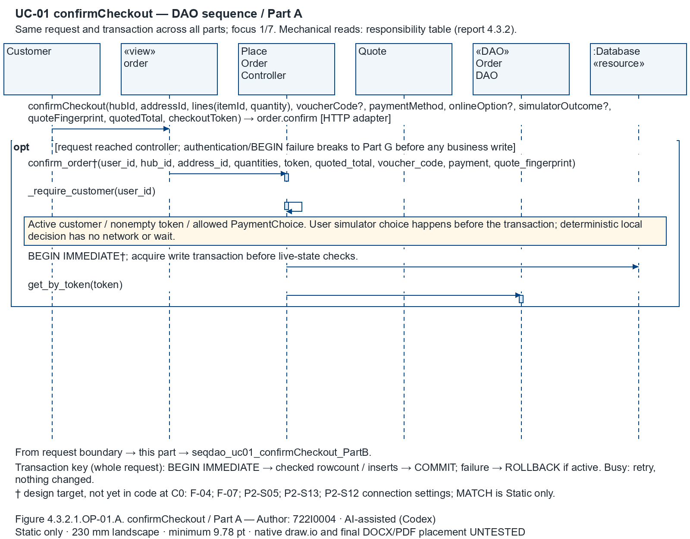

Figure 4.3.2.1.OP-01.A. UC-01 confirmCheckout — Part A — Author: 722I0004 · AI-assisted (Codex).
Editable source: [draw.io](../../../models/UC-01/seqdao_uc01_confirmCheckout_PartA.drawio); vector: [SVG](../../../models/UC-01/seqdao_uc01_confirmCheckout_PartA.svg).

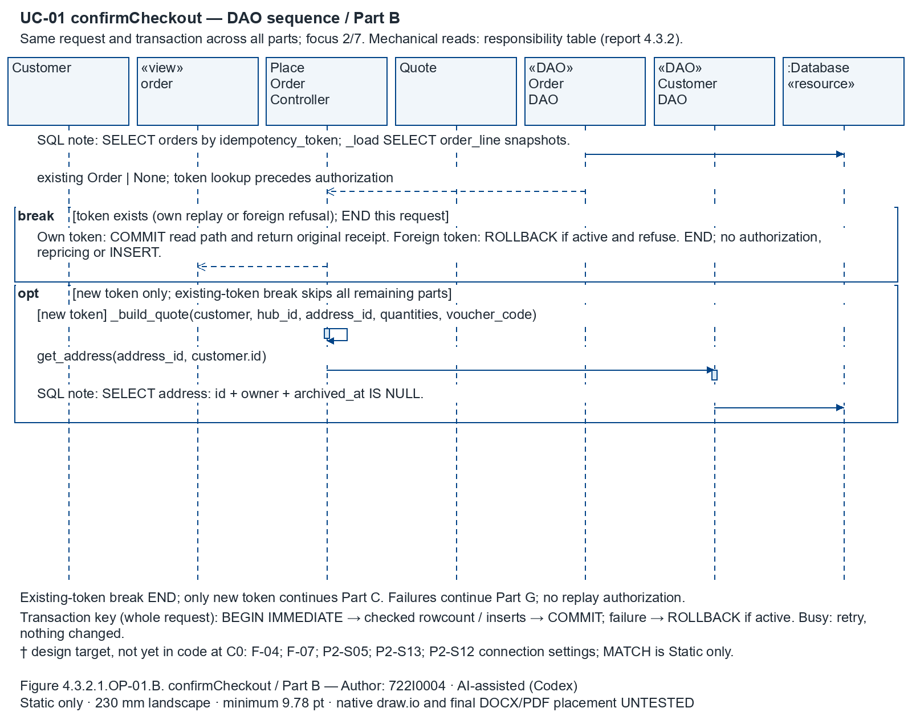

Figure 4.3.2.1.OP-01.B. UC-01 confirmCheckout — Part B — Author: 722I0004 · AI-assisted (Codex).
Editable source: [draw.io](../../../models/UC-01/seqdao_uc01_confirmCheckout_PartB.drawio); vector: [SVG](../../../models/UC-01/seqdao_uc01_confirmCheckout_PartB.svg).

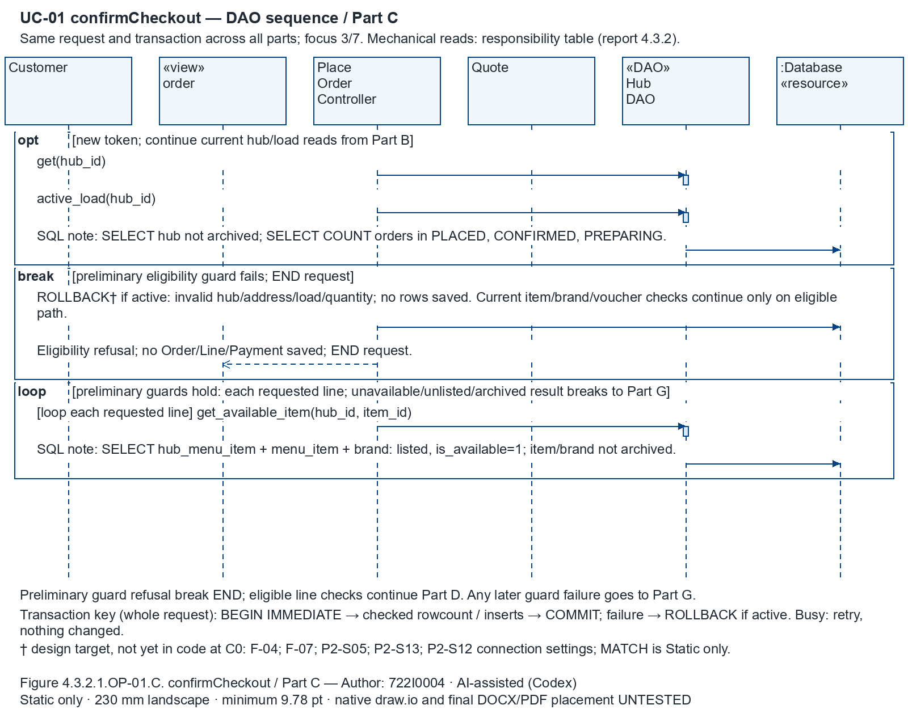

Figure 4.3.2.1.OP-01.C. UC-01 confirmCheckout — Part C — Author: 722I0004 · AI-assisted (Codex).
Editable source: [draw.io](../../../models/UC-01/seqdao_uc01_confirmCheckout_PartC.drawio); vector: [SVG](../../../models/UC-01/seqdao_uc01_confirmCheckout_PartC.svg).

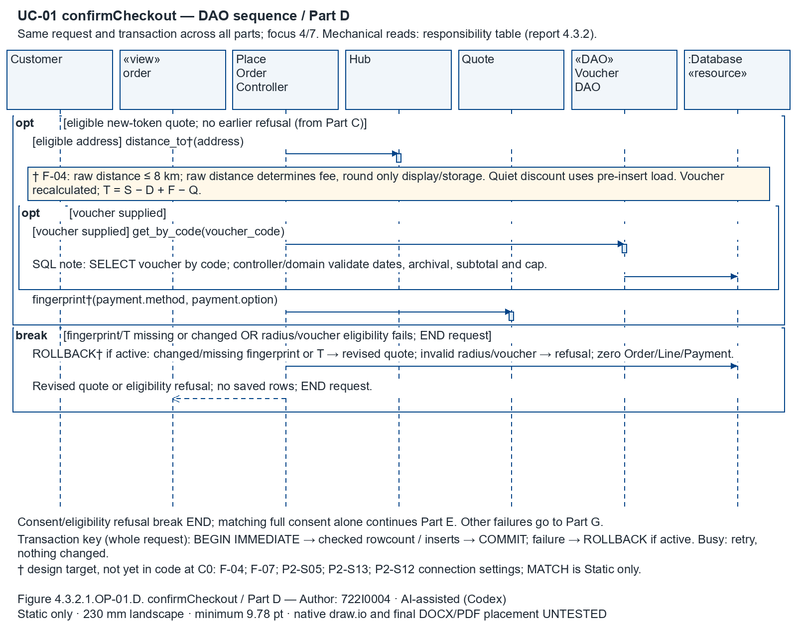

Figure 4.3.2.1.OP-01.D. UC-01 confirmCheckout — Part D — Author: 722I0004 · AI-assisted (Codex).
Editable source: [draw.io](../../../models/UC-01/seqdao_uc01_confirmCheckout_PartD.drawio); vector: [SVG](../../../models/UC-01/seqdao_uc01_confirmCheckout_PartD.svg).

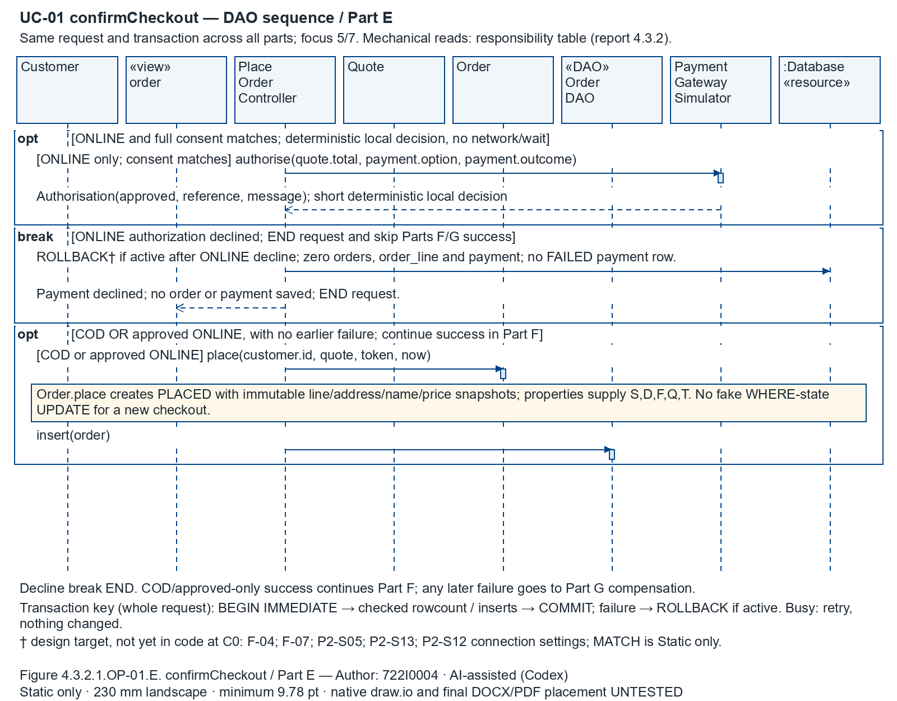

Figure 4.3.2.1.OP-01.E. UC-01 confirmCheckout — Part E — Author: 722I0004 · AI-assisted (Codex).
Editable source: [draw.io](../../../models/UC-01/seqdao_uc01_confirmCheckout_PartE.drawio); vector: [SVG](../../../models/UC-01/seqdao_uc01_confirmCheckout_PartE.svg).

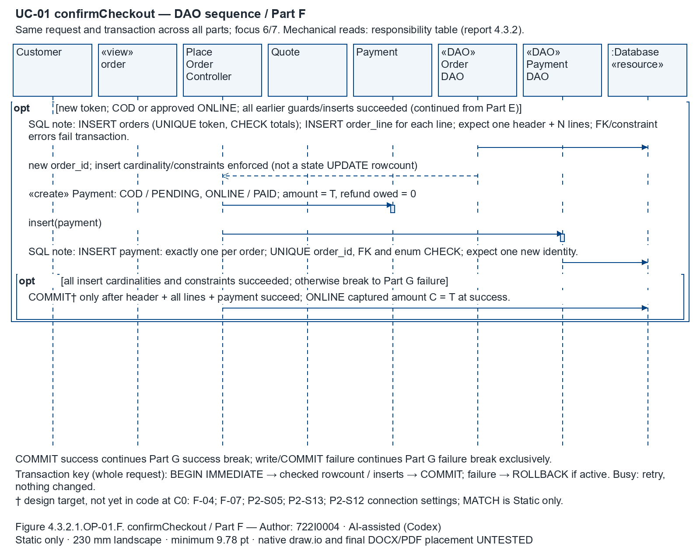

Figure 4.3.2.1.OP-01.F. UC-01 confirmCheckout — Part F — Author: 722I0004 · AI-assisted (Codex).
Editable source: [draw.io](../../../models/UC-01/seqdao_uc01_confirmCheckout_PartF.drawio); vector: [SVG](../../../models/UC-01/seqdao_uc01_confirmCheckout_PartF.svg).

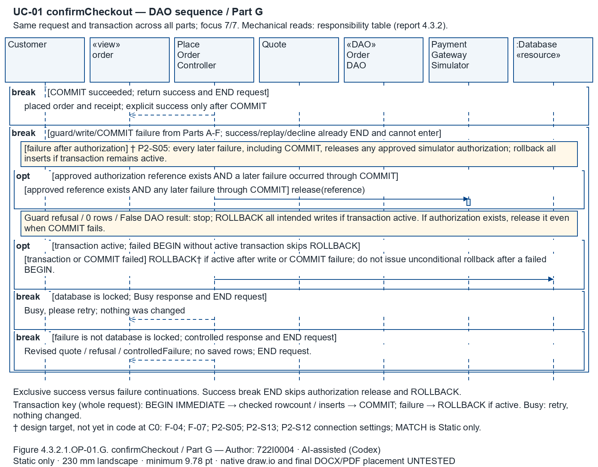

Figure 4.3.2.1.OP-01.G. UC-01 confirmCheckout — Part G — Author: 722I0004 · AI-assisted (Codex).
Editable source: [draw.io](../../../models/UC-01/seqdao_uc01_confirmCheckout_PartG.drawio); vector: [SVG](../../../models/UC-01/seqdao_uc01_confirmCheckout_PartG.svg).

**UC-02 — takeDelivery (`OP-10`)**

The active shipper checks the live delivery is unassigned/AWAITING_PICKUP and the order is READY. DeliveryDAO.take uses the actual AWAITING_PICKUP predicate; a true rowcount result is required before the paired READY→OUT_FOR_DELIVERY save. Any later failure rolls back the pickup as well. Only one competing take may commit; this is a design guarantee to test in P4, not a measured race result. No additional one-active-delivery rule is introduced.

SSD parameters: `orderId`. Occurrence: `models/UC-02/ssd_uc02_PartA.drawio#M03`.

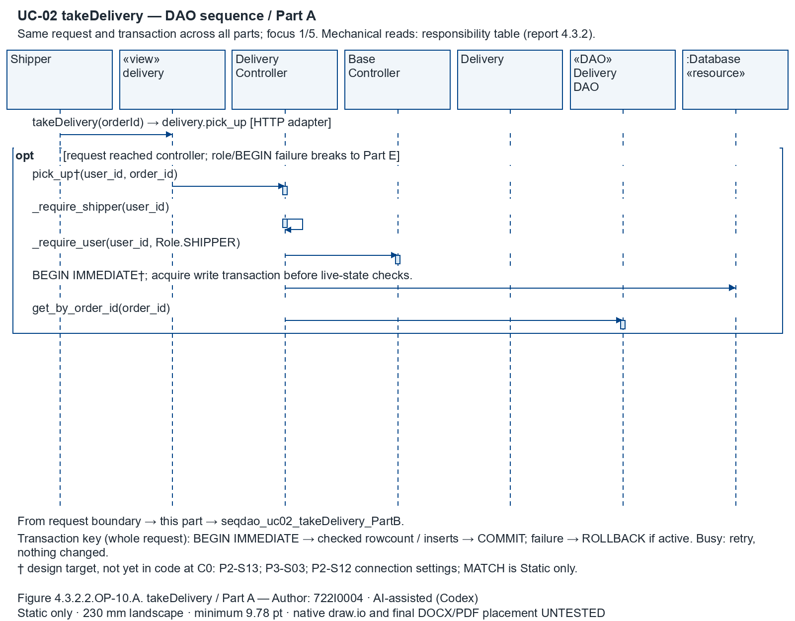

Figure 4.3.2.2.OP-10.A. UC-02 takeDelivery — Part A — Author: 722I0004 · AI-assisted (Codex).
Editable source: [draw.io](../../../models/UC-02/seqdao_uc02_takeDelivery_PartA.drawio); vector: [SVG](../../../models/UC-02/seqdao_uc02_takeDelivery_PartA.svg).

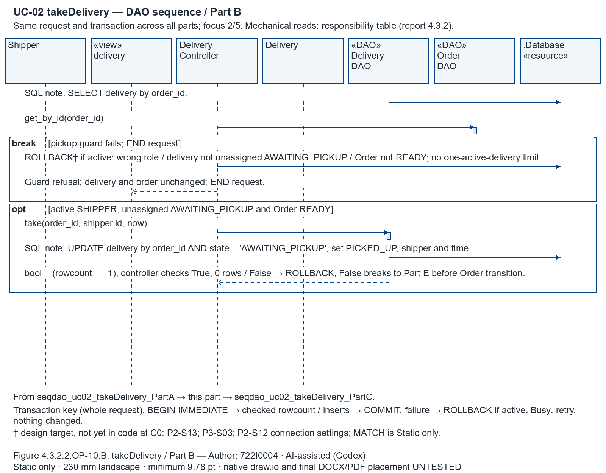

Figure 4.3.2.2.OP-10.B. UC-02 takeDelivery — Part B — Author: 722I0004 · AI-assisted (Codex).
Editable source: [draw.io](../../../models/UC-02/seqdao_uc02_takeDelivery_PartB.drawio); vector: [SVG](../../../models/UC-02/seqdao_uc02_takeDelivery_PartB.svg).

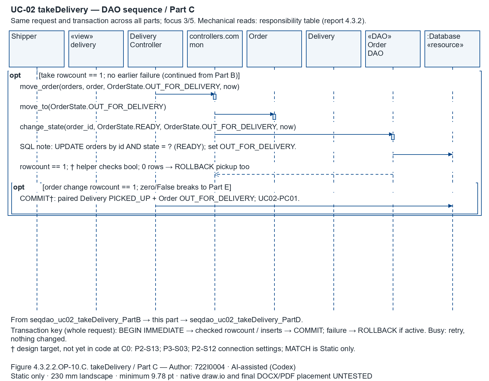

Figure 4.3.2.2.OP-10.C. UC-02 takeDelivery — Part C — Author: 722I0004 · AI-assisted (Codex).
Editable source: [draw.io](../../../models/UC-02/seqdao_uc02_takeDelivery_PartC.drawio); vector: [SVG](../../../models/UC-02/seqdao_uc02_takeDelivery_PartC.svg).

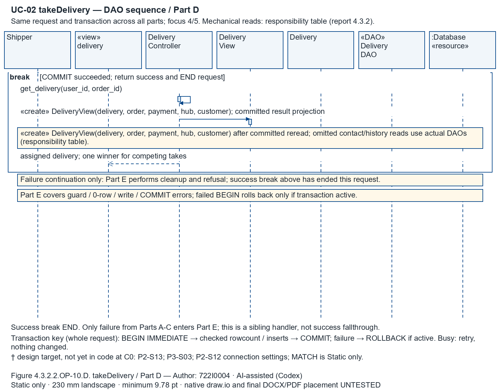

Figure 4.3.2.2.OP-10.D. UC-02 takeDelivery — Part D — Author: 722I0004 · AI-assisted (Codex).
Editable source: [draw.io](../../../models/UC-02/seqdao_uc02_takeDelivery_PartD.drawio); vector: [SVG](../../../models/UC-02/seqdao_uc02_takeDelivery_PartD.svg).

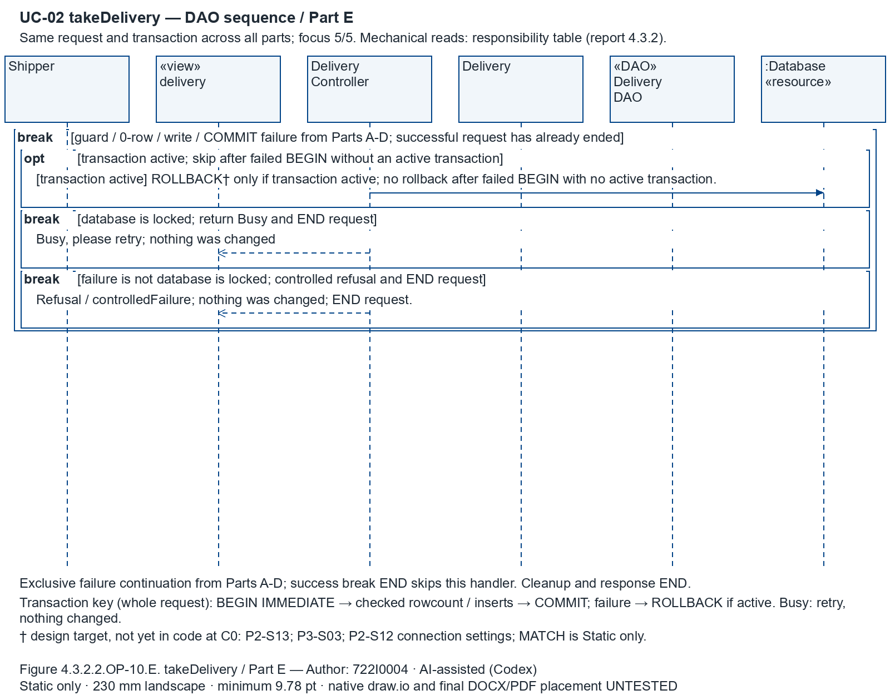

Figure 4.3.2.2.OP-10.E. UC-02 takeDelivery — Part E — Author: 722I0004 · AI-assisted (Codex).
Editable source: [draw.io](../../../models/UC-02/seqdao_uc02_takeDelivery_PartE.drawio); vector: [SVG](../../../models/UC-02/seqdao_uc02_takeDelivery_PartE.svg).

**UC-02 — confirmDelivered (`OP-11`)**

Only the assigned shipper may finish a PICKED_UP delivery paired with an OUT_FOR_DELIVERY order. COD cash must equal T; the PENDING→PAID update is conditional and checked. ONLINE accepts no cash and preserves captured C and any partial refund owed. DeliveryDAO.finish checks order_id, assigned shipper_id and PICKED_UP. The paired order update, finish and any COD write commit together; a zero result on any one reverses prior writes.

SSD parameters: `orderId, cashCollected?`. Occurrence: `models/UC-02/ssd_uc02_PartB.drawio#M04`.

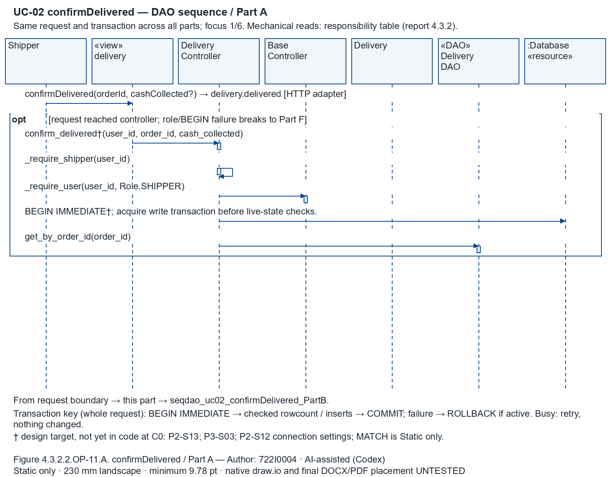

Figure 4.3.2.2.OP-11.A. UC-02 confirmDelivered — Part A — Author: 722I0004 · AI-assisted (Codex).
Editable source: [draw.io](../../../models/UC-02/seqdao_uc02_confirmDelivered_PartA.drawio); vector: [SVG](../../../models/UC-02/seqdao_uc02_confirmDelivered_PartA.svg).

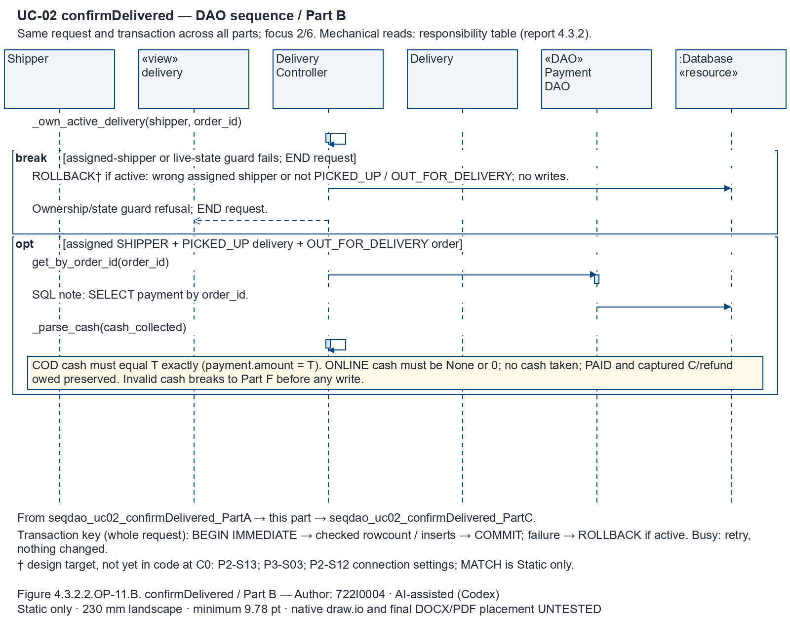

Figure 4.3.2.2.OP-11.B. UC-02 confirmDelivered — Part B — Author: 722I0004 · AI-assisted (Codex).
Editable source: [draw.io](../../../models/UC-02/seqdao_uc02_confirmDelivered_PartB.drawio); vector: [SVG](../../../models/UC-02/seqdao_uc02_confirmDelivered_PartB.svg).

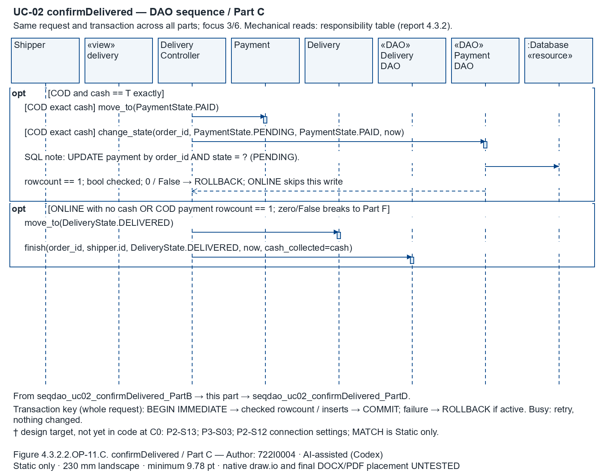

Figure 4.3.2.2.OP-11.C. UC-02 confirmDelivered — Part C — Author: 722I0004 · AI-assisted (Codex).
Editable source: [draw.io](../../../models/UC-02/seqdao_uc02_confirmDelivered_PartC.drawio); vector: [SVG](../../../models/UC-02/seqdao_uc02_confirmDelivered_PartC.svg).

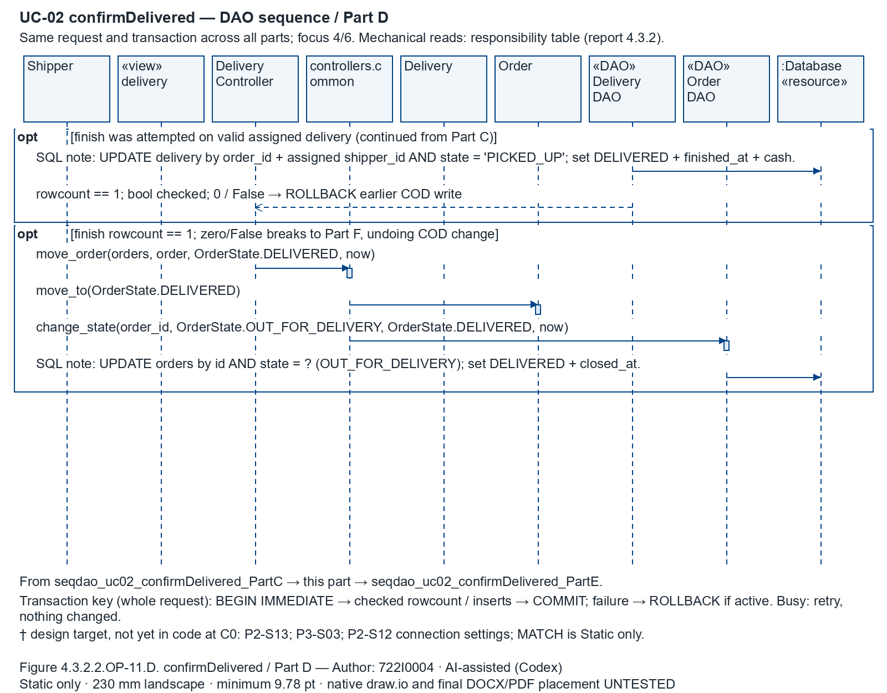

Figure 4.3.2.2.OP-11.D. UC-02 confirmDelivered — Part D — Author: 722I0004 · AI-assisted (Codex).
Editable source: [draw.io](../../../models/UC-02/seqdao_uc02_confirmDelivered_PartD.drawio); vector: [SVG](../../../models/UC-02/seqdao_uc02_confirmDelivered_PartD.svg).

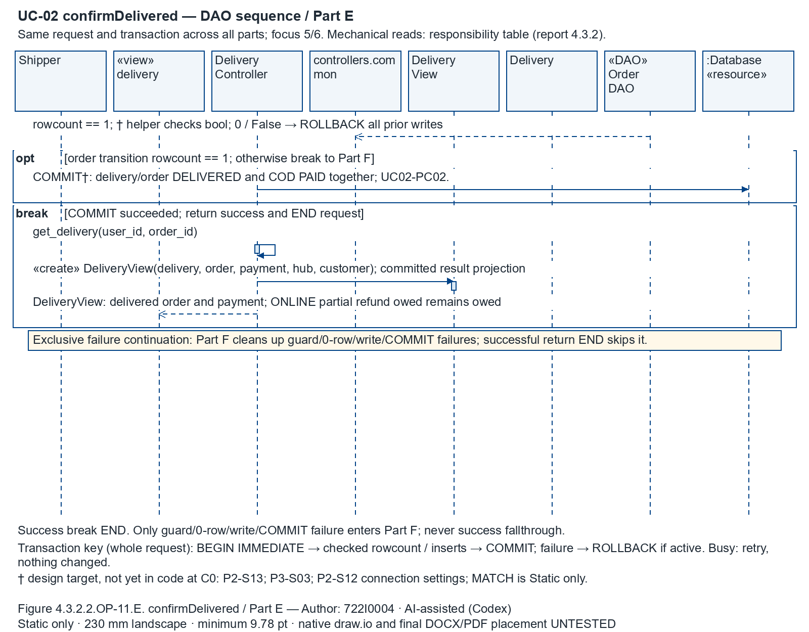

Figure 4.3.2.2.OP-11.E. UC-02 confirmDelivered — Part E — Author: 722I0004 · AI-assisted (Codex).
Editable source: [draw.io](../../../models/UC-02/seqdao_uc02_confirmDelivered_PartE.drawio); vector: [SVG](../../../models/UC-02/seqdao_uc02_confirmDelivered_PartE.svg).

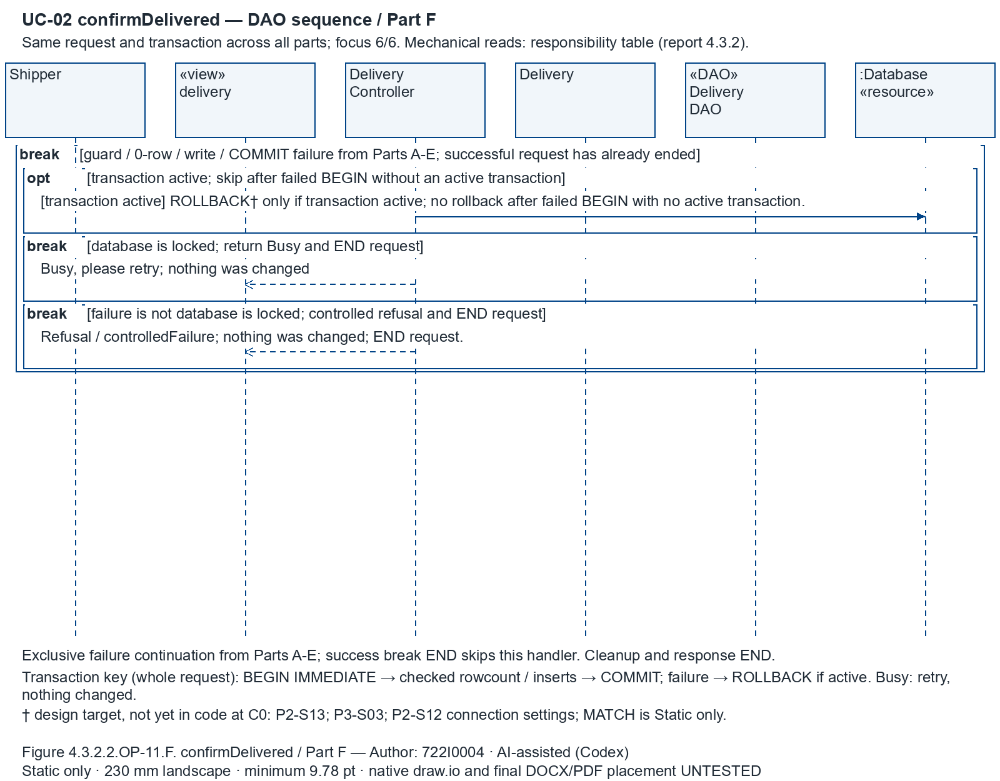

Figure 4.3.2.2.OP-11.F. UC-02 confirmDelivered — Part F — Author: 722I0004 · AI-assisted (Codex).
Editable source: [draw.io](../../../models/UC-02/seqdao_uc02_confirmDelivered_PartF.drawio); vector: [SVG](../../../models/UC-02/seqdao_uc02_confirmDelivered_PartF.svg).

**UC-03 — archiveHub (`OP-36`)**

Only an active admin may archive. The same write lock covers the open-order count and archive. Any order outside DELIVERED, DELIVERY_FAILED, REJECTED or CANCELLED blocks it. HubDAO.archive uses `id` plus `archived_at IS NULL`; the design does not invent an archive enum or a WHERE-state predicate. A successful archive hides operational access while preserving orders, receipts and authorised history (UC03-PC02/MG01).

SSD parameters: `hubId`. Occurrence: `models/UC-03/ssd_uc03.drawio#M03-05`.

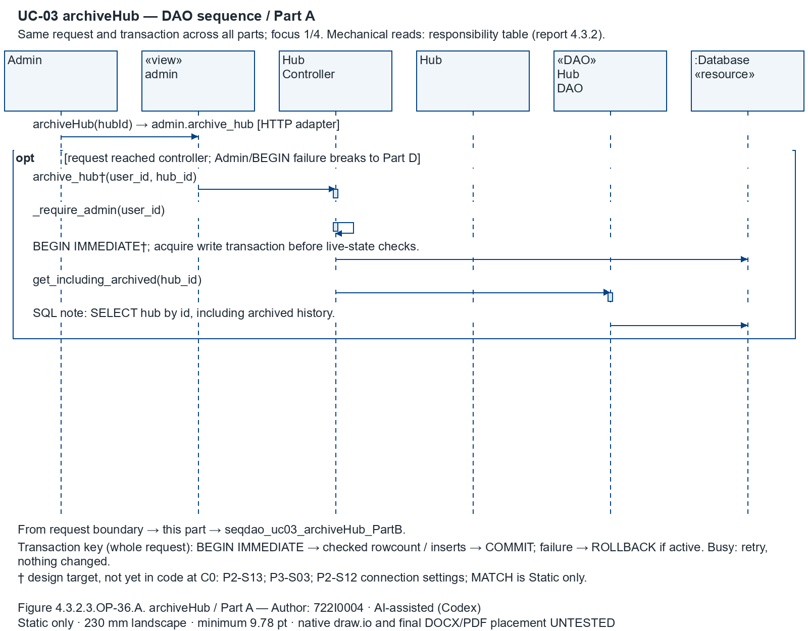

Figure 4.3.2.3.OP-36.A. UC-03 archiveHub — Part A — Author: 722I0004 · AI-assisted (Codex).
Editable source: [draw.io](../../../models/UC-03/seqdao_uc03_archiveHub_PartA.drawio); vector: [SVG](../../../models/UC-03/seqdao_uc03_archiveHub_PartA.svg).

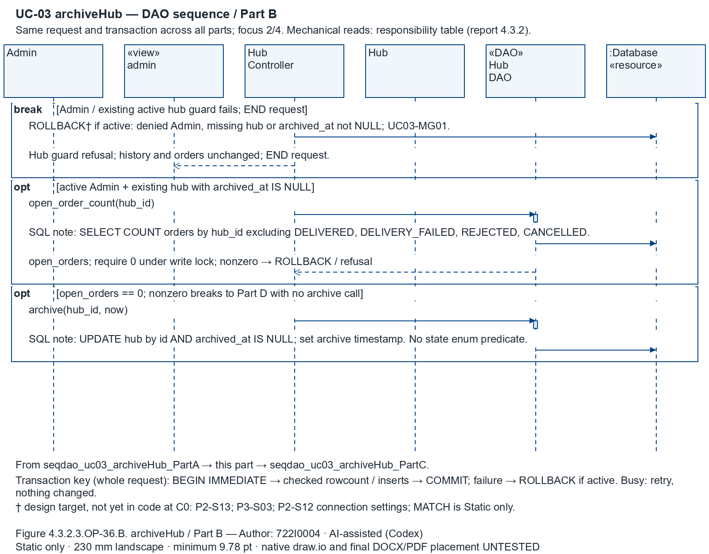

Figure 4.3.2.3.OP-36.B. UC-03 archiveHub — Part B — Author: 722I0004 · AI-assisted (Codex).
Editable source: [draw.io](../../../models/UC-03/seqdao_uc03_archiveHub_PartB.drawio); vector: [SVG](../../../models/UC-03/seqdao_uc03_archiveHub_PartB.svg).

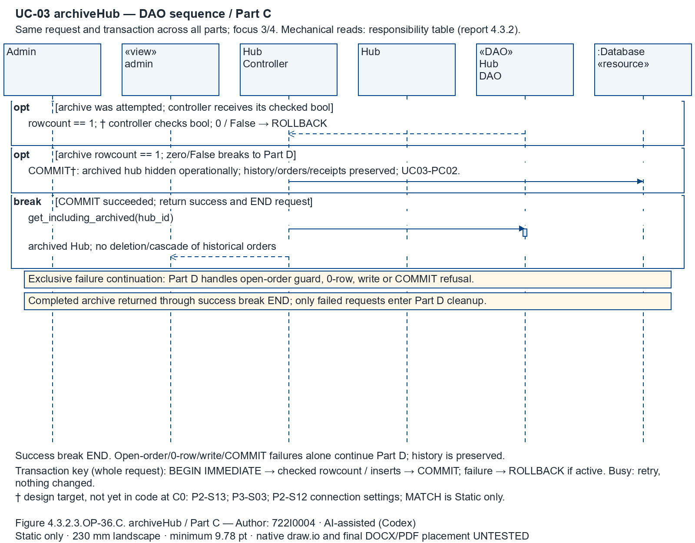

Figure 4.3.2.3.OP-36.C. UC-03 archiveHub — Part C — Author: 722I0004 · AI-assisted (Codex).
Editable source: [draw.io](../../../models/UC-03/seqdao_uc03_archiveHub_PartC.drawio); vector: [SVG](../../../models/UC-03/seqdao_uc03_archiveHub_PartC.svg).

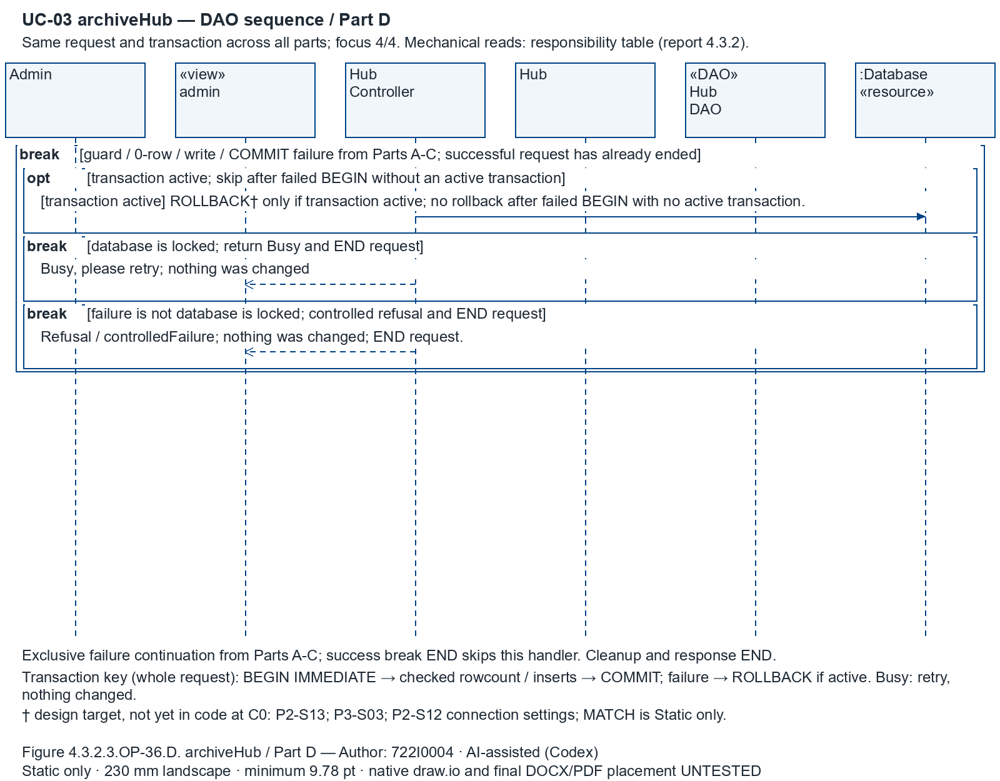

Figure 4.3.2.3.OP-36.D. UC-03 archiveHub — Part D — Author: 722I0004 · AI-assisted (Codex).
Editable source: [draw.io](../../../models/UC-03/seqdao_uc03_archiveHub_PartD.drawio); vector: [SVG](../../../models/UC-03/seqdao_uc03_archiveHub_PartD.svg).

**UC-04 — salesReport (`OP-26`)**

UC04-MG01 applies to success, empty output, Manager denial (UC04-MG02), invalid filters and read failures: no business data is written. ReportDAO.sales_by_hub selects DELIVERED orders by delivery finish time in the half-open UTC range derived from Vietnam calendar days; archived records remain included. Order-level sums have no order_line join. F-03 makes operational sales T, with refunds owed shown separately. F-09 makes item identity menu_item_id and retains it through SalesReport.top_items; a snapshot name is only a display label. Period, SalesRow and SalesReport are non-persisted values. No computed metric is claimed to pass an oracle.

SSD parameters: `startDateVN, endDateVN, hubId?`. Occurrence: `models/UC-04/ssd_uc04.drawio#M01`.

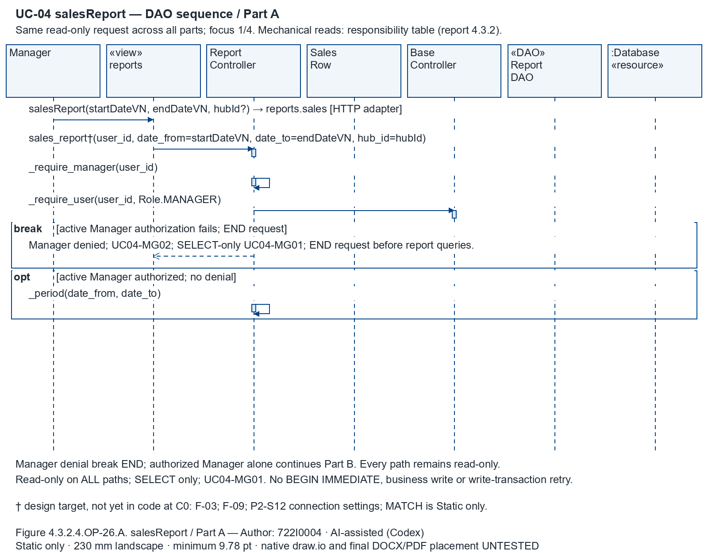

Figure 4.3.2.4.OP-26.A. UC-04 salesReport — Part A — Author: 722I0004 · AI-assisted (Codex).
Editable source: [draw.io](../../../models/UC-04/seqdao_uc04_salesReport_PartA.drawio); vector: [SVG](../../../models/UC-04/seqdao_uc04_salesReport_PartA.svg).

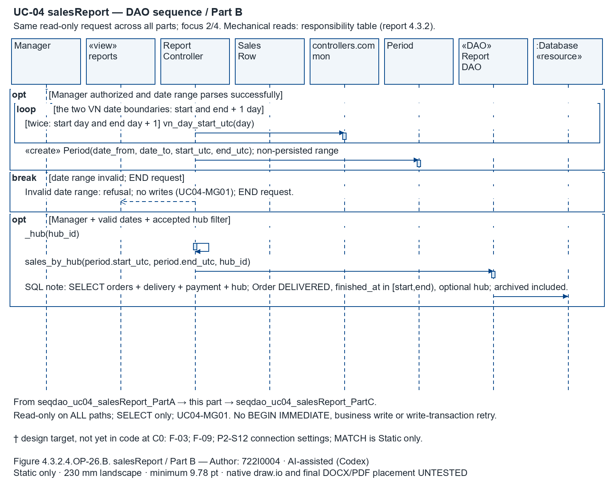

Figure 4.3.2.4.OP-26.B. UC-04 salesReport — Part B — Author: 722I0004 · AI-assisted (Codex).
Editable source: [draw.io](../../../models/UC-04/seqdao_uc04_salesReport_PartB.drawio); vector: [SVG](../../../models/UC-04/seqdao_uc04_salesReport_PartB.svg).

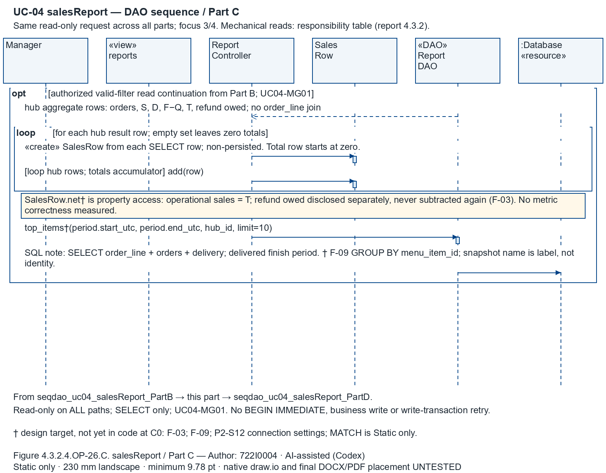

Figure 4.3.2.4.OP-26.C. UC-04 salesReport — Part C — Author: 722I0004 · AI-assisted (Codex).
Editable source: [draw.io](../../../models/UC-04/seqdao_uc04_salesReport_PartC.drawio); vector: [SVG](../../../models/UC-04/seqdao_uc04_salesReport_PartC.svg).

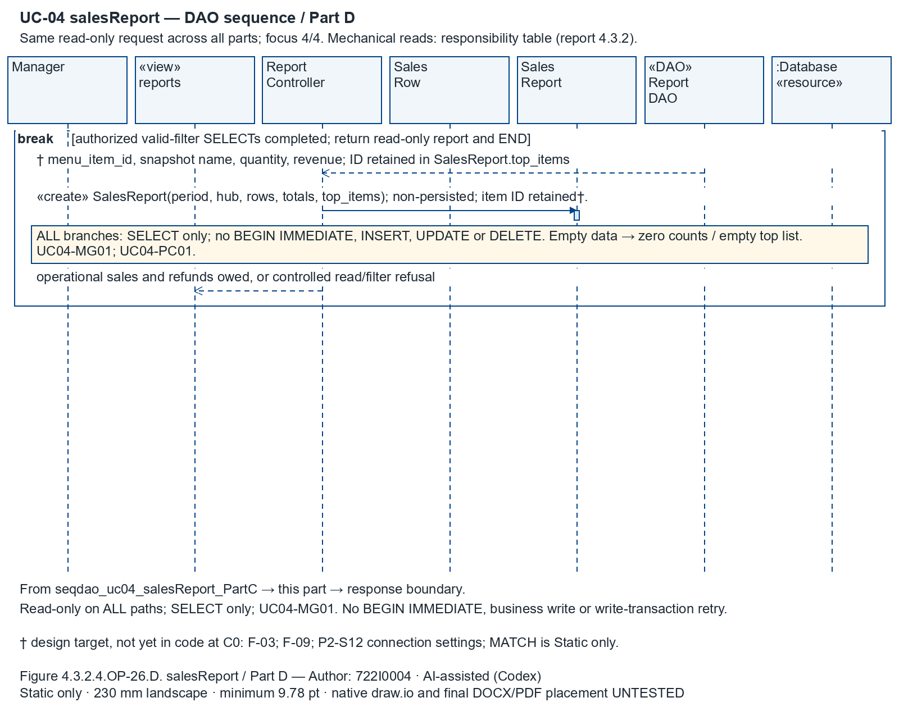

Figure 4.3.2.4.OP-26.D. UC-04 salesReport — Part D — Author: 722I0004 · AI-assisted (Codex).
Editable source: [draw.io](../../../models/UC-04/seqdao_uc04_salesReport_PartD.drawio); vector: [SVG](../../../models/UC-04/seqdao_uc04_salesReport_PartD.svg).

**UC-05 — rejectOrder (`OP-03`)**

Own-hub PLACED order and valid reason precede rejection. A conditional order transition, optional exact open-offer withdrawal, checked PaymentDAO.set_amounts target and conditional payment state save share one transaction. F-02/P2-S01 persist full captured C as the ONLINE refund obligation even after an earlier partial obligation; COD becomes VOIDED and ONLINE becomes REFUND_PENDING. The operation records an obligation and performs no payout. A zero rowcount on a later payment or offer save rolls back the intended rejection too.

SSD parameters: `orderId, reason`. Occurrence: `models/UC-05/ssd_uc05_PartA.drawio#05S-M04`.

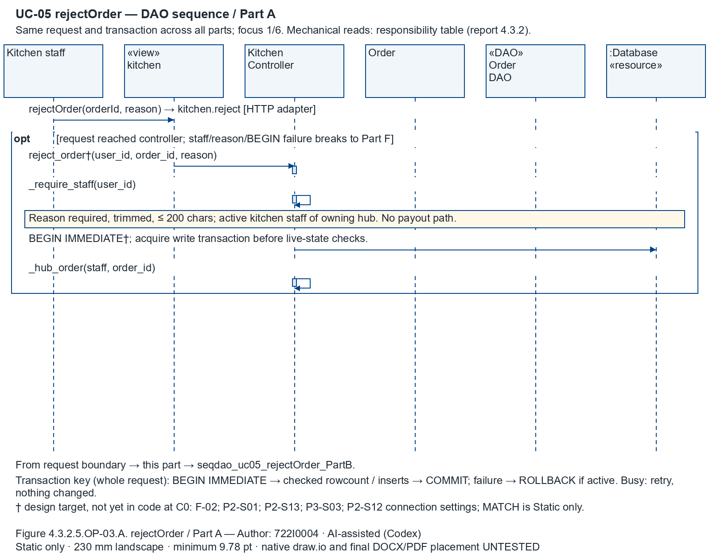

Figure 4.3.2.5.OP-03.A. UC-05 rejectOrder — Part A — Author: 722I0004 · AI-assisted (Codex).
Editable source: [draw.io](../../../models/UC-05/seqdao_uc05_rejectOrder_PartA.drawio); vector: [SVG](../../../models/UC-05/seqdao_uc05_rejectOrder_PartA.svg).

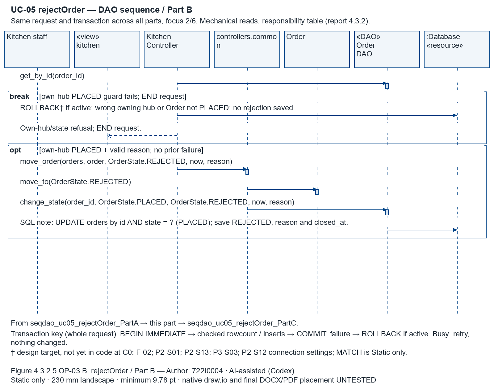

Figure 4.3.2.5.OP-03.B. UC-05 rejectOrder — Part B — Author: 722I0004 · AI-assisted (Codex).
Editable source: [draw.io](../../../models/UC-05/seqdao_uc05_rejectOrder_PartB.drawio); vector: [SVG](../../../models/UC-05/seqdao_uc05_rejectOrder_PartB.svg).

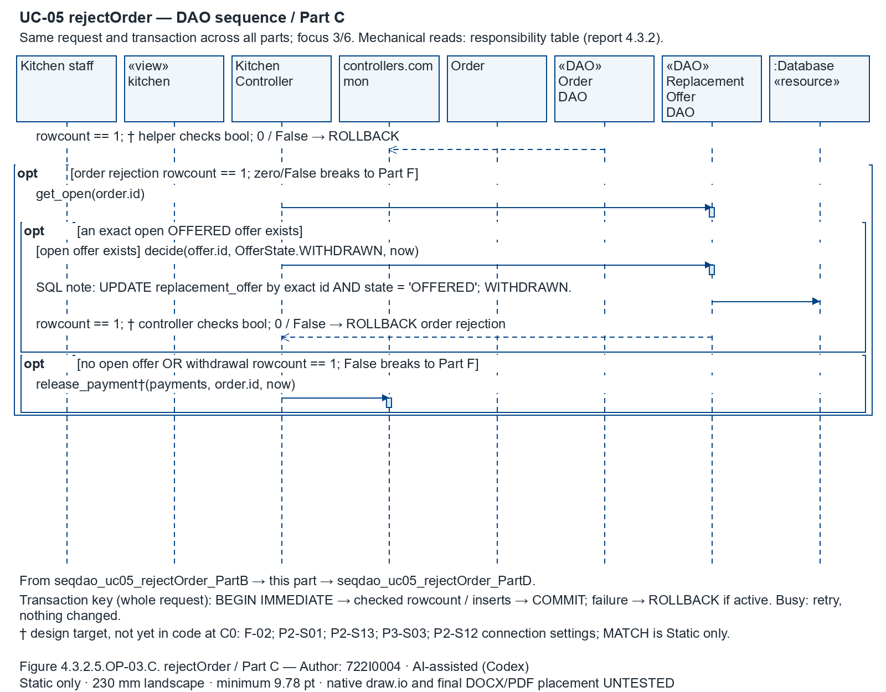

Figure 4.3.2.5.OP-03.C. UC-05 rejectOrder — Part C — Author: 722I0004 · AI-assisted (Codex).
Editable source: [draw.io](../../../models/UC-05/seqdao_uc05_rejectOrder_PartC.drawio); vector: [SVG](../../../models/UC-05/seqdao_uc05_rejectOrder_PartC.svg).

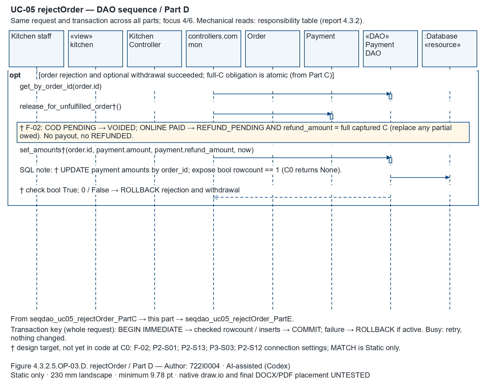

Figure 4.3.2.5.OP-03.D. UC-05 rejectOrder — Part D — Author: 722I0004 · AI-assisted (Codex).
Editable source: [draw.io](../../../models/UC-05/seqdao_uc05_rejectOrder_PartD.drawio); vector: [SVG](../../../models/UC-05/seqdao_uc05_rejectOrder_PartD.svg).

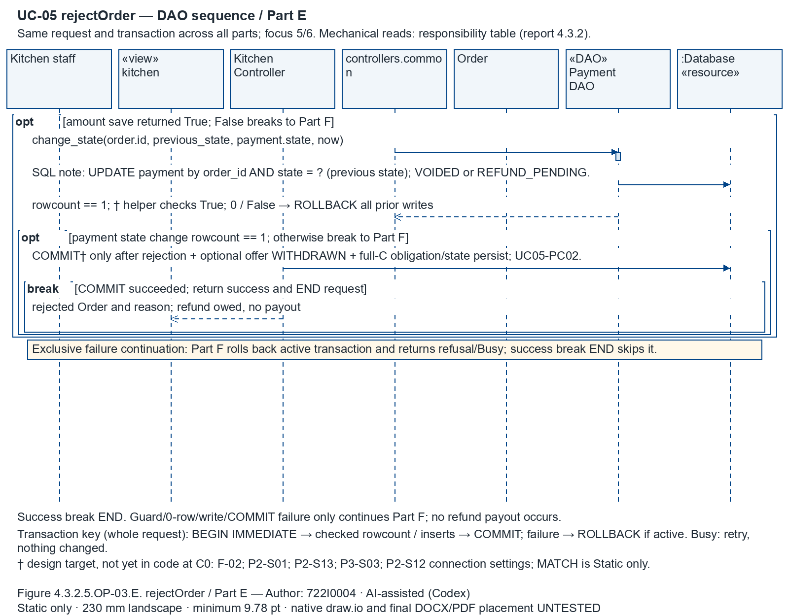

Figure 4.3.2.5.OP-03.E. UC-05 rejectOrder — Part E — Author: 722I0004 · AI-assisted (Codex).
Editable source: [draw.io](../../../models/UC-05/seqdao_uc05_rejectOrder_PartE.drawio); vector: [SVG](../../../models/UC-05/seqdao_uc05_rejectOrder_PartE.svg).

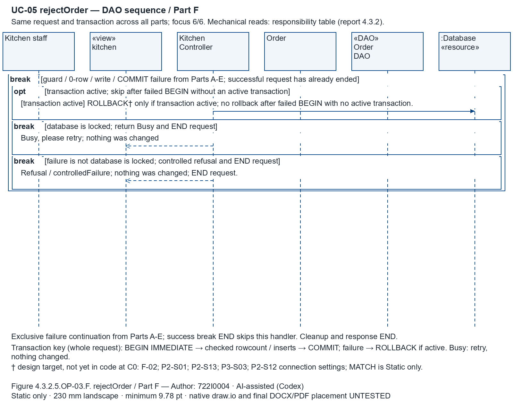

Figure 4.3.2.5.OP-03.F. UC-05 rejectOrder — Part F — Author: 722I0004 · AI-assisted (Codex).
Editable source: [draw.io](../../../models/UC-05/seqdao_uc05_rejectOrder_PartF.drawio); vector: [SVG](../../../models/UC-05/seqdao_uc05_rejectOrder_PartF.svg).

**UC-05 — acceptReplacement (`OP-05`)**

Ownership, PLACED state and exact open OFFERED offer are checked before target eligibility is rechecked (F-05). A stale/guard mismatch refuses unchanged. An invalid target intentionally saves only that exact offer as WITHDRAWN, checks the DAO boolean, then COMMITs; Order/Line/Payment stay unchanged. A failed withdrawal is rolled back. A valid branch uses the offered price/name for the whole line with unchanged quantity; Dnew=min(Dold,Snew), F/Q unchanged, and Tnew recomputed. COD payable becomes Tnew; ONLINE captured C stays unchanged with refund owed C−Tnew and state PAID. Checked line/header saves (P2-S09/S11), checked payment amounts and exact OFFERED→ACCEPTED all precede COMMIT. Order remains PLACED with no automatic confirmation. F-02, F-05, P2-S09/S11/S13 and P3-S03 remain explicit targets.

SSD parameters: `orderId, offerId`. Occurrence: `models/UC-05/ssd_uc05_PartB.drawio#05S-M08`.

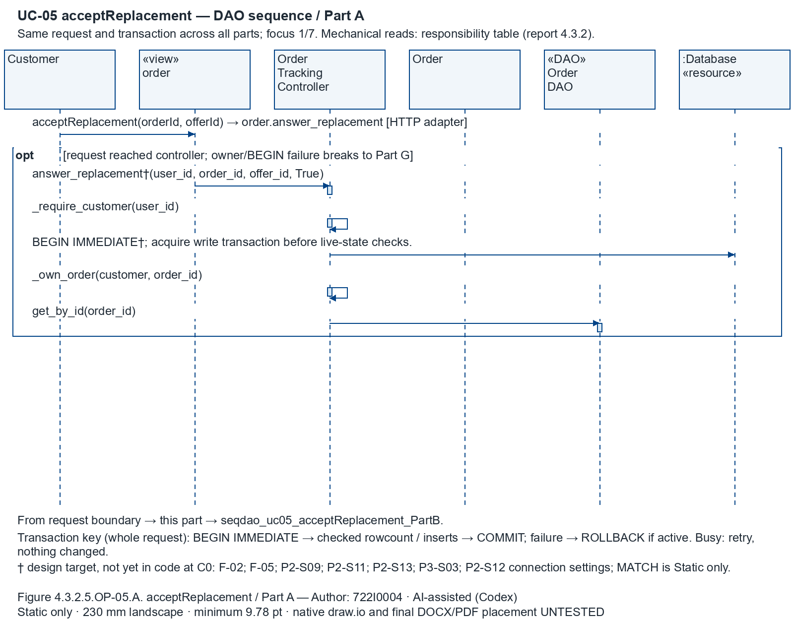

Figure 4.3.2.5.OP-05.A. UC-05 acceptReplacement — Part A — Author: 722I0004 · AI-assisted (Codex).
Editable source: [draw.io](../../../models/UC-05/seqdao_uc05_acceptReplacement_PartA.drawio); vector: [SVG](../../../models/UC-05/seqdao_uc05_acceptReplacement_PartA.svg).

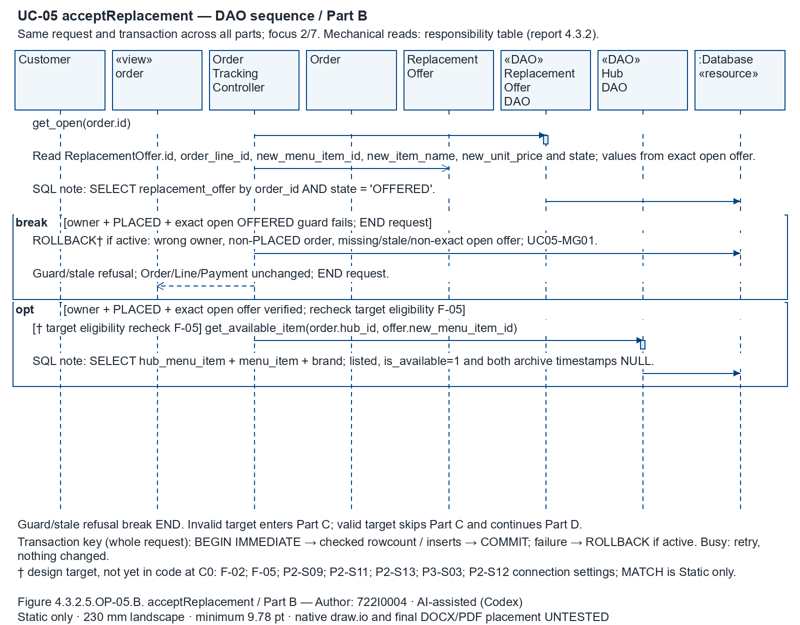

Figure 4.3.2.5.OP-05.B. UC-05 acceptReplacement — Part B — Author: 722I0004 · AI-assisted (Codex).
Editable source: [draw.io](../../../models/UC-05/seqdao_uc05_acceptReplacement_PartB.drawio); vector: [SVG](../../../models/UC-05/seqdao_uc05_acceptReplacement_PartB.svg).

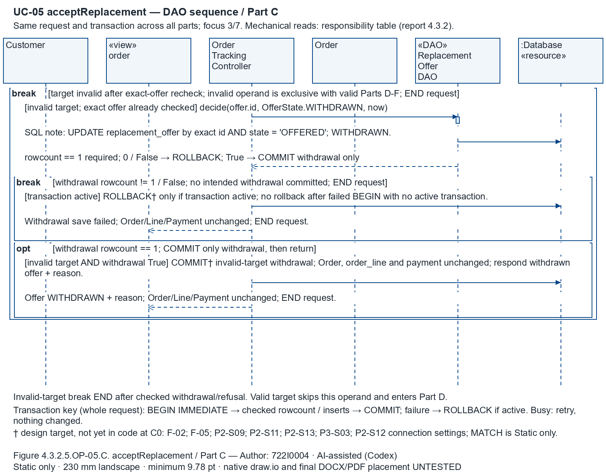

Figure 4.3.2.5.OP-05.C. UC-05 acceptReplacement — Part C — Author: 722I0004 · AI-assisted (Codex).
Editable source: [draw.io](../../../models/UC-05/seqdao_uc05_acceptReplacement_PartC.drawio); vector: [SVG](../../../models/UC-05/seqdao_uc05_acceptReplacement_PartC.svg).

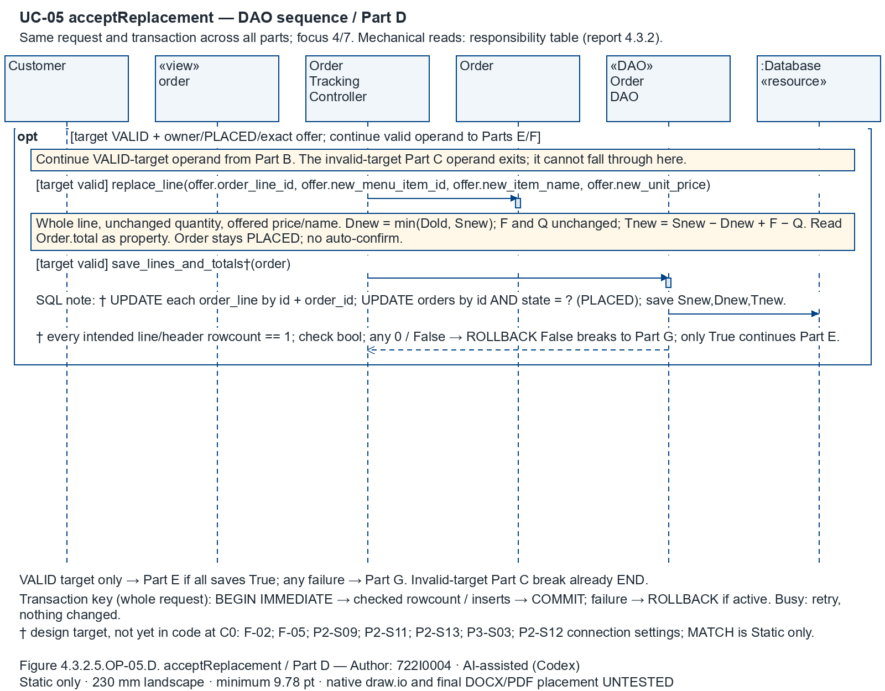

Figure 4.3.2.5.OP-05.D. UC-05 acceptReplacement — Part D — Author: 722I0004 · AI-assisted (Codex).
Editable source: [draw.io](../../../models/UC-05/seqdao_uc05_acceptReplacement_PartD.drawio); vector: [SVG](../../../models/UC-05/seqdao_uc05_acceptReplacement_PartD.svg).

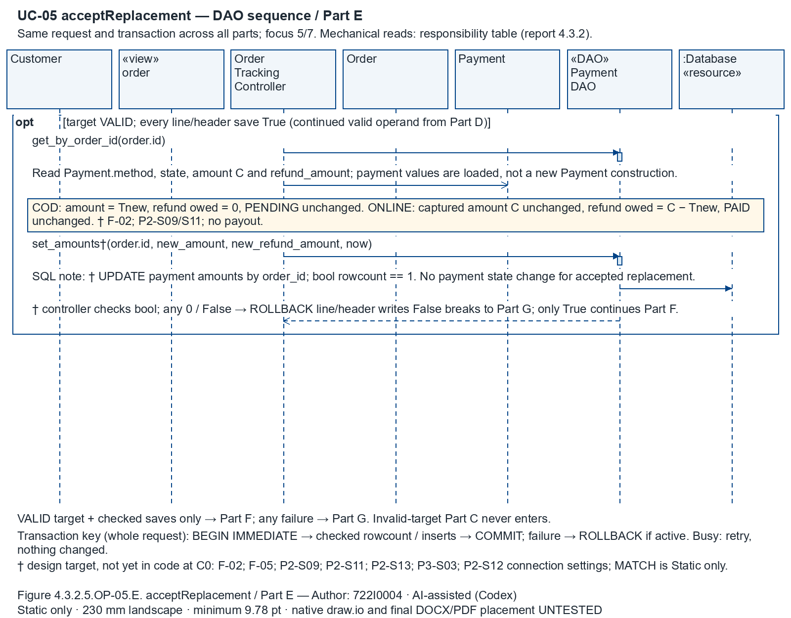

Figure 4.3.2.5.OP-05.E. UC-05 acceptReplacement — Part E — Author: 722I0004 · AI-assisted (Codex).
Editable source: [draw.io](../../../models/UC-05/seqdao_uc05_acceptReplacement_PartE.drawio); vector: [SVG](../../../models/UC-05/seqdao_uc05_acceptReplacement_PartE.svg).

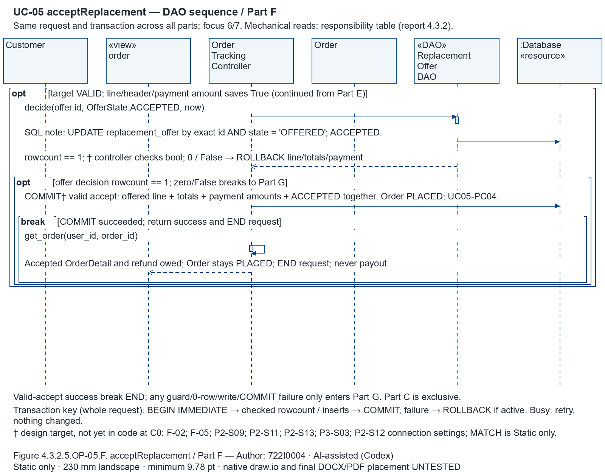

Figure 4.3.2.5.OP-05.F. UC-05 acceptReplacement — Part F — Author: 722I0004 · AI-assisted (Codex).
Editable source: [draw.io](../../../models/UC-05/seqdao_uc05_acceptReplacement_PartF.drawio); vector: [SVG](../../../models/UC-05/seqdao_uc05_acceptReplacement_PartF.svg).

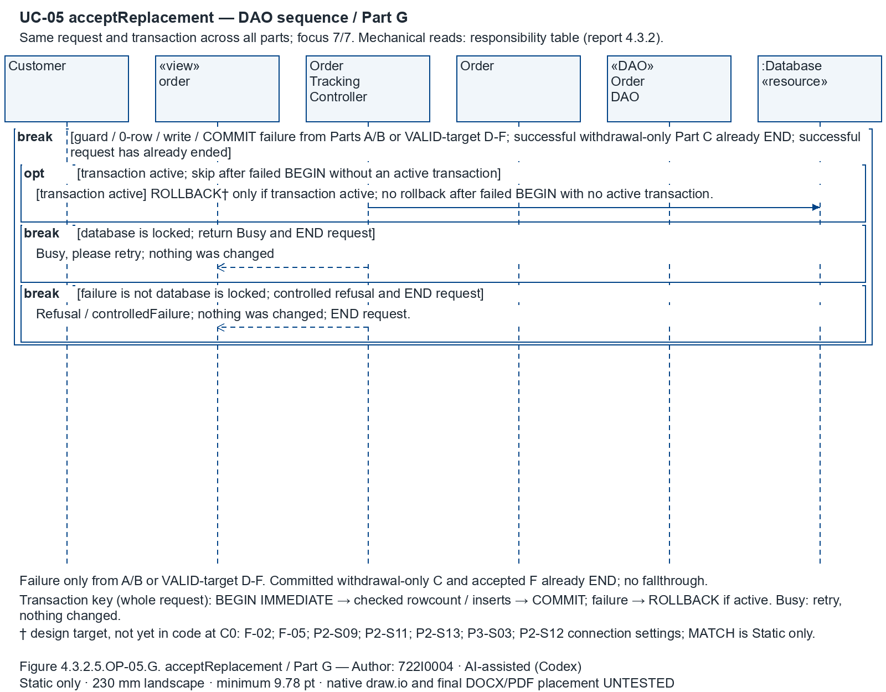

Figure 4.3.2.5.OP-05.G. UC-05 acceptReplacement — Part G — Author: 722I0004 · AI-assisted (Codex).
Editable source: [draw.io](../../../models/UC-05/seqdao_uc05_acceptReplacement_PartG.drawio); vector: [SVG](../../../models/UC-05/seqdao_uc05_acceptReplacement_PartG.svg).

**UC-06 — updateMenuItem (`OP-41`)**

The admin edits name, description and valid positive price after active-item and duplicate checks. The parent is current.brand_id; the posted brandId is context and cannot reparent a dish. MenuDAO.update_item has the actual `id AND archived_at IS NULL` predicate and returns rowcount==1. The target controller must check it. The only write is to menu_item; existing order_line name/price/quantity snapshots remain unchanged (UC06-MG01). Invalid prices and duplicates refuse without a write (UC06-MG02).

SSD parameters: `itemId, brandId, name, description, price`. Occurrence: `models/UC-06/ssd_uc06_PartB.drawio#M06-B03`.

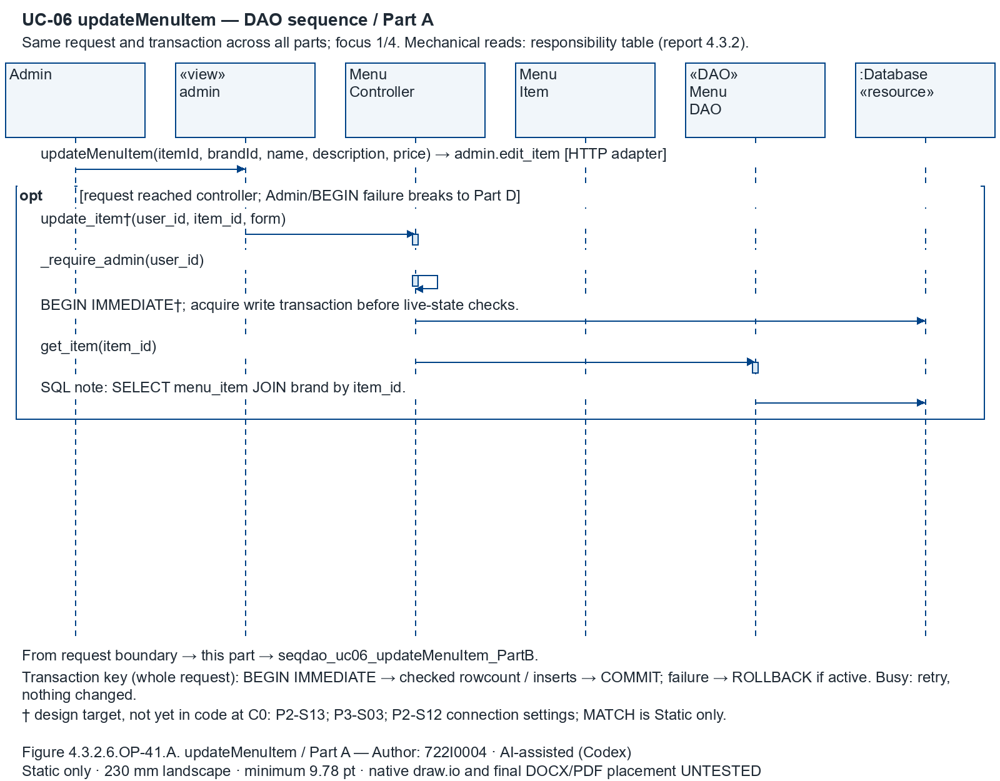

Figure 4.3.2.6.OP-41.A. UC-06 updateMenuItem — Part A — Author: 722I0004 · AI-assisted (Codex).
Editable source: [draw.io](../../../models/UC-06/seqdao_uc06_updateMenuItem_PartA.drawio); vector: [SVG](../../../models/UC-06/seqdao_uc06_updateMenuItem_PartA.svg).

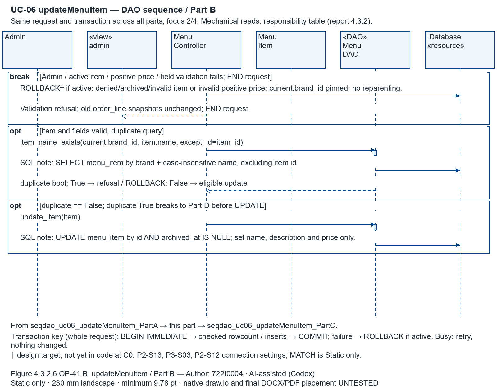

Figure 4.3.2.6.OP-41.B. UC-06 updateMenuItem — Part B — Author: 722I0004 · AI-assisted (Codex).
Editable source: [draw.io](../../../models/UC-06/seqdao_uc06_updateMenuItem_PartB.drawio); vector: [SVG](../../../models/UC-06/seqdao_uc06_updateMenuItem_PartB.svg).

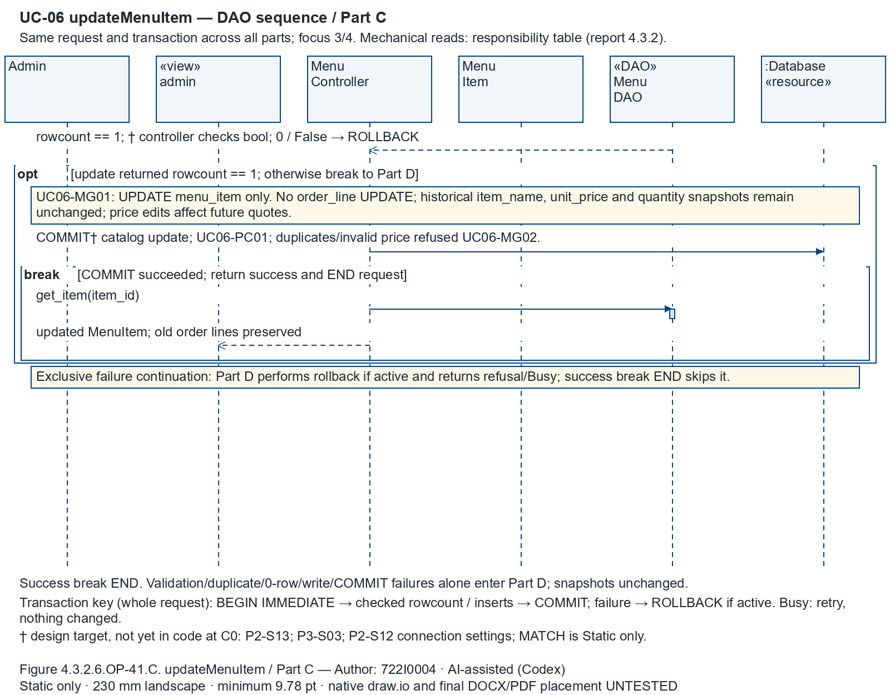

Figure 4.3.2.6.OP-41.C. UC-06 updateMenuItem — Part C — Author: 722I0004 · AI-assisted (Codex).
Editable source: [draw.io](../../../models/UC-06/seqdao_uc06_updateMenuItem_PartC.drawio); vector: [SVG](../../../models/UC-06/seqdao_uc06_updateMenuItem_PartC.svg).

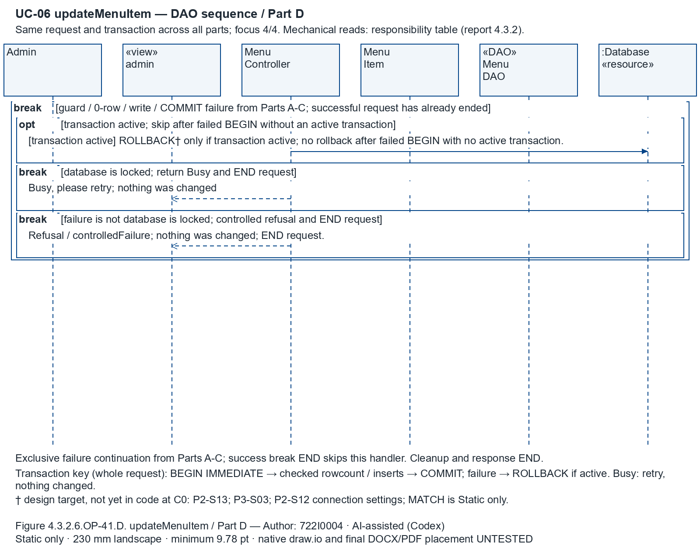

Figure 4.3.2.6.OP-41.D. UC-06 updateMenuItem — Part D — Author: 722I0004 · AI-assisted (Codex).
Editable source: [draw.io](../../../models/UC-06/seqdao_uc06_updateMenuItem_PartD.drawio); vector: [SVG](../../../models/UC-06/seqdao_uc06_updateMenuItem_PartD.svg).

**Guarded interaction control after independent review**

The checkout token-exists operand ends with replay/refusal and skips all authorization/repricing/INSERT work. The ONLINE-decline break contains rollback and its refusal return. Only COD or approved ONLINE enters the write continuation. Part G separates the successful COMMIT return in a terminal break from the failure break containing conditional authorization release, active-transaction rollback and mutually exclusive Busy/controlled-refusal replies. An approved success never reaches the release call.

For accepted replacement, Part C is the invalid-target break: it contains the exact-offer WITHDRAWN call, SQL request and checked result. A false result encloses rollback/refusal in its own break; a true result encloses the intended withdrawal-only COMMIT and result return. This break ends the request. Valid-target Parts D–F explicitly skip that operand, enclose the line/totals/payment/ACCEPTED work in continued valid-target operands, and end at the successful COMMIT/result. Their checked-save failures enter Part G's exclusive failure break, never the successful withdrawal branch.

Other write operations use the same explicit success-END versus failure-handler continuation. The final failure plate contains the actual rollback request and Busy/refusal returns inside guarded regions; rollback is optional only when a transaction is active, including the failed-BEGIN case with no active transaction. The sales-report denial and invalid-date operands terminate before report queries; all report branches remain read-only. Synchronous method and database request arrows have closed filled heads in editable XML, SVG and PNG; replies remain dashed with open heads. Attribute/property note arrows retain their separate annotation role.

**Validation boundary and reproducibility**

Each figure has an adjacent standalone Python generator and JSON metadata. The generator reads the sole reviewed shared model, refreshes call daggers from its explicit statuses, and refuses changed signatures until an explicit reviewed alias/lane refresh. It clears behavior-target daggers only after the operation and selected methods have explicit MATCH status; a matching name/signature alone never qualifies behavior. Re-run a figure with the bundled Python `-X utf8 -I <figure.py>`. No application module is imported.

All plates use a 1600 × 1250 landscape canvas placed at 230 mm, with 24 px minimum text (9.78 pt). Native XML font sizes/styles agree with the SVG; author labels exist in the editable sources. Own-file QA parses XML, resolves receiver members against the shared model, checks exact SSD identity, validates actual edge attachments and label bounds, and checks visible transaction/rowcount/busy labels. Every PNG and independently rasterized SVG is opened for visual inspection; physical A4 proofs and hash receipts are retained outside the repository in `Part2/notes/P3-F/`. Native draw.io editing and final DOCX/PDF placement remain UNTESTED.

### 4.3.3 UI Design

⟦PENDING: P5, sketch, wireframe, mockup, prototype and SSD-to-UI trace⟧

### 4.3.4 SQL Code

⟦PENDING: P7, database/table creation and sample SQL data excerpts⟧

### 4.3.5 Software Classes Method Code

⟦PENDING: P7, verified source excerpts and tagged code links⟧

### 4.3.6 Integration of Use Cases

⟦PENDING: P5, cross-role integration scenarios and evidence⟧
