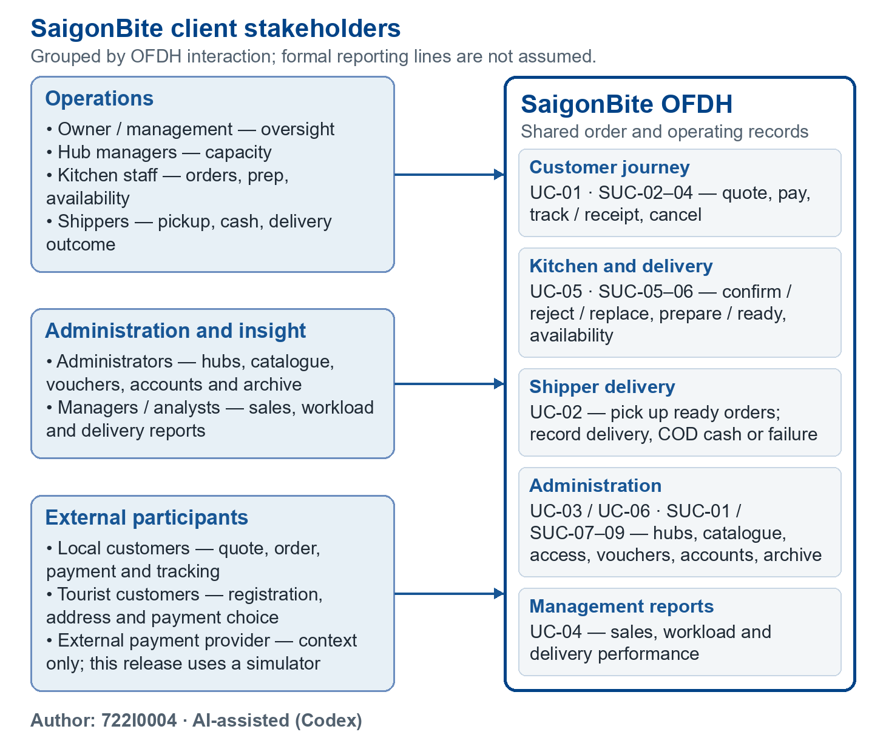
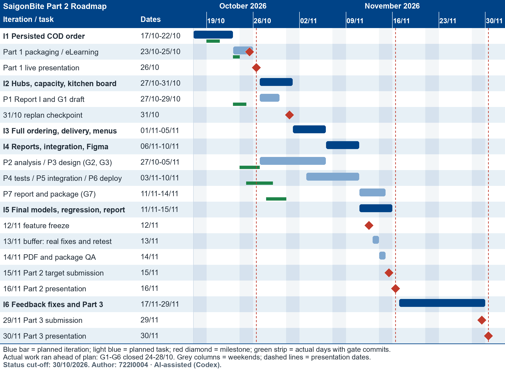

# 1.2 Organization Chart / Project Chart / Gantt Chart

Author: 722I0004 · AI-assisted (Codex)

## Client Stakeholders

The chart groups stakeholders by their interaction with the OFDH. It shows interaction groups, not an asserted company reporting hierarchy. The payment provider is external context; the release uses a simulator.

Figure 1. Client stakeholders and OFDH interaction groups. Author: 722I0004 · AI-assisted (Codex).

The editable source is [stakeholder_chart.drawio](../../../models/shared/stakeholder_chart.drawio); the matching vector export is [stakeholder_chart.svg](../../../models/shared/stakeholder_chart.svg). The PNG, SVG and draw.io source are generated from the same layout.

## Team Roles and Responsibilities

The proposal owners remain attached to their original main use cases. Dat (722I0004) is the actual author of all Part 2 artifacts (team decision D-1); this table does not assign Part 2 work to another member.

| Member | Student ID | Main use cases owned in the proposal | Actual author recorded for Part 2 artifacts |
|---|---|---|---|
| Nguyen Thanh Dat | 722I0004 | UC-01, UC-03 | 722I0004 |
| Le Minh Quan | 523K0049 | UC-02, UC-04 | 722I0004 |
| Nguyen Minh Quan | 523K0050 | UC-05, UC-06 | 722I0004 |

Proposal ownership and actual authorship are separate facts. No member contribution, approval, or work date is inferred from the proposal-owner column.

## Gantt Chart

Figure 2. Six-iteration roadmap: planned windows (blue) and actual work days (green). Author: 722I0004 · AI-assisted (Codex).

The editable source is [gantt.drawio](../../../models/shared/gantt.drawio), generated with [gantt.py](../../../models/shared/gantt.py); [gantt.svg](../../../models/shared/gantt.svg) is the matching vector export. The iteration windows follow the Part 1 roadmap in Part1_v2/content/content_master.md §6. The phase work, freeze, buffer, QA and submission target follow the locked plan §8 and D-10.

Green strips mark the days on which the work for that row was actually done, read from the dated gate commits in the repository (I1 on 19–20/10; G1 on 23–24/10; G2–G3 on 24–26/10; G4–G6 on 25–28/10; G7 from 28/10). The work ran about two weeks ahead of the planned windows, so the I5 dates (freeze 12/11, buffer 13/11, package QA 14/11) remain as reserve before the 15/11 team target. Section 1.3 lists each gate with its commit.
