# I. Business Requirements (1 point)

Author: 722I0004 · AI-assisted (Codex)

Phase 1 draft dated 23/10/2026. Template wording is retained; the primary marking rubric allocates 5 marks to this component. Client answers, lecturer feedback and future measurements remain pending. Analysis, design, implementation and test evidence will be added in their phases.

## 1.1 System Vision and Approval Record

Author: 722I0004 · AI-assisted (Codex)

### Problem Description

Orders reach SaigonBite's delivery kitchens through calls, Zalo and third-party apps, then staff copy them onto paper tickets. People outside a hub cannot see its queue. At lunch and dinner, one kitchen may accumulate orders while a nearby hub is underused. When a dish becomes unavailable, staff call customers to agree on a cancellation or replacement. Shippers are dispatched through individual calls or group chat, and end-of-day cash handovers can be difficult to reconcile. Tourists face registration and foreign-payment barriers; the menu is also Vietnamese-only. Staff apply discount codes by hand, managers handle complaint and refund cases one at a time, and management lacks dependable sales, workload and delivery-time reports.

### System Vision

The planned Part 2 release is one Online Food Delivery Hub Platform (OFDH) with shared order and operating records. It will give customers a reviewed quote and defined order path, give kitchen staff and shippers explicit decisions and delivery outcomes, let administrators maintain hubs and catalogue data, and let managers inspect operational reports. Local and tourist registration and payment choices are in scope; translating the Vietnamese-only menu is not.

### System Capabilities

The locked plan defines six main use cases and nine supporting use cases for this release.

| ID | Capability | Primary actor |
|---|---|---|
| UC-01 | PC01 one PLACED order owned by the customer; PC02 lines with snapshot names/prices; PC03 address snapshot + distance; PC04 S/D/F/Q/T stored and consistent; PC05 payment PENDING (COD) or PAID (ONLINE, amount C); PC06 hub load +1 | Customer |
| UC-02 | PC01 one shipper assigned, Delivery PICKED_UP, order OUT_FOR_DELIVERY; PC02 delivered: Delivery DELIVERED, order DELIVERED, COD PAID with cash = T; PC03 failed: Delivery FAILED + reason, order DELIVERY_FAILED, BR-17 | Shipper |
| UC-03 | PC01 hub created/updated with valid code, coordinates, fee, capacity; PC02 archived hub hidden from browse/checkout, visible in history/reports | Admin |
| UC-04 | PC01 sales, workload, performance equal the hand oracle for the filter; PC02 n/a on empty denominators | Manager |
| UC-05 | PC01 confirm: own-hub PLACED → CONFIRMED; PC02 reject: REJECTED + reason + BR-17 + offer WITHDRAWN; PC03 offer: one OFFERED offer per §3.3; PC04 accepted offer applied per §3.3 5–7 | Kitchen staff |
| UC-06 | PC01 brand/item created, updated, archived; PC02 listing added/removed, availability per hub; PC03 archived/sold-out items not orderable | Admin |
| SUC-01 | Log in / log out | All roles |
| SUC-02 | Register (local or tourist), edit profile, manage addresses | Customer |
| SUC-03 | Track my orders, view receipt, answer a replacement offer | Customer |
| SUC-04 | Cancel an order (PLACED or CONFIRMED) | Customer |
| SUC-05 | Start preparing and mark ready | Kitchen staff |
| SUC-06 | Set menu availability at my hub | Kitchen staff |
| SUC-07 | Maintain vouchers | Admin |
| SUC-08 | Maintain user accounts; deactivate/reactivate | Admin |
| SUC-09 | Archive closed orders; read archived history | Admin |

Online payment is simulated; this release uses no real payment provider or card data. Complaint decisions, refund payouts and ratings are deferred. The application records a refund obligation where the frozen rules require one, but it does not claim a payout.

### Business Benefits

These are expected effects of the planned capabilities, not measured results.

| Current problem | Capability used | Expected business benefit |
|---|---|---|
| Peak demand can overload one hub while another has spare capacity. | UC-01, UC-03 | A capacity check and quieter-hub option can reduce avoidable queue buildup. |
| Stock changes trigger after-order phone calls. | UC-05, UC-06, SUC-03, SUC-06 | Hub-specific availability and a recorded replacement decision make the customer's choice visible to the kitchen. |
| Shipper dispatch and cash handover rely on calls and notes. | UC-02 | Per-order pickup, delivery, COD and failure records give staff a common basis for cash reconciliation. |
| Tourists have difficulty with local registration and payment conventions. | SUC-02, UC-01 | Separate customer and payment paths provide a defined way to order, while the untranslated menu remains a limitation. |
| Voucher codes and order prices are applied manually. | UC-01, SUC-07 | A saved quote and voucher rule make the accepted total inspectable and repeatable. |
| Managers lack comparable sales, workload and delivery information. | UC-04, SUC-09 | Shared order records can support consistent operational reports, including authorised history. |
| Refund follow-up is handled case by case. | UC-01, UC-02, UC-05, SUC-03 | Recording payment state and the amount owed makes the obligation visible; complaint decisions and payout remain outside scope. |

### Approval Record

| Date / status | Source | Feedback or decision | Change made | Where recorded |
|---|---|---|---|---|
| 23/10/2026 | Team decision D-4 in the locked plan | Part 1 assumption A-08 limited supporting use cases to analysis; D-4 adopts minimal running create/read/update/archive paths for persistent classes. This is a team decision, not lecturer approval. | A-08 is superseded. Supporting use cases are in the release backlog and CRUD scope. | This section; report 1.3; later report section 2.3 |
| Status checked 23/10/2026; submitted dates unknown | Locked-plan record for client questions Q1–Q5 | The plan records all five as Submitted; answer and date cells are empty. No client response is recorded. | No answer-driven change is claimed. Defaults remain provisional until the 31/10 checkpoint. | docs/part2/decision_log.md; report 1.4.2 |
| 26/10/2026 — pending | Part 1 live presentation / lecturer feedback | ⟦PENDING: feedback 26/10⟧ | Record actual feedback and any resulting change after the presentation. Silence is not approval. | docs/part2/decision_log.md; update at the 31/10 checkpoint |
| Planned for 26/10/2026; not yet asked as of 23/10 | Course clarifications L1–L6 | No answers are available yet. These are course clarifications, separate from the five client questions. | Use locked-plan defaults until an answer is recorded; assess changes at the 31/10 checkpoint. | docs/part2/decision_log.md; report 1.4.2 |

## 1.2 Organization Chart / Project Chart / Gantt Chart

Author: 722I0004 · AI-assisted (Codex)

### Client Stakeholders

The chart groups stakeholders by their interaction with the OFDH. It shows interaction groups, not an asserted company reporting hierarchy. The payment provider is external context; the release uses a simulator.

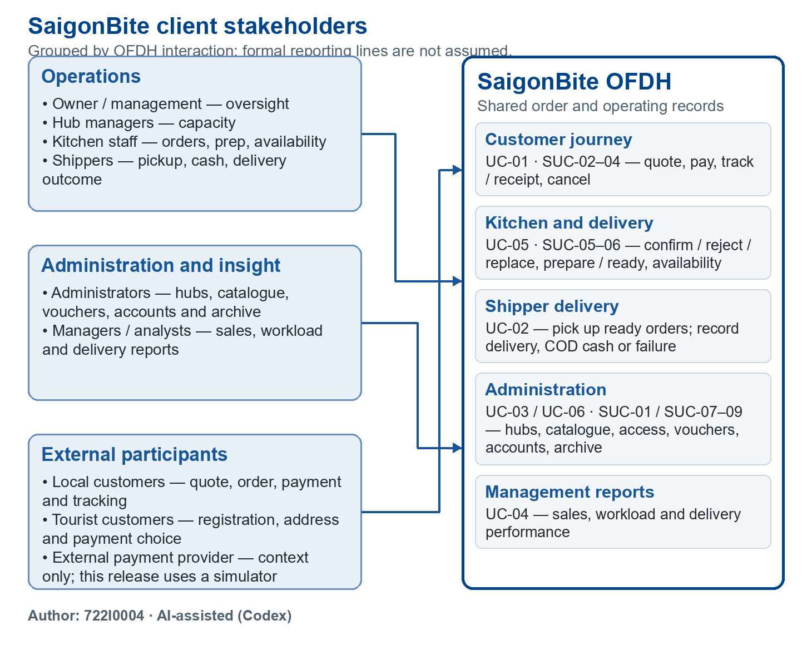

Figure 1. Client stakeholders and OFDH interaction groups. Author: 722I0004 · AI-assisted (Codex).

The editable source is [stakeholder_chart.drawio](../../../models/shared/stakeholder_chart.drawio); the matching vector export is [stakeholder_chart.svg](../../../models/shared/stakeholder_chart.svg). The PNG, SVG and draw.io source are generated from the same layout. Place the 1460 × 1160 px figure at 180 mm wide on A4 portrait: it is about 143 mm high and its smallest visible text is approximately 9.1 pt. Keep at least this width when assembling the report.

### Team Roles and Responsibilities

The proposal owners remain attached to their original main use cases. The locked plan records Dat as the actual author of all Part 2 artifacts under decision D-1 / J2; this table does not assign new Part 2 work to another member.

| Member | Student ID | Main use cases owned in the proposal | Actual author recorded for Part 2 artifacts |
|---|---|---|---|
| Nguyen Thanh Dat | 722I0004 | UC-01, UC-03 | 722I0004 |
| Le Minh Quan | 523K0049 | UC-02, UC-04 | 722I0004 |
| Nguyen Minh Quan | 523K0050 | UC-05, UC-06 | 722I0004 |

Proposal ownership and actual authorship are separate facts. No member contribution, approval, or work date is inferred from the proposal-owner column.

### Gantt Chart

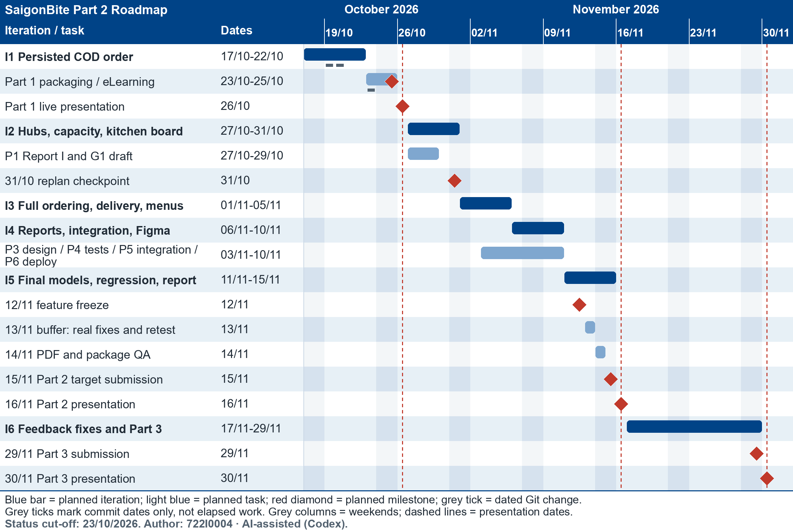

Figure 2. Planned six-iteration roadmap with dated repository-change markers. Author: 722I0004 · AI-assisted (Codex).

The editable source is [gantt.drawio](../../../models/shared/gantt.drawio), generated with [gantt.py](../../../models/shared/gantt.py); [gantt.svg](../../../models/shared/gantt.svg) is the matching vector export. The iteration windows follow the Part 1 roadmap in Part1_v2/content/content_master.md §6. The phase work, freeze, buffer, QA and submission target follow the locked plan §8 and D-10. At a 229 mm placement width on A4 landscape, the 2300 × 1544 px chart has a smallest label of about 9.0 pt; keep at least that width.

Actual markers show dated repository changes only: I1 commits on 19–20/10/2026 and the Part 1 package-sync commit on 23/10/2026, read from the local .git/logs/HEAD. The short marks identify commit dates; they do not claim continuous work, measured effort, an iteration acceptance result, or an upload receipt. All milestones from 25/10 onward remain planned in this chart. The Part 2 date is a team target of 15/11; the official eLearning deadline remains pending.

## 1.3 Iteration Plan, User Story Backlog and Risks

Author: 722I0004 · AI-assisted (Codex)

The iteration dates below retain the six windows in the Part 1 roadmap. The locked Part 2 plan adds phase work and release gates over those windows. Dates and bars are planned; estimates are not measured results. The official Part 2 eLearning deadline is pending confirmation when the slot opens.

### Six-Iteration Plan

| Iteration | Planned dates | Goal and UC/SUC focus | Planned deliverables and exit evidence |
|---|---|---|---|
| I1 | 17–22/10/2026 | Persist one COD order on a runnable base. UC-01 subset and initial login support. | Vision, initial UC-01 analysis, activity/SSD/state artifacts, schema, seed, data access and checkout slice. Local Git records changes dated 19–20/10; this section does not assert that every I1 acceptance criterion passed. |
| I2 | 27–31/10/2026 | Hub CRUD/capacity and the kitchen decision/queue path. UC-03, UC-05, UC-01 capacity check; analyse UC-02 and UC-06; SUC-01, SUC-05. | Draft Report I and G1 by 29/10; UC-03/UC-05 analysis and tests; hub state model; UC-02/UC-06 analysis; P4.1 foundation work and local Docker path. Ask L1–L6 at the 26/10 presentation and review answers at the 31/10 checkpoint. |
| I3 | 01–05/11/2026 | Complete ordering, delivery and menu management. UC-01, UC-02, UC-06; UC-05 replacement; SUC-02–04, SUC-06–07. | Full quote and payment choices, tourist registration path, voucher and distance rules, shipper outcome path, catalogue/listing work, designs and tests. P3/P4 work overlaps this window under the phase schedule. |
| I4 | 06–10/11/2026 | Reports, integrated use cases and Figma evidence. UC-04 plus all six UCs; SUC-03, SUC-08–09. | Hand-calculated report oracle before report implementation; cross-role integration evidence; Figma progression; remaining P4 tests and P6 backup/restore or deployed-path evidence as scheduled. |
| I5 | 11–15/11/2026 | Final models, regression, deployment instructions and Part 2 report. All six UCs and nine SUCs. | Feature freeze 12/11; buffer on 13/11 for real defects only; PDF/package QA 14/11; Part 2 submission target 15/11. The official eLearning deadline must still be checked. |
| I6 | 17–29/11/2026 | Address Part 2 feedback, make the final release and prepare Part 3. All six UCs. | Feedback fixes, planned v1.0-final release, Part 3 material and submission target 29/11. This iteration follows the Part 2 presentation and submission. |

Backlog linkage: I1 contains early COD and login slices of BL-03 and BL-04; I2 focuses on BL-04–07, BL-09 and BL-19–20; I3 on BL-01–03, BL-07–08, BL-10–14 and BL-18–20; I4 on BL-08 and BL-15–20; I5 closes the BL-19–20 verification and recovery gates with the full release. I6 is post-Part-2 feedback and Part 3 follow-up, not a separate Part 2 Must item.

### Changes from the Part 1 Proposal

| Topic | Part 1 proposal | Locked Part 2 plan |
|---|---|---|
| Supporting use cases and CRUD | A-08 treated several supporting paths as analysis-only or seed-backed. | D-4 supersedes A-08: persistent classes need minimal running create/read/update/archive paths through supporting use cases. The current backlog includes all nine SUCs. |
| Clarification timing | Proposal expected lecturer questions to shape later iterations. | D-3 says to proceed with conservative defaults, ask L1–L6 at the 26/10 presentation, and record answers or no answer at the 31/10 checkpoint. Q1–Q5 remain the five client questions. |
| Part 2 delivery gates | The proposal placed final work and submission in I5 and already named the 12/11 freeze, 13/11 buffer and 15/11 target. | D-10 / plan §8 retain those gates, add 14/11 PDF/package QA and state that the official eLearning deadline must still be checked. |
| Deployment route | The Part 1 draft included a Vercel demo. | D-5 retires Vercel for Part 2 and plans one GCP VM, with local Docker Compose as the reproducible path and fallback. No cloud resource or deployment outcome is claimed here. |
| Authorship record | Proposal ownership separated six main UCs among three students. | D-1 retains those ownership labels but records 722I0004 as actual author of Part 2 artifacts. Ownership is not evidence of another member's Part 2 work. |
| I6 | A post-submission iteration for feedback and Part 3 was already planned. | The role remains post-Part-2: feedback fixes, final release and Part 3 work. |

The report uses BL-01–BL-20 as stable row IDs for this current backlog. The proposal's US-01–US-22 IDs are not silently reassigned because the scope of some proposal stories changed under D-4.

### Prioritised User Story Backlog

MoSCoW reflects the locked release scope. The six main UCs, nine SUCs and release-wide verification/recovery work are Must items. The listed Won't items remain deferred or future scope; they are not presented as lecturer-approved exclusions.

| ID | User story | MoSCoW | Iteration | UC/SUC link |
|---|---|---|---|---|
| BL-01 | As a customer, I want to register for a local or tourist account and maintain my profile and addresses so that I can place an order using my customer details. | Must | I3 | SUC-02, UC-01 |
| BL-02 | As a customer, I want to browse active hubs, brands and available items so that I can choose what and where to order. | Must | I3 | UC-01, UC-06 |
| BL-03 | As a customer, I want to review the complete quote, voucher and payment choice before confirming so that I can make an informed order decision. | Must | I3 | UC-01, SUC-07 |
| BL-04 | As a user, I want to log in and log out with role-appropriate access so that each task is performed by an authorised account. | Must | I1–I5 | SUC-01 |
| BL-05 | As an administrator, I want to create, read, update and archive hubs and maintain capacity so that current hub operations are represented. | Must | I2 | UC-03 |
| BL-06 | As a customer, I want a full hub to refuse the order and present eligible quieter hubs so that I can choose another option before confirming. | Must | I2 | UC-01, UC-03 |
| BL-07 | As kitchen staff, I want to confirm or reject an incoming order, or offer a valid replacement, so that I can handle an order against current stock. | Must | I2–I3 | UC-05 |
| BL-08 | As a customer, I want to track my order, view its receipt and answer an open replacement offer so that I can see and decide the order outcome. | Must | I3 | SUC-03, UC-01, UC-05 |
| BL-09 | As kitchen staff, I want to start preparation and mark an order READY so that a shipper can take a prepared order. | Must | I2 | SUC-05, UC-05, UC-02 |
| BL-10 | As kitchen staff, I want to change availability for items at my hub so that new orders use the current listing. | Must | I3 | SUC-06, UC-06 |
| BL-11 | As a shipper, I want to take a ready order and record delivery, exact COD cash or a failed outcome so that fulfilment is traceable per order. | Must | I3 | UC-02 |
| BL-12 | As an administrator, I want to maintain brands, menu items and hub listings so that customers see the catalogue used by the kitchens. | Must | I3 | UC-06 |
| BL-13 | As an administrator, I want to create, update and archive vouchers so that eligible customers can use the configured discount rules. | Must | I3 | SUC-07, UC-01 |
| BL-14 | As a customer, I want to cancel my own order while it is PLACED or CONFIRMED so that an early cancellation follows the defined payment rules. | Must | I3 | SUC-04, UC-01 |
| BL-15 | As an administrator, I want to create accounts and deactivate or reactivate them so that access can be maintained. | Must | I4 | SUC-08, SUC-01 |
| BL-16 | As an administrator, I want to archive closed orders and read their history so that operational lists stay current while authorised history remains available. | Must | I4 | SUC-09 |
| BL-17 | As a manager, I want reports for sales, hub workload and delivery performance so that I can compare operations using shared definitions. | Must | I4 | UC-04 |
| BL-18 | As a customer, I want rejection, cancellation, replacement and delivery-failure outcomes to show the correct payment state and amount owed so that I know what remains due. | Must | I3–I4 | UC-01, UC-02, UC-05, SUC-03–04 |
| BL-19 | As a reviewer, I want postcondition, boundary, role and concurrency tests for each main use case so that release claims have recorded evidence. | Must | I2–I5 | UC-01–UC-06, SUC-01–SUC-09 |
| BL-20 | As a reviewer, I want a fresh local run path and documented backup/restore steps so that the planned release can be run and recovered reproducibly. | Must | I2–I5 | Release-wide |
| W-01 | Complaint handling and refund decisions, refund payout, and customer rating. These remain deferred under A-09 / L3; the L3 answer is pending. | Won't this release | — | A-09, L3 |
| W-02 | Loyalty points, subscription meals, group orders and scheduled orders. The case study lists these as future features. | Won't this release | — | Case study future scope; no A-ID was assigned |
| W-03 | Menu translation for tourists. Part 1 §1.3 explicitly leaves translation outside this release. | Won't this release | — | Part 1 §1.3; no A-ID was assigned |

### Risks

Likelihood and impact are qualitative planning judgments, not measured frequencies. IDs R-06–R-11 continue the proposal's R-01–R-05 numbering without changing the earlier risk meanings. Dat 722I0004 is the recorded owner because D-1 assigns actual Part 2 authorship to Dat; this does not claim work by another member.

| ID | Risk | Likelihood | Impact | Owner | Trigger | Mitigation |
|---|---|---|---|---|---|---|
| R-06 | Sole-author delivery and contribution-factor exposure: one person carries the Part 2 artifact workload, while the course marks contribution by actual evidence. | High | High | Dat 722I0004 | Required section, test or release evidence slips beyond the plan, or contribution records cannot substantiate what each person actually authored. | Track planned deliverables and actual evidence; preserve prompts, authored artifacts and commit history; record contribution facts accurately and mark unmet per-student items Partial. Review scope and hours at the 31/10 checkpoint. |
| R-07 | AI-policy clarification L6 may conflict with planned AI-assisted code or artifact work. | Medium | High | Dat 722I0004 | L6 answer does not permit the declared AI-assisted approach. | Declare each AI use, retain prompts/outputs and verification notes, ask L6 at the 26/10 presentation, and stop or replan the affected work if the answer requires it. |
| R-08 | SQLite lock contention or racing transitions may cause concurrent ordering/delivery requests to fail or miss response-time targets. | Medium | High | Dat 722I0004 | P4 lock, last-capacity-slot or shipper race checks fail, or a controlled database-locked case is unclear. | Keep writes within the planned transaction boundary, use the planned timeout/locking controls, and run the specified contention, race and rollback checks before calling the path ready. |
| R-09 | School-account organisation policy, static IP or TLS constraints may prevent the planned cloud demonstration. | Medium | High | Dat 722I0004 | Compute Engine, an external IP or certificate issuance is unavailable during the first-deploy window. | Check account/org restrictions before provisioning; follow the D-7 hostname fallback order if needed; keep local Docker Compose as the reproducible demo path and record any cloud limitation. |
| R-10 | Lecturer clarification L1 or L3 may change CRUD or deferred-feature scope. | Medium | High | Dat 722I0004 | The 26/10 answer contradicts D-4 or requires complaint/refund/rating work now deferred. | Proceed with conservative defaults, record actual answers or no answer by 31/10, assess effects on BRs, models, schema, screens, tests and dates, then replan explicitly. Do not record silence as approval. |
| R-11 | The remaining schedule may exceed the available focused time. | Medium | High | Dat 722I0004 | At the 31/10 checkpoint, recorded hours and remaining scope project beyond the 7 h/day budget. | Compare actual hours with the plan estimate. The plan budgets about 154 hours against an estimated 92–130 hours, leaving about 24 hours of estimated reserve; apply plan §9 cuts in order if forecasts exceed the remaining budget, while protecting the six UCs, truthful authorship, data safety and reproducible demo. |

## 1.4 Business Modelling / Requirements
Author: 722I0004 · AI-assisted (Codex)

### 1.4.1 Business Narrative
Author: 722I0004 · AI-assisted (Codex)

SaigonBite’s hubs are delivery-only kitchens. Each kitchen prepares food under several online-only brands, and shippers carry orders to homes, offices or hotels. In the case’s present-day process, customers contact SaigonBite by phone, Zalo or third-party delivery apps; staff rewrite orders onto paper tickets, while shippers are arranged by calls or group chat. Kitchen workload is hard to see outside each hub, menus can lag behind ingredient availability, cash handoffs can be mistaken, and discounts and refunds are handled manually. Customers and managers therefore lack one view of orders, availability, delivery performance and sales. The proposed platform is meant to coordinate those handoffs and make hub capacity, order progress, payment and reporting visible.

Customers are local residents or foreign tourists. A customer creates an account, keeps delivery addresses, browses hubs, virtual brands and hub-specific menu items, then submits one order for one cooking hub. Local registration requires a Vietnamese mobile number; tourist registration uses passport number, nationality and email, with phone optional and a hotel address allowed. Passport information is limited to customer and administrator views. The customer chooses an address, at most one optional voucher and a payment option. Before confirmation the platform shows a full quote: item subtotal, voucher discount, distance-based delivery fee, any quiet-hub fee reduction and total. This makes consent depend on the price the customer actually sees.

At checkout, workload and delivery range shape the hub choice. The plan counts PLACED, CONFIRMED and PREPARING orders as kitchen load. At capacity a hub refuses a new order; the system can suggest up to three active, non-busy alternatives in range, but their menus may differ and require a new quote. A quieter hub may apply a fee discount. The case leaves the figures open, so the current values—25% of capacity, a 5,000 VND discount, an 8 km radius, distance estimated to a district centroid and 3,000 VND per started kilometre on top of the hub’s base fee—are team defaults, not client answers. The quote labels the centroid distance as approximate.

The plan offers cash on delivery (COD) to all customers. Online choices are e-wallet or domestic bank QR for local customers and international card for tourists. In this release, those online outcomes use a team-built simulator; no real card data or provider processing is represented. A declined simulation creates no order. An approved online checkout is recorded as paid within the simulated boundary, while COD remains pending until the shipper records cash collection. The customer can open a printable receipt with the order and address snapshots, item lines, charges, total, payment type and state, and any refund owed. It is an order view, not a separate persisted transaction.

After an accepted checkout, the selected hub receives a PLACED order. Kitchen staff manage their own hub’s queue: they may confirm or reject the order with a reason, then start preparation and mark it ready. They also update item availability. If a dish is unavailable while the order is still PLACED, staff may offer a different listed, available item at the same or lower unit price. The customer sees the proposed change and updated total before choosing. Acceptance updates the order; rejection or declining an offer closes it. Customers can track order progress and cancel while it remains PLACED or CONFIRMED; the plan blocks cancellation after preparation begins.

After the kitchen marks an order READY, a shipper takes it, records pickup, then records successful delivery or a failure. For COD, the shipper records cash collection equal to the payable order total. Rejection, cancellation, a declined replacement or delivery failure voids COD. After those terminal outcomes, online payment retains its original capture, enters REFUND_PENDING and records the full captured amount as owed. If a customer accepts a cheaper replacement, the payment remains PAID while the price difference is recorded as refund owed. The system does not claim that money has been paid back. Complaint decisions, refund payout and rating remain deferred scope and are subject to course clarification L3.

Administrators maintain hubs and capacity, brands, menu items and hub listings, vouchers and user accounts. Closed records are archived so operational lists stay clear while authorised history remains available. Managers read sales, hub workload and delivery performance reports. The plan defines sales by successful delivery finish time, workload as a current snapshot, and delivery intervals and failure rate from lifecycle timestamps. These are operational reports, not accounting. Part 2 adds minimal supporting paths for registration, tracking and receipts, cancellation, preparation, availability, vouchers, account maintenance and order archive under the team’s CRUD decision D-4. The defaults in the log remain open to the unanswered client questions or planned lecturer clarifications; they are not approved business policy.

Source basis: RAD Sem01_2627 Case Study, pp. 1–2; RAD Final Project Requirements, §§2.1–2.2 and 4; locked Part 2 plan, §§1–4; docs/part2/rules.md, BR-01–BR-26; docs/part2/decision_log.md, D-2 and D-4.

### 1.4.2 Assumption Log
Author: 722I0004 · AI-assisted (Codex)

The Part 1 wording for A-01–A-11 is retained below. Refinements record the current Part 2 default; they do not imply a client answer. Historical A-11 contains the original placeholder literally for traceability only. The current roster is stated in that row from D-2, so the placeholder is not treated as a fact.

| ID | Assumption | Reason | Q&A ID | Affects (UC/BR) | Status | Confirmed by + date | Report section |
|---|---|---|---|---|---|---|---|
| A-01 | **Part 1 wording:** One order is cooked by one hub.   **Part 2 refinement:** Keep one cooking hub responsible for an order through kitchen and delivery handoffs. | Keeps responsibility for the order clear. | — | UC-01, UC-05; BR-26 | Team default, not client-confirmed. | None; no client answer as of 23/10/2026. | 1.4.2 |
| A-02 | **Part 1 wording:** Hub workload = orders in PLACED, CONFIRMED and PREPARING. A hub is busy when this count is at or above its max_active_orders. The check runs once, when the order is created.   **Part 2 refinement:** A PLACED order with an open replacement offer counts; capacity is rechecked at confirmation inside the write transaction. | The case gives no figure; one definition is used by checkout and by the workload report. | Q1 | UC-01, UC-03, UC-04; BR-01, BR-02, BR-22 | Team default, not client-confirmed; Q1 submitted, unanswered. ⟦PENDING: Q1 answer or no-answer outcome, record by 31/10/2026 checkpoint⟧ | None; no Q1 answer recorded as of 23/10/2026. | 1.4.2 |
| A-03 | **Part 1 wording:** The quiet-hub incentive is one configurable delivery-fee discount for a hub under the quiet threshold; threshold and amount stay open and sit in configuration.   **Part 2 refinement:** Quiet means load before insertion is below 25% of capacity; discount is min(5,000 VND, delivery fee), stored on the order. | The case says the figures will come from the client. | Q1 | UC-01; BR-03 | Team default, not client-confirmed; Q1 submitted, unanswered. ⟦PENDING: Q1 answer or no-answer outcome, record by 31/10/2026 checkpoint⟧ | None; no Q1 answer recorded as of 23/10/2026. | 1.4.2 |
| A-04 | **Part 1 wording:** Distance is the straight-line (Haversine) distance from seeded coordinates. The maximum radius and the fee formula are open.   **Part 2 refinement:** Measure from hub coordinates to the delivery district centroid, label the estimate approximate, and use the raw value for the radius check; A-14 and A-15 set the current radius and fee defaults. | No map service is used; the formula is the client’s decision. | Q2 | UC-01; BR-05 | Team default, not client-confirmed; Q2 submitted, unanswered. ⟦PENDING: Q2 answer or no-answer outcome, record by 31/10/2026 checkpoint⟧ | None; no Q2 answer recorded as of 23/10/2026. | 1.4.2 |
| A-05 | **Part 1 wording:** Payment is COD for everyone plus an online team-built stub. Local customers get e-wallet or domestic bank QR; tourists get international card.   **Part 2 refinement:** The team simulator approves or declines before checkout persistence; no real payment-provider processing or card data is used. | The case says the options differ but not what they are. | Q4; L2 | UC-01; BR-14 | Team default, not client-confirmed; Q4 submitted, unanswered; L2 planned. ⟦PENDING: Q4 answer and L2 response or no-answer outcomes, record by 31/10/2026 checkpoint⟧ | None; no Q4 answer or L2 course response recorded as of 23/10/2026. | 1.4.2 |
| A-06 | **Part 1 wording:** Payment outcomes: online payment fails, no order is created. The kitchen rejects, the customer cancels or delivery fails: a COD payment is VOIDED and an online payment becomes REFUND_PENDING and is owed back in full, with no decision. Only a complaint goes to office staff; a denied complaint leaves the payment PAID and the customer is told why. If an online payment is authorised but the order cannot be saved, the authorisation is released and no money is taken (stub, planned I3).   **Part 2 refinement:** REFUND_PENDING means an amount is owed, not that a payout occurred; a later unfulfilled terminal outcome sets the obligation to the full captured amount. Complaint decisions and payout remain deferred pending L3. | Every money path needs a defined end, even though the payout is not built in this release. | Q3; Q4; L2; L3 | UC-01, UC-02, UC-05; BR-14, BR-15, BR-16, BR-17 | Team default, not client-confirmed; Q3/Q4 submitted, unanswered; L2/L3 planned. ⟦PENDING: Q3/Q4 answers and L2/L3 responses or no-answer outcomes, record by 31/10/2026 checkpoint⟧ | None; no Q3/Q4 answers or L2/L3 course responses recorded as of 23/10/2026. | 1.4.2 |
| A-07 | **Part 1 wording:** Report definitions: sales are DELIVERED orders by delivered date; workload is a snapshot of active load against capacity; waiting for pickup is READY to PICKED_UP and delivery time is PICKED_UP to DELIVERED; failure rate is failed over delivered plus failed.   **Part 2 refinement:** Sales use successful delivery finish time; workload is labelled as a current snapshot; report dates use Vietnam calendar days and delivery metrics show their sample sizes. | Expected values are calculated from these definitions before coding. | Q5 | UC-04; BR-20, BR-21, BR-22, BR-23, BR-24 | Team default, not client-confirmed; Q5 submitted, unanswered. ⟦PENDING: Q5 answer or no-answer outcome, record by 31/10/2026 checkpoint⟧ | None; no Q5 answer recorded as of 23/10/2026. | 1.4.2 |
| A-08 | **Part 1 wording:** The supporting use cases in Section 5, including cancel or edit order (the Cancel order activity, Figure 1e, grey), are analysed but not built; CRUD coverage of their classes is by analysis and seed data.   **Part 2 refinement:** D-4 requires minimal running create/read/update/archive paths for persistent classes through supporting UCs. | The build is limited to the six main use cases and the minimum support. | L1 | UC-01–UC-06; SUC-01–SUC-09; CRUD coverage | Superseded by D-4 (23/10, team decision); not lecturer approval. L1 remains pending. ⟦PENDING: L1 response or no-answer outcome, record by 31/10/2026 checkpoint⟧ | Team decision D-4, 23/10/2026; no lecturer confirmation. | 1.4.2 |
| A-09 | **Part 1 wording:** Complaint and refund (including executing a refund) and rating are deferred core features: they stay in the process (grey in Figure 1), the use case list and the backlog, but are not built in this release, so online payments wait in REFUND_PENDING.   **Part 2 refinement:** Complaint/refund decision, refund payout and rating remain deferred; REFUND_PENDING records an amount owed and does not mean a payout happened. | Keeps the scope to what can be analysed, built and tested in six iterations. The case lists these as core features, so the exclusion needs the lecturer’s approval; if refused, the team re-plans I3 to I5 at the 31/10 decision point, dropping Should and Could items first. | L3 | UC-01, UC-02, UC-05; BR-17 | Team default, not client-confirmed; L3 planned. ⟦PENDING: L3 response or no-answer outcome, record by 31/10/2026 checkpoint⟧ | None; no L3 course response recorded as of 23/10/2026. | 1.4.2 |
| A-10 | **Part 1 wording:** Part 1 is submitted as a recorded video and also presented live. | The requirements (Section 3) ask for a video under 10 minutes in which all members speak. The video follows the slides and adds a short demo of the Iteration 1 order on the demo site. The same slides are presented live in class on 26/10/2026. | — | — (presentation activity, not a UC or BR) | Historical Part 1 wording retained; the live presentation is planned for 26/10 and is not a recorded outcome here. ⟦PENDING: live presentation outcome, record after the planned 26/10/2026 session⟧ | Requirement/schedule basis, not lecturer approval: Final Project Requirements §3 and locked-plan D-10, reviewed 23/10/2026. | 1.4.2 |
| A-11 | **Part 1 wording (historical):** The team has three members from Iteration 2: ⟦ACTUAL m3_short: short name⟧ joins with UC-05 and UC-06, so the team owns six main use cases. Iteration 1 was planned and run by two.   **Current D-2 roster:** 722I0004 Nguyen Thanh Dat (Dat); 523K0049 Le Minh Quan (Quan L.); 523K0050 Nguyen Minh Quan (Quan N.). Proposal owners for UC-05 and UC-06 remain 523K0050. The placeholder above is not a current fact. | Section 2.1 of the requirements: a team of three owns six main use cases. | L5 | UC-05, UC-06; BR not applicable | Current roster per D-2; lecturer confirmation L5 pending. ⟦PENDING: L5 response or no-answer outcome, record by 31/10/2026 checkpoint⟧ | Team decision D-2, 23/10/2026; IDs checked against RAD_N02_MonS3_StudentList.xlsx; no lecturer confirmation. | 1.4.2 |
| A-12 | Quiet load is below 25% of hub capacity before inserting the order; discount is 5,000 VND or the full delivery fee, whichever is lower, and is stored on the order. | A reproducible default is needed for checkout and workload reporting while Q1 is unanswered. | Q1 | UC-01; BR-03 | Team default, not client-confirmed; Q1 submitted, unanswered. ⟦PENDING: Q1 answer or no-answer outcome, record by 31/10/2026 checkpoint⟧ | None; no Q1 answer recorded as of 23/10/2026. | 1.4.2 |
| A-13 | If the selected hub is busy, suggest up to three other active, non-busy hubs within range, sorted by load ratio, distance, then ID; the menu may differ and requires a new quote. | The case calls for steering customers toward quieter hubs but gives no suggestion count or ranking. | Q1; Q2 | UC-01; BR-04 | Team default, not client-confirmed; Q1 and Q2 submitted, unanswered. ⟦PENDING: Q1/Q2 answers or no-answer outcomes, record by 31/10/2026 checkpoint⟧ | None; no Q1/Q2 answers recorded as of 23/10/2026. | 1.4.2 |
| A-14 | Use Haversine distance from hub coordinates to the delivery district centroid as an explicitly approximate estimate; accept at raw distance ≤ 8.0 km. | The case requires a maximum distance but gives no location method or radius; a centroid estimate supports a bounded, repeatable quote without claiming route distance. | Q2 | UC-01; BR-05, BR-06 | Team default, not client-confirmed; Q2 submitted, unanswered. ⟦PENDING: Q2 answer or no-answer outcome, record by 31/10/2026 checkpoint⟧ | None; no Q2 answer recorded as of 23/10/2026. | 1.4.2 |
| A-15 | Delivery fee is hub base fee + 3,000 VND × max(1, ceil(distance in km)); use whole VND and show the rule on the quote. | Q2 requests the missing radius and fee calculation; a started-kilometre rule provides a deterministic estimate. | Q2 | UC-01; BR-07 | Team default, not client-confirmed; Q2 submitted, unanswered. ⟦PENDING: Q2 answer or no-answer outcome, record by 31/10/2026 checkpoint⟧ | None; no Q2 answer recorded as of 23/10/2026. | 1.4.2 |
| A-16 | Allow at most one voucher per order; compute fixed or percentage discounts from item subtotal with the plan’s caps and Vietnam-date validity. Compute total as T = S - D + F - Q, with item discount D bounded by subtotal S and fee discount Q bounded by fee F. | The case fixes the one-voucher limit but leaves discount details open; explicit bounds keep checkout totals internally consistent. | — | UC-01; BR-08, BR-09 | Team default, not client-confirmed; no separate client question allocated. | None; no client answer recorded as of 23/10/2026. | 1.4.2 |
| A-17 | Checkout confirmation recomputes the quote and compares hub, address, each item/quantity/unit price, voucher and discount, fees, payment choice and total; any difference requires a fresh quote and saves nothing. | Comparing only the total could accept changed basket or payment details with the same total, so consent must cover the quoted contents. | — | UC-01; BR-10 | Team default, not client-confirmed; no separate client question allocated. | None; no client answer recorded as of 23/10/2026. | 1.4.2 |
| A-18 | Local customers require a Vietnamese mobile; tourists provide passport number, nationality and email, with phone optional and hotel address allowed; passport is visible only to the customer and admin, not kitchen/shipper boards or logs. | These defaults support tourist ordering while limiting exposure of sensitive identity details to operational roles. | — | SUC-02, UC-01, UC-02; BR-12 | Team default, not client-confirmed; no separate client question allocated. | None; no client answer recorded as of 23/10/2026. | 1.4.2 |
| A-19 | Provide a printable receipt in the customer’s own-order view with order ID/date, hub and address snapshot, line snapshots, subtotal, discounts, fees, total, payment method/option/state and refund owed; label online payment as simulated. | The case requires a receipt; a snapshot records what the customer agreed to and what remains owed. | — | UC-01, SUC-03; BR-13 | Case requirement in the locked plan; no client confirmation needed or inferred. | Case Study p.1 and locked-plan BR-13; reviewed 23/10/2026. | 1.4.2 |

#### Client Q&A status
Author: 722I0004 · AI-assisted (Codex)

The frozen Part 2 workbook and its Part 1 source both mark Q1–Q5 as Submitted. All five client-answer and answer-date cells are blank. The workbook has no submission-date field, so the original submission dates are unknown; no answer or approval is inferred.

| ID | Question | Status | Submitted date | Client answer | Date answered |
|---|---|---|---|---|
| Q1 | What is the workload policy: when is a hub too busy to take orders, and when does a quiet hub get a fee discount, and how much? | Submitted | Unknown in frozen workbook. ⟦PENDING: original submission date, Dat to confirm by 31/10/2026 if recoverable⟧ | No answer yet. | No answer date; the workbook cell is blank. ⟦PENDING: response or no-response outcome, record by 31/10/2026 checkpoint⟧ |
| Q2 | How should the maximum delivery distance and the fee be calculated? | Submitted | Unknown in frozen workbook. ⟦PENDING: original submission date, Dat to confirm by 31/10/2026 if recoverable⟧ | No answer yet. | No answer date; the workbook cell is blank. ⟦PENDING: response or no-response outcome, record by 31/10/2026 checkpoint⟧ |
| Q3 | Until when may a customer cancel, and how is an online payment refunded? | Submitted | Unknown in frozen workbook. ⟦PENDING: original submission date, Dat to confirm by 31/10/2026 if recoverable⟧ | No answer yet. | No answer date; the workbook cell is blank. ⟦PENDING: response or no-response outcome, record by 31/10/2026 checkpoint⟧ |
| Q4 | Which online payment options should local customers and tourists each have? | Submitted | Unknown in frozen workbook. ⟦PENDING: original submission date, Dat to confirm by 31/10/2026 if recoverable⟧ | No answer yet. | No answer date; the workbook cell is blank. ⟦PENDING: response or no-response outcome, record by 31/10/2026 checkpoint⟧ |
| Q5 | Should sales reports use the delivered date or the placed date? | Submitted | Unknown in frozen workbook. ⟦PENDING: original submission date, Dat to confirm by 31/10/2026 if recoverable⟧ | No answer yet. | No answer date; the workbook cell is blank. ⟦PENDING: response or no-response outcome, record by 31/10/2026 checkpoint⟧ |

Q1–Q5 exhaust the five-question client limit in the workbook (Instructions!B13 = 5); answered or closed questions also count. Any additional submitted client question requires the lecturer to increase or explicitly waive the limit. L1–L6 below are course clarifications, not extra client questions, and their separate treatment does not imply additional client-question capacity. The frozen workbook’s Q6–Q10 rows are draft lecturer questions; this report uses the locked plan’s L1–L6 IDs and does not count those draft rows as submitted client questions.

#### Course clarifications
Author: 722I0004 · AI-assisted (Codex)

| ID | Course clarification | Status |
|---|---|---|
| L1 | Must every persistent class have a running CRUD path, or is analysis + seed enough for non-main classes? | Planned for 26/10; no answer yet as of 23/10/2026. ⟦PENDING: L1 response or no-answer outcome, record by 31/10/2026 checkpoint⟧ |
| L2 | Is a clearly labelled payment simulator acceptable for "online payment"? | Planned for 26/10; no answer yet as of 23/10/2026. ⟦PENDING: L2 response or no-answer outcome, record by 31/10/2026 checkpoint⟧ |
| L3 | Complaint/refund decision, refund payout and rating deferred (in process + backlog, not built)? | Planned for 26/10; no answer yet as of 23/10/2026. ⟦PENDING: L3 response or no-answer outcome, record by 31/10/2026 checkpoint⟧ |
| L4 | Python/Flask acceptable? | Planned for 26/10; no answer yet as of 23/10/2026. ⟦PENDING: L4 response or no-answer outcome, record by 31/10/2026 checkpoint⟧ |
| L5 | Roster/ownership confirmed? | Planned for 26/10; no answer yet as of 23/10/2026. ⟦PENDING: L5 response or no-answer outcome, record by 31/10/2026 checkpoint⟧ |
| L6 | AI-assisted code generation, fully declared in the AI log — acceptable? | Planned for 26/10; no answer yet as of 23/10/2026. ⟦PENDING: L6 response or no-answer outcome, record by 31/10/2026 checkpoint⟧ |

## 1.5 Business Processes / Flowchart of Requirements

Author: 722I0004 · AI-assisted (Codex)

Figure 1.5 separates the order journey from the independent activities that keep it running. The upper path moves from customer identity and an accepted quote through the kitchen decision, preparation and delivery. Tracking remains available during the journey; its replacement-answer operation happens before kitchen confirmation, as Figure 1.6d shows. Early cancellation closes an order only while it is PLACED or CONFIRMED. Administration and management reporting are independent activities rather than mandatory steps of every order.

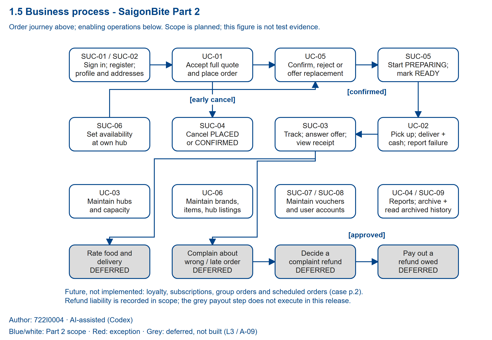

**Figure 1.5. Overall business process, Part 2 scope. Author: 722I0004 · AI-assisted (Codex).** [Editable draw.io source](../../../models/shared/business_process_v2.drawio) · [SVG](../../../models/shared/business_process_v2.svg).

The Part 1 business-process source was copied into the Part 2 work area before revision. This version reorganises that source's order, kitchen, delivery, cancellation and management concepts into a readable A4 overview and a set of activity details. It retains the blue/pale-blue style, red exceptions, grey deferred work and distinct final symbols. Part 1 remains frozen. Part 2 supersedes A-08 through D-4: supporting operations are in the build scope, rather than labelled “analysed only”. These models describe the agreed scope; they do not assert that the application has passed its later implementation and test gates.

| Process responsibility | Use cases included |
|---|---|
| Customer ordering | UC-01 Place an order with an accepted full price, voucher and payment choice; SUC-01 Log in / log out; SUC-02 Register (local or tourist), edit profile, manage addresses |
| Customer follow-up | SUC-03 Track my orders, view receipt, answer a replacement offer; SUC-04 Cancel an order (PLACED or CONFIRMED) |
| Kitchen fulfilment | UC-05 Decide an incoming order: confirm, reject, or offer a replacement the customer agrees to; SUC-05 Start preparing and mark ready; SUC-06 Set menu availability at my hub |
| Delivery | UC-02 Deliver an order: pick up, deliver with cash collection, or report failure |
| Administration | UC-03 Maintain hubs and kitchen capacity; UC-06 Maintain brands, menu items and hub listings; SUC-07 Maintain vouchers; SUC-08 Maintain user accounts; deactivate/reactivate; SUC-09 Archive closed orders; read archived history |
| Management | UC-04 Produce management reports: sales, workload, delivery performance |

Grey activities remain part of the wider business picture but are not built in this release: complaints, complaint/refund decisions, refund payout and ratings (A-09 / L3). Recording a refund liability is in scope and does not execute a payout. Loyalty, subscription meals, group orders and scheduled orders remain future possibilities, not implemented functions. Cash handover and office reconciliation described in the original business context remain manual work; UC-02 records the exact cash collected at the door and does not implement a cash-settlement ledger.

## 1.6 Activity Diagram

Author: 722I0004 · AI-assisted (Codex)

The swim-lane model uses Customer, Kitchen staff, Shipper, Admin, Manager and System. The overview is a responsibility index; Parts A-G carry the executable control-flow interpretation. Only relevant lanes are repeated on a detail page. Authentication and role checks apply before each authorised activity. The payment simulator belongs to the System lane and represents no external provider integration.

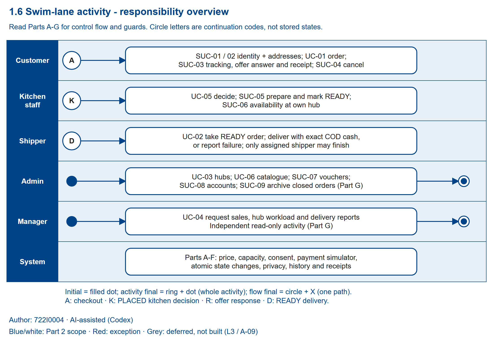

**Figure 1.6. Swim-lane responsibility overview. Author: 722I0004 · AI-assisted (Codex).** [Multi-page draw.io source](../../../models/shared/swimlane_v2.drawio) · [SVG](../../../models/shared/swimlane_v2.svg).

A filled dot starts an activity. A ring containing a dot ends the whole activity shown; the circle containing an X ends one path or unsuccessful request without implying that an existing order has closed. Administration, reports and cancellation requests are separate activities, so their final nodes do not end another activity. Continuation circles P, K, R and D transfer one selected flow between pages, rather than starting concurrent branches: P = checkout confirmation, K = a PLACED order awaiting a kitchen decision, R = an OFFERED replacement awaiting a customer response, D = a READY order available for pickup. Re-entering K after a resolved offer is an alternative continuation, not a join waiting for several inputs.

### Checkout and payment

Part A uses raw distance for the inclusive 8 km limit, then the derived hub-load classification. A refused attempt ends; a changed hub or address requires another quote, including the possibility that no alternative hub is available. The displayed distance uses a district centroid and is explicitly approximate. The customer sees subtotal S, voucher discount D, fee F, quiet concession Q and total T before confirmation (BR-01-BR-10).

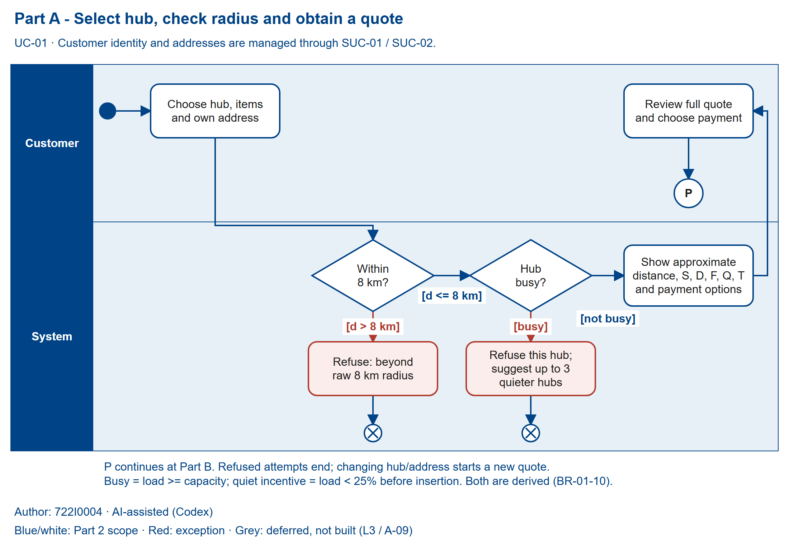

**Figure 1.6a. Select hub, check radius and obtain a quote. Author: 722I0004 · AI-assisted (Codex).** [draw.io](../../../models/shared/swimlane_v2_PartA.drawio) · [SVG](../../../models/shared/swimlane_v2_PartA.svg).

Part B separates a declined simulator attempt from a persisted order. Local customers may select E_WALLET or BANK_QR; tourists may select INTERNATIONAL_CARD; both may choose COD. The simulator page records a selected approve/decline result before the write transaction. Its deterministic in-process decision and all order/line/payment writes belong to the checkout transaction. Capacity, radius, voucher and the complete quote fingerprint are rechecked at confirmation. Any changed quote is shown again, without saving an order. A declined attempt creates neither an Order nor a Payment. A successful COD order starts with payment PENDING; approved ONLINE starts PAID. A commit failure releases the simulated approval and saves nothing. Replaying an accepted checkout token returns that customer's existing order rather than creating another (BR-11, BR-14).

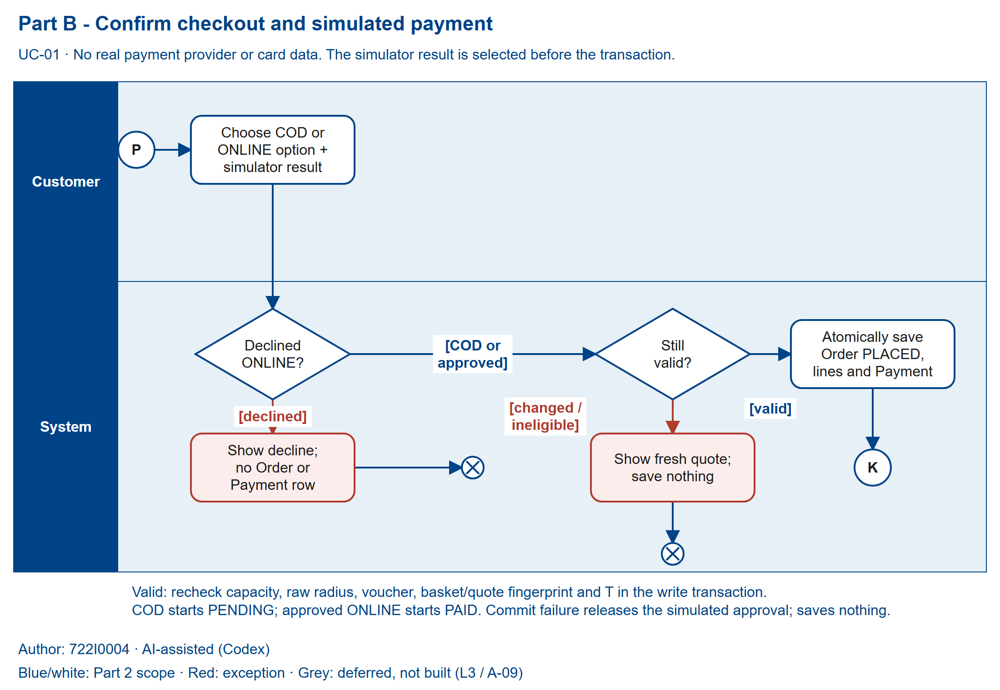

**Figure 1.6b. Confirm checkout and simulated payment. Author: 722I0004 · AI-assisted (Codex).** [draw.io](../../../models/shared/swimlane_v2_PartB.drawio) · [SVG](../../../models/shared/swimlane_v2_PartB.svg).

### Kitchen decision and replacement consent

Part C restricts kitchen operations to the staff member's own hub. A rejection needs a reason. Confirmation requires no open offer; preparation starts from CONFIRMED. Marking READY creates one Delivery in AWAITING_PICKUP. Kitchen availability is per hub: AVAILABLE and SOLD_OUT belong to its listing, not to the MenuItem itself (BR-16, BR-26; plan section 4).

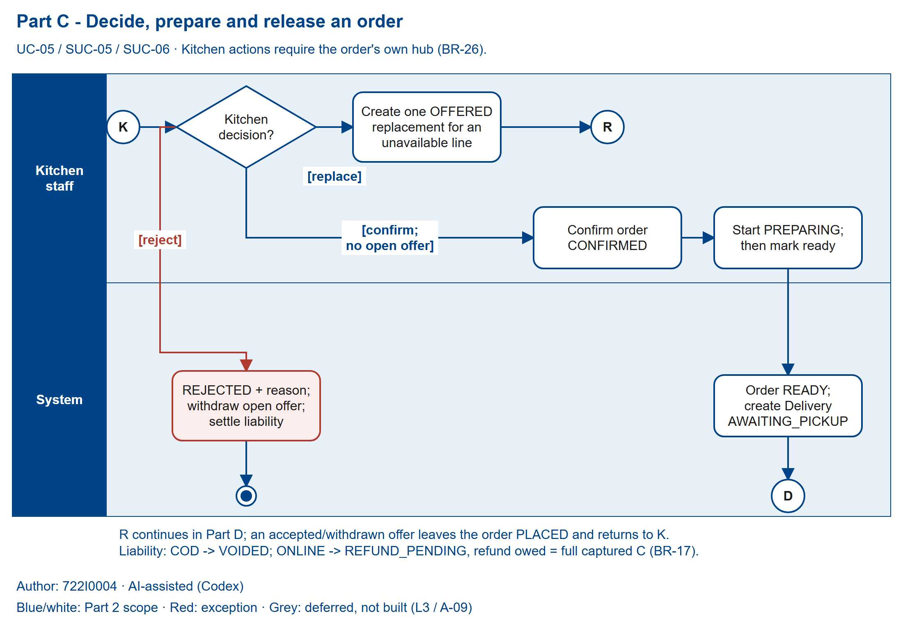

**Figure 1.6c. Decide, prepare and release an order. Author: 722I0004 · AI-assisted (Codex).** [draw.io](../../../models/shared/swimlane_v2_PartC.drawio) · [SVG](../../../models/shared/swimlane_v2_PartC.svg).

Part D requires the exact open OFFERED offer on the customer's own PLACED order. The source line must currently be unavailable; its replacement keeps the quantity, differs from the source, is not already in the order, and has an equal-or-lower offered unit price. Only one open offer is permitted. Acceptance rechecks the target's active brand/item and listed, AVAILABLE status at that hub. An invalid target withdraws the offer and leaves the order unchanged. A valid answer honours the stored offered price, changes the line and total, caps the old voucher concession at the new subtotal, and preserves F and Q. ONLINE keeps captured amount C and state PAID while C minus the new T becomes refund owed. Decline produces DECLINED and REJECTED, with the full unfulfilled liability. Stale/repeated answers change nothing; a cancelled order cannot be revived. “Waiting for customer” is derived from PLACED plus an open offer, not a stored state (plan section 3.3).

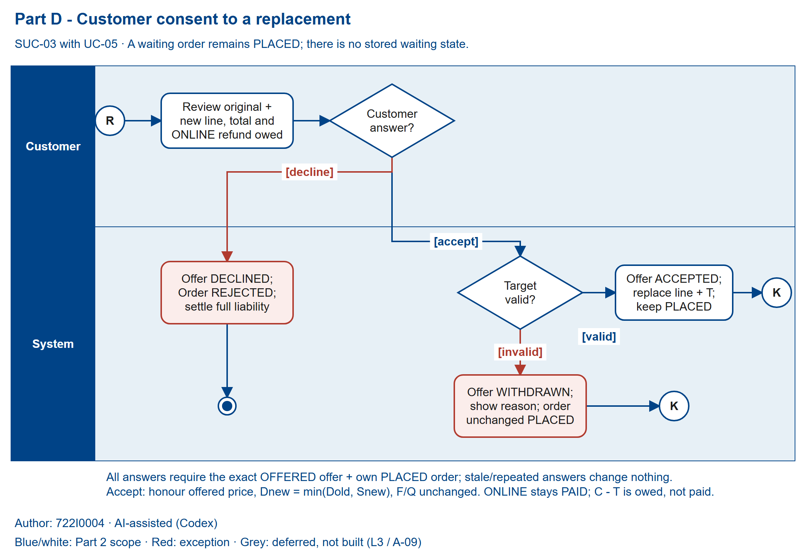

**Figure 1.6d. Customer consent to a replacement. Author: 722I0004 · AI-assisted (Codex).** [draw.io](../../../models/shared/swimlane_v2_PartD.drawio) · [SVG](../../../models/shared/swimlane_v2_PartD.svg).

### Delivery and cancellation

Part E atomically assigns an unclaimed READY order to an active shipper: Order becomes OUT_FOR_DELIVERY and Delivery becomes PICKED_UP. Only that shipper can finish. A successful COD finish requires cash exactly equal to T; success sets Order and Delivery to DELIVERED and COD payment to PAID. A valid failure needs a reason and sets DELIVERY_FAILED / FAILED. Invalid cash or a missing reason leaves the order OUT_FOR_DELIVERY so another valid finish request can be made. There is no redelivery transition. The own-order receipt uses stored snapshots, shows payment state and refund owed, and labels ONLINE as simulated (BR-13, BR-25).

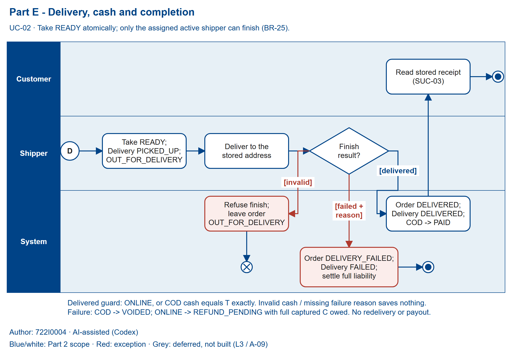

**Figure 1.6e. Delivery, cash and completion. Author: 722I0004 · AI-assisted (Codex).** [draw.io](../../../models/shared/swimlane_v2_PartE.drawio) · [SVG](../../../models/shared/swimlane_v2_PartE.svg).

Part F is the customer's cancellation request. Its ownership/state check and effects are one transaction. Only PLACED or CONFIRMED can become CANCELLED; an open offer becomes WITHDRAWN. PREPARING, later and terminal orders remain unchanged when cancellation is refused. Cancellation and kitchen/offer actions must recheck current state rather than rely on the state previously displayed (BR-15).

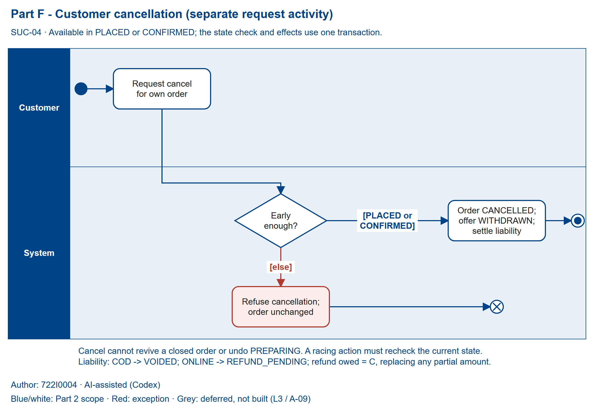

**Figure 1.6f. Customer cancellation request. Author: 722I0004 · AI-assisted (Codex).** [draw.io](../../../models/shared/swimlane_v2_PartF.drawio) · [SVG](../../../models/shared/swimlane_v2_PartF.svg).

Every unfulfilled terminal outcome in Parts C-F uses the same payment effect: COD becomes VOIDED; ONLINE becomes REFUND_PENDING with refund owed equal to the full captured C. A prior partial amount is replaced by C, never added to it. No path claims a refund was paid or sets REFUNDED. The terminal Order vocabulary is DELIVERED, DELIVERY_FAILED, REJECTED and CANCELLED; other represented Order states are PLACED, CONFIRMED, PREPARING, READY and OUT_FOR_DELIVERY (BR-17; plan section 4).

### Independent administration and management

Part G represents a selected administration task and a separate management-report request. Hub capacity must stay at least one; archiving a hub requires no open orders. Brand/item archive and catalogue price changes preserve existing line snapshots. UserAccount changes between ACTIVE and INACTIVE; a shipper holding a PICKED_UP delivery cannot be deactivated. Order archive requires a terminal order and preserves authorised history, receipts, reporting and refund obligations. Manager reports read records without creating report states or changing data. Their filters and measures follow BR-20-BR-24; report output is not a payment settlement operation (BR-18, BR-19, BR-25).

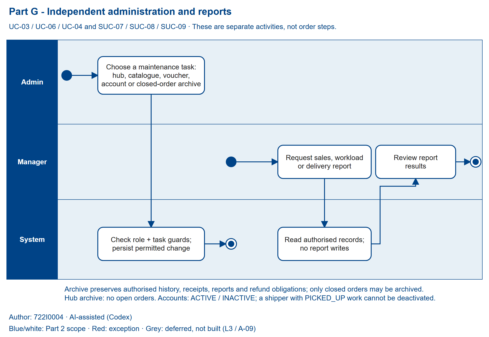

**Figure 1.6g. Independent administration and reports. Author: 722I0004 · AI-assisted (Codex).** [draw.io](../../../models/shared/swimlane_v2_PartG.drawio) · [SVG](../../../models/shared/swimlane_v2_PartG.svg).

**Placement and verification.** Insert each complete figure on an A4 landscape page at **230 mm wide** (158.9 mm high), retaining its aspect ratio and its built-in caption/legend. The 1100 × 760 viewBox uses no text smaller than 16 units, giving **9.48 pt** at that placement. Do not shrink below **218.3 mm wide** (9.00 pt). Portrait-width insertion would fail this legibility condition. The overview is not a replacement for the detail pages. Every supplied PNG is a 2200 × 1520 rendering of its matching SVG and was visually inspected; all nine figures were also inspected in 96 dpi A4 landscape proofs at the specified 230 mm placement; geometry and semantic evidence is in `models/shared/business_process_v2.qa.json`. XML parsing and export checks do not claim a native draw.io application review. Final report PDF placement remains a P7 verification item.

Sources: the locked Part 2 plan, sections 1-4 and P1; Case Study PDF pp.1-2; Final Project Requirements PDF pp.2-4 and 8; Report Template headings 1.5-1.6; frozen Part 1 business-process source and `build/proc_*.py` / `notes/diagram_changes.md`. The model and explanation use own wording. Scope clarification L3 remains a team default pending lecturer feedback; no lecturer approval is implied.

## 1.7 List of Requirements

Author: 722I0004 · AI-assisted (Codex)

The locked Part 2 plan governs this list. Plan thresholds and figures remain team defaults unless the decision log records an answer; Q1–Q5 have no answers recorded at this phase. Acceptance criteria define planned checks, not completed tests or measured results. All in-scope requirements are Must because they form the locked minimum portfolio; deferred and future work appears separately below.

Source key: **Case** = `Lec_re/RAD_Sem01_2627_Case_Study_SaigonBite.pdf`; **Requirements** = `Lec_re/RAD_Sem01_2627_FinalProject_Requirements_SaigonBite.pdf`; **Plan** = `PLAN_SaigonBite_Part2_Final.md`. Case pointers identify the printed page and feature or fixed-fact topic, rather than fabricated line numbers. Case evidence establishes the business need; linked BR/A/Q entries specify the team interpretation and unresolved details. Requirements p.2 §2.1 and D-4 require the minimum supporting CRUD paths; A-08 is superseded, not a basis for leaving them unbuilt. Source links to Q items indicate an unresolved question, never an answer.

### Functional requirements

| ID | Requirement | MoSCoW | UC/SUC | Source | Acceptance criterion |
|---|---|---|---|---|---|
| FR-01 | The system shall register a Local customer only with a valid Vietnamese mobile number and a Tourist customer with a passport number, nationality, and email address; Tourist phone is optional. | Must | SUC-02; UC-01 | Case p.1 registration feature; Plan §2.2 SUC-02; §3.1 BR-12/A-18 | A valid Local registration succeeds and missing or malformed mobile input is rejected. A Tourist registration succeeds without phone when passport, nationality, and email are present; omission of any required Tourist field is rejected. The applied mobile pattern is documented at the input. |
| FR-02 | The system shall let a customer edit their own profile and create, read, edit, and archive their delivery addresses, including an address labelled Hotel. | Must | SUC-02; UC-01 | Case p.1 profile, address, and hotel features; Plan §2.2 SUC-02; §2.4 Address; §3.1 BR-12/A-18 | The owner can create, retrieve, edit, and archive an address and can save Hotel as its label. A different customer cannot retrieve or change that address. |
| FR-03 | The system shall let an account holder log in and log out, and shall reject an inactive account on its next request. | Must | SUC-01; SUC-08 | Requirements p.2 §2.1 minimum CRUD; Case p.2 private customer data; Plan §2.2 SUC-01/SUC-08; §4.4 UserAccount | A valid active account can start a session; logout ends it; after deactivation, the next protected request is rejected. |
| FR-04 | The system shall let customers browse active hubs, brands, menus, and each hub listing’s availability. | Must | UC-01; UC-06; SUC-02; SUC-06 | Case p.1 catalogue feature; Plan §2.1 UC-01/UC-06; §2.2 SUC-06; §3.2 BR-19; §4.4 listing states | The catalogue shows AVAILABLE and SOLD_OUT per hub. Archived hubs, brands, and items do not appear in operational browsing. |
| FR-05 | The system shall quote an order for one selected hub and address with item lines, voucher choice, delivery charge, discounts, surcharges, payment method, and full total before confirmation. | Must | UC-01; SUC-02; SUC-07 | Case p.1 order-pricing feature; Plan §2.1 UC-01; §3.1 BR-09/A-16; Part 1 A-01 | Before confirmation, the customer can inspect the selected hub and address, each item and quantity, S, D, F, Q, T, and the chosen payment option. No order is saved merely by requesting the quote. |
| FR-06 | The system shall calculate hub load from PLACED, CONFIRMED, and PREPARING orders, refuse a busy hub, and offer up to three eligible alternative hubs. | Must | UC-01; UC-03; UC-04 | Case p.1 busy-hub feature and p.2 busy/quiet fixed fact; Plan §3.1 BR-01/BR-02/A-02/Q1 and BR-04/A-13/Q1/Q2; §4.1 Order | Load equal to capacity is busy and load one below capacity is not. A busy choice is refused; at most three ACTIVE non-busy alternatives within range are returned in load-ratio, distance, then ID order. An empty result is handled. Selecting an alternative reloads its menu and prices and shows a new full quote before confirmation. Confirmation rechecks capacity inside the write transaction, so two concurrent requests cannot both take the last slot. |
| FR-07 | The system shall calculate approximate distance from the hub to the delivery district centroid, enforce the delivery radius, and calculate the delivery fee using the locked rule. | Must | UC-01 | Case p.2 distance/radius/fee fixed fact; Plan §3.1 BR-05/A-14/Q2; BR-06/A-14/Q2; BR-07/A-15/Q2 | The quote labels the distance approximate. Raw distance at or below 8.0 km is accepted; raw distance above 8.0 km is rejected. Distance uses Haversine from hub coordinates to the district centroid. The quote shows the fee rule: base fee plus 3,000 VND times the greater of one or the ceiling of raw distance in kilometres; display rounding changes neither radius nor fee. Planned boundary examples include d = 0 billing one kilometre, d = 3.2 billing four, and raw 8.004 km being refused. |
| FR-08 | The system shall apply the quiet-hub delivery discount when the pre-insert load is below the configured threshold and save that discount with the order. | Must | UC-01; UC-03; UC-04 | Case p.2 quiet-incentive fixed fact; Plan §3.1 BR-03/A-03/A-12/Q1 | Under the current team default, load below 25 percent receives the lesser of 5,000 VND or the delivery fee; load exactly at 25 percent receives none. The saved Q remains unchanged if later hub load changes. The figures remain team defaults until answered. |
| FR-09 | The system shall allow zero or one voucher per order and apply its fixed or percentage discount subject to the voucher’s validity and limits. | Must | UC-01; SUC-07 | Case p.2 fixed fact on one voucher; Plan §3.1 BR-08/A-16; §2.2 SUC-07 | A second voucher is rejected. Percentage discounts round down; max discount and item subtotal cap the discount; minimum subtotal is enforced; Vietnam-calendar valid-from and valid-until dates are inclusive; an archived voucher cannot be used. |
| FR-10 | The system shall calculate and store the order total as T = S − D + F − Q while enforcing 0 ≤ D ≤ S and 0 ≤ Q ≤ F. | Must | UC-01; SUC-03 | Case p.1 full-price feature; Plan §3.1 BR-09/A-16 | For each saved order, the stored values satisfy the formula and both bounds. A value outside either bound is rejected by validation or the database constraint. |
| FR-11 | The system shall recompute the quote at confirmation and save nothing if any consent-relevant quote input has changed. | Must | UC-01 | Case p.1 full-price-before-confirmation feature; Plan §3.1 BR-10/A-17 | Changing the hub, address, item, quantity, unit price, voucher code or discount, F, Q, payment method or option, or T causes a refreshed quote and zero saved order, line, or payment rows. Client-posted prices are ignored. |
| FR-12 | The system shall support COD for both customer types and provide the plan’s customer-type-specific ONLINE simulator options. | Must | UC-01; UC-02 | Case p.1 payment feature and p.2 customer-type fact; Plan §3.1 BR-14/A-05/A-06/Q4; L2 | COD is available to Local and Tourist customers. ONLINE offers E_WALLET or BANK_QR to Local customers and INTERNATIONAL_CARD to Tourists. The customer makes the approve/decline choice on the simulator page before checkout writes begin; on approval, a deterministic in-process simulator decision and the order, lines, and PAID payment writes run inside the same transaction. A decline creates no order or payment row. A transaction failure at any point through commit releases simulated authorization and leaves no rows. No real card data is collected. |
| FR-13 | The system shall make checkout confirmation idempotent for a customer’s checkout token and prevent another customer from discovering that customer’s order. | Must | UC-01 | Case p.1 ordering feature; Requirements p.2 §2.2 explicit assumptions; Plan §3.1 BR-11; §5.2 UNIQUE checkout token | Repeated confirmation with the same customer and token returns the same order and leaves exactly one order for that token. A different customer’s request reveals no order details. |
| FR-14 | The system shall save a successful checkout as a PLACED order with line, address, item, and price snapshots and the corresponding payment record. | Must | UC-01 | Case p.1 ordering/payment feature and p.2 lifecycle fixed fact; Plan §3.1 BR-09/BR-13; §3.2 BR-19; §4.1 confirmCheckout | A successful COD checkout creates one PLACED order, snapshot lines, and a PENDING payment; approved ONLINE checkout creates the same order data with a PAID payment. Later edits to catalogue names or prices do not alter saved line snapshots. |
| FR-15 | The system shall let each customer track only their own orders and view the current order and delivery progress. | Must | SUC-03; UC-01; UC-02; UC-05 | Case p.1 tracking feature; Plan §2.2 SUC-03; §4.1 Order and §4.2 Delivery states | The owner can see the defined order states and delivery progress. Waiting for customer is derived from PLACED plus an OFFERED replacement; it is not persisted as a separate state. Another customer cannot read the order. |
| FR-16 | The system shall provide the customer with a printable receipt for their own order. | Must | SUC-03; UC-01 | Case p.1 receipt feature; Plan §3.1 BR-13/A-19 | The receipt includes order ID and date, hub, address snapshot, item snapshot names, prices and quantities, S, D, F, Q, T, method and option, payment state, and refund owed. ONLINE is labelled simulated payment; owed money is not labelled paid or refunded. |
| FR-17 | The system shall let a customer cancel an own order only while it is PLACED or CONFIRMED and shall settle the recorded payment obligation for that cancellation. | Must | SUC-04; UC-01; SUC-03 | Case p.1 cancel feature; Plan §2.2 SUC-04; §3.2 BR-15/Q3 and BR-17; §3.3 items 8–9; A-06/Q3 | Cancellation from PLACED or CONFIRMED sets CANCELLED and withdraws an open offer; later-state cancellation is rejected. COD becomes VOIDED. ONLINE remains an owed refund in REFUND_PENDING with refund_amount = captured C, replacing any partial amount. A previously accepted replacement can still be cancelled. |
| FR-18 | The system shall show active shippers the READY orders available for pickup with the delivery contact and address snapshot needed for fulfilment. | Must | UC-02; SUC-03; SUC-05 | Case p.1 shipper delivery feature; Plan §2.1 UC-02; §2.4 Delivery/Address; §3.2 BR-25 | A READY order can be viewed for pickup with its saved fulfilment details. Passport numbers are absent from shipper-facing output. |
| FR-19 | The system shall let any active shipper atomically take any unassigned READY order without a one-active-delivery cap. | Must | UC-02 | Case p.1 shipper pickup feature; Plan §3.2 BR-25; §4.1 takeDelivery; §4.2 Delivery | A successful take changes the order to OUT_FOR_DELIVERY and its delivery to PICKED_UP with the shipper assigned. Concurrent attempts for one order produce one winner; an active shipper may hold multiple deliveries. |
| FR-20 | The system shall let only the assigned shipper finish a delivery and shall require exact COD cash collection. | Must | UC-02 | Case p.1 delivery and cash collection features; Plan §3.2 BR-25; §4.1 confirmDelivered | The assigned shipper can set DELIVERED; another shipper cannot. For COD, cash must equal T exactly or the transition is rejected with no state change. Successful COD becomes PAID. |
| FR-21 | The system shall let the assigned shipper report a failed delivery with a reason and record the unfulfilled payment outcome. | Must | UC-02 | Case p.1 failed-delivery feature; Plan §3.2 BR-17/BR-25; §4.1 reportFailure; A-06/Q3 | A valid failure records DELIVERY_FAILED and Delivery FAILED with a reason. COD becomes VOIDED; ONLINE becomes REFUND_PENDING with refund_amount = captured C. An unassigned shipper cannot make the change. |
| FR-22 | The system shall let an admin create, read, update, and archive hubs while enforcing capacity and open-order guards. | Must | UC-03 | Case p.2 hub administration feature; Plan §2.1 UC-03; §3.2 BR-18; §2.4 Hub | Capacity cannot be set below one. It may be lowered below current load, after which the hub refuses new orders until load drops. Archive succeeds only when every order is DELIVERED, DELIVERY_FAILED, REJECTED, or CANCELLED; otherwise it is refused. |
| FR-23 | The system shall provide a read-only current workload report for each hub. | Must | UC-04 | Case p.2 workload report feature; Plan §2.1 UC-04; §3.4 BR-22/Q1 and BR-24/Q5; A-02/A-07/Q1/Q5 | The report labels its values now and shows cooking load against capacity plus READY and OUT_FOR_DELIVERY counts. It has no date filter, and running it changes zero rows. |
| FR-24 | The system shall provide an operational sales report for DELIVERED orders and item activity over Vietnam-calendar date ranges. | Must | UC-04 | Case p.2 sales report feature; Plan §3.4 BR-20/Q5, BR-21/Q5, BR-24/Q5; A-07/Q5 | Stored timestamps are UTC. The inclusive Asia/Ho_Chi_Minh calendar-date inputs define [start 00:00, end+1 00:00), converted to UTC; a delivery is included by finish time, never order placement time. The report shows order count, item sales S, voucher discounts D, net delivery fees F − Q, order totals T, and refund amounts owed separately without subtracting them again. Order-level sums use orders without line-join duplication; item sums group by menu_item_id and display snapshot names. Archived orders remain included. The report changes zero rows. |
| FR-25 | The system shall report delivery waiting time, successful ride time, and the delivery failure rate for a Vietnam-calendar date range. | Must | UC-04 | Case p.2 delivery-performance report feature; Plan §3.4 BR-20/Q5 and BR-23/Q5; A-07/Q5 | Only deliveries finished within the same half-open Vietnam-day interval defined in FR-24 are selected. The report shows mean READY-to-PICKED_UP wait, mean PICKED_UP-to-DELIVERED ride for successful deliveries only, and failure rate = failed / (delivered + failed). Each figure shows its own sample size and n/a when its denominator is zero. Archived deliveries remain included; the report changes zero rows. |
| FR-26 | The system shall restrict kitchen order access and actions to orders belonging to the staff member’s assigned hub. | Must | UC-05; SUC-05; SUC-06 | Case p.1 hub-staff feature and p.2 private contact data; Plan §2.1 UC-05; §3.2 BR-26; §4.1 kitchen transitions | Kitchen staff can retrieve and act on an own-hub order. Requests for another hub’s order return no order data and make no state change. |
| FR-27 | The system shall let own-hub kitchen staff confirm a PLACED order or reject it with a reason. | Must | UC-05 | Case p.1 incoming-order feature; Plan §2.1 UC-05; §3.2 BR-16/BR-17/BR-26; §4.1; A-06/Q3 | Confirm changes PLACED to CONFIRMED only when no offer is open. Reject requires a reason, changes the order to REJECTED, withdraws an open offer, and sets COD to VOIDED or ONLINE to REFUND_PENDING with the full captured amount owed. |
| FR-28 | The system shall allow a kitchen replacement offer only for an unavailable line on an own-hub PLACED order and only when its proposed target meets the locked eligibility rules. | Must | UC-05; UC-06; SUC-06 | Case p.1 unavailable-item substitution problem; Plan §3.3 items 1–3; §3.2 BR-26; §4.4 ReplacementOffer; A-06 | The source dish must currently be sold out, unlisted, or archived at that hub. The offer proposes replacement of the whole line at unchanged quantity; it changes no order line before customer acceptance. The target is ACTIVE, listed, AVAILABLE, different from the source, not already on the order, and no more expensive than the source snapshot. Cross-brand targets are allowed. At most one offer is OFFERED per order at a time; a later offer may follow a resolved one while the order stays PLACED. |
| FR-29 | The system shall preserve resolved replacement offers as history and show the customer the complete offered change before an answer is submitted. | Must | SUC-03; UC-05 | Case p.1 substitution problem and full-price consent feature; Plan §3.3 items 2 and 4; §2.2 SUC-03; A-06 | The customer sees original and new names and prices, quantity, proposed new total, and ONLINE refund owed before answering. The customer can still read resolved offer history, and at most one offer is open at a time. |
| FR-30 | The system shall block kitchen confirmation and preparation while an order has an open replacement offer. | Must | UC-05; SUC-05 | Case p.1 substitution problem and preparation feature; Plan §3.3 item 4; §4.1 confirmOrder/startPreparing; A-06 | While an offer is OFFERED, confirm and start-preparing requests leave both order and offer unchanged. After the offer resolves, the order may continue only if its state permits. |
| FR-31 | The system shall revalidate ownership, order state, the exact open offer, and target availability when a customer accepts a replacement. | Must | SUC-03; UC-05 | Case p.1 substitution problem and full-price consent feature; Plan §3.3 item 5; §4.1 acceptReplacement; A-06 | Acceptance is applied in one transaction only for the owning customer, a PLACED order, the exact OFFERED offer, and a target still listed, available, and not archived. If the target is invalid, the offer becomes WITHDRAWN with a reason, the order remains unchanged, and the customer sees a message. A valid acceptance uses the offered price even if catalogue price later changed. |
| FR-32 | The system shall recalculate replacement totals using the service-recovery concession and keep COD payable and ONLINE refund owed distinct. | Must | SUC-03; UC-05 | Case p.1 substitution, price, and online-payment needs; Plan §3.3 items 6–7 and oracle example; §3.1 BR-09; A-06/A-16 | On acceptance, D_new = min(D_old, S_new); voucher terms are not re-evaluated and F and Q do not change. COD is payable at new T. ONLINE keeps captured amount C and PAID state, with refund owed = C − T_new. The interface says refund owed; no payout or REFUNDED state is produced. Planned hand-calculated check: S = 100,000, D = 10,000, F = 15,000, Q = 5,000 gives C = T = 100,000; replacement S = 90,000 gives T = 90,000 and ONLINE refund owed = 10,000; later cancellation owes exactly 100,000, while delivery reports T = 90,000 without another deduction. |
| FR-33 | The system shall record a customer’s replacement decline as rejection and make stale or repeated answers harmless. | Must | SUC-03; UC-05 | Case p.1 substitution problem and p.2 lifecycle fixed fact; Plan §3.3 items 8–10; §3.2 BR-17; §4.1 declineReplacement; L3; A-06/A-09/L3 | Decline sets the offer to DECLINED and the order to REJECTED with reason “customer declined replacement”; COD becomes VOIDED and ONLINE is owed the full captured C in REFUND_PENDING. Repeated or stale answers change nothing, and no answer revives CANCELLED or REJECTED orders. |
| FR-34 | The system shall let own-hub kitchen staff start preparing a CONFIRMED order and mark a PREPARING order READY. | Must | SUC-05; UC-05; UC-02 | Case p.1 preparation and ready features; Plan §2.2 SUC-05; §4.1/§4.2 | Only a CONFIRMED own-hub order can become PREPARING. Only a PREPARING own-hub order can become READY; that transition records ready time and creates one AWAITING_PICKUP delivery. |
| FR-35 | The system shall let kitchen staff set availability for a listing at their own hub. | Must | SUC-06; UC-05; UC-06 | Case p.1 availability feature; Plan §2.2 SUC-06; §4.4 listing states; §3.2 BR-26 | An authorized staff member can switch an own-hub listing between AVAILABLE and SOLD_OUT. A cross-hub update is rejected, and SOLD_OUT is represented on the listing rather than as a global menu-item state. |
| FR-36 | The system shall let an admin create, read, update, and archive brands and menu items while preserving existing order snapshots. | Must | UC-06; UC-01; UC-05 | Case p.2 catalogue administration feature; Plan §2.1 UC-06; §3.2 BR-19; §2.4 Brand/MenuItem | Admin can complete the listed create/read/update/archive operations. Price or name changes leave existing order lines unchanged. An archived brand or item cannot be newly listed or ordered. |
| FR-37 | The system shall let an admin create, read, update, and unlist hub-menu listings. | Must | UC-06; SUC-06; UC-01 | Case p.2 menu administration feature; Plan §2.4 HubMenuItem; §2.4 CRUD union; §4.4 listing states | Admin can create and view a listing, update its hub-specific availability, and unlist it. Unlisting removes the operational association while saved order-line snapshots remain readable. |
| FR-38 | The system shall let an admin create, read, update, and archive vouchers. | Must | SUC-07; UC-01 | Case p.2 voucher administration feature; Plan §2.2 SUC-07; §3.1 BR-08/A-16 | Admin can complete each operation. An archived voucher is excluded from checkout; an active voucher is applied only under FR-09 conditions. |
| FR-39 | The system shall let an admin create, read, update, deactivate, and reactivate user accounts subject to delivery and session guards. | Must | SUC-08; SUC-01; UC-02 | Case p.2 account administration feature; Plan §2.2 SUC-08; §3.2 BR-25; §4.4 UserAccount | Admin can complete the listed operations. Deactivation blocks the account on its next request. A shipper holding a PICKED_UP delivery cannot be deactivated; after the delivery is no longer PICKED_UP, the guard is re-evaluated. |
| FR-40 | The system shall let an admin archive only closed orders and let authorized users read archived history. | Must | SUC-09; SUC-03; UC-04 | Requirements p.2 §2.1 persistent-class CRUD; Case p.2 management reports; Plan §2.2 SUC-09; §2.4 Order; §3.4 BR-24/Q5; §5.3 schema contract; A-07/Q5 | Only DELIVERED, DELIVERY_FAILED, REJECTED, or CANCELLED orders can be archived. Archived orders disappear from operational lists but remain available in authorized history, receipts, reports, and refund-obligation views; the archive operation does not physically delete the order or its related rows. |

### Non-functional requirements

Each criterion names a measurement method. Results remain unmeasured until the later implementation, testing, and deployment phases produce evidence.

| ID | Requirement | MoSCoW | UC/SUC scope | Source | Acceptance criterion and measurement method |
|---|---|---|---|---|---|
| NFR-01 | The system shall ensure that an unauthorized request changes zero persistent rows. | Must | UC-01–UC-06; SUC-01–SUC-09 | Plan §5.4 role, active-account, owner, and hub checks | For every protected operation, submit a request as a role or account without permission. The response is denied or redirected and there are zero inserts, updates, or deletes. Measurement: compare complete relevant row values and counts and the request connection's total_changes delta (zero); counts alone cannot detect an UPDATE. Include guessed IDs, wrong owner, wrong hub, inactive account, and each disallowed role in P4; no result recorded in P1. |
| NFR-02 | The system shall ensure that replaying checkout confirmation for one customer and token creates exactly one order. | Must | UC-01 | Plan §3.1 BR-11; §5.2 unique checkout token | Send the same confirmation at least twice with the same customer and token; count rows and require exactly one order for that token and both responses to reference it. Measurement: count the persisted orders after replay; no result recorded in P1. |
| NFR-03 | The system shall preserve a saved order across container recreation and VM reboot. | Must | UC-01–UC-06; SUC-03–SUC-09 | Plan D-5; §5.2 persistent local disk; §5.3 schema | Create an order, recreate the application container, then reboot the demo VM and retrieve the same authorized order ID with identical S/D/F/Q/T and payment state. This is a deployment target until measured in P6. |
| NFR-04 | The system shall respond to each designated key page in under one second on the demo VM. | Must | UC-01–UC-06; SUC-01–SUC-09 | Phase 1 checklist P1-17; Plan D-5 deployment target | For customer browse, quote, order/receipt, kitchen queue, shipper READY board, admin catalogue, and manager report pages, run 20 warm requests per page on the demo VM; each response target is below 1,000 ms. This target is unmeasured and must be labelled as such until P6 evidence exists. |
| NFR-05 | The system shall restrict passport disclosure to the owning customer and authorized admin views and keep it off kitchen and shipper pages and logs. | Must | UC-02; UC-05; SUC-03; SUC-08 | Plan §3.1 BR-12/A-18; §5.4; Phase 1 checklist P1-17 | Use a synthetic Tourist record with a unique passport sentinel, fetch every kitchen and shipper page plus unauthorized customer and manager requests, and inspect captured application logs; the sentinel must occur zero times. Only the owning customer and authorized admin views may show it. Measurement: exact string scan; no result recorded in P1. |
| NFR-06 | The system shall reject state-changing browser requests without a valid CSRF token. | Must | UC-01–UC-06; SUC-02–SUC-09 | Plan §5.1 presentation forms and §5.4 CSRF rule | For every state-changing POST operation, a missing or invalid token is rejected and makes zero persistent changes; a valid token proceeds subject to business rules. Measurement: enumerate POST routes, compare relevant row contents and counts, and require total_changes delta zero for rejected requests. CSRF tokens and checkout idempotency tokens are independently checked; no result recorded in P1. |
| NFR-07 | The system shall keep production secrets outside tracked source files and fail closed when its required production secret is absent. | Must | UC-01–UC-06; SUC-01–SUC-09 | Plan §5.4 SAIGONBITE_SECRET_KEY production guard | Before release, a secret scanner reports zero confirmed credentials in tracked files. In production mode, startup without SAIGONBITE_SECRET_KEY fails; with it supplied through deployment configuration, startup does not expose the value in logs. Measurement: scanner report and startup checks; not run in P1. |
| NFR-08 | The system shall serve the public demo over valid HTTPS and redirect public HTTP requests to HTTPS. | Must | UC-01–UC-06; SUC-01–SUC-09 | Plan D-5; §5.4 HTTPS and secure session cookies | On the demo hostname, the certificate validates, each HTTP request redirects with 301 or 308, and the session cookie has Secure, HttpOnly, and SameSite attributes. This deployment target is unmeasured until P6. |
| NFR-09 | The system shall keep key customer, kitchen, shipper, admin, and report pages usable at a 360 CSS-pixel viewport. | Must | UC-01–UC-06; SUC-01–SUC-09 | Phase 1 checklist P1-17 phone-width requirement | At 360 CSS pixels, each key page has document scroll width no greater than viewport width; primary controls are visible and operable without horizontal page scrolling. Measurement: browser viewport inspection at 360 pixels; not run in P1. |
| NFR-10 | The system shall keep presentation, controller, domain, and data-access responsibilities in the layers defined by the plan. | Must | UC-01–UC-06; SUC-01–SUC-09 | Plan §5.1 layering contract | A static import review finds zero SQL or sqlite access in presentation/controllers and zero Flask or SQL imports in the domain layer; database calls occur in data-access modules. Measurement: import scan and architecture review; not run in P1. |
| NFR-11 | The system shall archive closed records without physically deleting them and retain authorized historical access. | Must | SUC-09; SUC-03; UC-04 | Plan §2.4 archive semantics; §3.4 BR-24/Q5; §5.3 archived_at fields; checklist P1-17 | After archiving a closed order, its order, line, payment, delivery, and offer row counts are unchanged; operational lists omit it while authorized history, receipt, and report views still include it. Measurement: compare row counts and view results before and after archive; no result recorded in P1. |
| NFR-12 | The system shall serialize competing state changes and preserve order, delivery, and payment consistency when an operation fails. | Must | UC-01; UC-02; UC-05; SUC-03; SUC-04; SUC-05 | Case p.2 handoff/responsibility problem; Plan BR-02/BR-11/BR-17/BR-25; §3.3; §5.2; §7.2 | Planned P4 method: synchronize contenders with a barrier and use independent database connections for last kitchen slot, one READY pickup, accept versus cancel, and cancel versus start preparing. Exclusive claims have one durable winner and a controlled loser message. Other races allow a legal serialized outcome, including accept then cancel; a stale answer never revives a closed order. Force insert and COMMIT failures and require all related writes to roll back. A held write lock yields a controlled retry response without a partial change or HTTP 500. No race or rollback test has run in P1. |

### Deferred and future scope

| Item | Release boundary | Reason and source | A-ID |
|---|---|---|---|
| Complaint handling and staff refund decision | Deferred from this release; retained in the business process as a future item. | L3 asks whether these may be deferred; the case lists them among current features. L3 has no answer recorded, so this is the plan default, not lecturer approval. | A-09 |
| Refund payout | No path pays out an amount owed; the release records REFUND_PENDING and the owed amount only. | Deferred by L3 and Plan §3.3 item 10; no REFUNDED transition or “refunded” claim. L3 remains unanswered. | A-09 |
| Food and delivery rating | Deferred from this release. | L3 asks whether rating may be deferred; Case p.1 identifies rating as a feature. L3 has no answer recorded, so no approval is implied. | A-09 |
| Loyalty points | Future scope. | Case p.2 future-feature paragraph. No assumption ID is assigned in the plan or carried Part 1 log. | None assigned |
| Subscription meal plans | Future scope. | Case p.2 future-feature paragraph. No assumption ID is assigned in the plan or carried Part 1 log. | None assigned |
| Group orders | Future scope. | Case p.2 future-feature paragraph. No assumption ID is assigned in the plan or carried Part 1 log. | None assigned |
| Scheduled orders | Future scope. | Case p.2 future-feature paragraph. No assumption ID is assigned in the plan or carried Part 1 log. | None assigned |

A-09 is carried from Part 1 and records the proposed L3 scope exclusion. It does not establish lecturer approval. No A-ID has been invented for the case’s future features.
