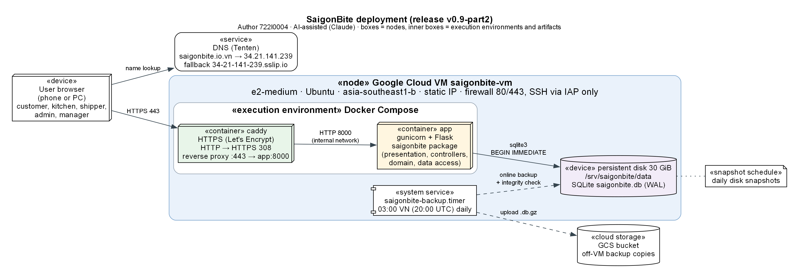

# 5.2 Deployment

Author: 722I0004 · AI-assisted (Codex, Claude)

## Deployment plan

The system is deployed as one Docker Compose application on one Google Cloud virtual machine. The same Compose files run on a laptop, so a reviewer can start the identical release locally. The public site is {{LinkDeployed}} (fallback {{LinkDeployedFallback}}).



Figure 5.2. Deployment diagram of the demonstration system — Author: 722I0004 · AI-assisted (Claude).

| Element | Choice | Reason |
|---|---|---|
| Server | Google Cloud e2-medium VM, Ubuntu, region asia-southeast1 (Singapore), static IP | Close to Vietnam; one small VM is enough for the demo load; covered by the cloud trial credit |
| Runtime | Docker Compose: an `app` container (gunicorn + Flask) and a `caddy` container | The same images run locally and in the cloud; gunicorn replaces the Flask development server |
| HTTPS | Caddy with a Let's Encrypt certificate; HTTP is redirected to HTTPS (308) | Secure session cookies and a valid certificate without manual renewal |
| Database | SQLite in WAL mode on a 30 GiB persistent disk mounted at `/srv/saigonbite/data` | One file database matches the course stack; the disk survives container and VM restarts |
| Backup | Nightly online backup at 03:00 Vietnam time with an integrity check, copied to a Cloud Storage bucket; seven local copies; daily disk snapshots | Recovery does not depend on the VM itself |
| Access | Firewall opens only ports 80 and 443; SSH only through Google IAP; the application secret is generated on the VM (file mode 600) and never stored in Git | Small attack surface; no secret in the repository (NFR-07) |
| Release | The Git tag `v0.9-part2` identifies the submitted code; the VM runs the tagged release (runtime code unchanged since commit 252ada1) | The report, tests and the running site refer to the same version |

## Instructions

**A. Run locally with Docker (recommended for reviewers).** Requires Git and Docker Desktop.

```
git clone https://github.com/Dat071104/SaigonBite.git
cd SaigonBite
git checkout v0.9-part2
docker compose up --build -d
```

Open http://127.0.0.1:5000. The database is created and seeded on the first start and kept in a Docker volume. Stop with `docker compose down`; `docker compose down -v` also deletes the local demo database so that the next start reseeds it.

**B. Run locally without Docker.** Requires Python 3.13.

```
python -m venv .venv
.venv\Scripts\activate          (Linux/macOS: source .venv/bin/activate)
pip install -r requirements.txt
python init_db.py
flask --app app run
```

`init_db.py` creates `instance/saigonbite.db` with the schema, seed data and demo history; the tests are run with `python -m pytest -q` (5.1).

**C. Deploy to the VM.** The operator runbook `deploy/RUNBOOK.md` gives every command. In short: create the VM, static IP, firewall rules and storage bucket; copy the release bundle to the VM over IAP; run `deploy/vm_setup.sh <hostname>` once (installs Docker, creates the directories and the secret, enables the backup timer) and `deploy/deploy.sh <tag> <bundle>` for each release (builds the image, starts Compose, waits for HTTPS, keeps the previous release for rollback). `deploy/restore.sh` restores a backup into a separate check path; `deploy/reset_demo.sh --confirm-reset` resets the demo data after taking a backup.

**Demo accounts** (seeded, demo data only; the same password is used on the local and the public demo):

| Role | Username | Password |
|---|---|---|
| Customer (local, with an address) | `customer` | `123456` |
| Kitchen staff (District 1 hub; `kitchen_bt` for Binh Thanh) | `kitchen` | `123456` |
| Shipper | `shipper` | `123456` |
| Admin | `admin` | `123456` |
| Manager | `manager` | `123456` |

## Deployment verification

Verified on 27–28/10/2026 (evidence in `docs/part2/test_report/deploy_2026-10-27/` and `deploy_2026-10-28_domain/`):

- A fresh clone built and ran locally; the full suite passed (928 tests).
- Public order 9 kept its state, amounts and payment through an application restart, Compose down/up and a VM reboot (NFR-03).
- An online backup passed its integrity check and was copied off the VM; a separate restore matched the order count and sample amounts and allowed a customer login.
- The certificate is valid, HTTP redirects to HTTPS with 308, the session cookie is `Secure`, `HttpOnly` and `SameSite=Lax`, and a request with an invalid CSRF token was rejected with the database digest unchanged (NFR-06, NFR-08).
- Response times over 20 warm requests per page (milliseconds), all under the 1-second target of NFR-04; 200 requests from 20 concurrent clients all returned HTTP 200:

| Page | Min ms | Median ms | p95 ms | Max ms |
|---|---:|---:|---:|---:|
| customer_browse | 67.45 | 70.51 | 89.37 | 92.83 |
| quote | 69.27 | 73.47 | 109.16 | 120.6 |
| order | 68.75 | 81.06 | 104.62 | 107.86 |
| receipt | 66.47 | 70.52 | 79.17 | 107.67 |
| kitchen_queue | 65.04 | 68.71 | 73.42 | 79.93 |
| shipper_ready_board | 70.34 | 75.88 | 79.41 | 82.7 |
| admin_catalogue | 60.1 | 64.03 | 70.45 | 80.35 |
| manager_report | 64.65 | 69.34 | 80.28 | 375.59 |

The running cost is about 1.31 million VND per month at list price and is covered by the cloud trial credit until 21/01/2027; a budget alert is set. Before the trial ends, a final backup is downloaded.
