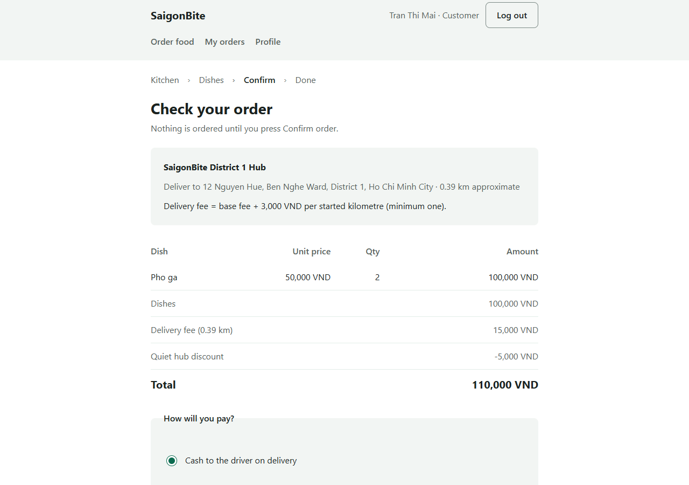
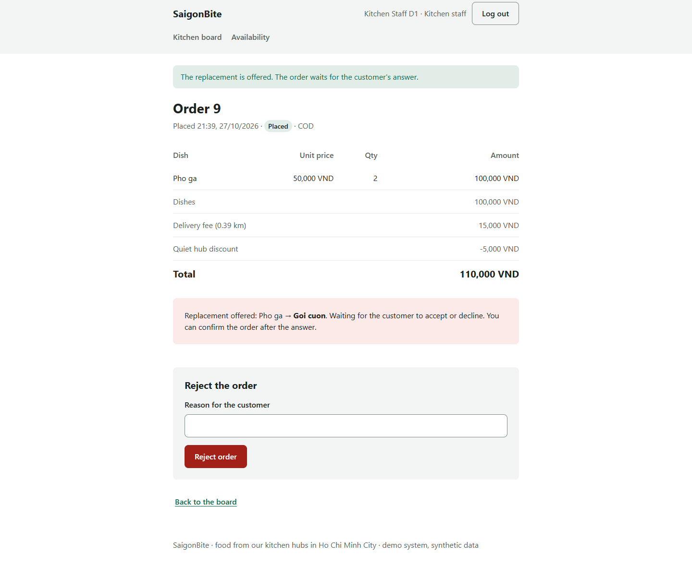
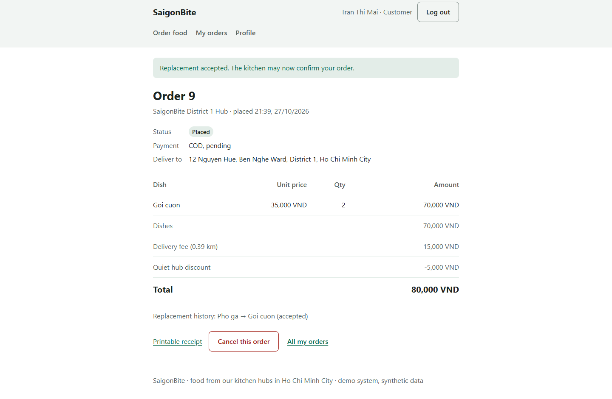
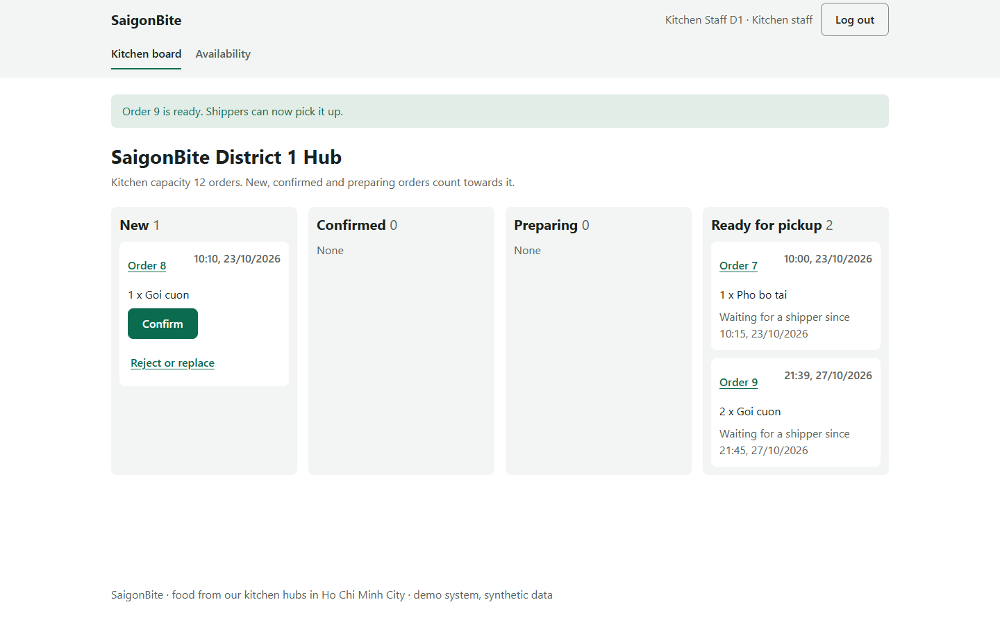
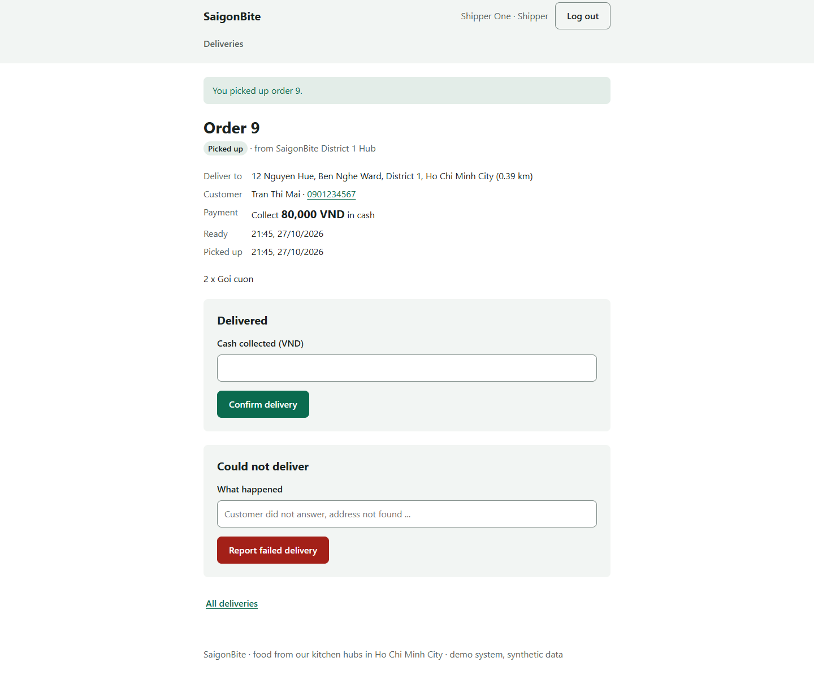
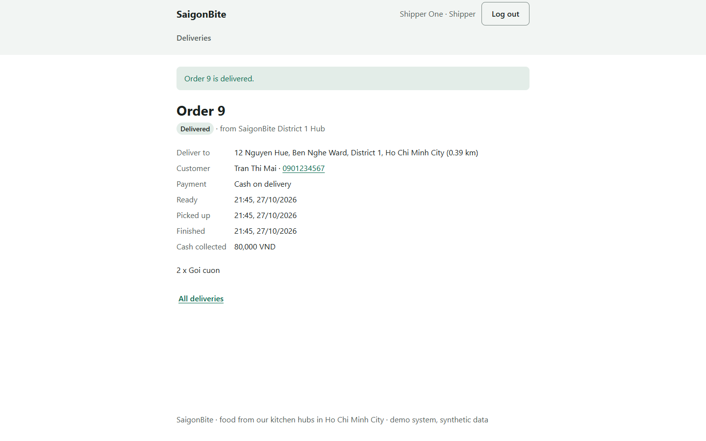
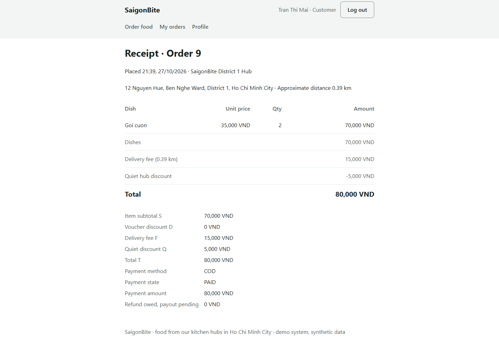

# 5.3 Demonstration

Author: 722I0004 · AI-assisted (Codex)

Dat plans to record the demonstration on the deployed site. The video link is {{LinkVideo}}. The screenshots below come from the earlier P6 deployment evidence on 27 October 2026 and illustrate the steps; a new recording may produce different order IDs or amounts. Use the demo-only accounts in the project README: `customer`, `kitchen` and `shipper`, with the shared demo password shown there. Use a new order and verify the current on-screen amount at each step.

1. Sign in as the customer, choose an available hub and dish, review the quote and confirm a cash-on-delivery order. Note its order ID and amount.

Figure 5.3A. Customer quote in the P6 deployment walkthrough. Author: 722I0004 · AI-assisted (Codex).

2. Sign in as kitchen staff for the same hub, open the order, mark a selected dish unavailable and offer an eligible replacement.

Figure 5.3B. Kitchen replacement offer in P6. Author: 722I0004 · AI-assisted (Codex).

3. Return to the customer account, review the replacement and accept it; the updated total is shown before the kitchen proceeds.

Figure 5.3C. Customer acceptance in P6. Author: 722I0004 · AI-assisted (Codex).

4. As kitchen staff, confirm the order, start preparation and mark it ready for pickup. Restore item availability after the demonstration where appropriate.

Figure 5.3D. Kitchen ready state in P6. Author: 722I0004 · AI-assisted (Codex).

5. Sign in as the shipper, locate the ready order and pick it up.

Figure 5.3E. Pickup in P6. Author: 722I0004 · AI-assisted (Codex).

6. Enter the exact cash-on-delivery amount displayed for the order and mark it delivered.

Figure 5.3F. Delivery completion in P6. Author: 722I0004 · AI-assisted (Codex).

7. Return to the customer account and open the receipt to show the delivered status, payment state and amount.

Figure 5.3G. Customer receipt in P6. Author: 722I0004 · AI-assisted (Codex).

The online payment option is a simulator. A refund amount shown as owed is not a payout. P6 used an adapted existing order for the main walkthrough; see 4.3.6 for its evidence and limits.
