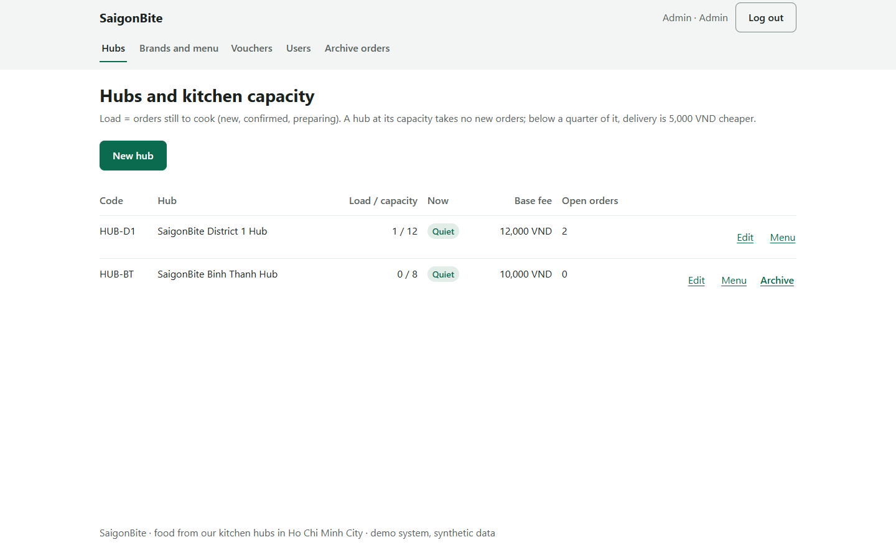
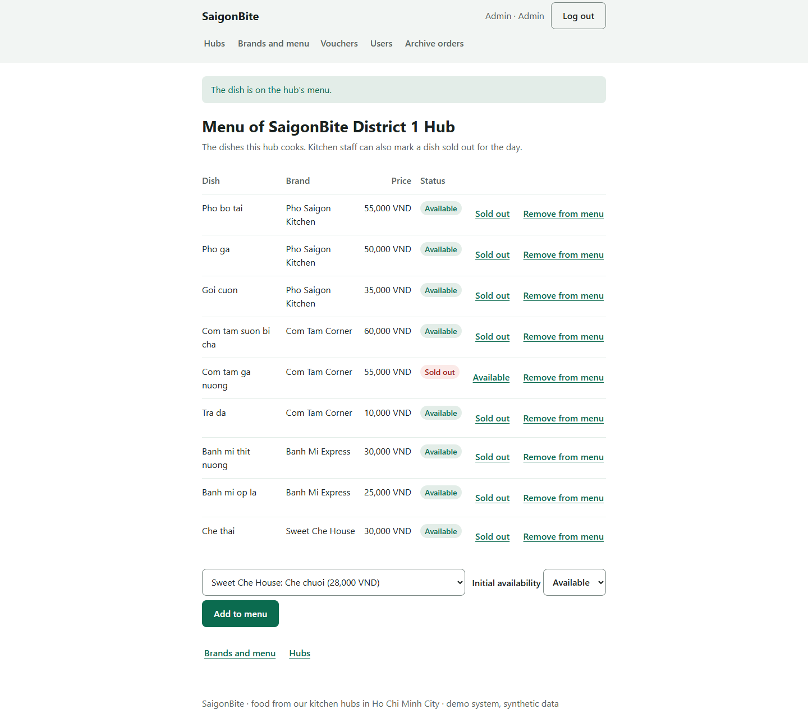
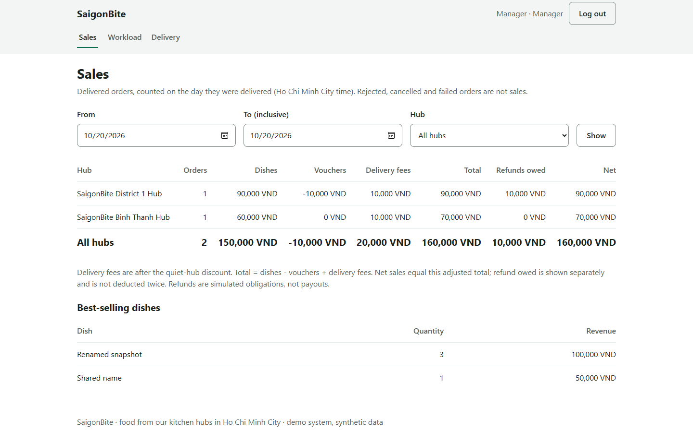
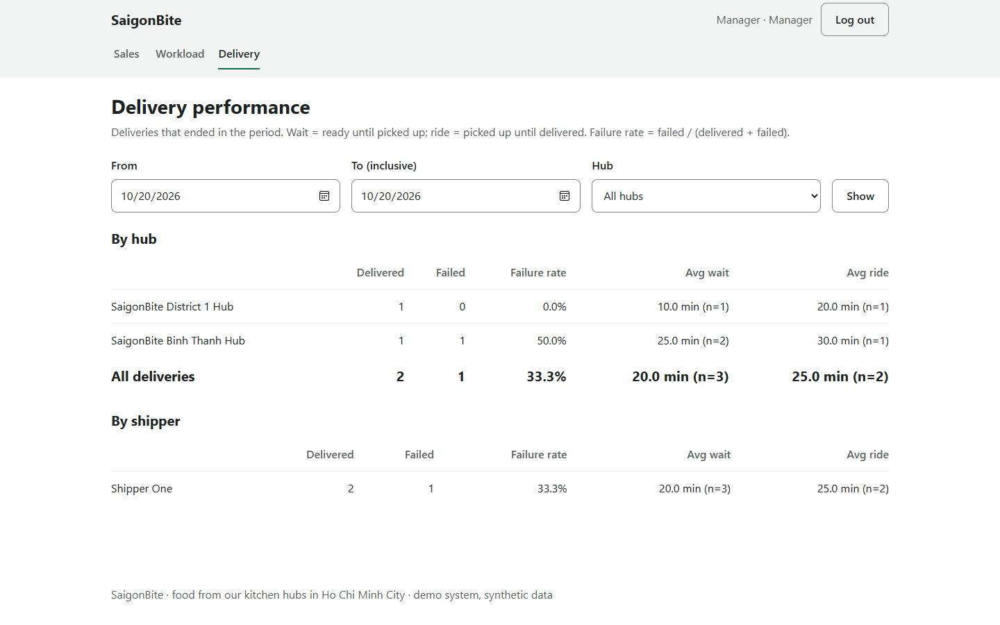

# 5.3 Demonstration

Author: 722I0004 · AI-assisted (Codex, Claude)

The demonstration follows one order through all six main use cases on the deployed site {{LinkDeployed}} (or a local copy started as in 5.2 A). It takes about ten minutes and uses the demo accounts of 5.2, one browser window per role. The screenshots come from the recorded runs on 27/10/2026 (deployed run for steps 3–9, local browser run for steps 1, 2 and 10); a new run shows new order numbers, so read the amounts on the screen at each step.

| Step | Role and use case | What to do | What the audience should see |
|---|---|---|---|
| 1 | Admin — UC-03 | Open Hubs, edit the District 1 hub and raise its capacity | The hub list shows load / capacity and busy or quiet for every hub |
| 2 | Admin — UC-06 | Open the hub menu, list a dish at District 1 as available | The dish appears on the hub menu |
| 3 | Customer — UC-01 | Choose the hub and dishes, request the quote, confirm with cash on delivery | The full quote (items, voucher, distance fee, quiet discount, total) before confirming; then an order number |
| 4 | Kitchen — UC-05 | Open the new order, mark a dish unavailable and offer a replacement | The order waits for the customer's answer |
| 5 | Customer — UC-05 / SUC-03 | Accept the replacement | The new line and the new total |
| 6 | Kitchen — SUC-05 | Confirm, start preparing, mark ready | The order moves to READY |
| 7 | Shipper — UC-02 | Take the ready order | The order is OUT_FOR_DELIVERY and assigned to this shipper |
| 8 | Shipper — UC-02 | Enter the exact cash amount and mark delivered | DELIVERED; cash recorded |
| 9 | Customer — SUC-03 | Open the receipt | Delivered status, payment PAID and the amount |
| 10 | Manager — UC-04 | Open the sales and the delivery performance reports for today | The new order counted in sales; waiting and riding times and the failure rate |

1. Sign in as the admin, open **Hubs** and edit the District 1 hub (for example raise the maximum active orders).

Figure 5.3H. Admin hub list with load, capacity and busy/quiet status (local browser run, 27/10/2026). Author: 722I0004 · AI-assisted (Claude).

2. Open the hub menu of District 1 and list a dish as available at that hub.

Figure 5.3I. Admin lists a dish on the hub menu (local browser run). Author: 722I0004 · AI-assisted (Claude).

3. Sign in as the customer, choose an available hub and dish, review the quote and confirm a cash-on-delivery order. Note its order ID and amount.

Figure 5.3A. Customer quote in the P6 deployment walkthrough. Author: 722I0004 · AI-assisted (Codex).

4. Sign in as kitchen staff for the same hub, open the order, mark a selected dish unavailable and offer an eligible replacement.

Figure 5.3B. Kitchen replacement offer in P6. Author: 722I0004 · AI-assisted (Codex).

5. Return to the customer account, review the replacement and accept it; the updated total is shown before the kitchen proceeds.

Figure 5.3C. Customer acceptance in P6. Author: 722I0004 · AI-assisted (Codex).

6. As kitchen staff, confirm the order, start preparation and mark it ready for pickup. Restore item availability after the demonstration where appropriate.

Figure 5.3D. Kitchen ready state in P6. Author: 722I0004 · AI-assisted (Codex).

7. Sign in as the shipper, locate the ready order and pick it up.

Figure 5.3E. Pickup in P6. Author: 722I0004 · AI-assisted (Codex).

8. Enter the exact cash-on-delivery amount displayed for the order and mark it delivered.

Figure 5.3F. Delivery completion in P6. Author: 722I0004 · AI-assisted (Codex).

9. Return to the customer account and open the receipt to show the delivered status, payment state and amount.

Figure 5.3G. Customer receipt in P6. Author: 722I0004 · AI-assisted (Codex).

10. Sign in as the manager and open **Sales** and **Delivery performance** for the demonstration day.

Figure 5.3J. Manager sales report (local browser run). Author: 722I0004 · AI-assisted (Claude).

Figure 5.3K. Manager delivery performance report (local browser run). Author: 722I0004 · AI-assisted (Claude).

Other paths can be shown with the same accounts: the hub-full refusal with quieter hubs suggested (UC-01), kitchen rejection (UC-05), failed delivery (UC-02) and cancellation (SUC-04); 4.3.6 lists the seven recorded scenarios that cover them. The online payment option is a simulator, and a refund shown as owed is not a payout.
